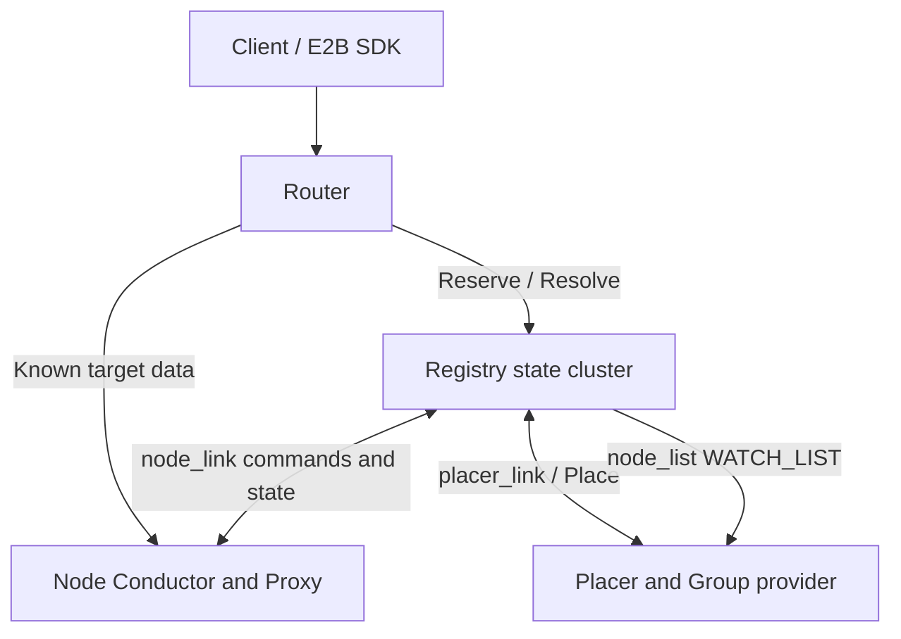
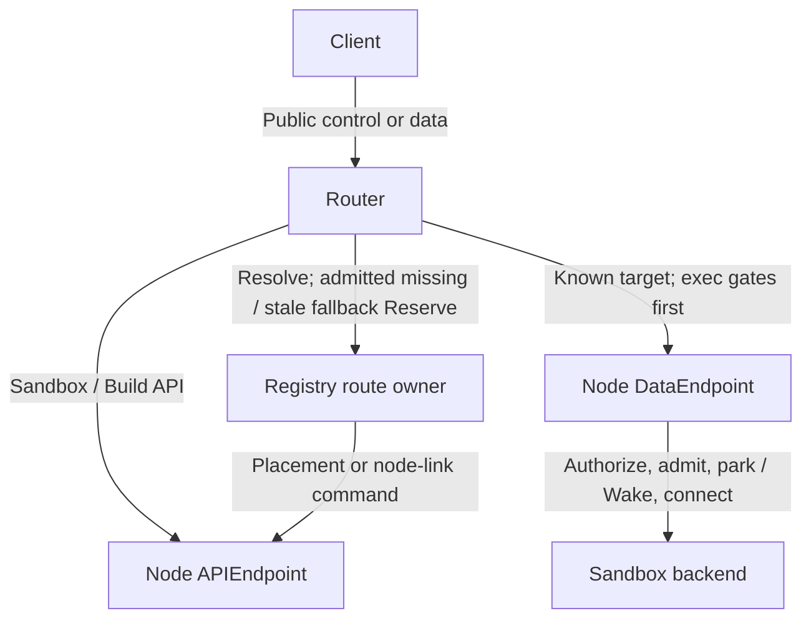

[English](cluster.md) | [简体中文](cluster_zh.md)

<a id="overview"></a>

# Cluster control

This contract follows cluster capabilities and state ownership across Registry, Router and Placer. Use the public ingress section first, then define Groups and configure roles. Membership/state and link protocols are reference material for operators and implementers; failures and recovery close the contract. Node-local Sandbox/Build behavior remains in its capability document.

`cluster-ctl` is the cluster control plane for large deployments, with three independent roles:

- `registry`: a reliable, stateful cluster that maintains execution state for nodes, routes and placer imports.
- `router`: a unified e2b-compatible entry point that locates the route owner by sandbox group and forwards the hot path directly to the node.
- `placer`: the group provider/importer and placement scheduler; it consumes `node_list` and offers Place / verify-key to Registry.

Registry's foundation is a consistent KV organized by `namespace + shard key + recordSet + record key`. All `node_link`, `route_link`, `node_list` and `placer_link` records share this model: no traversal across shards, full replication within a shard, and convergence through quorum reads/writes, CAS, WATCH and read repair.

**Read by task:** [Public ingress](#client-access) · [Groups and placement](#groups-and-placement) · [Configure roles](#configuration) · [State ownership](#membership-and-state) · [Link protocols](#protocols) · [Failure and recovery](#failure-and-recovery)

<a id="roles-and-topology"></a>

## Overview

<a id="overall-topology"></a>

### Overall topology



The steady-state data plane bypasses Registry. Explicit create/connect/exec-session operations and data requests with a missing target or typed stale fallback require Registry:

- `POST /route-link/reserve` distinguishes four operations using `operation=create|connect|exec-session|data`. Create calls Reserve directly; Registry completes connect/exec-session through node-link; data calls Reserve only when the route lacks a complete node target or the node proxy reports typed stale state. Unknown routes do not implicitly create sandboxes. Explicit build registration calls `ReserveBuild`.
- Registry calls the placer's `PlaceSandbox` / `PlaceBuild`.
- Registry sends create/connect/exec_session/delete/build/key commands through the node owner.
- Nodes report sandbox/build state and the low-frequency node directory through node_link.

<a id="design-principles"></a>

### Design principles

1. **Group is the business shard key**: every northbound cluster request must include `X-Kuasar-Sandbox-Group` or equivalent group identity. A cluster data-plane entry without a group is currently unsupported.
2. **Registry is a reliable state cluster**: Registry members directly replicate execution state. With three owners, a logical owner set tolerates one member failure; a single-owner configuration has no redundancy. Automatic recovery of running sandboxes is not required after the entire Registry cluster loses its state.
3. **No traversal across shards**: Registry must not scan across group/node shards or combine partial results from unrelated shards into an authoritative view.
4. **Full replication within a shard**: owners of the same `namespace + shard key + recordSet` hold the complete view and can serve point reads, CAS and WATCH. A non-owner may coordinate point reads/CAS, but cannot provide a complete local Snapshot/WATCH.
5. **Member health does not determine sharding**: the member list comes from versioned configuration; `LocateN` takes only membership members as input. Memberlist detects health and propagates metadata.
6. **Nodes are the authority for runtime state**: node reports determine whether sandboxes/builds still exist. A host reboot loses running processes; surviving durable rows are reconciled against actual units and checkpoint/cleanup ownership. A conductor process restart can adopt surviving units. Neither event means blindly deleting all durable rows or automatically recreating every old sandbox; see [State ownership and disaster-recovery boundaries](#registry-state-ownership-and-disaster-recovery-boundaries)–[Registry Reliability](#registry-reliability).
7. **Placer does not own lifecycle**: it imports groups, patches selectors, applies shuffle sharding/P2C and proposes placements. The node owner checks current connectivity/usage; the node's durable transaction makes the authoritative Build registration admission decision.
8. **Router does not subscribe to huge numbers of groups**: create/data Reserve returns READY or an error; connect/exec-session Reserve returns after synchronous node preparation, without waiting for asynchronous resume. Router keeps only a bounded route cache; in-flight requests do not provide routes for new requests.

<a id="role-boundaries"></a>

### Role boundaries

| Role | Responsibility |
|---|---|
| Registry member | Forms the Registry cluster and hosts `route_link` / `node_link` / `node_list` / `placer_link` execution state and membership |
| Router | Unified e2b entry; locates route owners by group; Resolve on a cache miss, Reserve for create/connect/exec-session/data; local route cache on the hot path |
| Placer | Consumes `node_list` WATCH_LIST; imports groups through providers/importers; maintains placement and selector patches; offers Place / verify-key |
| Node | Runs sandboxes/builds; reports full inventories and events through node_link; receives create/connect/exec_session/delete/build/key commands |

<a id="client-access"></a>

## Public ingress and identity

The standalone `kuasar-sandbox.identity` / `X-Kuasar-Sandbox-Identity` extension is rejected by public cluster Create and Build registration; Registry keeps allocation authority. See [Sandbox identity on Create](sandbox-lifecycle.md#create-identity).

`cluster-ctl router` is the cluster's northbound ingress for both the e2b control plane and data plane. It is not a routing authority and subscribes to neither routes nor node_list. It locates route owners by group. Explicit create/connect/exec-session calls use their corresponding Reserve operation; a data-plane cache miss starts with Resolve. RouteResolve returns both `APIEndpoint` and `DataEndpoint`, each with a fixed purpose. Once a route has `NodeSandboxID + DataEndpoint`, ordinary data traffic connects directly to the final node proxy even in paused/starting states; the node handles authorized parking, Wake, and backend connection. Exec CONNECT is the exception: after public 200, the router reads and authorizes the first ctl frame before connecting to the final node. `Reserve(operation=data)` remains only a fallback for a missing target after request admission, a typed stale target before sending Raw, or the ordinary data-plane compatibility path.

<a id="client-onboarding"></a>

### Minimal cluster client acceptance

Start from the existing [Registry](cluster.md), [Placer configuration and file provider](#placer-configuration) and [deployment order](https://github.com/kuasar-sandbox/kuasar-sandbox/blob/main/docs/deployment.md).
This is a one-group acceptance path, not an HA reference configuration.

1. Register eligible nodes with matching runtime/kernel/artifact access and the
   intended selector labels. Ensure node-link full sync and a ready placer for
   this group. Reuse the provider JSON schema, replacing illustrative `tmpl-1`
   with an actually published canonical `e2b-img/sbx/snp-...` ID from an exact
   ready Build. Configure its ManifestKey/APISecret under the existing protected
   provider contract; give clients only an API key signed by that APISecret.
2. For this SDK command/file test, use the provider's example `target_port=49983`.
   That constraint deliberately limits data to envd. To test an arbitrary user
   application port as well, use a group without a fixed port constraint or one
   configured for that port; do not assume 49983 represents every service.
3. Configure public Router TLS, `api.<domain>` and sandbox host DNS/certificates.
   Use `auth.data_plane: enforce`. Registry TLS is independent. Current
   Router→Node APIEndpoint/DataEndpoint must be reachable **plaintext internal**
   listeners, respectively Conductor and Proxy; protect them with private network
   access controls. Public HTTPS does not encrypt that hop. Do not advertise a
   TLS-only node listener as a plaintext endpoint.
4. Set `KUASAR_GROUP` to the exact provider group, `TEMPLATE_ID` to its usable
   template, and reuse API URL/key/domain/CA settings. With the project's pinned
   **e2b==2.25.1**, pass the same Group and caller-chosen route key on Create and
   every later control/data operation:

```python
import os, uuid
from e2b import Sandbox
headers = {
    "X-Kuasar-Sandbox-Group": os.environ["KUASAR_GROUP"],
    "X-Kuasar-Route-Key": str(uuid.uuid4()),
}
options = dict(api_url=os.environ["E2B_API_URL"],
               api_key=os.environ["E2B_API_KEY"],
               domain=os.environ["E2B_DOMAIN"], headers=headers)
sandbox = Sandbox.create(os.environ["TEMPLATE_ID"], timeout=300, **options)
sid = sandbox.sandbox_id
print("Retain group, route key, stable SID:", headers, sid)
try:
    assert sandbox.commands.run("printf cluster-ok").stdout == "cluster-ok"
    sandbox.files.write("/tmp/cluster-proof", "cluster-state")
    sandbox.pause()
    sandbox = Sandbox.connect(sid, **options)
    assert sandbox.files.read("/tmp/cluster-proof") == "cluster-state"
finally:
    sandbox.kill()
```

The SDK's `ConnectionConfig.sandbox_headers` merges custom headers into envd
requests; command and file clients use that configuration. Reconnecting creates
another client, so pass `options` again. Choosing the route key avoids relying on
SDK exposure of the Router's extra `routeKey` response field. Persist
`(group, route key, stable SID)` in the application if it outlives this process.
This header propagation is verified against 2.25.1 source, not a promise for all
SDK versions. The SDK does not provision groups, sign API roots, recover Registry
state or inject these headers into a browser request to `get_host(port)`.

For application-port access, the application/gateway must carry Group, route key,
stable sandbox identity, target port and the appropriate scoped forward token
([Addressing](#router-addressing)–[Control plane](#router-control-plane)); it must not leak the tenant API key to the guest. Verify both the SDK
commands/files path and an authenticated request to the intended application port.
In an isolated acceptance group, confirm missing Group, wrong credentials and an
unauthorized target fail without activating a different sandbox. Create may omit
route key and receive a newly generated one; verify missing route key rejection
on subsequent operations that require the existing route, such as connect, pause
and data requests. Inspect
node endpoint selection to prove control and data use their distinct listeners.

Success means real create, command/file roundtrip, pause/resume and kill; Registry
stub tests alone do not prove this VM path. On NoNode, check group import, selector,
node health/capacity and artifact access; on control success/data failure, check
header propagation, target_port, DNS/TLS and the Proxy internal endpoint. Stop on
identity mismatch. Kill only test-owned instances; removing a provider file is
not instance cleanup or immediate revocation of credentials already bound to rows.
Retain shared templates/keys until the retention policy permits deletion.

Dead/deleting Sandboxes keep their management location. ID-based query, Reset, checkpoint Export/Delete and parent Delete use the node APIEndpoint and existing ownership checks. They expose no business DataEndpoint. Create with an occupied group/route_key conflicts until final parent deletion. Node and cluster Create preserve autoReset (default false); Reset success does not start a VM.

Create preserves nullable `idleTimeout` through route-link reserve, Registry's
durable reservation, node-link create and effective route/list views. Zero is
retained as an enabled immediate policy. Pause keeps using HTTP forwarding:
`ifIdleSince` is forwarded unchanged and only the final Conductor validates it
against its receipt clock. No node-link Pause command is added.

<a id="router-addressing"></a>

### Addressing

| Request | Required identity | Behavior |
|---|---|---|
| create | group + route_key (generated if omitted) | Extract and validate the resource patch and this request's restore/credentials/checkpoint; locate the route owner and pass them with `ReserveSandbox`. |
| kill | group + route_key + sandbox_id | Locate the route owner; the registry dispatches `CmdDelete` through node-link. |
| connect | group + route_key + stable sandbox_id | Call Reserve with `operation=connect`; the registry dispatches CmdConnect through node-link. No Resolve or forwarding to node HTTP `/connect`. |
| exec session | group + route_key + stable sandbox_id | Call Reserve with `operation=exec-session`; the registry verifies the API key and dispatches CmdExecSession through node-link. Only ExecAccessToken is returned publicly. |
| get/stats/pause/timeout/export | group + route_key + stable sandbox_id | Resolve the current NodeSandboxID and APIEndpoint through the route owner; rewrite the path and forward to the node conductor. Stats bodies have no SID and need no response identity adaptation. Missing APIEndpoint fails closed. |
| list/get | group | Read the group shard; individual sandbox lookup also uses the identity described above. |
| data plane | group + route_key + stable sandbox_id + target | With known NodeSandboxID/DataEndpoint, open a one-use node CONNECT, including paused/starting states. Fall back to `operation=data` only for a missing target or typed stale response; a miss starts with Resolve. |
| build register | group + build_id | Normalize the body/Builder header into Build.Resources, parse the target Sandbox ResourcePatch independently, then call `ReserveBuild`. The selected node performs final registration admission. |
| build cancel | group + build_id | ResolveBuild afresh for each call and forward through the current APIEndpoint without selecting another node. |
| build trigger/status/files | group + build_id | ResolveBuild returns APIEndpoint; cache it and forward to the node conductor. Never fall back to DataEndpoint if it is missing. |
| build delete | group + transient TemplateID | Resolve the original node APIEndpoint from the existing projection; forward Query/Header unchanged for final node authorization and execution |

`route_key` locates a route within a group; `sandbox_id` is the stable public identity. The registry generates SandboxID on the first create. Same-node resume, cross-node migration, and re-placement do not change it. Protected routes additionally carry the current `node_sandbox_id=<sandbox_id>-g<N>`. The router addresses sandboxes by stable SandboxID and substitutes NodeSandboxID only at the node boundary; public responses do not expose NodeSandboxID.

The protected route's `stable_id` is the same sandbox's StableID across NodeSandboxID changes. The cluster always requires `StableID == SandboxID`. The router retains this field as the existing credential projection and uses it to validate KAT `sid`, while cache/route lookup remains keyed by `(group, route_key, SandboxID)`. It neither uses StableID as a node-local lookup key nor builds a unique index on it.

Create body metadata can carry `kuasar-sandbox.resource`, traffic, restore, credentials, and checkpoint. `X-Kuasar-Sandbox-Resource` and `X-Kuasar-Sandbox-Traffic` override only explicitly present leaves in their respective patches. The public resource surface is strictly limited to capacity/allocatable/startup and uses the same merge helper as group defaults; traffic uses the shared max-inflight patch validation and leaf merge. Restore/credentials headers replace the complete object of the same name; the checkpoint header overrides individual fields. The router always parses and strictly validates the body, so a valid header cannot conceal an invalid lower-priority resource/traffic/checkpoint. Omitted restore, `{}`, and explicit `off` all disable restore; only an explicit `memory` on this create enables it. The create-body limit is 16 MiB; larger bodies return **413**.

The router constructs requests to the shared `POST /route-link/reserve` endpoint according to the [Registry Reserve protocol](#reserve). It forwards operation-specific authenticated context and preserves the requested stable identity. Create is strictly normalized before admission; Connect preserves the optional memory selection, including absence; exec-session first strictly parses public TTL/conditions and converts them to the typed Registry request. Data uses the existing access-token/service/port context.

The Registry specification owns the exact query/header/body schemas and repeats validation at its boundary. Conditions are not carried in unrelated metadata, query parameters or configuration Headers. Keeping this transformation boundary separate avoids a second, potentially stale schema table here.

For connect/exec-session/data, `sid` is the customer's expected stable SandboxID. It prevents requests from crossing lineage when a route_key is deleted and recreated.

<a id="router-control-plane"></a>

### Control plane

API-key authentication cannot be disabled. Create/connect/exec-session pass the client's original API key to Reserve, where the registry verifies it before any lifecycle side effect. Create group admission uses a ready placer's provider APISecret; connect/exec-session use the APISecret already bound to the Sandbox business record. For other control operations, the router calls the route owner's `verify-key`, which fails over to ready placers. ManifestKey serves content paths only and does not authenticate API calls.

| Operation | Behavior |
|---|---|
| create | Call `operation=create` Reserve with leaf-merged resources and request-scoped restore/credentials/checkpoint. Separate credentials before writing ordinary metadata. |
| kill | The route owner matches group + route_key + sandbox_id exactly and dispatches `CmdDelete` through node-link. |
| connect | Call `operation=connect` Reserve. The registry dispatches CmdConnect to the current NodeSandboxID and returns after validating typed ConnectResult. The router neither Resolves nor forwards a second request to node HTTP `/connect`. |
| exec session | Strictly parse the body with a 64 KiB limit and call `operation=exec-session` Reserve. The registry verifies the original API key and dispatches CmdExecSession; the router projects only ExecAccessToken. |
| get/pause/timeout/export | Resolve the current route, use APIEndpoint only, and replace public SandboxID with NodeSandboxID in the forwarded path. Rewrite typed get responses to stable SandboxID. |
| get/list | Read the group's route_link records. |
| build register | Generate stable build_id/template_id, strictly merge registration resource body/header/E2B capacity leaves, and call ReserveBuild. The node validates again before saving the build. |
| build cancel | ResolveBuild afresh by group+build_id and forward through the current original-node APIEndpoint without using a stale cache entry. |
| build trigger/status/files | Locate the node by group+build_id; cache and forward through BuildReserveResult.APIEndpoint only. |
| build delete | Transient TemplateID only; resolve the original node from the existing projection and preserve Query/Header |

DELETE `/templates/{transientID}?cancel=true` and `X-Kuasar-Sandbox-Builder: {"cancel":true}` share the node action parser. Each input is strictly validated independently. Explicit Header.cancel > Query.cancel > false; `{}` preserves Query and explicit false overrides true. Router does not parse this as registration BuildOptions. Lookup failure or incomplete ownership returns 503; an unreachable node returns 502, never successful deletion or an invented 404. DELETE 202 preserves the node relative Status Location; only final node hard deletion completes the operation. See [Build actions](node-build.md#cancel-and-delete-a-build-record).

Sandbox control and Build follow-up use a different node endpoint from ordinary data/CONNECT/native exec. Missing APIEndpoint for control/build never falls back to DataEndpoint; missing DataEndpoint for data/exec never falls back to APIEndpoint.

A connect Node Ack projects only NodeSandboxID, TemplateID, Profile, and Envd/Traffic/ForwardAccessToken; it contains neither root credentials nor fingerprints. The router checks consistency between the Ack and protected Route, then builds an e2b response containing only stable SandboxID and the profile's public tokens. The node has synchronously completed validation, optional migration import, deadline persistence, and credential reads. Resume proceeds asynchronously after Ack.

The public exec-session endpoint is `POST /sandboxes/{stableSandboxID}/exec-sessions`. Requests require group, route-key, and the original `X-API-KEY`, with optional `X-Kuasar-Migration-Token`. The body permits only an empty body, `{}`, or strict `ttlSeconds` plus `conditions:[{"expr":"..."}]`. The entire original body, including trailing whitespace, is limited to 64 KiB. Missing conditions and `[]` are unrestricted and normalize to nil. Explicit `null`, unknown/duplicate fields, empty expr, a second JSON value, negative values, or exceeded TTL/condition bounds return 400.

The router passes the API key to the registry verifier without writing it into the command. CmdExecSession explicitly carries APISecretFingerprint, expected Profile, TTLSeconds, ExecConditions, and optional MigrationToken/cluster context. The node is the sole signer: before any activation mutation, it authoritatively compiles conditions and signs. Ack returns only `ExecSessionResult`, followed by asynchronous resume under the existing eager contract. Conditions do not enter Route/record/event/metadata/log. Deferred activation in [#240](https://github.com/kuasar-sandbox/orchestrator/issues/240) remains separate work. The registry joins the result with the current stable-lineage Route; after checking consistency, the router returns:

```http
HTTP/1.1 201 Created
Cache-Control: no-store
Content-Type: application/json

{"execAccessToken":"kat1..."}
```

The response contains no session ID, exp, NodeSandboxID, ServiceSecret, or route. Runtime failures return fixed, sanitized errors rather than raw node Ack reasons or internal paths. An asynchronous resume failure after Ack does not retroactively alter the returned token; later connections fail according to current route/state.

<a id="router-data-plane"></a>

### Data plane

The router first separates ordinary legacy targets from the native exec logical service:

- Ordinary HTTP uses only the legacy port from Host/`E2b-Sandbox-Id + E2b-Sandbox-Port`. Except for the exact value `exec`, it does not interpret `E2b-Sandbox-Service`; that header remains an application header in the inner request. Non-CONNECT requests selecting `exec` return **405** with `Allow: CONNECT` before route lookup or activation.
- CONNECT without a service also uses a legacy raw port.
- `E2b-Sandbox-Service: exec` is the integrated portless CONNECT target. A port may coexist but does not select the backend.
- The complete cluster service-aware forwarding contract for `forward|e2b:envd|e2b:code-interpreter` is tracked in [#63](https://github.com/kuasar-sandbox/orchestrator/issues/63). Current cluster ingress does not advertise those three header values as supported backend selectors. The final node chooses its backend from its locally trusted profile.

Legacy sid-host data-plane credential rules are:

- e2b profile ports 49983/49999 require `X-Access-Token: <envd_access_token>`.
- Other e2b ports and every bare port require `X-Access-Token: <forward_access_token>`. Bare ports 49983/49999 are ordinary TCP forwarding targets, not 501 control ports.
- `traffic_access_token` is for external gateways and e2b data-plane components; the cluster router does not consume it.
- A presigned envd file URL can omit the token only for `port=49983`, `GET/POST /files`, and a nonempty `signature` query.
- A nonempty but incorrect `X-Access-Token` never falls back to signature authentication.

Ordinary token forwarding reuses the client's `X-Access-Token`:

```text
CONNECT sandbox:<port> HTTP/1.1
E2b-Sandbox-Id: <node_sandbox_id>
E2b-Sandbox-Port: <port>
X-Access-Token: <client X-Access-Token>
```

The client-facing Host/path uses stable SandboxID. The router uses current NodeSandboxID in the outer CONNECT to the node proxy and rewrites ordinary HTTP's inner Host to `<port>-<node_sandbox_id>.<domain>`. If the inner request already carries `E2b-Sandbox-Id`, it replaces that value with NodeSandboxID while preserving the header so user applications can see the current node-local ID.

For tokenless signed envd `/files` requests, the router first validates the signature with the protected route's `EnvdAccessToken`. This occurs before any node CONNECT or Reserve/activation. Failure returns 401 immediately and must not wake the sandbox. After successful verification, the router adds that `EnvdAccessToken` only to the outer CONNECT for the node proxy's final-hop authentication. The tunneled HTTP request keeps its original signature and receives no injected `X-Access-Token`, so envd validates the URL independently. Ordinary token requests retain the client's original `X-Access-Token` in both outer CONNECT and tunneled HTTP.

After the router's local authentication gate, a route with `NodeSandboxID + DataEndpoint` does not wait for READY in the registry: paused/starting opens a one-use node CONNECT immediately, just like ready. The final node proxy follows `LookupRoute → authorize → BeginParking → ActivateRoute/Wake → fresh Route → dial`. Admitted parking is therefore counted only at the final node, without duplicate router/registry accounting. In ordinary router `enforce` mode, invalid tokens fail before node CONNECT/Reserve. The router's file-signature validation and explicit token checks on `/files` remain enforced in every router mode. Exec is always enforced. For ordinary requests, router `log` records a local mismatch and continues, while `off` skips that local token check. The node proxy applies its own effective authentication policy independently: preventing an invalid ordinary credential from Wake/Resume/parking/backend dial requires node proxies to remain in `enforce`. If the target node also uses `log` or `off`, it can admit that request and activate the backend. Router configuration does not override the node's policy.

Only a missing target first invokes the `operation=data` fallback. Ordinary requests pass the customer token to the registry; signed `/files` passes the protected EnvdAccessToken already used to validate the signature. If a known node returns typed `not_found`/`unauthorized` before accepting the inner request, the router evicts that node-local target and invokes the same ReserveData to revalidate the credential against current lineage and get a fresh route, then retries once. A fallback returning another stable identity or still lacking a complete target fails closed. `auth.data_plane=off` only skips the router's local token gate for ordinary requests; an explicit wrong token on `/files` never falls back to signature in any mode.

Exec CONNECT uses its own three-stage KAT + request-admission contract:

```text
client CONNECT
  stable SandboxID + service=exec + X-Access-Token=KAT
    ↓ side-effect-free cache/Resolve
Router verifies StableID + ServiceSecret, then compiles CEL
    ↓ flush public 200; read strict first ctl frame; recheck expiry; evaluate
    ↓ admission passed (no node/Reserve before this point)
node CONNECT
  current NodeSandboxID + service=exec + optional original port + same KAT
    ↓ node independently verifies KAT + CEL and reads/evaluates first frame
    ↓ parking → ActivateExec/Wake → ctl.sock; Raw written exactly once

missing/stale target, only after public request admission and before Raw send:
  Reserve(operation=data, same KAT + service=exec)
    ↓ Registry re-verifies and returns fresh current Route
  retry one node CONNECT
```

Exec is always enforced regardless of `auth.data_plane=off|log|enforce`. EnvdAccessToken, ForwardAccessToken, and TrafficAccessToken cannot substitute for an exec KAT. A missing, expired, incorrectly signed, or wrong-SID/audience KAT returns 401 before public 200 and cannot trigger router Reserve, node CONNECT, registry CmdConnect, node parking, or resume. ExecRequest/condition failures after 200 return the uniform `{"type":"error","msg":"exec request rejected"}` with none of those side effects. A paused/starting route with a known node target adds no registry calls. Router and node both execute the complete gate; a pure transport relay does not parse tokens/CEL/ExecRequest. The registry revalidates only on missing/stale fallback. After Reserve, the router must recheck stable lineage/credentials and use current NodeSandboxID, never the old target.

After public 200, the router runs the first-frame gate before opening the next hop. The final node independently checks `StableID + ServiceSecret` from its local route, replies with node CONNECT 200, and repeats the first-frame gate before parking, activation, or connecting to `<run_root>/sandboxes/<NodeSandboxID>/ctl.sock`. The router does not dial `ctl.sock`.

KAT binds StableID, not NodeSandboxID or its generation. Same-lineage resume, migration, or replacement therefore does not itself require re-signing the token; expiry, claims, and current credential validation still apply. Each new node CONNECT uses the current NodeSandboxID.

When ordinary HTTP/non-exec CONNECT reaches the final node proxy's per-Sandbox limit, that proxy returns `429` plus `X-Kuasar-Proxy-Error: max_inflight_reached`. The router passes through status, header, and fixed body unchanged. This typed response is not a stale route: it causes no cache eviction, Reserve, or retry on a different node. The router implements no second limiter; the target proxy enforces the same Sandbox limit across all its workers, not as cluster-wide or per-router capacity. Native exec admission occurs at the node after CONNECT 200 and CEL/first-frame checks. At the limit, the node writes the existing generic ctl error and closes. The router transparently relays the frame without synthesizing HTTP 429.

Long-lived CONNECT uses the same route resolution, but tunnels are never reused. After disconnect, the route cache remains until idle/TTL expiry or fail-fast invalidation. Bytes prefetched by the router-to-node CONNECT response reader remain available in the tunnel. One-way EOF propagates a half-close only; the relay waits for the opposite direction's complete `exec_ack`, stdout/stderr, and exit status rather than truncating the tunnel on the first `io.Copy` return. One typed stale retry is allowed before Raw has been written to any node. Once Raw reaches a node, retry/reroute/replay is prohibited; node ctl errors pass through transparently without a second synthesized error.

<a id="public-sandbox-identity"></a>

### Identity

- Route lookup key: `(group, route_key)`.
- Stable public identity: `sandbox_id`. Registry generates it on first create; same-node resume, cross-node migration and re-placement do not change it. Public APIs, Host and Router cache keys use this ID.
- Stable sandbox identity: `stable_id`. The cluster invariant fixes `stable_id == sandbox_id`; it survives NodeSandboxID changes and binds ServiceSecret and KAT `sid`. This duplicate projection is existing protected credential state and is not deduplicated here. StableID is not a node-local lookup key and has no additional unique index; identity-preserving migration/copy can give multiple node-local sandboxes the same StableID.
- Registry durable JSON state uses `stable_id` directly, without a legacy-field fallback. Pre-release deployments must clear and rebuild old preview state.
- Node execution identity: `node_sandbox_id = <sandbox_id>-g<sandbox_generation>`. The first candidate is g0; candidate conflict/failure or cross-node migration consumes the next generation. Same-node resume keeps the current NodeSandboxID. NodeSandboxID is an opaque node-local ID; Registry ownership maps are authoritative, and components do not reverse-parse the string.
- Node events carry no group/route_key/SandboxGeneration. Registry looks up `(node_id,node_sandbox_id)` to recover stable identity and group context. There is no cross-group SandboxID index.

<a id="cluster-credentials"></a>

### Keys and authentication

A group/tenant has two root credential domains with separate purposes:

| Name | Holders | Purpose |
|---|---|---|
| `APISecret` | provider/placer/node/registry/router/proxy | Signs/verifies API keys and later purpose-specific authentication material; its complete SHA-256 fingerprint identifies the credential pair |
| `ManifestKey` | provider/placer/node | Decrypts manifest/image/snapshot contents and wraps pull tokens; Router never receives it |

Both are 32 bytes / 64 lowercase hex characters. If APISecret is omitted, placer derives it while materializing inline ManifestKey using the fixed KDF:

```text
APISecret = HMAC-SHA256(decodeHex(ManifestKey), "kuasar-api-secret-v1")
```

Only APISecret signs/verifies API keys. The API key's `SHA256(APISecret)[:12]` is only a candidate prefilter; node-link, lifecycle commands and business records use full 64-hex `SHA256(APISecret)`. ManifestKey has its own full 64-hex SHA-256 fingerprint to validate the paired content key.

APISecret and ManifestKey are typed secrets supporting inline or out-of-band ref delivery. A selector patch either carries a complete pair—both typed carriers and both complete fingerprints—or no credential fields at all. Half-pairs must be rejected. Credential distribution occurs only through shuffle-sharding/import/selector-patch paths:

```text
placer selector patch
  │ target node set + APISecret/ManifestKey material/ref
  ▼
registry/node owner
  │ CAS node_link key_pair cache (record key = APISecretFingerprint)
  ▼
node_link heartbeat refresh
  │ key_put complete pair only when missing or near lease expiry
  ▼
node encrypted local key store
```

The node atomically validates and installs the complete pair on `key_put`. One complete APISecret fingerprint cannot bind different pair material. `key_drop` locates a pair by full APISecret fingerprint, but correctness does not depend on it. Node leases evict entries not renewed before TTL. Distribution is a prerequisite for create/build; drop, TTL and provider updates do not alter pairs already copied into existing sandbox/build business records.

ServiceSecret is not a third group root; it is an independent service credential for each node Sandbox business record. Its default derives from that Sandbox's bound APISecret and `StableID()` using a fixed domain, or the current create's `kuasar-sandbox.credentials` object can explicitly supply it. Before route/ref/command side effects, Registry validates and normalizes that object against placement Profile. The node validates and separates it again, then encrypts ServiceSecret and Envd/Traffic/Forward tokens into the Sandbox business row. Ordinary metadata, guest configuration and node-stub observation retain no credentials object.

ForwardAccessToken and ExecAccessToken both use `kat1`, with separate audiences. ExecAccessToken's canonical payload fields are `v,session_id,sid,aud[,exp][,conditions]`: session ID is UUIDv7, `sid=StableID`, `aud=exec`, and there is no `iat`; normalized CEL source strings appear only when restricted conditions were requested. ServiceSecret is decoded to a 32-byte key and used directly for HMAC-SHA256, with no extra exec-specific derivation. Create/get/list does not return a default ExecAccessToken. Every exec-session API call signs independently, without a server-side session row, revocation or single-use/replay state.

When Registry materializes a protected route from a node route event, it accepts APISecret, both root fingerprints, StableID, ServiceSecret and Envd/Traffic/Forward tokens. It does not accept raw ManifestKey or the existing node-link wire's MmdsSecret intended for node proxy/MMDS. Registry currently stores protected route credentials as plaintext structured fields without an extra encryption layer. They may be returned only by protected Reserve/Resolve to trusted routers, never by ordinary route watch/list, public create/get/list, logs or observation interfaces. Reserve separates `kuasar-sandbox.credentials` from ordinary config at entry, freezes it only with the RESERVED record, temporarily encodes it before CmdCreate, and clears it after READY.

<a id="groups-and-placement"></a>

## Groups, providers and placement

`cluster-ctl placer` is an independent placement scheduler. It holds no node connections, owns no sandbox lifecycle, and does not replicate registry state. It obtains group configuration and key material through `SandboxGroupProvider` / `SandboxGroupImporter`, consumes the registry's `node_list` WATCH_LIST, and provides `PlaceSandbox` / `PlaceBuild` / `verify-key` to the registry.

<a id="placement-responsibilities"></a>

### Overview

<a id="placer-responsibilities"></a>

#### Responsibilities

```text
SandboxGroupProvider / Importer
          │
          ▼
      placer
          │  selector patch / Place / verify-key
          ▼
      registry
          │ node owner commands
          ▼
        node
```

The placer is responsible for:

- Integrating group providers/importers.
- Consuming the `node_list` WATCH_LIST.
- Selector patches and APISecret/ManifestKey pair-cache refresh.
- Shuffle sharding, static selectors, runtime matching, and P2C.
- `PlaceSandbox` / `PlaceBuild` recommendations.
- Provider-side API-key verification.

The placer does not:

- Connect to nodes.
- Dispatch `key_put`, create, delete, or build commands.
- Maintain route/build execution state.
- Store the registry's group/route records.

<a id="placer-principles"></a>

#### Principles

1. **The registry does not implement a group provider**: Provider/Importer belongs to the placer or an external platform.
2. **WATCH_LIST serves the placer only**: the router does not consume node_list.
3. **High-frequency load does not travel through WATCH_LIST**: WATCH_LIST carries only low-frequency directory fields; final resource confirmation occurs at node-owner admission.
4. **source_id identifies the import execution unit**: placers configured with the same `source_id` compete for the same source lease.
5. **Shuffle affects new placement only**: it does not migrate running sandboxes.
6. **Credential-pair distribution affects create/build prerequisites only**: dropping a pair, lease expiry, or provider updates do not modify pairs already copied into existing sandbox/build records.

<a id="placer-provider--importer"></a>

### Provider / Importer

The placer uses these common interfaces:

```text
SandboxGroupProvider:
  Get(group)
  GetPlacementHint(group)
  GetKey(group)       # typed manifest_key
  GetAPISecret(group) # typed APISecret

SandboxGroupImporter:
  Range(cursor, limit)
```

The built-in file source is for local development and e2e use:

```yaml
import_groups:
  - source_id: example-file-source
    source_type: file
    path: /path/to/dir
```

It enumerates `*.json` files in the directory. Each file contains one `SandboxGroupRecord` JSON object. The expected file count is small, so `Get/GetPlacementHint/GetKey/GetAPISecret` can scan and parse the directory directly. Production deployments should integrate their actual group source through the interfaces.

Example:

```json
{
  "group": "/cell/project/app/group",
  "template_ref": "tmpl-1",
  "target_port": 49983,
  "api_secret": {"type": "inline", "value": "<64-lowercase-hex>"},
  "manifest_key": {"type": "inline", "value": "<64-lowercase-hex>"},
  "node_selectors": [{"pool": "default"}]
}
```

An explicit `api_secret` takes precedence. When an inline `manifest_key` omits `api_secret`, the placer derives the default using `HMAC-SHA256(decodeHex(ManifestKey), "kuasar-api-secret-v1")`. A referenced ManifestKey cannot be materialized locally by the placer and requires an explicit APISecret. Both roots and the complete fingerprints of references must be 64 lowercase hexadecimal characters.

`target_port` is the enforced data-plane port returned with placement to route_link/router. It does not filter nodes; node selection still uses `node_selectors` and shuffle-sharding configuration.

Distinguish these semantics when using multiple sources:

- Provider point lookups can search sources in order; defining the same group in multiple sources is an error.
- Importer Range runs independently for each `source_id`; it does not combine sources into one Range view.
- Each `source_id` maintains its own cursor and lease.

After a group disappears from the provider, new Place requests have no matching group and verify-key rejects missing credentials; neither can use the removed group. Pairs already cached in node_link are not actively deleted; registry/node TTL eviction removes them. Durable credential copies in existing sandbox/build records remain unchanged.

<a id="placer-import-reconciliation"></a>

### Import reconciliation

<a id="placer-source-owner-selection"></a>

#### Source-owner selection

Each source runs independently:

```text
readyPlacers = placer memberlist nodes where ready_label == active_registry_label
sourceOwners = LocateN(source_id, readyPlacers, import_source_owner_count)

sourceOwners race:
  POST /placer-link/import-source-lease
```

The source lease lives in registry shardkv:

```text
namespace = placer_link
shardKey  = import/source/<source_id>
recordSet = import
recordKey = state
```

A lease request carries `source_id`, `owner_id`, `run_id`, and `ttl_ms`. Only the lease winner executes that source's `Importer.Range(cursor, limit)`.

<a id="placer-page-processing"></a>

#### Page processing

```text
lease winner
  │ Range(cursor, limit)
  ▼
groups in page
  │ for each group:
  │   GetPlacementHint
  │   GetKey / GetAPISecret
  │   calculate effective selectors
  ▼
selector patch with fencing
  │
  ▼
registry refreshes node_link credential-pair cache
  │
  ▼
cursor checkpoint after whole page succeeds
```

A selector patch must carry `import_source_id/import_owner_id/import_run_id/import_term`. The registry accepts it only when it matches the current source lease. Missing fencing fields or a mismatched term/run_id cause rejection.

`NextCursor==""` ends the round: the cursor is cleared and the round increments. Failure or owner crash does not advance the cursor; the next lease owner resumes from the last successful cursor or replays the same page.

<a id="placer-selector-patch-refresh"></a>

#### Selector-patch refresh

At `placement.selector_patch_refresh_interval`, the placer resends unchanged selector patches to keep the node_link credential-pair cache alive. A group disappearing from the provider does not actively delete the cache; entries expire by TTL.

<a id="placer-placement"></a>

### Placement

<a id="placer-registry-selection-of-a-placer"></a>

#### Registry selection of a placer

For each group, the registry performs deterministic failover only:

```text
readyPlacers = placer memberlist nodes where role=placer and alive and ready=true
               and ready_label == active_registry_label
candidates   = LocateN(group, readyPlacers, placer_link.placer_replica_count)
try candidates in order until success
```

The registry does not use P2C to choose a placer. P2C is used only inside a placer to choose a placement target from node candidates.

<a id="placer-placesandbox"></a>

#### PlaceSandbox

Input:

```text
group, route_key, sandbox_id, target_runtime_digest?, config?, exclude_node_ids?
```

`sandbox_id` is the stable public SandboxID owned by the registry. The placer does not allocate, parse, or receive NodeSandboxID or SandboxGeneration.

Flow:

```text
provider.GetPlacementHint(group)
  │
  ▼
filter node_list:
  selector match
  not draining
  not in exclude_node_ids
  zone <= admit max
  runtime digest match
  shuffle slot match
  │
  ▼
P2C over candidates
  │
  ▼
return node_id + create_spec + APISecret fingerprint + runtime/template hints
```

`node_list` is a low-frequency directory, not an online-status authority. Before committing, the route owner asks the node owner for the current node-link connection. Disconnected candidates, admission rejections, or command rejections add the candidate to `exclude_node_ids`, followed by another Place, until an online candidate is selected or the placer reports no candidate. The node owner is the sole liveness authority.

<a id="placer-placebuild"></a>

#### PlaceBuild

Input:

```text
group, build_id, template_id, resources
```

Build placement resembles sandbox placement, but the placer's low-frequency view uses configured registration capacity only to exclude nodes that cannot fit the single Build even in isolation. It receives no heartbeat usage. Current headroom is read only at the Holder/node boundary:

1. The placer recommends a node whose static capacity can fit the request.
2. Through the current Holder, the registry confirms that node-link is online and reads the latest durable registration usage.
3. If headroom is insufficient, the registry excludes that candidate and reschedules before creating a registration intent.
4. The registry persists a STARTING intent for the selected node/build, then sends `build_register`.
5. The node performs final registration admission in a SQLite transaction. Only a definitive rejection without side effects permits excluding the candidate. Timeout, disconnect, or lost ACK pins queries/retries to that node/BuildID.

<a id="placer-key-distribution"></a>

### Key distribution

The placer owns selector patches and APISecret/ManifestKey pair-cache refresh:

1. Obtain the group's typed `manifest_key` and `api_secret`. A missing APISecret can be derived only from an inline ManifestKey using the fixed derivation.
2. Compute the target node set from placement selectors and shuffle results.
3. A selector patch carries either the complete pair or no credential fields. Each member includes a typed carrier and full 64-hex SHA-256 fingerprint; half-pairs are rejected.
4. Registry/node owners use the full `APISecretFingerprint` as the record key, write the desired pair to node_link's `key_pair` recordSet, and replicate it by CAS across the owner set.
5. A node_link heartbeat performs atomic `key_put` only for entries lacking `AckAccepted` or entering the renewal window. Delivery state advances only for an ACK matching the entire current desired pair and lease.
6. One full APISecret fingerprint can bind only identical pair material; conflicts must not overwrite it.
7. Nodes evict unrenewed pairs by TTL. `key_drop` addresses the full APISecret fingerprint and is not a correctness dependency.

Credential pairs are create/build prerequisites. Cache removal, key_drop, lease expiry, or later provider updates do not affect pairs already copied into existing sandbox/build business records.

<a id="provider-import-boundary"></a>

### Group provider boundary

Registry does not implement `SandboxGroupProvider` / `SandboxGroupImporter`. Group configuration, placement hints, APISecret and ManifestKey belong to placer/provider. Registry retains only execution state and the credential-pair cache needed by each node.

Once a group disappears from its provider, new Place/verify-key calls treat it as nonexistent. Credential pairs already cached in node_link are not proactively deleted; Registry/node TTLs evict them. Credential pairs already copied into existing sandbox/build records are unaffected.

<a id="configuration"></a>

## Role configuration and node attachment

Each configuration type owns its exact field meanings below. Shared Conductor path/loading semantics remain in [node operation](node.md#conductor-configuration); platform-wide address, DNS and rollout composition belong to the main project deployment guide.

<a id="registry-configuration"></a>

### Registry configuration and listeners

Registry uses one control-plane listener by default. A separate node_link listener can isolate long-lived node connections without changing owner rules. The following three-member example shows membership and timing fields; `https://` advertisements also require the matching `member.tls` configuration and peer trust. They do not enable TLS by themselves. The built-in default has one member and one owner per namespace.

```yaml
member:
  id: A
  listen: "0.0.0.0:7700"       # Unified Registry control-plane listener

membership:
  active: 1
  # next: 2                    # Target version during joint phase
  # old_grace: 1               # Retain old members as read-only shardkv certificate/snapshot sources after cutover
  reload_ready_timeout: 10s
  versions:
    - version: 1
      members:
        - { id: A, advertise: "https://A:7700", node_advertise: "A:7700" }
        - { id: B, advertise: "https://B:7700", node_advertise: "B:7700" }
        - { id: C, advertise: "https://C:7700", node_advertise: "C:7700" }
  owners:
    route_link: 3
    node_link: 3
    placer_link: 3
    node_list: 3

node_link:
  # listen: ""                 # Empty reuses member.listen; nonempty provides a separate long-lived node listener
  heartbeat_interval: 10s
  node_dead_after: 30s          # Wait after node-link disconnect before cleaning stored state

route_link:
  park_timeout: 30s

node_list:
  watch_retention: 10000

placer_link:
  placer_label: placer.default
  placer_replica_count: 3      # Number of Registry-to-placer failover candidates
  min_ready_placers: 1
  place_timeout: 2s
```

Default paths:

```text
/cluster/membership
/node-link/*
/route-link/*
/placer-link/*
/internal/registry-member/shardkv
/internal/node-owner
/internal/node-link/relay
/internal/memberlist/packet
/internal/memberlist/stream
```

Registry's advertised address is `membership.versions[].members[].advertise`; redirect-capable nodes use `membership.versions[].members[].node_advertise`.

<a id="router-command"></a>

### Router command

```text
cluster-ctl router --config /etc/cluster-ctl/router.yaml
```

<a id="router-configuration"></a>

### Router configuration

```yaml
domain: sandboxes.example.com

registry:
  bootstrap: registry-1.example:7700

ingress:
  listen: ":443"

auth:
  data_plane: enforce
  cache_ttl: 60s

cache:
  route_ttl: 5m
  idle_timeout: 2m
```

| Field | Meaning |
|---|---|
| `domain` | Cluster service domain. |
| `ingress.listen` | Control- and data-plane ingress listener. |
| `ingress.tls` | Wildcard certificate configuration. |
| `registry.bootstrap` | Registry bootstrap endpoint for fetching membership. |
| `registry.tls` | mTLS to the registry control plane. |
| `auth.data_plane` | Data-plane credential verification: `enforce` / `log` / `off`. |
| `auth.cache_ttl` | API-key verification cache TTL. |
| `cache.route_ttl` | Route-resolution cache TTL. |
| `cache.idle_timeout` | Idle age for route-cache eviction; it is not a tunnel idle-close timer. |
| `metrics_listen` | Prometheus endpoint. |

Public router ingress can terminate TLS; registry control connections can use independent mTLS. Current router-to-node `APIEndpoint` and `DataEndpoint` connections use plaintext HTTP/CONNECT. Node registration must supply reachable plaintext internal listeners for these two different purposes; a TLS-enabled node listener cannot be placed directly in either field.

<a id="placer-command"></a>

### Placer command

```text
cluster-ctl placer --config /etc/cluster-ctl/placer.yaml
```

A standalone placer must configure at least one `import_groups` source. Embedded or production integrations can directly inject custom `SandboxGroupProvider` / `SandboxGroupImporter` implementations.

<a id="placer-configuration"></a>

### Placer configuration

```yaml
placer:
  id: placer-1
  listen: ":7800"
  advertise: "https://placer-1.example:7800"
  memberlist_label: placer.default

registry:
  bootstrap: registry-1.example:7700

import_groups:
  - source_id: example-file-source
    source_type: file
    path: /var/lib/kuasar/groups

placement:
  candidates: 2
  zone_admit_max: yellow
  import_source_owner_count: 3
  import_source_lease_ttl: 15s
  selector_patch_refresh_interval: 1m
  # shuffle_sharding:
  #   - selector: { pool: gpu }
  #     shard_by: zone
  #     n: 2
```

| Field | Meaning |
|---|---|
| `registry.bootstrap` | Registry bootstrap endpoint for fetching membership. |
| `placer.id` | Placer instance ID. |
| `placer.listen` | Placer HTTP API listener. |
| `placer.advertise` | Address used by the registry to call the placer, also its memberlist HTTP transport address. |
| `placer.memberlist_label` | Placer memberlist label; defaults to `placer.default`. |
| `import_groups[]` | Standalone placer group sources; built-in type: `source_type=file`. |
| `placement.candidates` | Number of P2C candidates inside the placer. |
| `placement.zone_admit_max` | Highest eligible placement water-level zone. |
| `placement.import_source_owner_count` | Number of placer candidates allowed to compete for each source lease. |
| `placement.import_source_lease_ttl` | Registry-side source lease TTL. |
| `placement.selector_patch_refresh_interval` | Refresh interval for unchanged selector patches. |
| `placement.shuffle_sharding` | Shuffle-sharding rules. |

On the registry, `placer_link.placer_label` selects the placer memberlist domain; `placer_link.placer_replica_count` selects the number of failover candidates used to call a placer for one group. It is not the owner count of the registry's internal `placer_link` namespace.

<a id="node-attachment-configuration"></a>

### Node attachment configuration

These fields belong to Conductor configuration. Shared loading, path and environment rules are defined in [node operation](node.md#conductor-configuration).

| Field | Default | Meaning |
|---|---|---|
| `cluster.node_link.endpoint` | Empty | Registry node-link address ([Cluster integration (node-link)](#node-attachment)); empty means standalone |
| `cluster.node_link.tls` | Empty | Node-link mTLS cert/key/CA; production requires it ([Cluster integration (node-link)](#node-attachment) and cluster.md) |
| `cluster.node_id` | Required in cluster mode | Unique node registration identity |
| `cluster.labels` | Empty | zone/pool/slot/node labels matched by Placer nodeSelectors |
| `cluster.api_endpoint` | Required in cluster mode | Explicit advertised conductor host:port; never inferred from api.listen |
| `cluster.data_endpoint` | Required in cluster mode | Explicit advertised Proxy host:port; never inferred from its bind listener |

<a id="node-attachment"></a>

### Cluster integration (node-link)

With cluster.node_link.endpoint ([Configuration](node.md#conductor-configuration)), `node-ctl conductor serve` dials Registry to join the cluster orchestrated by `cluster-ctl registry/router/placer`. Node-link reuses routesync's framed JSON over h2c engine (node-proxy.md [routesync and shared route views](node-proxy.md#route-synchronization)), with reversed roles: node owns local routes/builds; Registry subscribes and sends commands.

This section defines node behavior. [cluster.md](cluster.md) defines Registry ownership selection, redirect/relay, shardkv replication and membership changes.

```text
node-ctl conductor serve
  │ dial registry node_link endpoint
  │ register node profile
  │ stream heartbeat + sandbox route events
  │ stream Build full snapshot + live BuildUpsert/BuildDelete
  │ receive create/connect/exec_session/delete/key/build commands
  ▼
registry node_link owner or relay holder
```

There are two cluster→node paths:

- **Node-link:** registration, heartbeats, Sandbox route events, Build snapshots/deltas, commands and manifest-key leases.
- **Router forwarding to local e2b control/data planes:** pause/kill/timeout and Build status/files use local e2b control; data enters local Proxy after Router injects E2b-Sandbox-Id and X-Access-Token (node-proxy.md).

<a id="membership-and-state"></a>

## Membership, replicated state and ownership

These are Registry consistency and role-membership contracts, not additional public Sandbox APIs.

<a id="registry-membership-and-health-detection"></a>

### Membership and health detection

<a id="registry-versioned-membership"></a>

#### Versioned membership

Registry membership comes only from an operator-distributed configuration file. Each version has a stable label:

```text
registry.<version>.<sha256(sort(member_ids))>
```

Registry can hold three views simultaneously:

- `active`: the version clients use to locate route/node/node_list/placer_link owners.
- `next`: the target version during the joint phase. Writes must satisfy both active and next quorums.
- `old_grace`: the previous version retained after cutover. Old members may still accept peers/node_link or receive node-owner RPCs, and provide old-head snapshots/certificates as a read-only shardkv set. They are excluded from write owner sets and cannot commit writes using the old view.

```text
stable(v1)
  -> load_config(active=v1,next=v2)
  -> wait_memberlist_ready(v2)
  -> joint owner set: owners(v1) ∪ owners(v2)
  -> cutover active=v2, old_grace=v1
  -> retire(v1)
```

Reload can load/cancel `next` from a stable state, or promote an already configured `next` to the new `active`. It cannot jump directly from stable(v1) to stable(v2).

<a id="registry-memberlist-boundaries"></a>

#### Memberlist boundaries

```text
membership config                       memberlist
  defines member ids                      observes liveness
  defines advertise URLs                  propagates tiny meta
  input to LocateN                        does not reshard
  controlled by reload                    does not own member list
```

Each Registry membership label has its own memberlist domain. Memberlist transport reuses control-plane HTTP:

```text
registry A /internal/memberlist/*  ◄────►  registry B /internal/memberlist/*
label=registry.1.hash(A,B,C)
```

Memberlist is used only to:

- Determine whether configured members are reachable at runtime.
- Publish Registry/placer readiness metadata.
- Provide signals for RPC fail-fast/cooldown.

Memberlist does not:

- Maintain the Registry member inventory.
- Change `LocateN` inputs.
- Replicate data.
- Turn suspect/dead states into resharding.

<a id="registry-placer-memberlist-domain"></a>

#### Placer memberlist domain

Placer uses a separate label, `placer.default` by default. Registry has no configured placer list; it joins the placer memberlist with `role=observer`. `POST /placer-link/register` supplies only a seed for Registry's initial join. Placer memberlist metadata expresses readiness:

```json
{"role":"placer","id":"s1","advertise":"https://s1:7800","ready":true,"ready_label":"registry.2.hash"}
```

Registry considers only members satisfying `role=placer && alive && ready=true && ready_label==active_registry_label` for Place / verify-key.

<a id="registry-registry-state-model"></a>

### Registry state model

<a id="registry-data-hierarchy"></a>

#### Data hierarchy

```text
namespace
  └── shardKey
        └── recordSet
              ├── commit Rev
              ├── recordKey -> value
              └── tombstone(recordKey)
```

- `namespace`: a logical domain, such as `route_link` or `node_link`.
- `shardKey`: the member-sharding key, such as group or node_id.
- `recordSet`: the replication, Rev and WATCH domain.
- `recordKey`: a record key within the recordSet.
- `Rev`: the recordSet commit version. A record's `rev` is the recordSet Rev at that record's last modification.

A shard is the unit of member sharding; a recordSet is the unit of data replication. Rev does not belong at the shard level, which would unnecessarily couple independently evolving profile/sandbox/build/key domains within that shard.

<a id="registry-owner-resolution"></a>

#### Owner resolution

```text
(namespace, shardKey)
        │
        ▼
ShardResolver
        │  LocateN(shardKey, versioned members, owner_count)
        ▼
owner set
   ┌──────────┬──────────┬──────────┐
   ▼          ▼          ▼
 registry A  registry B  registry C
 full copy   full copy   full copy
```

`membership.owners.route_link/node_link/placer_link/node_list` controls the owner count for each namespace. Owner count is Registry's internal replication factor. `placer_link.placer_replica_count` controls only the number of ready-placer failover candidates called by Registry; it is not the owner count of the `placer_link` namespace.

<a id="registry-namespace-schema"></a>

#### Namespace schema

| Namespace | Shard key | RecordSet | Record key | Contents |
|---|---|---|---|---|
| `route_link` | group | `sandbox` | route_key | Route record |
| `route_link` | group | `build` | build_id | Build execution state |
| `node_link` | node_id | `profile` | `profile` | Node profile, labels, liveness, link_owner and low-frequency capacity |
| `node_link` | node_id | `sandbox` | node_sandbox_id | Per-node sandbox ownership; value contains sandbox_id + sandbox_generation + group + route_key + profile + api_secret_fingerprint |
| `node_link` | node_id | `build` | build_id | Per-node Build ownership; value contains group |
| `node_link` | node_id | `key_pair` | api_secret_fingerprint | Node APISecret+ManifestKey pair cache |
| `node_list` | `node_list` | `nodes` | node_id | Low-frequency node directory and WATCH_LIST |
| `placer_link` | `import/source/<source_id>` | `import` | `state` | Import-source lease/cursor |

A fixed schema defines the current recordSet collection. If a namespace introduces dynamic recordSet names in the future, its recordSet directory must itself be a reserved recordSet in the same shard, following the same CAS/WATCH rules.

<a id="registry-readwrite-protocol"></a>

#### Read/write protocol

Shardkv must let any receiving Registry member perform CAS, reads and WATCH within the target shard's owner set without introducing a primary for every group/node. It must also preserve a monotonically consistent recordSet committed history across a member failure, joint membership, partial repair and tombstone collection.

The approach separates member sharding from data replication:

- `shardKey` determines only the owner set.
- `recordSet` is the replication unit for CAS, Rev, WATCH and commit certificates.
- Writes use a unique ballot `(round, writer_id)` and two-phase prepare/accept.
- Accepted state is initially invisible; only a quorum-chosen committed snapshot can enter the committed view.
- A committed snapshot carries a `CommitCertificate`, allowing later readers/writers to prove that a quorum decided that Rev even if they see only one up-to-date replica.

Shardkv distinguishes two collections within each shard view:

- `WriteSets`: sets allowed to prepare/accept/install. Active in stable mode; active+next in joint mode; active after cutover with old_grace.
- `ReadSets`: sets allowed for reads/snapshots/certificate validation. Active in stable mode; active+next in joint mode; active+old_grace after cutover.

A stable commit requires the current `WriteSets` quorum; a joint commit requires active quorum + next quorum. Old_grace participates only in reads and proof of the old head, not new-write commits.

```text
coordinator
   │ prepare(ballot)
   ├──────────────► owner A
   ├──────────────► owner B
   └──────────────► owner C
          quorum promise
   │ fetch committed snapshot from read members
   │ install current head on write owners
   │ accept(record, new_rev)
   ├──────────────► owner A
   ├──────────────► owner B
   └──────────────► owner C
          quorum accepted
   │ install(snapshot, commit_certificate)
   ├──────────────► owner A
   ├──────────────► owner B
   └──────────────► owner C
          quorum installed, laggards repaired best-effort
```

<a id="registry-invariants"></a>

##### Invariants

Shardkv correctness rests on these invariants:

1. **The replication unit is a recordSet**. Each `(namespace, shardKey, recordSet)` has one monotonically increasing `Rev` sequence. A commit changes at most one `recordKey`, but consumes the next `Rev` of the entire recordSet.
2. **Member sharding and data replication are separate**. `shardKey` determines the owner set; `recordSet` determines the Rev, CAS and WATCH domain. Different recordSets within a shard advance their Revs independently.
3. **A ballot applies to the entire recordSet**. `prepare` raises the recordSet-level promise. Concurrent writes to different keys are therefore ordered in one recordSet Rev sequence instead of independently allocating the same `Rev+1`.
4. **Accept is invisible**. On `accept`, an owner stores only a pending accepted record. It does not change committed records, trigger WATCH or expose the record to ordinary reads. Only an install with a commit certificate, or a quorum-verifiable snapshot, enters the committed view.
5. **Each owner holds a complete committed view**. A ready owner can serve local Snapshot/WATCH. A non-ready local view can participate in quorum protocols but cannot act as a complete local read source.

The system assumes crash/fail-stop Registry members that do not forge peer responses. Communication can time out, disconnect or duplicate requests, but request bodies are not Byzantine-tampered. `UpdatedAt` serves only TTL/GC; it does not order consistency.

<a id="registry-commit-certificates"></a>

##### Commit certificates

An accept quorum has already decided the value of a Rev. Keeping only in-memory accepted state would create an availability problem: if an accepting member then fails, the surviving quorum may see just one current replica and one older replica, making it impossible to recover the latest commit by requiring an identical snapshot from a quorum.

The coordinator therefore creates a `CommitCertificate` after accept quorum:

```text
CommitCertificate {
  rev      = committed recordSet Rev
  digest   = hash(rev + canonical live records)
  ballot   = accepted ballot
  labels   = membership labels whose owner set accepted quorum
  members  = accept quorum member ids
}
```

`canonical live records` includes only undeleted records. A delete still advances recordSet `Rev` and therefore changes the commit's `digest`; whether an owner locally retains an expired tombstone does not change the logical committed state at that Rev.

Install writes the complete committed snapshot and certificate to owners. A later quorum snapshot read can establish the committed head in either way:

```text
case A: same (rev,digest) snapshot is returned by quorum
case B: one snapshot carries valid certificate, and certificate.members proves one ReadSet quorum
```

Case B permits this sequence: m1/m2 commit while m3 is down; m1 subsequently fails, yet m2+m3 can continue writing. The certificate from m2 proves that the m1/m2 accept quorum decided the Rev, so the coordinator can repair the snapshot onto m3 and then allocate `Rev+1`.

`labels` identifies old heads during membership transitions. A certificate committed in stable V1 has `labels=[V1]`. On the first access to a cold recordSet after entering V1+V2 joint mode, V2 owners may not yet have that head. A snapshot certificate satisfying a V1-owner quorum still proves a committed head. The coordinator first installs/repairs it onto the joint owner set, then performs the next write. A new joint-phase certificate carries both V1/V2 labels because new writes require old quorum + new quorum.

After cutover to `active=V2,old_grace=V1`, V1 leaves `WriteSets` but remains in `ReadSets`. On V2's first access to a cold recordSet, a V1 certificate can still prove its old head; Registry repairs that head onto V2 write owners before continuing. Once V2 write owners hold a certified committed head, subsequent operations need only an online V2 write quorum, not an online V1 old_grace quorum as well. V1 certificates stop being accepted as proof for the current shard view only when `old_grace` is retired. Concurrent old-only and new-only writes that bypass the joint view remain forbidden throughout the transition.

If the coordinator fails after accept quorum but before install quorum, the next writer's prepare sees the pending accepted record. The new coordinator must complete that record under a new ballot and install its certificate before processing its own write. For callers, a CAS returning `ErrQuorum` at such a stage has an unknown outcome: reread/retry using `(recordKey, expectRev)` instead of assuming the write did not happen.

Install must also obey local monotonicity:

- A locally certified view cannot be overwritten by a lower `Rev`.
- At the same `Rev`, snapshots may replace each other only if their canonical digests match; this allows retained/compacted tombstone representations.
- Different canonical digests at the same `Rev` represent different committed histories and must be rejected so the caller can retry/report a conflict.
- An uncertified local view is only a cache awaiting repair and can be replaced by the quorum-chosen committed snapshot.

<a id="registry-write-correctness"></a>

##### Write correctness

A successful CAS linearizes when the accept quorum decides that Rev. Returning success additionally requires an install quorum to have saved the committed snapshot/certificate, so the commit remains recoverable after another member fails.

Two different values cannot both commit at the same Rev because:

- Each write uses a unique ballot `(round, writer_id)`.
- Any two quorums in the same member set intersect. A joint view requires both old and new quorums, so it also intersects old-only/new-only operations. Membership transitions must not permit concurrent old-only and new-only writes that bypass the joint view.
- After prepare, an intersecting owner rejects accepts with a lower ballot.
- If that owner has a pending accepted record, a later writer with a higher ballot sees it in prepare and completes it first. A new write cannot skip an accepted `head+1`.
- An owner rejects an accept with `rec.rev > local_rev+1`, preventing the coordinator from skipping intermediate Revs.

The recordSet's committed history is therefore a linear sequence. CAS `expectRev` matches the target record's last-modified Rev. If other keys advance the recordSet Rev while the target key stays unchanged, those unrelated writes do not invalidate its `expectRev`.

<a id="registry-read-correctness"></a>

##### Read correctness

Point reads use a quorum by default, without always fetching a full snapshot:

```text
read(key) from all ReadSet members
  ├─ if same record version is visible on WriteSet quorum: return it and repair write laggards
  ├─ if ReadSet quorum reports not found and no ReadSet member reports a record: return not found
  └─ otherwise fetch committed snapshot, choose committed head, install/repair, then read key
```

A record version can be returned only when that version itself is quorum-visible. If the key was modified/deleted at a higher Rev, the successful write installed its new version on a `WriteSets` quorum. The read's `ReadSets` intersects the current/old commit-certificate sets and cannot mistake an old version for a quorum-visible one. Not-found also needs a `ReadSets` quorum; during old_grace, empty active replicas alone cannot prove that an old recordSet is absent. A higher version on one replica or conflicting replicas requires fallback to committed-snapshot selection.

Snapshot/EnsureReady always chooses the committed head first, installs it locally and marks `(label, Rev)` ready. When the local recordSet view is ready, callers can use `ReadOptions`:

| Option | Behavior |
|---|---|
| `ReadDefault` | Quorum read |
| `ReadDefault + MinRev` | Read the ready local view directly if its Rev satisfies MinRev; otherwise fall back to quorum |
| `ReadLocal` | Read only the ready local view; return local-view-behind if not ready |
| `ReadLocal + MinRev` | Return local-view-behind if the ready local view's Rev is insufficient |

Only `EnsureReady` / `Snapshot` / `Watch` establishes a complete local view. Ordinary accept stores only pending accepted state. Read repair can install one committed record without marking that recordSet complete and ready.

<a id="registry-watch-correctness"></a>

##### WATCH correctness

WATCH uses only committed records:

- Pending accepts neither enter the watch log nor wake subscribers.
- Contiguous single-record commits append put/delete deltas to the watch log.
- Installing a snapshot that is not a single-record commit at local `rev+1` resets subscribers, requiring another full snapshot.
- The token contains epoch, membership label, recordSet identity and recordSet Rev. An epoch/label/recordSet mismatch or compacted log requires resubscription/reset.

WATCH is therefore an incremental cache of the committed view, not the replication protocol itself. Quorum read/CAS/install still provides replication and repair.

<a id="registry-efficiency-boundaries"></a>

##### Efficiency boundaries

The current implementation prioritizes very many shards with small-to-medium recordSets:

| Operation | RPC rounds | Payload | Notes |
|---|---:|---|---|
| Point read of a quorum-visible record | 1 | O(1) record | Hot path; can also repair a lagging replica |
| Point read missing on the complete quorum | 1 | O(1) record | Direct not-found if no ReadSet member returns the key |
| Conflicting/lagging point read | read + snapshot/install | O(recordSet) snapshot | Establishes the committed head |
| CAS | prepare + snapshot + head install + accept + commit install | O(recordSet) snapshot/install | Cold path; owner calls run in parallel |
| Initial Snapshot/Watch | snapshot + install | O(recordSet) | Establishes a complete ready local view |
| WATCH delta | 0 additional RPCs | O(1) event | Broadcast only after local committed install |

With `N=3`, a stable write normally takes five sequential phases, with calls to owners parallelized within each phase (prepare, snapshot read, current-head install, accept and new-commit install). Reserve/create/build/import leases are cold paths, whose cost is acceptable relative to sandbox startup/build time; Router's hot data path does not write shardkv. Cost grows mainly with the records in one recordSet, not the global group/node count, because Registry does not scan across shards.

Design constraints:

- RecordSets should not hold unbounded tables. Group sandbox/build tables, node sandbox/build/key tables and the low-frequency node_list directory should remain pageable, evictable or reprojectable from their authority.
- If a future recordSet needs frequent large-table writes, use a delta certificate based on the preceding digest or split the recordSet; do not continue relying on full-snapshot install.
- Member readiness provides only fail-fast/liveness signals and does not change quorum calculation. With owner count 3, the runtime guarantee is one member failure from the logical shard's perspective.

<a id="registry-watch"></a>

#### WATCH

WATCH operates at recordSet level. Initial frames provide reset/snapshot, followed by a bookmark marking completion of the initial view, then live deltas.

```text
watch(from token)
  -> reset(records, rev, token)
  -> bookmark(rev, token)
  -> put/delete(..., rev, token)
```

The watch token encodes local epoch, shard-view label, recordSet identity and Rev. A mismatched epoch/label/recordSet or compacted changelog requires resubscription for reset + full snapshot.

The route owner also uses the shardkv watch log to wake its own process's waiters. This is not a Router watch: Router does not subscribe to routes.

<a id="registry-gc"></a>

#### GC

GC addresses local storage and WATCH reset-snapshot growth, not data migration. It must preserve two boundaries:

- Do not enumerate across shards.
- Do not change recordSet committed history.

A tombstone is retained after deletion for short-term `GetRecord`, WATCH reset and debugging. Logical reads/writes care only whether the key currently exists, so expired tombstones can be deleted locally. The commit certificate's canonical digest excludes deleted records: at the same Rev, an owner retaining tombstones and one that compacted them have equivalent committed snapshots, without a same-Rev conflict.

Compactor rules:

- Delete a local tombstone only after retention expires and the owner member is ready.
- Before compaction, repair the local view through recordSet committed-head selection so collection does not run on a lagging replica.
- Release expired idle local shards in non-pinned namespaces.

GC does not trigger migration. Active records are still reached through the namespace's authority and reads/writes to the same shard.

<a id="registry-membership-changes"></a>

### Membership changes

For one shard key:

```text
oldOwners   = LocateN(shardKey, V1)
newOwners   = LocateN(shardKey, V2)
jointOwners = oldOwners ∪ newOwners

write/read quorum = quorum(oldOwners) + quorum(newOwners)
repair            = best-effort to jointOwners
```

Example:

```text
V1 owners for group G: A,B,C
V2 owners for group G: B,D,E

joint write sets: A,B,C + B,D,E
commit requires: quorum(A,B,C) + quorum(B,D,E)
```

A simple majority of the union is unsafe because it may miss a committed value held only by an old quorum. An overlapping member can count toward both the old and the new quorum.

A membership transition is not a global migration job. Registry does not scan every group/node. Data reaches new owners naturally through these authorities:

- Active node connections, heartbeats and sandbox/build events continuously write to the current node_link owner set.
- Node owners continuously project low-frequency profiles to node_list under the current membership.
- Group requests, node reports and group-scoped list/export operations catch up/read-repair the route_link recordSet they access. This does not introduce operator export/import of execution state; [State ownership and disaster-recovery boundaries](#registry-state-ownership-and-disaster-recovery-boundaries) defines that boundary.
- Placer import/source leases, cursors and selector patches use the current `placer_link` owner set.

On first access to an old recordSet, its old membership certificate can prove the old head; that same operation then repairs it to current `WriteSets`. Joint/cutover therefore needs no cross-shard scan. After cutover, `old_grace` remains a read-only `ReadSets` source so empty active replicas cannot incorrectly declare a cold recordSet absent. Cutover must still be controlled: all new writes during active/next joint mode must use the joint view. If some members write using only next early, the protocol no longer guarantees intersection across membership quorums.

<a id="router-membership"></a>

### Registry membership

After startup, the router fetches registry membership through bootstrap:

```text
GET /cluster/membership
```

The response includes active / next / old_grace registry members, the membership label, and owner count. For each group, the router locates route owners with `LocateN(group, active.members, route_link.owner_count)`.

During refresh, it tries bootstrap and known members and selects the result with the newest active version. A route_link 5xx/409 response triggers membership refresh and one retry.

The router does not participate in registry member health detection and subscribes to neither routes nor node_list.

<a id="placer-membership"></a>

### Placer memberlist domain

At startup, the placer joins the memberlist selected by `placer.memberlist_label` and periodically registers a seed with active / next registry members:

```json
{"id":"s1","advertise":"https://s1:7800","memberlist_label":"placer.default"}
```

```text
placer S1 ── register seed ──► registry A
    │                            │
    └──── placer.default memberlist ◄──── registry observer
```

Placer readiness requires:

- Current registry membership has been fetched.
- One active node_list WATCH_LIST has completed reset/bookmark.

Group import is not a global readiness gate. Each Place resolves only its requested group. A missing group returns NoNode / unavailable without blocking other groups.

The registry selects ready placers from memberlist metadata only:

```json
{"role":"placer","id":"s1","advertise":"https://s1:7800","ready":true,"ready_label":"registry.2.hash"}
```

`placer_link/register` is neither the readiness source nor a placer directory store.

<a id="protocols"></a>

## Routing, commands and link protocols

Read only the protocol involved in an integration or failure. Node events, Registry ownership and Router caches have separate authority; duplicated projections never transfer ownership.

<a id="node-link"></a>

### node_link

<a id="registry-connection-redirect-and-relay"></a>

#### Connection, redirect and relay

A node can connect to any Registry member. The receiving member first resolves its node owner set with `LocateN(node_id,N)`.

```text
node X connects registry A

hash(node X) -> node owners = B,C,D

case 1: A ∈ owners
node X ─────► A
              │ subscribe node stream
              ├── replicate profile/sandbox/build/key ─► C
              └── replicate profile/sandbox/build/key ─► D

case 2: A ∉ owners, node supports redirect
node X ─────► A
              │ hello{redirect:[B,C,D]}
              ▼
node X reconnects B/C/D

case 3: A ∉ owners, no redirect target
node X ─────► A ── relay ──► first successful owner in B,C,D
```

Relay must try owners sequentially in owner order; the first successful responder accepts the subscription. The node profile's `link_owner` identifies the Registry member actually holding the h2 stream. Route-owner create/connect/delete/build/key commands reach `link_owner` through node-owner RPC.

During `old_grace`, old members are excluded from owner sets but can remain `link_owner` and receive forwarded commands. When the node disconnects and reconnects, it resolves owners using current membership.

<a id="registry-node-records"></a>

#### Node records

Node_link maintains these recordSets:

- `profile`: node_id, labels, runtime_digest, api_endpoint, data_endpoint, Build registration/execution capacity and durable usage, draining, liveness and link_owner. Heartbeat `allocated` memory is the sum of all sandbox NodeReservations on that node; `pool` is the node allocatable pool, not host `memory.current`, VMM charge or guest demand. The low-frequency `node_list` projection includes both endpoints and capacity; usage stays in the node owner's live profile.
- `sandbox`: the complete per-node sandbox ownership map, `node_sandbox_id -> {sandbox_id,sandbox_generation,group,route_key,profile,api_secret_fingerprint}`.
- `build`: the complete per-node Build ownership map, `build_id -> {group,template_id}`.
- `key_pair`: the APISecret+ManifestKey pair cache refreshed by selector patches.

Heartbeats update only runtime/liveness fields in `profile`; they must not rewrite the `sandbox`, `build` or `key_pair` recordSets. The cluster writes sandbox/build ownership before dispatch. Registration usage counts registered/waiting/building rows with neither cancel nor delete intent. Execution usage independently counts every execution claim, including cancellation and cleanup. Accepting intent releases registration capacity; exact host cleanup and terminal commit release execution capacity. Retaining owner-free terminal history does not retain admission usage. The ownership record stays until explicit deletion or node terminal retention actually deletes that Build row and emits `BuildDelete`; Registry then exactly deletes the corresponding Build projection and owner ref. Selector patches update key_pair. Nodes do not generate group/route-key, but validate and separately persist sandbox system context delivered by node-link. A Build's cluster group is a separate system field of the node Build row, outside portable metadata. High-frequency heartbeats therefore do not slow unrelated recordSet CAS queues.

Within a node, `node_sandbox_id` ownership is written by CAS: replaying the same complete ownership is an idempotent refresh; different ownership returns a conflict without overwriting the old value. If create encounters that conflict before sending the node command, it rolls back only this attempt's RESERVED record, preserves stable `sandbox_id`, consumes the next `sandbox_generation`, generates a new `node_sandbox_id` and retries. The node synchronously rejects an existing or currently-being-created node-local ID before asynchronous launch.

Node_link processes streams by event importance:

- Route `upsert/delete`, `cmd_ack` and `BuildUpsert/BuildDelete` are essential convergence events and are processed immediately in the read loop.
- Heartbeats have latest-value semantics. The Registry read loop sends the latest heartbeat to one asynchronous coalescing updater per node; a slow updater may skip superseded heartbeats.
- Node-side transmission is also prioritized: command ACKs and Build deltas enter a high-priority outbox; only the latest heartbeat is retained.
- The writing side of `StreamAuthority` flushes route events first so heartbeats do not delay route READY/DEAD.

Reserve's READY report is therefore not blocked by heartbeat persistence. A node-local `starting` upsert exposes launch identity only to the node proxy/MMDS. The node_link owner includes it in the seen set during full sync, but does not add a route_link business state or overwrite existing RESERVED/PAUSED. Later READY/PAUSED/Delete advances route_link. If a failed create candidate's Delete still matches the current in-flight RESERVED fence, Registry uses that fence to restore the pre-Reserve route, or deletes the reservation for a new create. It must not delete RESERVED first and destroy the old route's rollback anchor. Sandbox events carry NodeSandboxID, profile and node-owned execution state. The nodelink owner looks up `(node_id,NodeSandboxID)` in that node's ownership map to recover stable SandboxID, SandboxGeneration and group/route_key, then updates route_link. A READY arriving after park timeout finds no ownership entry, is classified as orphaned, and triggers cleanup of the orphan sandbox on the node.

When Connect or ExecSession commits a new node generation during an existing migration, it clears the source instance ID and state version. The first authorized destination projection establishes the imported instance. The generation check fences late source reports.

Dead and deleting retain protected management records and exact node ownership. Live updates and
full snapshots include these non-routable states with instance_id, state version and auto_reset.
Node Delete acceptance publishes deleting; final parent hard deletion alone publishes Delete.
Registry retains their group/route_key through reconnect, full reconciliation and node-directory
sweeps. It rejects stale state versions and mismatched object instances. Query, Reset, checkpoint
export/delete by ID and Sandbox Delete resolve the current APIEndpoint; DataEndpoint is empty.
Unavailable nodes return a temporary failure without discarding retained management ownership.

The node returns CmdCreate `cmd_ack` only after claiming the unique launch attempt, inserting durable `starting,run_id=""`, and caching/publishing starting. The ACK means node-local launch acceptance, not READY. Subsequent resource preparation, runner or runtime failure publishes retained dead and fences replacement until parent deletion. CmdConnect completes cleanup of old runner/network/RunDir ownership before ACK; atomic paused→starting acceptance restores canonical RunDir/UDS and commits the deadline before publishing starting. Restore failure publishes a paused Upsert and must not enter the fresh-create Delete path. CmdDelete ACK means the node durably accepted `deleting`; it does not wait for the local finalizer. Pending replay is idempotent. Standalone and cluster Delete share one finalizer: node-link owns neither another cleanup implementation nor different path derivation. Deleting Upsert is published before ACK to withdraw business routing while preserving management; final Delete and terminal observation follow hard deletion.

High-frequency usage and liveness are not projected to node_list. That directory contains registration-time labels/capacity/endpoints/runtime and draining changes. The node owner's current node-link connection is the sole liveness authority. Before create/build dispatch, the route owner checks connectivity; failed candidates enter the current placement's exclusion set before reselection. Failure to persist the node_link profile rejects the subscription. A node_list projection failure does not disconnect node_link; later register/heartbeat/resync retries the pending directory projection.

<a id="registry-incremental-subscriptions"></a>

#### Incremental subscriptions

When starting a subscription, the node owner can supply an opaque revision string. The current format is `source_fingerprint:seq`, parsed privately by the node; callers must treat the token as opaque. Matching fingerprints and available changelog history permit incremental replay; otherwise a full resync occurs. A randomly staggered 1–6 hour full-resync cycle was a design recommendation, not an implemented periodic timer. Current full sync is driven by connection/resume-token and replay-window conditions.

Before full subscription starts, the nodelink owner captures that node's sandbox-ownership baseline. At the completion bookmark, it cleans only baseline entries absent by node_sandbox_id in this snapshot. Before cleanup, it rereads and verifies that the complete current stable/node-generation ownership still matches the baseline, protecting work newly dispatched or rebound during synchronization. An incremental-replay bookmark only advances the resume token and does not clean missing entries.

Build projections do not use the route replay window. Every node-link session requires `BuildSyncBegin → BuildUpsert* → BuildSyncEnd`. The snapshot contains all cluster Builds still retained in node SQLite: registered/waiting/building and ready/error within retention. The node subscribes to live deltas before ranging the snapshot, so Upsert/Delete during synchronization follows End without being lost. The nodelink owner likewise cleans only post-registration baseline refs captured before connection establishment, still bound to the exact `(NodeID, BuildID)` at End, and absent from this snapshot. A Registry-owned `BuildStarting` ambiguous dispatch intent is not a node projection and cannot be deleted by an empty snapshot. Reconnection repairs a lost live Delete, while newly registered/rebound work remains protected from an older snapshot. Missing Begin/End, duplicate brackets or Bookmark before End fails closed. Registry has no independent Build terminal TTL.

<a id="node-registration-and-redirect"></a>

#### Registration and redirect

After dialing Registry's node_link endpoint, the first node frame is:

```text
register{
  node_id,
  labels,
  capacity,
  build_registration_capacity,
  build_execution_capacity,
  api_endpoint,
  data_endpoint,
  runtime_digest,
  accept_redirect
}
```

If the accepting member does not own this node_link and the node supports redirect, Registry may return the owners' node_advertise list. Node tries owners in order, advancing on failure. With no redirect target or redirect disabled, the accepting member may relay to the first available owner.

<a id="node-heartbeats-and-the-low-frequency-directory"></a>

#### Heartbeats and the low-frequency directory

Node periodically sends:

```text
heartbeat{zone, allocated, pool, build_registration_usage,
          build_execution_usage, counts, draining}
```

Both Build capacity levels travel in the initial register frame. Sandbox watermarks come from the resource controller (node-resource.md). Allocated memory sums all local NodeReservations, while pool is node allocatable capacity; neither is host memory.current, VMM charge or guest demand. Both Build usage levels exactly sum each nonterminal SQLite Build.Resources/execution claim, never active count × a default vector. Node resource drain or maintenance policy sets draining. Ordinary heartbeats update node_link liveness and local watermarks without changing node_list. Initial registration and draining changes drive low-frequency directory projection. At placement commit, only the current connection held by the Registry node owner establishes liveness.

<a id="node-sandbox-and-build-projections"></a>

#### Sandbox and Build projections

Node reports authoritative local execution state:

```text
sandbox{
  sid, profile, state(starting|running|pausing|paused|dead|deleting), instance_id, pressure_version, auto_reset, artifact_location, template_id,
  stable_id, api_secret, api_secret_fingerprint,
  manifest_key_fingerprint, service_secret,
  envd_access_token, traffic_access_token, forward_access_token,
  mmds_secret
}
delete{sid}
build_sync_begin{}
build_upsert{build_event:{build_id, state, template_id, persist_id?, reason?}}
build_delete{build_event:{build_id, template_id}}
build_sync_end{}
bookmark{full_sync}
```

Dead and deleting are non-routable management projections. They retain the exact node/Sandbox
location, credentials, instance_id, state version and auto_reset in live updates and full snapshots.
Delete acceptance publishes deleting; only successful parent hard deletion publishes delete{sid}.
Thus a lost incremental update is recovered by the next full snapshot, and the same group/route_key
cannot be overwritten while retained data or cleanup responsibility exists. Registry rejects
older state versions and mismatched object instances. Restart retries durable deleting ownership;
an exact-cleared network tuple is never reacquired.

Node route events retain mmds_secret for local proxy/MMDS use; Registry excludes it when materializing protected cluster routes. Starting means local launch is in progress. Registry includes it in the full-sync seen set without overwriting reserved/paused routes; running/pausing/paused/dead/deleting/delete drive cluster convergence. Events explicitly carry the remaining credentials required for those purposes.

Sandbox events do not self-report Registry-owned cluster context. Before dispatch, the node-link owner maintains the node's complete Sandbox/Build ownership table. It looks up `(node_id,sid)` or `(node_id,build_id)` to recover group/route_key. Event sid is the local NodeSandboxID, allocated by Registry as `<stable-sandbox-id>-g<N>`. Node neither receives SandboxGeneration nor parses this ID. Registry's ownership table recovers stable SandboxID and generation; there is no cross-group SandboxID index.

The bookmark ending a full Sandbox Range carries full_sync=true. Node-link owner compares seen SIDs only against the ownership baseline captured before subscription, then rechecks that each current entry still matches before deletion. This protects newly dispatched/rebound tasks during synchronization. Incremental-replay bookmarks only advance the resume token.

Build events preserve registration template_id independently of terminal persist_id. Hard deletion carries the original template_id, so late events cannot affect a new same-BuildID registration. Only committed node hard deletion emits BuildDelete; an error row leaving an observer collection is not hard deletion.

Existing post-registration Build projection has an independent bracket. Node subscribes to live Build changes, sends build_sync_begin, every retained local cluster Build row, then build_sync_end. The set includes registered/waiting/building and ready/error within retention. Registry fences these frames by NodeID session: once a new link takes effect, an overlapping old connection cannot alter projection. An unconditional per-Build fence orders each durable transition and live publication, independently of conductor Extension. Changes during snapshot follow end in order; slow subscribers disconnect and rebuild a complete snapshot. At build_sync_end, Registry deletes only unseen post-registration projection/refs from the preconnection immutable `(NodeID, BuildID, TemplateID)` baseline that still belong exactly to that node. Registry-owned BuildStarting ambiguous-dispatch intent is not node projection; an empty snapshot cannot establish definitive rejection. This protects new registrations and converges lost live build_delete on reconnection. Registry runs no separate terminal TTL. Long snapshots do not block control replies: the shared writer drains bounded command ACKs and coalesced heartbeats between items; live Build changes still wait for build_sync_end.

<a id="node-command-acceptance"></a>

#### Command acceptance

Registry sends commands to serve, which reuses e2b lifecycle primitives ([Lifecycle and state machine](sandbox-lifecycle.md#state-and-ownership)/[Artifact capture, templates and migration](sandbox-lifecycle.md#capture-and-pause)). Every Sandbox sid is an exact NodeSandboxID. Normal commands return cmd_ack on acceptance and report terminal state through route or BuildUpsert events. CmdCreate ACK requires the unique launch owner, inserted starting row, published cache/route, successful ordered route-applied barrier and lease recheck. It proves durable acceptance, not READY. Before ACK, CmdConnect cleans old runner/network/RunDir ownership, atomically restores canonical RunDir/UDS on paused→starting acceptance, commits the final deadline and publishes cache/route. CmdExecSession first completes optional import, authorization/signing and the same resume acceptance. All three then launch asynchronously under the common lifecycle root:

| Command | Node action |
|---|---|
| `create{cmd_id, sid, template_ref, profile, api_secret_fingerprint, config, cluster, auto_reset?}` | Cold-launch template_ref and retain/merge config ([Lifecycle and state machine](sandbox-lifecycle.md#state-and-ownership); snp means snapshot restoration for fresh Create). Full APISecret fingerprint selects an installed credential pair. Persist cluster={group,route_key,stable_id?} and profile as separate system fields; resolve and strip credentials namespace before the business insert. Before ACK, state is starting with empty run_id, an active attempt and the successful route/lease barrier. |
| `connect{cmd_id, sid, profile, api_secret_fingerprint, cluster, migration_token?, timeout_seconds?, memory?}` | SID is NodeSandboxID. Existing targets ignore migration tokens and validate full fingerprint, profile and cluster context. Missing targets with KMT1 synchronously verify the matching local pair and insert paused with command SID/context. Before ACK, clean old owners and atomically restore canonical RunDir/UDS, resolved launch mode and deadline. Optional memory retains absent/null/false/true semantics through ResumeMode ([Resume admission, Connect and Wake](sandbox-lifecycle.md#resume)). ACK carries ConnectResult{NodeSandboxID,TemplateID,Profile,EnvdAccessToken,TrafficAccessToken,ForwardAccessToken}, without root/fingerprint. Restore is asynchronous; missing targets without tokens are rejected. |
| `exec_session{cmd_id, sid, profile, api_secret_fingerprint, cluster, ttl_seconds, exec_conditions, migration_token?}` | Reuse Connect's exact target, optional synchronous import and profile/context/full-fingerprint checks; raw API keys never enter node-link. Node authoritatively compiles conditions, generates UUIDv7 session ID and optional exp from actual issuance time. ACK contains only ExecSessionResult{ExecAccessToken}. Resume remains asynchronous without waiting for READY. Conditions never enter Sandbox rows/routes/events/metadata. |
| `delete{cmd_id, sid, api_secret_fingerprint}` | Full fingerprint must match the existing row. ACK means the exact owner durably entered deleting, without awaiting finalizer completion. Publish deleting management Upsert before ACK; business-route withdrawal is not cleanup proof. Pending replay is idempotent ([Process management through systemd template units](node.md#systemd-pools) kill). |
| `key_put{api_secret_fingerprint, api_secret_type, api_secret?, api_secret_ref?, manifest_key_fingerprint, manifest_key_type, manifest_key?, manifest_key_ref?, expires_unix}` / `key_drop{api_secret_fingerprint}` | Atomically validate/install or renew the complete pair; both fingerprints are 64-hex SHA-256. Key_drop best-effort removes by full APISecret fingerprint; TTL eviction supplies correctness ([Credentials and ownership: encrypted APISecret/ManifestKey pairs](node-proxy.md#credential-model)). Cluster.md specifies distribution. |
| `build_register{build_id, template_id, profile, resources, image_repo, registry_auth, api_secret_fingerprint, config}` | Config.builder.target is the canonical register-only requested target and participates in replay digest/node validation. Node transactionally performs final registration admission against the same canonical Build.Resources. Persist final Sandbox Create config/resources, build-only options and cluster group separately; never derive A/B resources from target Sandbox resources. Only definitive rejection without side effects permits reselection; ambiguous outcomes retry the same node/BuildID. |

There is no drain command. Resource drain (node-resource.md [Command-line interface](node-resource.md#resource-command)) or local maintenance originates at the node; the cluster merely stops assigning it work.

Post-ACK CmdCreate launch failure rolls fresh starting back to retained dead and sends a dead Upsert.
CmdConnect/ExecSession failure returns to the original paused source and sends paused Upsert.
A terminal management row fences replacement reservations until final hard deletion; it is not
a transient placement failure. Concurrent cluster create/connect/delete cannot acquire a second
local launch owner. Node and cluster Create carry the same frozen autoReset choice (default false).

Standalone and cluster Delete share the same local finalizer. Node-link has no alternative cleanup or path derivation. Finalizer failure neither reports deleting as ready/paused/starting nor delays/repeats route withdrawal. Terminal object observation waits for hard-delete.

Each exec-session API call is a separate authorization with a new CmdID and KAT; Resume can still join the SID's current attempt. CmdID correlates only the current command and ACK waiter. Node persists neither command digest nor typed result; Registry does not automatically resend that CmdID after disconnect, timeout or node restart. An API retry is a new operation: Connect revalidates/retries recovery and Exec Session may issue a new KAT.

<a id="node-disconnection-and-security"></a>

#### Disconnection and security

Node reconnects with exponential backoff and registers again. Registry supplies its retained Sandbox route revision in Hello.resume_from; node replays from that subscriber cursor when its retention permits, otherwise sends individual full routes plus bookmark. This is not a node registration field. Build projection performs a complete bracket in every new session, independently of the route token, including after Registry restart.

Production node-link uses cluster.node_link.tls mTLS. Distributed APISecret+ManifestKey pairs and creation credentials enter only encrypted storage and runtime memory. Sandbox tokens are sensitive and travel only over trusted links.

Cluster integration and the local plugin plane share the routesync engine/wire format, with different subscriber kinds. Router never subscribes to node plugins; Registry aggregates fleet routes.

<a id="node-create-context"></a>

#### Node Create system context

Cluster Create arrives as a node-link `create` command. Profile, group, route-key and optional authentication identity use structured system context and separate durable fields. Events report profile, node-owned execution facts and protected routing credentials; Registry recovers cluster identity from its existing node ownership records ([Cluster integration (node-link)](#node-attachment) and [Sandbox configuration propagation](sandbox-lifecycle.md#request-configuration)).

<a id="node-system-context"></a>

#### Node system projection

kuasar-sandbox.cluster is not tenant configuration. Cluster Build group uses a separate durable system field, outside portable metadata. Ordinary Sandbox Profile/Group/RouteKey/optional StableID arrive through structured node-link context and persist separately. Node events do not echo Registry-owned group/route key/authentication identity; Registry restores them from ownership records.

<a id="node-list"></a>

### node_list

Node_list is a special namespace with a fixed shard key:

```text
namespace = node_list
shardKey  = node_list
recordSet = nodes
recordKey = node_id
```

```text
node_link owner
  │ labels/capacity/endpoints/runtime/draining low-frequency projection
  ▼
node_list owner set: LocateN("node_list", M)
  ┌─────────────┬─────────────┬─────────────┐
  ▼             ▼             ▼
 owner A       owner B       owner C
 full view     full view     full view
  ▲
  │ WATCH_LIST
  ▼
placer consumes one owner at a time
```

The node_list owner shard is fully replicated. Placer neither needs nor is allowed to merge results from multiple owners as if they were different shards. If the current owner disconnects, placer clears that source view and switches to another owner for a new reset + bookmark.

When node_list is not ready, it may list + repair only from the same node_list owner set. It cannot scan across node shards or create a second authoritative propagation path by rebuilding from node_link.

<a id="placer-node-list"></a>

#### node_list WATCH_LIST

Registry node owners project these low-frequency node fields into node_list:

- node_id
- labels
- runtime_digest
- api_endpoint
- data_endpoint
- Configured registration/execution Build capacity; usage/headroom does not enter this low-frequency view.
- draining
- Liveness timestamp

```text
registry node owners
  │ low-frequency projection
  ▼
node_list owner set
  │ reset + delta + bookmark
  ▼
placer local node view
```

WATCH_LIST semantics:

1. The placer derives node_list owner candidates from active membership and consumes one owner's complete WATCH_LIST at a time.
2. The first frame is reset, followed by deltas; bookmark marks completion of the initial view.
3. A watch token encodes the registry-local epoch, node_list shard-view label, and Rev.
4. An epoch/label mismatch or compacted changelog requires a full resubscription.
5. Ordinary heartbeats do not trigger WATCH_LIST. Draining changes and coarse liveness refresh do update node_list.

The node_list shard is fully replicated across its owners. The placer neither needs nor may merge results from multiple node_list owners. If its current owner disconnects, the placer clears that source view, fails over to another candidate owner, and repeats reset + bookmark. It must not declare ready before bookmark completes.

<a id="route-link"></a>

### route_link

<a id="route-record"></a>

#### Route record

| Field | Meaning |
|---|---|
| `group` | Shard key |
| `route_key` | Route lookup key within the group |
| `sandbox_id` | Stable public SandboxID |
| `node_sandbox_id` | Current node-local execution ID |
| `sandbox_generation` | Registry-owned generation of the current NodeSandboxID |
| `next_sandbox_generation` | Next allocatable generation; persisted only by Registry, never sent to the node |
| `state` | `reserved` / `ready` / `pausing` / `paused` / `dead` / `deleting` |
| `instance_id` / `state_version` | Node parent incarnation and monotonic lifecycle projection fence |
| `auto_reset` | Immutable Create choice; absent old value means false |
| `node_id` | Current hosting node |
| `profile` | Sandbox profile fixed by create intent, consistent with node ownership and event facts |
| `api_secret_fingerprint` | Complete APISecret fingerprint bound to the sandbox business record; lifecycle commands/ownership cleanup use it to prevent operations across bindings |
| `manifest_key_fingerprint` | Complete fingerprint of the paired ManifestKey; routes neither store nor project raw ManifestKey |
| `stable_id` | Sandbox identity retained across NodeSandboxID changes; equals `sandbox_id` in the cluster and binds ServiceSecret/KAT |
| `api_secret` | APISecret currently bound to the sandbox; exists only in protected route storage and trusted router/proxy projections |
| `service_secret` | Persisted per-sandbox service credential for signing/verifying purpose-specific KAT tokens |
| `envd_access_token` | Data-plane token for the e2b envd port |
| `traffic_access_token` | Token used by external gateways and e2b data-plane components; not consumed by the cluster platform layer |
| `forward_access_token` | Data-plane token for other bare/e2b forwarding targets |
| `target_port` | Mandatory data-plane port returned by group/provider; if zero, the request must explicitly specify a port |
| `updated_at` | Used by timeout/reconciliation |

State machine:

```text
none -> reserved -> ready
ready -> pausing -> paused -> reserved -> ready
ready/pausing/paused/reserved -> dead
dead -> paused (Reset)
any retained state -> deleting -> tombstone (final deletion)
```

`pausing` preserves the current node binding. Router forwards authenticated data to that node;
node Proxy parks it and requests Wake. Pause/Resume sequencing remains conductor-owned.
Create for the same route key also connects to the existing pausing owner and waits for running,
without placement or a new generation. Checkpoint deletion forwards its child API path and
never invokes sandbox deletion.

A retained dead/deleting parent reserves its group/route_key: Create/reserve cannot overwrite it.
Reset success updates the same management row to paused; final deletion releases that location.
Reconnection/full snapshots restore these projections, while old instance/version events cannot
overwrite a later run. This adds no cross-node disk recovery or node-loss replacement policy.

<a id="reserve"></a>

#### Reserve

```text
POST /route-link/reserve
  ?operation=create|connect|exec-session|data
  &group=<group>&route_key=<route-key>
  [&sid=<stable-sandbox-id>][&port=<effective-port>]
  [&timeout=<seconds>]
```

Each operation has its own typed Reserve body: create accepts `{"config":{...},"auto_pause_memory":true|false,"auto_reset":true|false}` with optional fields (at most 16 MiB); connect accepts an optional `{"memory":true|false}` (at most 64 KiB), preserving absent/null selection; exec-session carries `{"ttl_seconds":N,"conditions":["..."]}`; data has an empty body. Credentials and completion conditions differ among the four operations. Registry strictly validates exec-session schema/bounds again; it accepts neither the legacy `ttl_seconds` query nor conditions hidden in headers/metadata/config maps:

- `create`: query carries only group/route_key, header carries `X-API-KEY`, and the config map permits only `kuasar-sandbox.resource`, `kuasar-sandbox.traffic`, `kuasar-sandbox.restore`, `kuasar-sandbox.credentials` and `kuasar-sandbox.checkpoint`; optional `auto_pause_memory` and `auto_reset` (default false) are separate typed body fields, and `memory` is rejected. Registry validates and normalizes resource/traffic patches before placement or route writes; supplied leaves override group defaults carried by placement, while omitted leaves inherit. Before placement or route writes, Registry validates the API key through the group provider, generates stable SandboxID and the first NodeSandboxID, and sends CmdCreate. Node ACK means only durable starting + active attempt. Registry still waits for the node READY event before returning `Route` to northbound create. Concurrent creates are coalesced inside Registry.
- `connect`: query must carry expected stable `sid`, with optional `timeout`; headers carry `X-API-KEY` and optional `X-Kuasar-Migration-Token`. The body accepts only the optional memory selector (no config/auto_pause_memory). Registry validates the API key with the APISecret bound to the route business record and preserves that selector in CmdConnect to the exact NodeSandboxID. If that node is unavailable and a migration token is supplied, Registry excludes it, allocates a new generation and sends CmdConnect to a new node. The node synchronously validates, optionally imports, cleans old runner/network/RunDir ownership, restores canonical RunDir/UDS during paused→starting acceptance, persists the deadline and reads credentials. ACK returns typed `ConnectResult`. Registry checks its NodeSandboxID/TemplateID/Profile/three public tokens against the route, then returns `Route + Connect`. Resume is asynchronous; connect does not wait for READY, and Router does not coalesce different requests.
- `exec-session`: query must carry expected stable `sid`; the typed body carries nonnegative int64 `ttl_seconds` and a normalized array of CEL source strings. Headers carry the original `X-API-KEY` and optional `X-Kuasar-Migration-Token`. Registry validates the API key with the route business record's bound APISecret and checks expected stable SID. The raw key terminates at the Registry verifier; it does not enter commands, ACKs, routes, logs or error text. Registry sends `CmdExecSession{APISecretFingerprint,Profile,TTLSeconds,ExecConditions,MigrationToken?,Cluster?}` to the current/new candidate NodeSandboxID. Any other command kind carrying `ExecConditions` must be rejected. The node synchronously performs optional import, object/credential/context validation, authoritative CEL compilation and KAT signing. ACK carries only `ExecSessionResult{ExecAccessToken}`, followed by asynchronous resume under the existing contract. Compilation/minting failure precedes any resume mutation. Conditions exist only in this public request, Reserve body, Command and token; they are never persisted in Route, SandboxRecord, events or metadata, and their source is not logged. MigrationToken likewise lives only in this Reserve/command wire exchange, is never stored in route/SandboxRecord or included in logs/errors, and is discarded after synchronous import. Registry validates the typed result, rereads the current route and returns `Route + ExecSession` without waiting for READY. Router exposes only `execAccessToken` to the client. Token issuance on a READY/RESERVED route neither rewrites its revision nor takes another workflow's rollback fence; only PAUSED transitions to RESERVED under existing activation semantics. Every API call uses its own CmdID and mints a fresh KAT; exec-session Reserve calls are not coalesced.
- `data`: query must carry expected stable `sid`; a legacy target may supply an effective `port`, which Registry combines with route `target_port` for authentication. The logical exec service does not require a port. Headers carry `X-Access-Token`, and exec additionally carries `E2b-Sandbox-Service: exec`. For ordinary targets, Registry selects EnvdAccessToken or ForwardAccessToken by profile/port; exec validates a KAT with `StableID + ServiceSecret`. Authentication precedes any route CAS/CmdConnect. READY returns directly; PAUSED first CASes to RESERVED and sends CmdConnect; RESERVED waits for events in the current stable lineage. `Route` returns only after READY and a valid DataEndpoint. A nonexistent route returns not-found without creating a sandbox.

`Route` is a protected result containing stable SandboxID, current NodeSandboxID, `APIEndpoint`, `DataEndpoint` and `route_revision`. Both endpoints come from the current node runtime/profile looked up by NodeID, rather than being copied into SandboxRecord. Control/build always uses APIEndpoint; data/exec always uses DataEndpoint. Router→node currently uses plaintext HTTP/CONNECT, so each value must point to its reachable plaintext internal listener. External TLS terminates at Router; node-link mTLS is separate. `route_revision` is the current committed revision of the group route recordSet, allowing Router to reject late results for an old node. Router does not subscribe to route_link updates.

CmdConnect/CmdExecSession `CmdID` correlates only the current Command and ACK waiter; it is not a durable idempotency key. Registry does not automatically redeliver the same Command/`CmdID` after ACK timeout, link loss or node restart. The call returns a temporary failure, and an API retry creates a new operation/CmdID. Connect remains retryable through insert-only targets, object-binding validation and node-local launch ownership; an Exec Session retry can issue another KAT. The system persists no command digest, ACK/result or temporary deduplication state.

The nodelink owner and route owner jointly converge orphan cleanup. They first look up `(node_id,node_sandbox_id)`. If the ownership entry is absent, or its `(group,route_key)` is gone/replaced by another instance, they send delete/kill to that node. This does not traverse the data plane or depend on access tokens or global sandbox-ID lookup. Full sync, orphan cleanup and node reclamation compare complete `(group,route_key,sandbox_id,node_sandbox_id,sandbox_generation,profile,api_secret_fingerprint)` ownership so late events cannot delete new records across generations or credential bindings.

<a id="placer-link"></a>

### placer_link and placer

<a id="placer-discovery"></a>

#### Placer discovery

```text
placer S1
  │ POST /placer-link/register {id, advertise, memberlist_label}
  ▼
registry observer joins placer.default memberlist
  │
  ▼
ready placer view from memberlist meta
```

Registry uses deterministic failover by group:

```text
readyPlacers = placer memberlist nodes where role=placer and alive and ready=true
               and ready_label == active_registry_label
candidates   = LocateN(group, readyPlacers, placer_link.placer_replica_count)
try candidates in order until success
```

Registry does not apply P2C to placers. P2C belongs inside placer, where it chooses a target from node candidates.

<a id="importsource"></a>

#### Import/source

```text
source_id = file-prod-a

ready placers ── LocateN(source_id, readyPlacers, import_source_owner_count)
       │
       ▼
candidates race CAS lease:
  namespace = placer_link
  shardKey  = import/source/file-prod-a
  recordSet = import
  recordKey = state

lease winner
  │ Range(cursor, limit)
  │ GetPlacementHint/GetKey/GetAPISecret(group)
  │ selector patch with lease fencing
  │ cursor checkpoint after page success
  ▼
node_link key_pair cache refreshed
```

`source_id` is the importer's sole execution unit. Placers configured with the same `source_id` compete for one `placer_link` source-execution record. Provider point lookups may deduplicate across sources; an Importer Range does not combine multiple sources into one view.

<a id="router-boundary"></a>

### Router

Router is the stateless northbound E2B control/data entry. Registry supplies authenticated, group-scoped route and Build state through this document's protocols; the node remains lifecycle/resource authority. Public clients retain stable SandboxID while the selected node target may change. Protected route credentials must not appear in public observation or ordinary watch/list responses; see [cluster credentials](#cluster-credentials).

[Public ingress](#client-access) defines operation-specific conversion, API/data endpoint selection, native-exec token and first-frame admission. [Router cache](#router-route-cache) defines keys/revisions, lookup and retries; [membership](#router-membership) defines Registry discovery. The accepted, persisted and returned Reserve/Resolve schemas belong to [route_link](#route-link); caller behavior does not redefine that schema.

A complete node target may be forwarded to even while pausing/paused/starting; the node owns parking/activation. Ordinary data lookup or stale-route retry never permits creating an unknown Sandbox, skipping authentication or replaying admitted exec bytes.

<a id="router-request-path"></a>

### Router request decisions

<a id="router-request-path-2"></a>

#### Request path



<a id="router-principles"></a>

#### Principles

1. **Every request requires a group**: `X-Kuasar-Sandbox-Group` shards both the cluster control plane and data plane.
2. **Reserve operations are explicit**: create/data return only at READY. connect/exec-session complete after synchronous node preparation and a typed result, without waiting for asynchronous resume. The router does not subscribe to route watches.
3. **The hot path prefers the route cache**: a recently resolved route with a node target lets new requests avoid Resolve/Reserve in ready, paused, and starting states. In-flight requests are not a routing source for new requests.
4. **Fail-fast invalidation**: if the node returns typed not-found/unauthorized before accepting the inner request, the router evicts the old target, revalidates the same credential through ReserveData, refreshes the route, and retries once. Exec permits this retry only before Raw has been sent to any node. Connection failure also evicts the target; subsequent requests Resolve again.
5. **Data-plane bytes do not enter the registry**: the registry participates only in explicit create/connect/exec-session, cache-miss Resolve, and data Reserve fallback for a missing target or typed stale response.
6. **Root credentials have separate purposes**: Reserve requires the original API key for create/connect/exec-session. Create group admission uses a ready placer's provider APISecret; connect/exec-session use the APISecret already bound to the Sandbox record. For other control operations, the router calls the route owner's verify-key, and the registry fails over to ready placers for verification. Protected READY route results also project the sandbox's bound APISecret, ServiceSecret, and purpose-specific access tokens to trusted routers. Raw ManifestKey never enters the registry/router routing chain.

<a id="router-route-cache"></a>

### Cache model

<a id="router-decision-order"></a>

#### Decision order

```text
request
  │
  ├─ cache hit with NodeSandboxID + DataEndpoint
  │     └─► forward to node (ready/paused/starting)
  ├─ cache hit without a complete node target
  │     └─► operation=data Reserve, then forward
  │
  └─ miss
        └─► Resolve via route owner
              ├─ complete node target ──► cache route, then forward
              └─ missing node target ───► Reserve, cache route, then forward
```

The route-resolution cache is a hot-path optimization that avoids sending every new HTTP request to the registry. Direct forwarding depends only on a complete `NodeSandboxID + DataEndpoint`, not on ready/paused/starting state. The final node performs parking, Wake, and backend connection. The router does not maintain consistency through a full route stream.

<a id="router-route-resolution-cache"></a>

#### Route-resolution cache

Key:

```text
(group, route_key, sandbox_id)
```

Value:

```text
{node_id, api_endpoint, data_endpoint, sandbox_id, node_sandbox_id, profile, stable_id,
 api_secret, api_secret_fingerprint, manifest_key_fingerprint, service_secret,
 envd_access_token, traffic_access_token, forward_access_token,
 target_port, route_revision, expires, last_used}
```

This cache is protected state inside the router process. Root credentials and tokens must not be emitted in public responses, logs, or observability interfaces. `envd_access_token` serves e2b envd ports; `forward_access_token` serves other forwarding targets. `traffic_access_token` is retained with the protected route and returned in create responses; the cluster router does not use it for data-plane authentication.

`route_revision` is the committed revision of the group's route recordSet. A lower revision cannot overwrite the cache. An equal revision with a different NodeSandboxID is also rejected. Late Resolve/Reserve results from an old generation therefore cannot roll back a switched node target.

Ports are not parsed from route_key. A legacy port comes from `E2b-Sandbox-Port`, the `<port>-<sandbox_id>` Host, CONNECT authority, or route_link's `target_port`. `target_port>0` enforces that port: use it when the request omits a port, and reject an explicitly conflicting port with 400. If all sources are missing, legacy requests return 400; the router does not default to 49983. `exec` is a portless logical service. A request may carry a port, but the router does not use it to select the backend and does not reject an omitted port. Port contracts for other explicit services remain within the [#63](https://github.com/kuasar-sandbox/orchestrator/issues/63) scope.

<a id="router-in-flight-requests"></a>

#### In-flight requests

The in-flight count only indicates that `(group, route_key, stable sandbox_id)` is being forwarded. Once forwarding starts, each request owns a route copy and no longer depends on the cache entry. The count is not a routing source for new requests, does not retain/reuse/share data-plane TCP connections, and does not prevent a higher RouteRevision from replacing the current NodeSandboxID.

```text
client A ── data request ──┐
client B ── data request ──┼─ same resolved route ─► each request opens its own CONNECT to node proxy
client C ── CONNECT ───────┘
```

New requests for a route take their current decision only from the route cache and always create a fresh one-use CONNECT to the node proxy. Ordinary HTTP requests also start with CONNECT to the node proxy, then send one HTTP request inside the tunnel. External CONNECT requests receive the tunnel directly. A router-to-node TCP connection is therefore never shared across sandboxes or ports.

<a id="router-reserve-concurrency"></a>

#### Reserve concurrency

The router does not coalesce Reserve requests, avoiding a shared call across different operations, credentials, timeouts, or migration tokens. The registry coalesces the creation state machine only for concurrent create. Data converges on one activation through route CAS and stable-lineage waits. Each connect independently dispatches CmdConnect to the current NodeSandboxID. Each exec-session API call also has its own CmdID and ExecSessionResult and does not share a token. Data requests for unknown routes only Resolve; they never implicitly create a sandbox.

<a id="router-invalidation"></a>

#### Invalidation

Evict a cached route when:

- The node proxy returns 404/401 during the CONNECT handshake with `X-Kuasar-Proxy-Error: not_found|unauthorized`.
- Connecting to node data_endpoint fails.
- Route TTL or cache idle timeout expires.

After a successful handshake, HTTP 401/403/404 comes from the sandbox application or envd and does not evict the route. A handshake failure with the typed errors above evicts the old target, calls `ReserveData` with the same request credential to revalidate and obtain a fresh route, then retries once. Ordinary connection failure only evicts the cache; subsequent requests Resolve again. No router route subscription is maintained for this purpose.

<a id="cluster-build"></a>

### Build

Build records live in the group-scoped `route_link` `build` recordSet. The node owns durable registration/execution claims and usage; its node-link owner holds the current connectivity/profile projection for Registry checks.

```text
router build register
  │ stable build_id/template_id + explicit profile
  ▼
route owner ReserveBuild → PlaceBuild
  │ placer filters configured capacity and suggests a node
  ▼
node owner: live connection + current registration usage check
  │
  ▼
route_link BuildStarting intent CAS + exact node_link build ref
  │
  ▼
node_link build_register → node durable registration admission
  │ ACK accepted: retain exact target; definitive rejection: clean/reselect
  │ ambiguous dispatch: keep intent pinned to this node/BuildID
  ▼
node BuildUpsert projects state; heartbeat projects durable usage
  │ exact execution cleanup precedes terminal commit / execution release
  │ ready/error no longer counts toward registration; history remains
  ▼
node TTL deletes history; BuildDelete removes projection/ref
```

`ReserveBuild` returns the current node's `APIEndpoint`. Router caches and dials only that address for later build status/trigger/files/log control HTTP. The result retains no old `DataEndpoint` alias, and BuildRecord does not copy endpoints.

Northbound `/v3/templates` resolves omitted profile to `e2b` according to that endpoint's semantics. Internally, profile must be explicit. `X-Kuasar-Sandbox-Builder.target` is a registration-only immutable definition: Image, top-level Sandbox E and memory Sandbox targets travel with canonical builder JSON, Registry replay identity, `build_register` and the node Build row. When omitted, only the worker resolves it automatically from effective start/ready. The route owner persists profile, target/config identity and placement's `APISecretFingerprint` into BuildRecord and passes them through `build_register`. The node uses the full fingerprint to copy the same credential pair into the local Build and writes profile into BuildSpec. Missing/invalid values are rejected, never silently rewritten. Bare builds can choose all three targets but still cannot use e2b-only start/ready commands.

Build Register and ordinary Create share strict header/metadata normalization for resource/network/launch/init/mounts/files/metadata, and also pass `envVars`. Registry's replicated BuildRecord retains non-secret config/env/secure plus irreversible digests of credentials/MMDS values. Raw credentials and initial MMDS values live only in the current dispatch envelope; after validation, the node encrypts them into task-local Build state. Router, Registry, node and worker must each fail closed on instance-only inputs for explicit Image/top-level Sandbox E, unconditional rejection of restore, and target/output-ref mismatches. Filtering by one hop does not replace another hop's trust boundary.

Placer filters low-frequency configured capacity. Registry validates the node's live connection and current registration-usage headroom, then persists immutable `BuildStarting` dispatch intent and the `(node_id,build_id)` ownership ref before `build_register`. The node's durable registration transaction is the sole authoritative admission decision; Registry has no `AdmitBuild` lease or terminal `ReleaseBuild` RPC. Insufficient known headroom or a definitive admission rejection permits exclusion/reselection after exact intent cleanup. Timeout, reset, disconnect, ACK loss or an invalid/uncertain acceptance leaves the operation bound to the selected node and BuildID. A retry must replay the identical stored definition and credential/MMDS digests to that same target; it cannot silently move an ambiguous registration to another node. Equal build_id values on different nodes remain distinct node-local bindings.

BuildUpsert/Delete carries only a node-local projection. The nodelink owner obtains group from the immutable `(node_id,build_id)` ref. Terminal Upsert updates the query projection; durable node heartbeat reports claim usage. Cancel/delete intent commit immediately releases registration usage. After exact execution-owner cleanup, terminal commit releases execution ownership. Explicit deletion, including persisted delete intent after cleanup, or node TTL removes the retained row and sends BuildDelete with immutable transient TemplateID, allowing Registry to remove only the matching projection/ref. See the [durable usage query](../internal/store/build_admission.go) and [registration transaction](../internal/store/mmds_route_secret_values.go). Northbound queries and Router caches always include group. Every node Build durable transition and its corresponding live publication is serialized under an unconditional per-Build fence, independent of conductor Extension enablement, so waiting cannot arrive after building/terminal and overwrite Registry's projection.

Ready/error status, transient TemplateID, name/alias and local/Registry Build lists remain available until explicit deletion or the node's `builder.terminal_ttl` expiry. A canonical TemplateID self-encodes profile, kind and portable artifact ref, so it can be reused for img/sbx/snp Create after the Build row is deleted. Create does not recover IMG config from old Build projections or metadata; canonical `fromTemplate` likewise needs no old projection. Registry has no separate timer and does not extend node retention. During overlapping connections, Registry accepts Build frames only from the current active node-link session. Session replacement and Build store mutation share one NodeID fence so an old connection cannot delete a new generation's same-ID Build. During reconnect snapshot, the node still interleaves bounded command ACKs/heartbeats through the same stream writer. Live Build changes stay buffered in their independent subscription until after `build_sync_end`.

Cancel resolves group + BuildID to the original node. DELETE resolves group + immutable registration transient TemplateID in the existing Build projection, retaining PersistID separately after success. Router forwards DELETE Query and Builder Header unchanged for the node action parser and ownership check. Header explicit cancel takes precedence over Query, then false; {} does not override Query. Unavailable nodes, incomplete projection and failed authoritative lookup return service errors. Registry does not pre-delete ownership, release node execution usage or reassign cancellation to another node. BuildStarting ambiguous registration and the existing binding contract remain unchanged. See [Build actions](node-build.md#cancel-and-delete-a-build-record) for status, retry, recovery and coordinated upgrade/rollback.

Build placement continues to use registration headroom and the selected node's durable admission decision. The node retains execution admission, FIFO and exact run-ID ownership. Registration performs no systemd quota-encoding validation. Build.Resources also resolves A/B Sandbox resources; target Sandbox resources remain independent. The node's Builder units/slice manage lifecycle and delegation, while sandbox-ctl alone applies phase VMM resource limits.

<a id="failure-and-recovery"></a>

## Failure, recovery and operating limits

<a id="registry-state-ownership-and-disaster-recovery-boundaries"></a>

### State ownership and disaster-recovery boundaries

The node is the authority for sandbox/build execution state. Sandbox/build records in `route_link`, reverse ownership in `node_link`, and admission-related projections derive from node facts for routing, queries or scheduling; operator files cannot create or transfer them. A terminal Build remains a projection of one node execution. Its produced template/manifest is durably reusable; the BuildRecord is not.

Registry's normal control plane offers no execution-state import/export. In particular, it must not import existing SID, NodeID, READY/PAUSED state, Build execution, node refs, admission or local checkpoints. Nodes persist separate system context for cluster sandboxes, but current node-link full reports do not return Registry-owned identity. If an execution shard is completely lost, route events alone cannot rebuild ownership, and preinstalling ownership to make old events appear legitimate is forbidden. The explicit recovery/bootstrap protocol is not yet implemented and is tracked by [#34](https://github.com/kuasar-sandbox/orchestrator/issues/34); manually writing execution rows must not bypass that limitation.

The disaster-recovery object for a portable paused sandbox is an **unbound durable route** with a migration token, not SandboxRecord. It contains no old SID/NodeID/admission. Recovery performs fresh placement; the target node validates the remote snapshot and creates a new identity, and READY establishes the runtime route. [#33](https://github.com/kuasar-sandbox/orchestrator/issues/33) tracks this recovery-only workflow, outside normal route_link APIs.

Manifest Bundle does not change migration-token/KMT wire format: the token still carries only the root Bundle ref. Target-node task-local preflight reads only the root Bundle's contiguous metadata prefix, gathers located sources from flat `bundle/refs`, and deterministically derives the complete mapping using `checkpoint.remote.ref_location_parent`. Same-directory siblings need no mapping. Orchestration does not open or recursively scan referenced Bundles. Export/promote still delegates to sandboxer, publishing the root Bundle and its unlocated siblings unchanged while retaining the addresses of externally located dependencies.

Sandbox-group configuration, placement hints, APISecret and ManifestKey remain the placer/provider's responsibility for persistence and disaster recovery. Before #33/#34 is implemented, complete Registry execution-state loss has no operator runtime-import fallback. It must be reported as unrecoverable through the current protocol, instead of constructing route/build ownership that could conflict with nodes.

<a id="registry-reliability"></a>

### Registry Reliability

| Event | Behavior |
|---|---|
| Router crash | Local cache is lost; after restart, a miss resolves again |
| Placer crash | Registry fails over to the next ready placer for that group; the hot path is unaffected |
| node_link disconnect | Node owner immediately rejects new submissions to that node; route owner excludes/reselects it. After node_dead_after, node profile/node_list and associated execution projections are cleaned. Reconnection reports full/incremental state |
| Conductor process restart | Reconciles durable rows against systemd units: adopts live sandboxes/builders, retries deleting/paused cleanup, resumes already accepted interrupted restores, and cleans/fails missing fresh executions. This is not whole-host reboot |
| Node host reboot | Running processes are gone. If node SQLite/artifacts survive, reconciliation still processes paused rows, accepted interrupted restores, cleanup owners and retained Builds. Missing executions converge through node reports/exact route cleanup; no blanket durable-row deletion or automatic recreation of every old sandbox |
| One Registry member fails | Service continues while the owner-set quorum is available; access to the same shard or authority reports read-repair recovered members. A single-owner deployment cannot tolerate losing its owner |
| Multiple Registry failures lose quorum | Affected shards stop writes, without unsafe degraded writes |
| Registry execution shard is completely lost while nodes survive | Do not import backup execution rows. Explicit recovery/bootstrap is needed to rebuild projections from node facts (#34; currently unimplemented) |
| Membership change | active/next joint write quorums + old_grace read-only certificates/snapshots |
| Whole-cluster power loss | Running processes are lost. Surviving node durable rows/checkpoints can be reconciled only with intact storage and required Registry ownership; this is not a guaranteed cluster recovery protocol. If Registry execution state is lost, provider data, portable templates/manifests and future migration-token routes (#33) are the disaster-recovery inputs, not an execution-row import |

<a id="registry-performance"></a>

### Registry Performance

- Hot data path: a complete node-target cache hit forwards directly to the node, including pausing/paused/starting, without Registry access.
- Cold Place path: group → route_link owner → ready-placer failover → node-owner connectivity/current-usage check → authoritative node admission. Definitively failed candidates are excluded before reselection; ambiguous Build dispatch stays pinned.
- Very many groups: Router does not subscribe to groups; Registry does not scan across them; placer import pages independently by source_id.
- Very many nodes: node_link shards by node_id; node_list holds only a low-frequency directory, not high-frequency usage.
- Membership changes: no global promoter; node reports, group requests, source imports and read repair drive convergence.

<a id="registry-cluster-stub-e2e"></a>

### Cluster stub e2e

`node-stub-ctl` is this repository's cluster e2e node stub. It connects to Registry using real node_link; one process can simulate multiple nodes without starting microVMs. Each process has distinct admin, API and Data listeners. Ready JSON returns `admin`, `api`, `data`, and each node registers APIEndpoint and DataEndpoint. It simulates node control behavior except microVM/application execution:

- Node registration, heartbeats, draining, usage and Build budgets.
- Receiving `key_put/key_drop/create/connect/exec_session/delete/build_register` commands and returning ACKs.
- Publishing READY/dead route events according to configured sandbox behavior.
- Publishing full Build snapshots, BuildUpsert and BuildDelete; an empty reconnect snapshot can converge a lost Delete.
- The admin listener offers only node-stub-ctl management queries; the API listener simulates conductor control APIs; the Data listener simulates ordinary data, CONNECT and exec.
- Node actions including `restart-link`, `reboot-empty` and `crash/start`.

Source stub integration runs with `REQUIRE_CLUSTER_STUB=1 bash test/source/cluster_stub.sh`
or the required `make test-source` gate. It uses the selected source workspace
and starts real control-plane processes without a MicroVM. Prepared product
E2E uses the [shared public runner and focused cases](../CONTRIBUTING.md#node-validation).
`test/source/cluster_stub.sh` covers N=1 and multi-member Registry, joint/old_grace membership cutover, group import, key distribution, explicit create/Reserve, stable-SandboxID CmdConnect, SandboxID↔NodeSandboxID translation, control/build reaching the API listener, data/exec reaching the Data listener, ExecSession Reserve/CmdExecSession issuance, `service=exec` KAT rejection/two-hop validation and the second-hop buffered tunnel, route cache, BuildRegister, orphan-route cleanup, reconnect full-sync convergence after a lost Build Delete, and emptied-node convergence. The stub's `reboot-empty` deliberately empties simulated state; it is not proof that real conductor startup deletes durable SQLite rows.

The independent `orchestrator.cluster-lifecycle.sh` owns the real lifecycle,
Build cancellation/reclamation and Router restart contracts.
`orchestrator.cluster-recovery.sh` derives the exact Registry owner from the actual node-link redirect and confirms
that the node used it. It restarts that owner and Router, requires a new node-link
connection, then uses the existing bounded placer probe to require the expected
node. The recovered topology and empty Router cache must then serve one real
Create, pass the existing bounded read-only guest `/health` readiness probe, and
complete normal Delete with node-local finalization. This exercises actual
post-restart placement after node-link recovery. Failed recovery readiness blocks
Create; failed Create is not retried. Guest readiness retains its existing bound
and permits no repeated mutating operation. Syntax,
ShellCheck and the placer/recovery gate regressions precede the required real KVM
owner run; stub or helper results do not replace that run.

<a id="router-reliability"></a>

### Router Reliability

| Event | Behavior |
|---|---|
| Router crash | Local caches disappear; the load balancer redirects traffic; cache misses Resolve again after restart. |
| Registry moved | Refresh membership and retry. |
| Registry-owner failure | Fail over in owner-set order. |
| Reserve timeout | Return 503/504 and finish the current request; the router retains no Reserve flight. |
| Typed stale cache | Evict the old target, revalidate/refresh through ReserveData, and retry once. |
| Typed `max_inflight_reached` | Pass 429 through unchanged; no route eviction, Reserve, or retry on another node. |
| Node API endpoint failure | Fail the current control/build request; subsequent requests Resolve again without switching to DataEndpoint. |
| Node data endpoint failure | Evict the route cache; the next request Resolves again without switching to APIEndpoint. |
| Late old-generation result | A lower RouteRevision or equal revision with another NodeSandboxID cannot overwrite the cache; an old request's failure cannot evict the new generation. |

<a id="router-performance"></a>

### Router Performance

- A cached known node target uses local route resolution plus one new router-to-node CONNECT in ready/paused/starting states. Parking/Wake runs at the node.
- A data miss adds one registry Resolve. A missing target or typed stale response alone adds data Reserve.
- Growth in group count does not make the router maintain a full route stream.
- Per-Sandbox max inflight is enforced only at the final node proxy; the router adds no global limiter, shared counter, or retry amplification.
- Control-plane forwarding may use HTTP transport connection pools isolated by `api_endpoint`; data-plane forwarding uses no pooled transport.

<a id="placer-reliability"></a>

### Placer Reliability

| Event | Behavior |
|---|---|
| Placer crash | The registry fails over to the next ready placer for the group; the hot path is unaffected. |
| WATCH_LIST disconnect | The placer clears its node_list view and fully resubscribes through another owner; it remains not-ready until bookmark completes. |
| Provider unavailable | Place/verify-key for affected groups return unavailable. |
| Stale node labels | Node-owner admission/create provides the final rejection. |
| Source-owner crash | After lease expiry, another candidate resumes from the committed cursor; fencing rejects old-owner patches/cursor updates. |
| Key-renewal delivery failure | Timeout, disconnect, or rejection does not advance delivery state; create/build rejects at the node and the next heartbeat refresh retries. |
| Build registration timeout or lost ACK | Keep the persisted selected-node/BuildID intent and query/retry that same node. Durable registration usage remains node-owned; the placer has no admission-lease timer that frees it. The node releases registration usage on its ready/error transition; terminal-history deletion later removes the Registry projection. These are separate events. See the [durable usage query](../internal/store/build_admission.go). |

See the authoritative [registration dispatch and projection reconciliation](../internal/registry/build.go) and [placement predicates](../internal/placer/scaler.go). In particular, ambiguous delivery cannot be treated as proof of a side-effect-free rejection.

<a id="placer-performance"></a>

### Placer Performance

- WATCH_LIST carries low-frequency fields only, avoiding high-frequency water-level fan-out.
- Group `LocateN` distributes Place QPS across ready placers.
- Inside the placer, P2C compares only sampled candidates using the current local directory view; it does not synchronously poll nodes for live load.
- Import pagination is independent per source; sources are not fully merged.
- Selector patches are a slow path and can be rate-limited; unchanged patches refresh TTL only.

<a id="related-contracts"></a>

## Related contracts

<a id="registry-see-also"></a>

### Registry references

- [Cluster router](#client-access) — Router ingress, route cache and data forwarding.
- [Cluster placer](#groups-and-placement) — Group provider/importer, WATCH_LIST, Place and key distribution.
- [Node](node.md) — node-ctl host and node-side node-link behavior.
- [Node proxy](node-proxy.md) — Node data proxy, routesync and CONNECT.
- [Deployment](https://github.com/kuasar-sandbox/kuasar-sandbox/blob/main/docs/deployment.md) — Deployment topology, ports, startup/shutdown and failure domains.

<a id="router-see-also"></a>

### Router references

- [cluster.md](cluster.md) — registry membership, route_link, Reserve, and the data model.
- [cluster.md](#groups-and-placement) — verify-key, Place, and key-distribution sources.
- [node-proxy.md](node-proxy.md) — node-internal data-plane forwarding, CONNECT, and envd signatures.
- [Router implementation](../internal/router/router.go) — authentication modes, cache lifetime, endpoint selection, and exec admission.

<a id="placer-see-also"></a>

### Placer references

- [cluster.md](cluster.md) — overall registry membership, shardkv, node_link, route_link, and placer_link design.
- [cluster.md](#client-access) — router Reserve consumption, route cache, and data-plane forwarding.
- [node.md](node.md) — node-side node-link registration, heartbeats, command execution, and key TTL.
