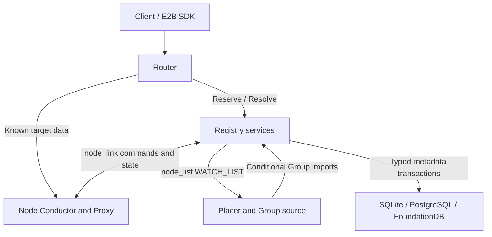
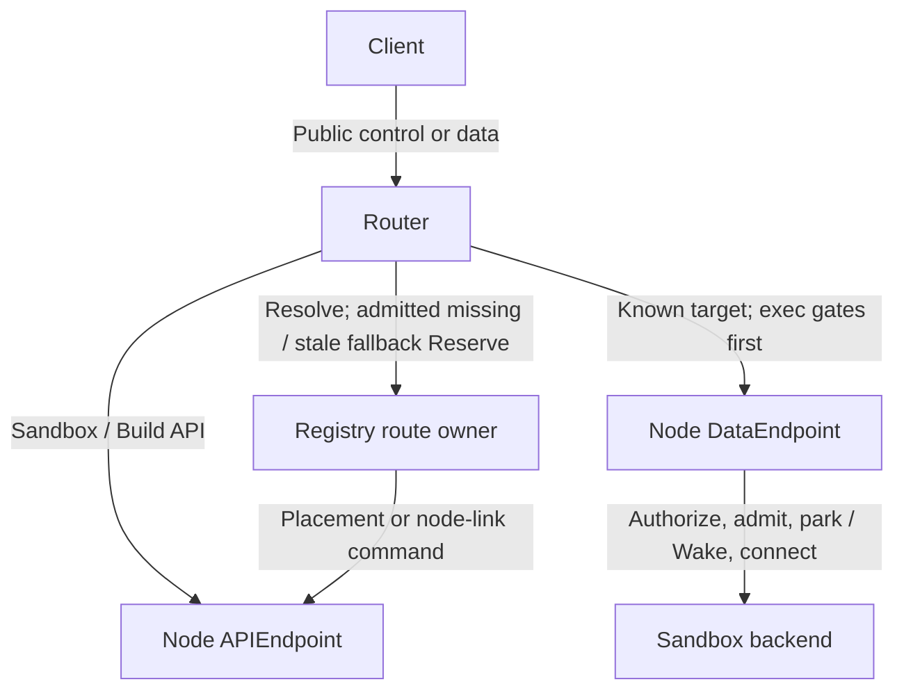

[English](cluster.md) | [简体中文](cluster_zh.md)

<a id="overview"></a>

# Cluster control

This contract follows cluster capabilities and state ownership across Registry, Router and Placer. Use the public ingress section first, then define Groups and configure roles. Membership/state and link protocols are reference material for operators and implementers; failures and recovery close the contract. Node-local Sandbox/Build behavior remains in its capability document.

`cluster-ctl` is the cluster control plane for large deployments, with three independent roles:

- `registry`: maintains durable execution ownership, authenticates requests, selects Nodes and owns node connections.
- `router`: a unified e2b-compatible entry point that locates the route owner by sandbox group and forwards the hot path directly to the node.
- `placer` (optional): imports complete Group records and maintains conditional Node updates from the `node_list` view.

Registry accesses durable execution metadata through typed repositories backed by SQLite, PostgreSQL or FoundationDB 7.3.77. SQLite is limited to one Registry; shared deployments use PostgreSQL or FoundationDB. Transactions and storage recovery belong to the selected database; Registry retains lifecycle rules, node connection ownership and command dispatch. Router and Placer use the same business protocols without importing a database client.

**Read by task:** [First cluster](#minimum-cluster) · [Public ingress](#client-access) · [Groups and placement](#groups-and-placement) · [Configure roles](#configuration) · [State ownership](#membership-and-state) · [Link protocols](#protocols) · [Failure and recovery](#failure-and-recovery)

<a id="roles-and-topology"></a>

## Overview

<a id="overall-topology"></a>

### Overall topology



The steady-state data plane bypasses Registry. Explicit create/connect/exec-session operations and data requests with a missing target or typed stale fallback require Registry:

- `POST /route-link/v2/reserve` distinguishes four operations using `operation=create|connect|exec-session|data`. Create calls Reserve directly; Registry completes connect/exec-session through node-link; data calls Reserve only when the route lacks a complete node target or the node proxy reports typed stale state. Unknown routes do not implicitly create sandboxes. Explicit build registration calls `ReserveBuild`.
- Registry authenticates the request and selects Nodes from a bounded GroupSupport query.
- Registry sends create/connect/exec_session/delete/build/key commands through the node owner.
- Nodes report sandbox/build state and the low-frequency node directory through node_link.

<a id="design-principles"></a>

### Design principles

1. **Group is the business shard key**: every northbound cluster request must include `X-Kuasar-Sandbox-Group` or equivalent group identity. A cluster data-plane entry without a group is currently unsupported.
2. **The selected database owns durable metadata**: Registry process failure does not erase metadata. Database availability depends on its configured redundancy and failure domains, not Registry owner count. SQLite supports one Registry; shared PostgreSQL/FDB deployments can use multiple members. Losing all metadata still does not authorize reconstructing execution ownership from incomplete reports.
3. **Operations stay within typed scopes**: Route/Build operations use a group and record identity, node operations use NodeID, and the low-frequency directory uses bounded bucket pages. Unrelated partial lists cannot be merged into authority.
4. **Atomicity follows business invariants**: coupled intent/ownership, lifecycle fences and projections commit through typed transactions. Registry members do not maintain replicas of each other's metadata.
5. **Member health does not determine sharding**: the member list comes from versioned configuration; `LocateN` takes only membership members as input. Memberlist detects health and propagates metadata.
6. **Nodes are the authority for runtime state**: node reports determine whether sandboxes/builds still exist. A host reboot loses running processes; surviving durable rows are reconciled against actual units and checkpoint/cleanup ownership. A conductor process restart can adopt surviving units. Neither event means blindly deleting all durable rows or automatically recreating every old sandbox; see [State ownership and disaster-recovery boundaries](#registry-state-ownership-and-disaster-recovery-boundaries)–[Registry Reliability](#registry-reliability).
7. **Placer does not own lifecycle**: it maintains Group definitions on static targets. Registry selects Nodes from published support; Node admission copies the business inputs and applies the existing lifecycle.
8. **Router does not subscribe to huge numbers of groups**: create Reserve returns READY or an error; data Reserve can also return PAUSING; connect/exec-session Reserve returns after synchronous node preparation, without waiting for asynchronous resume. Router keeps only a bounded route cache; in-flight requests do not provide routes for new requests.

<a id="role-boundaries"></a>

### Role boundaries

| Role | Responsibility |
|---|---|
| Registry member | Hosts business protocols, live node links and membership; accesses durable metadata through typed repositories |
| Router | Unified e2b entry; locates route owners by group; per-request control authorization, Reserve for create/connect/exec-session/data; bounded DataRoute cache on the hot path |
| Placer | Consumes `node_list` WATCH_LIST; imports complete Group records and applies conditional Node maintenance |
| Node | Runs sandboxes/builds; reports full inventories and events through node_link; receives create/connect/exec_session/delete/build/key commands |

<a id="minimum-cluster"></a>

## First cluster: one SQLite Registry, one Router, two Nodes

This path uses direct Node Group maintenance; it needs no Placer or FDB service.
One Registry limits control-plane availability, not the number of compute Nodes.
Use an isolated test deployment before opening production admission.

### 1. Install matching inputs and prepare the two Nodes

Select one aggregate release through the main project's [installation guide](https://github.com/kuasar-sandbox/kuasar-sandbox/blob/main/docs/installation.md).
Install its complete native archives, including the `run-cluster-ctl` launcher
and private libraries, on the control host. Prepare two native Nodes using the
[deployment guide](https://github.com/kuasar-sandbox/kuasar-sandbox/blob/main/docs/deployment.md)
or the [node-infra cluster example](https://github.com/kuasar-sandbox/kuasar-sandbox/blob/main/docs/node-infra.md#cluster-attachment).
Both Nodes need usable KVM, their own persistent Node DB/encryption key and
Conductor/Proxy/Connector setup, compatible runtime/kernel inputs, and access to
the same artifact store or named file locations. A local path on node-a alone
is not a portable template. Configure real Runner/Builder budgets and the
Builder diff template before the Build below.

Use the addresses below as a mapping to replace with your own DNS and interfaces:

| Role | Private address | Configuration |
|---|---|---|
| Registry | `registry-1.example:7700` | `/etc/cluster-ctl/registry.yaml` |
| Router | Public `api.sandboxes.example.com` and `*.sandboxes.example.com` | `/etc/cluster-ctl/router.yaml` |
| node-a | `node-a.example:3000` API, `node-a.example:3001` data | Node-specific Conductor and Proxy files |
| node-b | `node-b.example:3000` API, `node-b.example:3001` data | Separate Node identity, state and keys |

Provision a private CA and per-role client/server certificates for Registry
links. Public Router ingress needs a trusted certificate covering the API and
sandbox hosts. Router-to-Node API/data listeners remain distinct private
plaintext endpoints; restrict their network access to trusted infrastructure.

### 2. Configure and start Registry and Router

The following complete single-member Registry input selects SQLite explicitly:

```yaml
member:
  id: registry-1
  listen: ':7700'
  tls: {cert: /etc/cluster-ctl/tls/registry.pem, key: /etc/cluster-ctl/tls/registry.key, ca: /etc/cluster-ctl/tls/ca.pem}
membership:
  active: 1
  versions:
    - version: 1
      members:
        - {id: registry-1, advertise: 'https://registry-1.example:7700', node_advertise: 'registry-1.example:7700'}
  owners: {route_link: 1, node_link: 1, placer_link: 1, node_list: 1}
storage:
  backend: sqlite
  namespace: first-cluster/records-v2/
  sqlite_path: /var/lib/cluster-ctl/metadata.sqlite
```

Create `/var/lib/cluster-ctl` with access limited to the Registry service user
and persist it across restarts. Do not run a second Registry against that file.
The Router input is:

```yaml
domain: sandboxes.example.com
registry:
  bootstrap: registry-1.example:7700
  tls: {cert: /etc/cluster-ctl/tls/router-client.pem, key: /etc/cluster-ctl/tls/router-client.key, ca: /etc/cluster-ctl/tls/ca.pem}
ingress:
  listen: ':443'
  tls: {cert: /etc/cluster-ctl/tls/public.pem, key: /etc/cluster-ctl/tls/public.key}
auth:
  data_plane: enforce
```

Validate both files with `run-cluster-ctl config ROLE --config FILE`. Install the
shipped `cluster-registry.service` and `cluster-router.service`, then run
`systemctl daemon-reload` and `systemctl start cluster-registry cluster-router`.
These units expect installed binaries in `/usr/bin`; match the unit to your
installation prefix. For another supervisor, use the identical role commands.
A listening Router is not yet proof that a Node can accept work.

### 3. Attach both Nodes and create a Group

Add the following to node-a's Conductor configuration; use `node-b`, its addresses/certificates and `labels.node: node-b` on the other Node. Set the Proxy's `data_listen` to
`node-a.example:3001` (the local interface address may be used for binding).

```yaml
api:
  domain: sandboxes.example.com
  listen: ':3000'
cluster:
  node_id: node-a
  node_link:
    endpoint: registry-1.example:7700
    tls: {cert: /etc/node-ctl/tls/node.pem, key: /etc/node-ctl/tls/node.key, ca: /etc/node-ctl/tls/ca.pem}
  api_endpoint: node-a.example:3000
  data_endpoint: node-a.example:3001
  labels: {pool: first-cluster, node: node-a}
```

Validate through `node-ctl config conductor --config FILE` and `node-ctl config
proxy --config FILE`, then start each Node's Conductor and Proxy using the
selected deployment's normal service units. A node-infra instance uses its
native overlay paths and `node-conductor.service` instead of `node-ctl.service`.

Generate one tenant pair in a trusted administrative shell, retain it through
your normal secret storage, and make that same pair available to both Nodes'
local administrators. Do not generate a different pair on each Node.

```sh
export MANIFEST_KEY=$(e2b-key-ctl gen-key)
export API_SECRET=$(e2b-key-ctl derive-api-secret)
export E2B_API_KEY=$(e2b-key-ctl gen-apikey)
```

On **each Node**, with those values available and the local admin socket:

```sh
umask 077
node-ctl manifest-key add --socket /run/sandbox/node-ctl.socket --label first-cluster
cat >first-cluster.json <<'JSON'
{"group":"first-cluster","expected_version":0,"context":{"target_port":49983}}
JSON
node-ctl group apply --socket /run/sandbox/node-ctl.socket -f first-cluster.json
```

Retain each apply result's `version`. Zero means create-only; if the Group already
exists, read it and make an explicit CAS update instead of retrying zero.
`group apply` does not install roots. The local admin socket handles the root
installation; `E2B_API_KEY` authenticates the business Group operation. Give
application clients only the API key, never either root or the Node encryption key.

### 4. Verify publication, build a real template, then set the default

From a trusted control host, inspect **each Node** through Registry:

```sh
run-cluster-ctl status --registry https://registry-1.example:7700 \
  --ca /etc/cluster-ctl/tls/ca.pem \
  --cert /etc/cluster-ctl/tls/operator.pem --key /etc/cluster-ctl/tls/operator.key \
  --group first-cluster --node-id node-a
```

Require `storage_readable:true`, `published:true`, the same `group_version` as
the local apply result, and a nonempty current `registration` with Node ID,
link owner and fence. Repeat for node-b. Until a default exists,
`default_template_missing` is expected for default Create; it does not block a
Build. A successful `/verify-key` call alone cannot prove this publication.
After reconnect or an update, repeat this comparison with the current local
revision and registration; do not mask incomplete publication with Create retries.

Set `E2B_API_URL=https://api.sandboxes.example.com`,
`E2B_DOMAIN=sandboxes.example.com`, `KUASAR_GROUP=first-cluster`, and
`BUILD_KIND=sbx` in the SDK/Build client environment. Prepare `APP_IMAGE` pinned
by digest with the [first application recipe](https://github.com/kuasar-sandbox/kuasar-sandbox/blob/main/docs/templates.md#first-application),
then execute the complete [Build HTTP recipe](node-build.md#client-workflow).
With `KUASAR_GROUP` set, that recipe sends the Group header on registration,
trigger and status calls through Router. Wait for this exact Build's `ready`
result and export its canonical `e2b-sbx-...` TemplateID as `TEMPLATE_ID` in both
Node admin sessions and the SDK client; a
transient ID or an illustrative string is not a runnable template.

On each Node, replace the Group file's context with that canonical template,
retaining `target_port:49983`, and set `expected_version` to that Node's observed
revision. For example, when its revision is 1:

```sh
python3 - <<'PY_GROUP'
import json, os
with open('first-cluster.json', 'w') as f:
    json.dump({'group': 'first-cluster', 'expected_version': 1,
               'context': {'templateID': os.environ['TEMPLATE_ID'], 'target_port': 49983}}, f)
PY_GROUP
node-ctl group apply --socket /run/sandbox/node-ctl.socket -f first-cluster.json
```

Check publication again against each new returned revision. Now require
`eligible:true`; inspect the fixed reason if it is false. This read-only result
is a point-in-time observation, not a capacity reservation. Node admission still
checks real resources and artifacts on the actual request.

### 5. Exercise the SDK and retain recovery inputs

Run the [client acceptance recipe](#client-onboarding) below with the same
Group/API key and canonical TemplateID. It covers Create, exec, files, pause,
connect and delete through Router. Run it once with `KUASAR_NODE=node-a` and once with `KUASAR_NODE=node-b` to
exercise both Nodes. The optional Placement header uses the explicit `node`
label configured above; Node ID does not automatically become a label.

Keep Registry metadata, each Node's own DB/encryption key, tenant roots, Group
inputs and the artifact closure according to their respective retention rules.
For a shared control plane, replace SQLite with one supported PostgreSQL/FDB
backend and configure multiple Registry members as described in
[metadata storage](cluster-storage.md). Changing the backend does not migrate
execution state; follow its explicit rebuild/restore boundary before switching.
Add [Placer](#placer-configuration) only
when source import and automatic credential renewal are needed. Neither step is
required to operate this initial two-Node cluster.

<a id="client-access"></a>

## Public ingress and identity

The standalone `kuasar-sandbox.identity` / `X-Kuasar-Sandbox-Identity` extension is rejected by public cluster Create and Build registration; Registry keeps allocation authority. See [Sandbox identity on Create](sandbox-lifecycle.md#create-identity).

`cluster-ctl router` is the cluster's northbound ingress for both the e2b control plane and data plane. It is not a routing authority and subscribes to neither routes nor node_list. It locates route owners by group. Explicit create/connect/exec-session calls use their corresponding Reserve operation; a data-plane cache miss starts with Resolve. RouteLink v2 returns an operation-specific ControlRoute or DataRoute; only DataRoute is cached. Once a route has `NodeSandboxID + DataEndpoint`, ordinary data traffic connects directly to the final node proxy even in paused/starting states; the node handles authorized parking, Wake, and backend connection. Exec CONNECT is the exception: after public 200, the router reads and authorizes the first ctl frame before connecting to the final node. `Reserve(operation=data)` remains only a fallback for a missing target after request admission, a typed stale target before sending Raw, or the ordinary data-plane compatibility path.

<a id="client-onboarding"></a>

### Minimal cluster client acceptance

Complete the [first-cluster setup](#minimum-cluster), or use an existing Group
maintained directly on Nodes or by the optional Placer. This is a one-group
acceptance path, not an HA reference configuration.

1. Register eligible nodes with matching runtime/kernel/artifact access and the
   intended selector labels. Ensure node-link full sync and completed GroupSupport publication for
   this group. Use an actually published canonical `e2b-img/sbx/snp-...` ID from
   an exact ready Build. Install the root pair through the Node admin socket or
   trusted importer contract; give clients only an API key signed by its APISecret.
2. For this SDK command/file test, use the Group example `target_port=49983`.
   That constraint deliberately limits data to envd. To test an arbitrary user
   application port as well, use a group without a fixed port constraint or one
   configured for that port; do not assume 49983 represents every service.
3. Configure public Router TLS, `api.<domain>` and sandbox host DNS/certificates.
   Use `auth.data_plane: enforce`. Registry TLS is independent. Current
   Router→Node APIEndpoint/DataEndpoint must be reachable **plaintext internal**
   listeners, respectively Conductor and Proxy; protect them with private network
   access controls. Public HTTPS does not encrypt that hop. Do not advertise a
   TLS-only node listener as a plaintext endpoint.
4. Set `KUASAR_GROUP` to the exact Group name, `TEMPLATE_ID` to its usable
   template, and reuse API URL/key/domain/CA settings. With the project's pinned
   **e2b==2.25.1**, pass the same Group and caller-chosen route key on Create and
   every later control/data operation:

```python
import json, os, uuid
from e2b import Sandbox

if not __debug__:
    raise RuntimeError("Run this recipe without Python optimization (-O/-OO or PYTHONOPTIMIZE).")

headers = {
    "X-Kuasar-Sandbox-Group": os.environ["KUASAR_GROUP"],
    "X-Kuasar-Route-Key": str(uuid.uuid4()),
}
if os.environ.get("KUASAR_NODE"):
    headers["X-Kuasar-Sandbox-Placement"] = json.dumps({
        "node_selectors": [{"node": os.environ["KUASAR_NODE"]}]})
options = dict(api_url=os.environ["E2B_API_URL"],
               api_key=os.environ["E2B_API_KEY"],
               domain=os.environ["E2B_DOMAIN"], headers=headers)
sandbox = Sandbox.create(os.environ["TEMPLATE_ID"], timeout=300, **options)
sid = sandbox.sandbox_id
print("Retain group, route key, stable SID:", headers, sid)
try:
    assert sandbox.commands.run("printf cluster-ok").stdout == "cluster-ok"
    sandbox.files.write("/tmp/cluster-proof", "cluster-state")
    sandbox.pause()
    sandbox = Sandbox.connect(sid, **options)
    assert sandbox.files.read("/tmp/cluster-proof") == "cluster-state"
finally:
    sandbox.kill()
```

The SDK's `ConnectionConfig.sandbox_headers` merges custom headers into envd
requests; command and file clients use that configuration. Reconnecting creates
another client, so pass `options` again. Choosing the route key avoids relying on
SDK exposure of the Router's extra `routeKey` response field. Persist
`(group, route key, stable SID)` in the application if it outlives this process.
This header propagation is verified against 2.25.1 source, not a promise for all
SDK versions. The SDK does not provision groups, sign API roots, recover Registry
state or inject these headers into a browser request to `get_host(port)`.

For application-port access, the application/gateway must carry Group, route key,
stable sandbox identity, target port and the appropriate scoped forward token
([Addressing](#router-addressing)–[Control plane](#router-control-plane)); it must not leak the tenant API key to the guest. Verify both the SDK
commands/files path and an authenticated request to the intended application port.
In an isolated acceptance group, confirm missing Group, wrong credentials and an
unauthorized target fail without activating a different sandbox. Create may omit
route key and receive a newly generated one; verify missing route key rejection
on subsequent operations that require the existing route, such as connect, pause
and data requests. Inspect
node endpoint selection to prove control and data use their distinct listeners.

Success means real create, command/file roundtrip, pause/resume and kill; Registry
stub tests alone do not prove this VM path. On NoNode, check current Group publication, selector,
node health/capacity and artifact access; on control success/data failure, check
header propagation, target_port, DNS/TLS and the Proxy internal endpoint. Stop on
identity mismatch. Kill only test-owned instances; removing an input file is
not instance cleanup or immediate revocation of credentials already bound to rows.
Retain shared templates/keys until the retention policy permits deletion.

Dead/deleting Sandboxes keep their management location. ID-based query, Reset, checkpoint Export/Delete and parent Delete use the node APIEndpoint and existing ownership checks. They expose no business DataEndpoint. Create with an occupied group/route_key conflicts until final parent deletion. Node and cluster Create preserve autoReset (default false); Reset success does not start a VM.

Create preserves nullable `idleTimeout` through route-link reserve, Registry's
durable reservation, node-link create and effective route/list views. Zero is
retained as an enabled immediate policy. Pause keeps using HTTP forwarding:
`ifIdleSince` is forwarded unchanged and only the final Conductor validates it
against its receipt clock. No node-link Pause command is added.

<a id="router-addressing"></a>

### Addressing

| Request | Required identity | Behavior |
|---|---|---|
| create | group + route_key (generated if omitted) | Extract and validate the resource patch and this request's restore/credentials/checkpoint; locate the route owner and pass them with `ReserveSandbox`. |
| kill | group + route_key + sandbox_id | Locate the route owner; the registry dispatches `CmdDelete` through node-link. |
| connect | group + route_key + stable sandbox_id | Call Reserve with `operation=connect`; the registry dispatches CmdConnect through node-link. No Resolve or forwarding to node HTTP `/connect`. |
| exec session | group + route_key + stable sandbox_id | Call Reserve with `operation=exec-session`; the registry verifies the API key and dispatches CmdExecSession through node-link. Only ExecAccessToken is returned publicly. |
| get/stats/pause/timeout/export | group + route_key + stable sandbox_id | Resolve the current NodeSandboxID and APIEndpoint through the route owner; rewrite the path and forward to the node conductor. Stats bodies have no SID and need no response identity adaptation. Missing APIEndpoint fails closed. |
| list/get | group | Read a bounded page of the group shard; individual sandbox lookup also uses the identity described above. |
| data plane | group + route_key + stable sandbox_id + target | With known NodeSandboxID/DataEndpoint, open a one-use node CONNECT, including paused/starting states. Fall back to `operation=data` only for a missing target or typed stale response; a miss starts with Resolve. |
| build register | group + build_id | Normalize the body/Builder header into Build.Resources, parse the target Sandbox ResourcePatch independently, then call `ReserveBuild`. The selected node performs final registration admission. |
| build cancel | group + build_id | ResolveBuild afresh for each call and forward through the current APIEndpoint without selecting another node. |
| build trigger/status/files | group + build_id | ResolveBuild returns APIEndpoint; cache it and forward to the node conductor. Never fall back to DataEndpoint if it is missing. |
| build delete | group + transient TemplateID | Resolve the original node APIEndpoint from the existing projection; forward Query/Header unchanged for final node authorization and execution |

`route_key` locates a route within a group; `sandbox_id` is the stable public identity. The registry generates SandboxID on the first create. Same-node resume, cross-node migration, and re-placement do not change it. Protected routes additionally carry the current `node_sandbox_id=<sandbox_id>-g<N>`. The router addresses sandboxes by stable SandboxID and substitutes NodeSandboxID only at the node boundary; public responses do not expose NodeSandboxID.

The protected route's `stable_id` is the same sandbox's StableID across NodeSandboxID changes. The cluster always requires `StableID == SandboxID`. The router retains this field as the existing credential projection and uses it to validate KAT `sid`, while cache/route lookup remains keyed by `(group, route_key, SandboxID)`. It neither uses StableID as a node-local lookup key nor builds a unique index on it.

Create body metadata can carry `kuasar-sandbox.resource`, traffic, restore, credentials, and checkpoint. `X-Kuasar-Sandbox-Resource` and `X-Kuasar-Sandbox-Traffic` override only explicitly present leaves in their respective patches. The public resource surface is strictly limited to capacity/allocatable/startup and uses the same merge helper as group defaults; traffic uses the shared max-inflight patch validation and leaf merge. Restore/credentials headers replace the complete object of the same name; the checkpoint header overrides individual fields. The router always parses and strictly validates the body, so a valid header cannot conceal an invalid lower-priority resource/traffic/checkpoint. Omitted restore, `{}`, and explicit `off` all disable restore; only an explicit `memory` on this create enables it. The create-body limit is 16 MiB; larger bodies return **413**.

Create accepts `checkpoint.max_checkpoints` only inside `X-Kuasar-Sandbox-Checkpoint` or `metadata["kuasar-sandbox.checkpoint"]`; the old top-level body field returns 400. The quota is a positive integer or null, defaults to 1 when unset, and uses the same non-null Header-over-metadata field precedence as snapshot defaults. Router extracts it into the existing typed internal Reserve field; forwarded checkpoint config retains only `merge_ref`/`drop_caches`. The accepted quota remains stable across Reserve retries and replacements ([Checkpoint policy input](sandbox-lifecycle.md#request-checkpoint)).

The router constructs requests to the shared `POST /route-link/v2/reserve` endpoint according to the [Registry Reserve protocol](#reserve). It forwards operation-specific authenticated context and preserves the requested stable identity. Create is strictly normalized before admission; Connect preserves the optional memory selection, including absence; exec-session first strictly parses public TTL/conditions and converts them to the typed Registry request. Data uses the existing access-token/service/port context.

The Registry specification owns the exact query/header/body schemas and repeats validation at its boundary. Conditions are not carried in unrelated metadata, query parameters or configuration Headers. Keeping this transformation boundary separate avoids a second, potentially stale schema table here.

For connect/exec-session/data, `sid` is the customer's expected stable SandboxID. It prevents requests from crossing lineage when a route_key is deleted and recreated.

#### Sandbox list pagination

**Compatibility change:** cluster `GET /v2/sandboxes` (and its `/sandboxes`
alias) now returns a page by default, instead of the entire group. The response
remains a JSON array with the existing item fields. Clients that need the full
list must follow the `x-next-token` response header, passing its value as the
next request's `nextToken`, until that header is absent. A short or empty array
does **not** indicate completion when the header is present.

`limit` defaults to 100 and accepts integers from 1 through 1,000. It bounds the
number of route records examined per request, before per-object authorization
and state filtering; therefore a page can contain fewer visible items. The
Registry reads at most 128 route records per storage transaction. Omitted
`state` selects `ready`, `pausing`, and `paused`. Explicit filters accept those
states plus `reserved`, `dead`, and `deleting`; `running` is an alias for the
existing cluster `ready` projection. Item state values remain unchanged. Invalid
limits, unknown states, repeated pagination parameters, and invalid continuation
tokens return 400. Node `starting` reports are not retained as a distinct cluster
route state and are not a supported cluster list filter.

Keep the same group, state filter, and API token throughout a traversal; changing
any of them requires starting again without `nextToken`. Each page rechecks the
API token and every returned object's complete MAC. Tokens are encrypted and
authenticated with XChaCha20-Poly1305 using a server-only namespace key, so an
empty page's continuation does not expose another root's filtered `route_key`.
They hide object names, not page counts, empty pages, or token lengths. They
remain valid across Registry peers and process restarts using the same metadata
namespace. Pagination has no snapshot across requests: concurrent creation,
deletion, or state changes can change the set seen during a traversal.

The namespace initializes one random 32-byte cursor encryption key atomically,
only after an authenticated listing needs a continuation. Registry caches only
a successfully loaded key; pages create no durable cursor sessions. Include
this immutable record in consistent metadata backups and restore it with its
namespace, then restart cache consumers as required by the recovery contract.
A new namespace has a different key, and existing continuations must be
discarded. Corrupt or previously deleted key records fail closed and are never
silently replaced.
There is no public key deletion or rotation API; a future rotation protocol must
explicitly define which cursor versions remain accepted.

**Upgrade requirement:** an older cluster-list client that does not consume
`x-next-token` will silently see only the first page after the server upgrade.
Update such clients before enabling this behavior; the JSON shape alone does not
make the change backward compatible.

Do not perform a mixed-version rolling cutover for this endpoint. The previous
Router forwards only the Group and drops `limit`/`nextToken`; with a new
Registry this can repeatedly return the first page. A previous Registry ignores
the pagination parameters and returns the complete list, so a mixed Registry
pool does not provide consistent bounded behavior. Drain or isolate traffic so
all Router and Registry peers serving paginated clients are upgraded together,
then enable clients that follow continuation tokens. Existing sandbox records
and API credentials do not require migration.

<a id="router-control-plane"></a>

### Control plane

API-key authentication cannot be disabled. Every control request passes the original key to Registry for complete MAC verification before lifecycle effects. New admission uses published Group support; existing objects use their retained credential binding. Control and Build follow-ups reauthorize that exact object on each request. Migration/new-object commands carry the key and expected Group version to Node admission; the key is not persisted in records, ACKs or logs. ManifestKey is for content only.

| Operation | Behavior |
|---|---|
| create | Call `operation=create` Reserve with leaf-merged resources and request-scoped restore/credentials/checkpoint. Separate credentials before writing ordinary metadata. |
| kill | The route owner matches group + route_key + sandbox_id exactly and dispatches `CmdDelete` through node-link. |
| connect | Call `operation=connect` Reserve. The registry dispatches CmdConnect to the current NodeSandboxID and returns after validating typed ConnectResult. The router neither Resolves nor forwards a second request to node HTTP `/connect`. |
| exec session | Strictly parse the body with a 64 KiB limit and call `operation=exec-session` Reserve. The registry verifies the original API key and dispatches CmdExecSession; the router projects only ExecAccessToken. |
| get/pause/timeout/export | Resolve the current route, use APIEndpoint only, and replace public SandboxID with NodeSandboxID in the forwarded path. Rewrite typed get responses to stable SandboxID. |
| get/list | Read the group's route_link records. |
| build register | Generate stable build_id/template_id, strictly merge registration resource body/header/E2B capacity leaves, and call ReserveBuild. The node validates again before saving the build. |
| build cancel | ResolveBuild afresh by group+build_id and forward through the current original-node APIEndpoint without using a stale cache entry. |
| build trigger/status/files | Locate the node by group+build_id; cache and forward through BuildReserveResult.APIEndpoint only. |
| build delete | Transient TemplateID only; resolve the original node from the existing projection and preserve Query/Header |

DELETE `/templates/{transientID}?cancel=true` and `X-Kuasar-Sandbox-Builder: {"cancel":true}` share the node action parser. Each input is strictly validated independently. Explicit Header.cancel > Query.cancel > false; `{}` preserves Query and explicit false overrides true. Router does not parse this as registration BuildOptions. Lookup failure or incomplete ownership returns 503; an unreachable node returns 502, never successful deletion or an invented 404. DELETE 202 preserves the node relative Status Location; only final node hard deletion completes the operation. See [Build actions](node-build.md#cancel-and-delete-a-build-record).

Sandbox control and Build follow-up use a different node endpoint from ordinary data/CONNECT/native exec. Missing APIEndpoint for control/build never falls back to DataEndpoint; missing DataEndpoint for data/exec never falls back to APIEndpoint.

A connect Node Ack projects only NodeSandboxID, TemplateID, Profile, and Envd/Traffic/ForwardAccessToken; it contains neither root credentials nor fingerprints. The router checks consistency between the Ack and protected Route, then builds an e2b response containing only stable SandboxID and the profile's public tokens. The node has synchronously completed validation, optional migration import, deadline persistence, and credential reads. Resume proceeds asynchronously after Ack.

The public exec-session endpoint is `POST /sandboxes/{stableSandboxID}/exec-sessions`. Requests require group, route-key, and the original `X-API-KEY`, with optional `X-Kuasar-Migration-Token`. The body permits only an empty body, `{}`, or strict `ttlSeconds` plus `conditions:[{"expr":"..."}]`. The entire original body, including trailing whitespace, is limited to 64 KiB. Missing conditions and `[]` are unrestricted and normalize to nil. Explicit `null`, unknown/duplicate fields, empty expr, a second JSON value, negative values, or exceeded TTL/condition bounds return 400.

The router passes the API key to the registry verifier without writing it into the command. CmdExecSession explicitly carries APISecretFingerprint, expected Profile, TTLSeconds, ExecConditions, and optional MigrationToken/cluster context. The node is the sole signer: before any activation mutation, it authoritatively compiles conditions and signs. Ack returns only `ExecSessionResult`, followed by asynchronous resume under the existing eager contract. Conditions do not enter Route/record/event/metadata/log. Deferred activation in [#240](https://github.com/kuasar-sandbox/orchestrator/issues/240) remains separate work. The registry joins the result with the current stable-lineage Route; after checking consistency, the router returns:

```http
HTTP/1.1 201 Created
Cache-Control: no-store
Content-Type: application/json

{"execAccessToken":"kat1..."}
```

The response contains no session ID, exp, NodeSandboxID, ServiceSecret, or route. Runtime failures return fixed, sanitized errors rather than raw node Ack reasons or internal paths. An asynchronous resume failure after Ack does not retroactively alter the returned token; later connections fail according to current route/state.

<a id="router-data-plane"></a>

### Data plane

The router first separates ordinary legacy targets from the native exec logical service:

- Ordinary HTTP uses only the legacy port from Host/`E2b-Sandbox-Id + E2b-Sandbox-Port`. Except for the exact value `exec`, it does not interpret `E2b-Sandbox-Service`; that header remains an application header in the inner request. Non-CONNECT requests selecting `exec` return **405** with `Allow: CONNECT` before route lookup or activation.
- CONNECT without a service also uses a legacy raw port.
- `E2b-Sandbox-Service: exec` is the integrated portless CONNECT target. A port may coexist but does not select the backend.
- The complete cluster service-aware forwarding contract for `forward|e2b:envd|e2b:code-interpreter` is tracked in [#63](https://github.com/kuasar-sandbox/orchestrator/issues/63). Current cluster ingress does not advertise those three header values as supported backend selectors. The final node chooses its backend from its locally trusted profile.

Legacy sid-host data-plane credential rules are:

- e2b profile ports 49983/49999 require `X-Access-Token: <envd_access_token>`.
- Other e2b ports and every bare port require `X-Access-Token: <forward_access_token>`. Bare ports 49983/49999 are ordinary TCP forwarding targets, not 501 control ports.
- `traffic_access_token` is for external gateways and e2b data-plane components; the cluster router does not consume it.
- A presigned envd file URL can omit the token only for `port=49983`, `GET/POST /files`, and a nonempty `signature` query.
- A nonempty but incorrect `X-Access-Token` never falls back to signature authentication.

Ordinary token forwarding reuses the client's `X-Access-Token`:

```text
CONNECT sandbox:<port> HTTP/1.1
E2b-Sandbox-Id: <node_sandbox_id>
E2b-Sandbox-Port: <port>
X-Access-Token: <client X-Access-Token>
```

The client-facing Host/path uses stable SandboxID. The router uses current NodeSandboxID in the outer CONNECT to the node proxy and rewrites ordinary HTTP's inner Host to `<port>-<node_sandbox_id>.<domain>`. If the inner request already carries `E2b-Sandbox-Id`, it replaces that value with NodeSandboxID while preserving the header so user applications can see the current node-local ID.

For tokenless signed envd `/files` requests, the router first validates the signature with the protected route's `EnvdAccessToken`. This occurs before any node CONNECT or Reserve/activation. Failure returns 401 immediately and must not wake the sandbox. After successful verification, the router adds that `EnvdAccessToken` only to the outer CONNECT for the node proxy's final-hop authentication. The tunneled HTTP request keeps its original signature and receives no injected `X-Access-Token`, so envd validates the URL independently. Ordinary token requests retain the client's original `X-Access-Token` in both outer CONNECT and tunneled HTTP.

After the router's local authentication gate, a route with `NodeSandboxID + DataEndpoint` does not wait for READY in the registry: paused/starting opens a one-use node CONNECT immediately, just like ready. The final node proxy follows `LookupRoute → authorize → BeginParking → ActivateRoute/Wake → fresh Route → dial`. Admitted parking is therefore counted only at the final node, without duplicate router/registry accounting. In ordinary router `enforce` mode, invalid tokens fail before node CONNECT/Reserve. The router's file-signature validation and explicit token checks on `/files` remain enforced in every router mode. Exec is always enforced. For ordinary requests, router `log` records a local mismatch and continues, while `off` skips that local token check. The node proxy applies its own effective authentication policy independently: preventing an invalid ordinary credential from Wake/Resume/parking/backend dial requires node proxies to remain in `enforce`. If the target node also uses `log` or `off`, it can admit that request and activate the backend. Router configuration does not override the node's policy.

Only a missing target first invokes the `operation=data` fallback. Ordinary requests pass the customer token to the registry; signed `/files` passes the protected EnvdAccessToken already used to validate the signature. If a known node returns typed `not_found`/`unauthorized` before accepting the inner request, the router evicts that node-local target and invokes the same ReserveData to revalidate the credential against current lineage and get a fresh route, then retries once. A fallback returning another stable identity or still lacking a complete target fails closed. `auth.data_plane=off` only skips the router's local token gate for ordinary requests; an explicit wrong token on `/files` never falls back to signature in any mode.

Exec CONNECT uses its own three-stage KAT + request-admission contract:

```text
client CONNECT
  stable SandboxID + service=exec + X-Access-Token=KAT
    ↓ side-effect-free cache/Resolve
Router verifies StableID + ServiceSecret, then compiles CEL
    ↓ flush public 200; read strict first ctl frame; recheck expiry; evaluate
    ↓ admission passed (no node/Reserve before this point)
node CONNECT
  current NodeSandboxID + service=exec + optional original port + same KAT
    ↓ node independently verifies KAT + CEL and reads/evaluates first frame
    ↓ parking → ActivateExec/Wake → ctl.sock; Raw written exactly once

missing/stale target, only after public request admission and before Raw send:
  Reserve(operation=data, same KAT + service=exec)
    ↓ Registry re-verifies and returns fresh current Route
  retry one node CONNECT
```

Exec is always enforced regardless of `auth.data_plane=off|log|enforce`. EnvdAccessToken, ForwardAccessToken, and TrafficAccessToken cannot substitute for an exec KAT. A missing, expired, incorrectly signed, or wrong-SID/audience KAT returns 401 before public 200 and cannot trigger router Reserve, node CONNECT, registry CmdConnect, node parking, or resume. ExecRequest/condition failures after 200 return the uniform `{"type":"error","msg":"exec request rejected"}` with none of those side effects. A paused/starting route with a known node target adds no registry calls. Router and node both execute the complete gate; a pure transport relay does not parse tokens/CEL/ExecRequest. The registry revalidates only on missing/stale fallback. After Reserve, the router must recheck stable lineage/credentials and use current NodeSandboxID, never the old target.

After public 200, the router runs the first-frame gate before opening the next hop. The final node independently checks `StableID + ServiceSecret` from its local route, replies with node CONNECT 200, and repeats the first-frame gate before parking, activation, or connecting to `<run_root>/sandboxes/<NodeSandboxID>/ctl.sock`. The router does not dial `ctl.sock`.

KAT binds StableID, not NodeSandboxID or its generation. Same-lineage resume, migration, or replacement therefore does not itself require re-signing the token; expiry, claims, and current credential validation still apply. Each new node CONNECT uses the current NodeSandboxID.

When ordinary HTTP/non-exec CONNECT reaches the final node proxy's per-Sandbox limit, that proxy returns `429` plus `X-Kuasar-Proxy-Error: max_inflight_reached`. The router passes through status, header, and fixed body unchanged. This typed response is not a stale route: it causes no cache eviction, Reserve, or retry on a different node. The router implements no second limiter; the target proxy enforces the same Sandbox limit across all its workers, not as cluster-wide or per-router capacity. Native exec admission occurs at the node after CONNECT 200 and CEL/first-frame checks. At the limit, the node writes the existing generic ctl error and closes. The router transparently relays the frame without synthesizing HTTP 429.

Long-lived CONNECT uses the same route resolution, but tunnels are never reused. After disconnect, the route cache remains until idle/TTL expiry or fail-fast invalidation. Bytes prefetched by the router-to-node CONNECT response reader remain available in the tunnel. One-way EOF propagates a half-close only; the relay waits for the opposite direction's complete `exec_ack`, stdout/stderr, and exit status rather than truncating the tunnel on the first `io.Copy` return. One typed stale retry is allowed before Raw has been written to any node. Once Raw reaches a node, retry/reroute/replay is prohibited; node ctl errors pass through transparently without a second synthesized error.

<a id="public-sandbox-identity"></a>

### Identity

- Route lookup key: `(group, route_key)`.
- Stable public identity: `sandbox_id`. Registry generates it on first create; same-node resume, cross-node migration and re-placement do not change it. Public APIs, Host and Router cache keys use this ID.
- Stable sandbox identity: `stable_id`. The cluster invariant fixes `stable_id == sandbox_id`; it survives NodeSandboxID changes and binds ServiceSecret and KAT `sid`. This duplicate projection is existing protected credential state and is not deduplicated here. StableID is not a node-local lookup key and has no additional unique index; identity-preserving migration/copy can give multiple node-local sandboxes the same StableID.
- Registry durable JSON state uses `stable_id` directly, without a legacy-field fallback. Pre-release deployments must clear and rebuild old preview state.
- Node execution identity: `node_sandbox_id = <sandbox_id>-g<sandbox_generation>`. The first candidate is g0; candidate conflict/failure or cross-node migration consumes the next generation. Same-node resume keeps the current NodeSandboxID. NodeSandboxID is an opaque node-local ID; Registry ownership maps are authoritative, and components do not reverse-parse the string.
- Node events carry no group/route_key/SandboxGeneration. Registry looks up `(node_id,node_sandbox_id)` to recover stable identity and group context. There is no cross-group SandboxID index.

<a id="cluster-credentials"></a>

### Keys and authentication

A group/tenant has two root credential domains with separate purposes:

| Name | Holders | Purpose |
|---|---|---|
| `APISecret` | provider/placer/node/registry | Signs/verifies API keys and later purpose-specific authentication material; its complete SHA-256 fingerprint identifies the credential pair |
| `ManifestKey` | provider/placer/node | Decrypts manifest/image/snapshot contents and wraps pull tokens; Router never receives it |

Both are 32 bytes / 64 lowercase hex characters. If APISecret is omitted, placer derives it while materializing inline ManifestKey using the fixed KDF:

```text
APISecret = HMAC-SHA256(decodeHex(ManifestKey), "kuasar-api-secret-v1")
```

Only APISecret signs/verifies API keys. The API key's `SHA256(APISecret)[:12]` is only a candidate prefilter; node-link, lifecycle commands and business records use full 64-hex `SHA256(APISecret)`. ManifestKey has its own full 64-hex SHA-256 fingerprint to validate the paired content key.

Import sources support typed inline or out-of-band secrets. The trusted Group maintenance command resolves a complete pair and applies it with the Group CAS in one Node transaction. Public Group bodies carry no roots. Pair expiry or rotation does not rewrite credentials already bound to existing objects. Management authenticates each exact object against its retained root, not the latest Group default.

ServiceSecret is not a third group root; it is an independent service credential for each node Sandbox business record. Its default derives from that Sandbox's bound APISecret and `StableID()` using a fixed domain, or the current create's `kuasar-sandbox.credentials` object can explicitly supply it. Before route/ref/command side effects, Registry validates and normalizes that object against placement Profile. The node validates and separates it again, then encrypts ServiceSecret and Envd/Traffic/Forward tokens into the Sandbox business row. Ordinary metadata, guest configuration and node-stub observation retain no credentials object.

ForwardAccessToken and ExecAccessToken both use `kat1`, with separate audiences. ExecAccessToken's canonical payload fields are `v,session_id,sid,aud[,exp][,conditions]`: session ID is UUIDv7, `sid=StableID`, `aud=exec`, and there is no `iat`; normalized CEL source strings appear only when restricted conditions were requested. ServiceSecret is decoded to a 32-byte key and used directly for HMAC-SHA256, with no extra exec-specific derivation. Create/get/list does not return a default ExecAccessToken. Every exec-session API call signs independently, without a server-side session row, revocation or single-use/replay state.

Registry retains protected object credentials from authoritative Node facts; it does not accept raw ManifestKey or proxy/MMDS-only MmdsSecret. RouteLink v2 projects a control route (API endpoint and public result tokens) or a data route (data endpoint and service authentication material). Neither projection includes APISecret, ManifestKey or their root fingerprints. Only the data projection enters Router's data cache. Create credential overrides are separated from metadata, frozen with RESERVED and cleared on READY. Root material must never enter public responses, ordinary lists, logs or observations.

<a id="groups-and-placement"></a>

## Groups, providers and placement

Node owns the Group definition and the context copied into each new Sandbox or Build. Registry selects eligible Nodes from their published Group support. Placer imports desired definitions and maintains conditional Node updates; Create, Build and API-key verification no longer call Placer.

### Node Group authority

The same business operation serves the Node HTTP/UDS API and trusted NodeLink commands. Public requests use `X-API-KEY`; the full MAC is verified before reading private context or exposing a revision. A fingerprint prefix is only a candidate filter. Current credential pairs authorize new Group creation; retained owner roots continue to authorize management of existing Groups and objects.

| Operation | Node API |
|---|---|
| List owner-visible names/revisions | `GET /groups?limit=128&cursor=...` |
| Read private context | `GET /groups?group=...` |
| Create/update | `PUT /groups?group=...` with `{"expected_version":0,"context":{...}}` |
| Delete | `DELETE /groups?group=...&expected_version=...` |

Names are query parameters, so a Group containing `/` does not become a URL path. Updates require the observed revision; zero creates only a never-existing Group. Delete retains a tombstone. Re-creation requires its known revision and is an explicit operation. Listing is bounded to 128 entries. Bodies and NodeLink envelopes have a 1 MiB limit; the context budget reserves envelope space. Unknown fields, duplicate fields, invalid templates and credential or placement fields outside their defined interfaces are rejected.

Context contains optional `templateID`, `sandbox_config`, `image_repo`, `registry_auth`, `target_port`, `project_id` and metadata. Private repository credentials remain at the Node. Registry receives only the support needed for authentication and selection, including Group revision, allowed full API fingerprints and an optional default template. Group snapshots/deltas are ordered and bounded, and tied to the original Node registration. Incomplete snapshots do not make a Node selectable; overflow or a sequence error forces a fresh connection/snapshot.

Local business import is explicit:

```sh
node-ctl group apply --socket /run/sandbox/node-ctl.socket -f /etc/sandbox/groups
```

It reads `E2B_API_KEY` and submits a file, or regular `.json` files in lexical directory order, through the same UDS `/groups` API. Each file contains `group`, a `context` object and optional `expected_version`. Without a revision it reads once, then performs one CAS, including an authorized tombstone revision. A conflict is reported without re-reading or retrying. Files commit independently; errors identify the failed files and do not roll back successful ones. It installs no root keys, watches no files, and never prunes missing entries.

### Registry selection and request inputs

Create accepts a canonical explicit `templateID`, or omission/null to use the selected Group default. Node first checks an existing object and its complete binding. For a new object it checks the expected Group revision, copies the input, and continues that invocation on the copied input even if Group is updated or deleted afterward. Default-template Create merges request overrides with Node-owned defaults; explicit-template Create uses request configuration only. Build uses the copied Node-owned repository/auth context. Registry does not construct a second source of Group defaults.

The optional `X-Kuasar-Sandbox-Placement` JSON header has the same schema as `kuasar-sandbox.placement` metadata: `{"node_selectors":[{"pool":"gpu"}]}`. Selector objects are OR branches; entries inside one object are AND conditions. Both sources are validated; a supplied header replaces the whole metadata constraint, including `{}`. Constraints are removed from persisted Sandbox metadata. Limits are 8 KiB, 32 branches, 32 entries per branch, 256 entries total, and bounded key/value lengths.

Registry scans bounded pages of normally published Group support, verifies the complete API-key MAC, then filters Node liveness, draining/zone state, caller selectors, runtime compatibility and Build admission capacity. It samples distinct candidates and chooses by load. The intent transaction rechecks the selected publication, original registration and relevant Node conditions. `placement.candidates` and `placement.zone_admit_max` configure this Registry decision.

Valid unannotated legacy SNP templates remain usable. An annotated SNP additionally requires the same Node's runtime label to match both bundle basename and declared digest. Invalid annotations fail without stripping metadata or falling back. Selection performs no artifact I/O and does not infer identity from a host's default runtime. For an opaque migration token, the destination Node decrypts and validates the actual restored template; Registry does not substitute the Group default or historical initial template as its runtime requirement.

### Runtime inventory and selection diagnostics

Conductor builds its reserved runtime labels **once at startup** by inspecting
regular entries/symlinks ending in `.bundle` in the lexical parent directory of
`sandbox.boot.runtime`. For `/opt/boot/current.bundle` pointing into a versioned
release directory, the inventory is `/opt/boot`, not the symlink target's parent.
Each usable entry must have a valid basename and Bundle-declared digest. Invalid
entries are omitted with a diagnostic; manually configured labels under
`kuasar-sandbox.boot/` are discarded and cannot manufacture support.

Install each retained runtime under the exact basename declared by the snapshots
that need it, in that inventory directory, and keep referenced bytes immutable.
New files are not watched or downloaded. Through the normal node maintenance
procedure, restart Conductor to rescan and wait for the new registration/full
support publication. Updating only a label, the primary symlink target, or the
Group's template does not rescan an already running process. Keep older bundles
while retained snapshots need them; a compatible configured primary runtime is
not sufficient evidence that every captured basename is advertised.
A Node can advertise only one digest for a given basename. If old and new
snapshots captured the same basename with different contents, keep separate
compatible Node pools; use distinct immutable basenames for future captures.
Renaming a reference or editing its annotation does not make it compatible.

`run-cluster-ctl status --registry URL --group GROUP --node-id NODE` reads one
authenticated Group/Node pair using `E2B_API_KEY`; use `--ca`, `--cert` and `--key`
for the deployment's Registry TLS. Add `--template-id TEMPLATE_ID` to inspect an
explicit canonical template instead of the Group default. It makes no lifecycle
write and exposes no private Group context, root, fingerprint or token. Only a
completed publication tied to the same live registration and the authenticated
root exposes its revision and registration. An old object's retained key can
still manage that object without proving current Group support.

| Observation | Operator action |
|---|---|
| `published:false`, `support_unavailable` | Compare the local Group revision, correct API key, NodeLink registration and completion of full support publication; a listening process or key verification alone is insufficient |
| `node_unavailable` | Check NodeLink owner/reconnect and heartbeat evidence; do not retry a possibly executed Create on another Node |
| `draining` / `zone_rejected` | Inspect native Node drain/resource pressure; preserve its admission decision |
| `default_template_missing` | Build/publish and conditionally set a Group default, or inspect an explicit template |
| `runtime_unavailable` | Check exact basename/digest, inventory directory and completed publication after the maintenance restart |
| `eligible:true`, actual admission fails | Inspect the final Node's resource, artifact/network and request-selector requirements; status reserves no capacity |
| Placer conflict / key expiry | Inspect per-target results from the explicit `placer apply`, its source-lease logs and local `manifest-key list` expiry; resolve the observed revision instead of silently overwriting a manual Group edit |

Exit zero means the authenticated observation succeeded. Inspect `published`,
`group_version` and `eligible` separately. `storage_readable:true` covers this
metadata/auth read only; it does not certify database HA or future writes.
`eligible` checks this Node's default/explicit-template Create prerequisites
without request selectors. `registration.fence` is an opaque comparison token,
not a time or credential. Use per-object status and the native resource tools to
investigate actual work; do not dump private Group reads into shared logs.

### Acceptance, recovery and delivery order

An intent owns a stable logical ID and an exact Node-local generation. Timeout, lost ACK, generic 400/409/429, NotFound and absence from a report do not prove nonexecution. Cleanup responsibility remains until authoritative object facts or existing reclamation rules resolve it. Late failure cannot regress a newer fact. Only the structured `GroupVersionConflict` produced at initial Node admission, before input copy or core effects, can retire that exact fresh delivery through the atomic intent/registration guard. The client receives the conflict; Registry does not hide it by an implicit retry. No persistent command execution journal or exactly-once promise is introduced.

Reader SDKs, tools and binaries must be published and available before the snapshot producer emits annotated references. RouteLink v2 separates control and data projections; incompatible old peers must not be treated as compatible. Deployment requires a coordinated consumer/protocol upgrade before enabling new writers.

### Placer import and explicit apply

Placer's full-record source interface combines bounded `Range` and `Read`. Each maintenance operation reads one complete source record once and derives context, credential pair and static targets from that same value. File sources and embedded sources use the same adapter. Static selectors and optional shuffle sharding determine all intended targets, including draining/hot Nodes and Nodes currently missing a runtime. Import does not run P2C. An empty intersection stays empty.

After acquiring the source lease, each file-source pass reads and validates the directory once, then shares that immutable snapshot across all pages and target reads. File changes after this scan become visible on the next pass. This is a pass-local snapshot, not an atomic filesystem snapshot while files are being read.

Ready importers compete for a bounded, fenced source lease through Registry. Pages advance only after every item succeeds, using the original owner/run/term. Registry validates this lease again immediately before forwarding the Node command. The trusted command can install a complete key pair and update Group context in one Node SQLite transaction; the import path creates no independent desired-key cache in Registry.

Background import may create an absent Group or renew an unchanged context. A different definition is a conflict. It never silently overwrites a manual edit or revives a tombstone. `cluster-ctl placer apply --config ...` performs one explicit pass using the same sources and adapter; it reads each target revision and makes one conditional attempt. Conflicts and partial outcomes are reported per target without private context or key material.

After a lost reply, the pending operation keeps its original definition, revision and absolute key expiry. A read observing equal context proves only the context state, not that key renewal committed. Only the matching positive Node ACK confirms renewal; unknown writes are retried with the original conditional identity. A changed revision is reported as conflict, without automatic rebase. The bounded in-memory cache can evict confirmed optimization entries but never discards unresolved writes to make room for new ones. Source removal or target-set shrink does not implicitly delete Groups; deletion is an explicit Node operation.

<a id="placement-responsibilities"></a>
<a id="placer-responsibilities"></a>
<a id="placer-principles"></a>
<a id="placer-provider--importer"></a>
<a id="placer-import-reconciliation"></a>
<a id="placer-source-owner-selection"></a>
<a id="placer-page-processing"></a>
<a id="placer-selector-patch-refresh"></a>
<a id="placer-placement"></a>
<a id="placer-registry-selection-of-a-placer"></a>
<a id="placer-placesandbox"></a>
<a id="placer-placebuild"></a>
<a id="placer-key-distribution"></a>
<a id="provider-import-boundary"></a>
<a id="configuration"></a>

## Role configuration and node attachment

Each configuration type owns its exact field meanings below. Shared Conductor path/loading semantics remain in [node operation](node.md#conductor-configuration); platform-wide address, DNS and rollout composition belong to the main project deployment guide.

<a id="registry-configuration"></a>

### Registry configuration and listeners

Registry uses one control-plane listener by default. A separate node_link listener can isolate long-lived node connections without changing owner rules. The following three-member example shows membership and timing fields; `https://` advertisements also require the matching `member.tls` configuration and peer trust. They do not enable TLS by themselves. The built-in default has one member and one service candidate per business scope. Configure the external database independently.

```yaml
member:
  id: A
  listen: "0.0.0.0:7700"       # Unified Registry control-plane listener

membership:
  active: 1
  # next: 2                    # Target version during joint phase
  # old_grace: 1               # Keep old peers reachable for streams they already hold
  reload_ready_timeout: 10s
  versions:
    - version: 1
      members:
        - { id: A, advertise: "https://A:7700", node_advertise: "A:7700" }
        - { id: B, advertise: "https://B:7700", node_advertise: "B:7700" }
        - { id: C, advertise: "https://C:7700", node_advertise: "C:7700" }
  owners:
    route_link: 3
    node_link: 3
    placer_link: 3
    node_list: 3

node_link:
  # listen: ""                 # Empty reuses member.listen; nonempty provides a separate long-lived node listener
  heartbeat_interval: 10s
  node_dead_after: 30s          # Disconnected node heartbeat staleness threshold

route_link:
  park_timeout: 30s

storage:
  backend: fdb                 # fdb | postgres; this example has three Registry members
  namespace: kuasar-sandbox/cluster/records-v2/
  # postgres_dsn_env: CLUSTER_STORAGE_POSTGRES_DSN
foundationdb:
  cluster_file: /etc/foundationdb/fdb.cluster
  prefix: "kuasar-sandbox/cluster/"

placer_link:
  placer_label: placer.default

placement:
  candidates: 2
  zone_admit_max: yellow
```

Default paths:

```text
/cluster/membership
/node-link/*
/route-link/*
/placer-link/*
/internal/node-owner
/internal/node-link/relay
/internal/memberlist/packet
/internal/memberlist/stream
```

Registry's advertised address is `membership.versions[].members[].advertise`; redirect-capable nodes use `membership.versions[].members[].node_advertise`.


<a id="native-build-and-runtime"></a>

### Native build, runtime and validation

`cluster-ctl` supports SQLite and PostgreSQL with CGO=0. FDB support requires CGO and the `fdb` tag; the native release below includes it. `node-ctl`, `node-stub-ctl` and `e2b-key-ctl` remain CGO=0. For the native release use a Linux x86_64 or aarch64 host with Go, a C compiler, Python 3.9+ and `readelf`; the build does not install Debian packages or require `dpkg-deb`. See [storage backends and schema v2](cluster-storage.md) for configuration and pure-Go builds.

```sh
make build-core
make build-cluster-native
make test-core
python3 -B scripts/with-test-fdb.py -- make test-cluster-native
```

`make build` composes both binary paths. The native target fetches only the SHA256-pinned official 7.3.77 client/SDK and Debian runtime inputs in [cluster-native-lock.json](../scripts/cluster-native-lock.json), validates the ELF dependency and symbol-version closure, then executes the real command's `version` through its bundled loader. The SDK comes from the official clients package because the standalone 7.3.77 headers tar omits a required header. The native tests exercise the driver, command assembly and the same cluster-stub business tests against a real, explicitly selected test database. `with-test-fdb.py` starts and cleans only its isolated local test cluster. An existing test database can instead be selected explicitly with `FDB_CLUSTER_FILE`; a missing variable is an error, not a skipped native gate.

The release contains `bin/cluster-ctl`, `bin/run-cluster-ctl`, fixed runtime files under `lib/cluster-ctl/`, and native licenses/provenance under `share/licenses/orchestrator/native/`. The launcher invokes the bundled loader with an explicit library path; install the complete archive and run the roles through `run-cluster-ctl`. The supplied systemd units use `/usr/bin/run-cluster-ctl`. Linux x86_64 needs AVX for the official client, independently of Go's `GOAMD64` setting. The ARM package uses native ARM libraries without emulator-specific settings.

When FDB is selected, Registry needs a readable cluster file and the same storage namespace as its peers. Coordinator-file updates may require a writable file. Router/Placer do not open Registry storage. The archive contains an FDB client runtime, not a production database server; database redundancy and recovery remain deployment responsibilities.

Release validation retains source revision, selected dependency and Go module checks. Only cluster-ctl is admitted as CGO=1 with the `fdb` tag; the other payloads and trusted archive validator remain CGO=0. Native library names, bytes, loader, licenses and provenance are checked against a fixed allowlist. Validation never executes foreign-architecture payloads or downloads dependencies. `make test-release` includes native linkage/launcher and negative packaging fixtures; it uses the matching host architecture.

FDB-backed prepared cluster cases receive the fixed `fdbserver-test` and `fdbcli-test` helpers through [the declared helper inventory](../release/helper-inputs.json). The source-build stage verifies the official package hashes and executable/runtime compatibility; each FDB case owns its isolated single-SSD database, connection file and namespace. SQLite cases own a persistent local test file; PostgreSQL cases use the digest-pinned PostgreSQL image prepared with the test inputs. The prepared runtime uses delivered products/helpers without compiling, downloading dependencies or selecting a machine's default database. Each fixture cleans only its own resources. These isolated fixtures test deployment wiring, not production database redundancy.

<a id="router-command"></a>

### Router command

```text
run-cluster-ctl router --config /etc/cluster-ctl/router.yaml
```

<a id="router-configuration"></a>

### Router configuration

```yaml
domain: sandboxes.example.com

registry:
  bootstrap: registry-1.example:7700

ingress:
  listen: ":443"

auth:
  data_plane: enforce
  cache_ttl: 60s

cache:
  route_ttl: 5m
  idle_timeout: 2m
```

| Field | Meaning |
|---|---|
| `domain` | Cluster service domain. |
| `ingress.listen` | Control- and data-plane ingress listener. |
| `ingress.tls` | Wildcard certificate configuration. |
| `registry.bootstrap` | Registry bootstrap endpoint for fetching membership. |
| `registry.tls` | mTLS to the registry control plane. |
| `auth.data_plane` | Data-plane credential verification: `enforce` / `log` / `off`. |
| `auth.cache_ttl` | API-key verification cache TTL. |
| `cache.route_ttl` | Route-resolution cache TTL. |
| `cache.idle_timeout` | Idle age for route-cache eviction; it is not a tunnel idle-close timer. |
| `metrics_listen` | Prometheus endpoint. |

Public router ingress can terminate TLS; registry control connections can use independent mTLS. Current router-to-node `APIEndpoint` and `DataEndpoint` connections use plaintext HTTP/CONNECT. Node registration must supply reachable plaintext internal listeners for these two different purposes; a TLS-enabled node listener cannot be placed directly in either field.

<a id="placer-command"></a>

### Placer command

```text
run-cluster-ctl placer --config /etc/cluster-ctl/placer.yaml
```

A standalone placer must configure at least one `import_groups` source. Embedded or production integrations can directly inject custom full-record `SandboxGroupSource` implementations.

<a id="placer-configuration"></a>

### Placer configuration

The `https://` advertisement below requires matching `placer.tls` certificate/key
and peer trust. The URL alone does not enable TLS on `placer.listen`.

```yaml
placer:
  id: placer-1
  listen: ":7800"
  advertise: "https://placer-1.example:7800"
  memberlist_label: placer.default

registry:
  bootstrap: registry-1.example:7700

import_groups:
  - source_id: example-file-source
    source_type: file
    path: /var/lib/kuasar/groups

placement:
  import_source_owner_count: 3
  import_source_lease_ttl: 15s
  import_refresh_interval: 1m
  # shuffle_sharding:
  #   - selector: { pool: gpu }
  #     shard_by: zone
  #     n: 2
```

| Field | Meaning |
|---|---|
| `registry.bootstrap` | Registry bootstrap endpoint for fetching membership. |
| `placer.id` | Placer instance ID. |
| `placer.listen` | Placer HTTP API listener. |
| `placer.tls` | Listener/memberlist TLS certificate and key; a configured CA also requires verified client certificates. |
| `placer.advertise` | Address used by the registry to call the placer, also its memberlist HTTP transport address. |
| `placer.memberlist_label` | Placer memberlist label; defaults to `placer.default`. |
| `import_groups[]` | Standalone placer group sources; built-in type: `source_type=file`. |
| `placement.import_source_owner_count` | Number of placer candidates allowed to compete for each source lease. |
| `placement.import_source_lease_ttl` | Registry-side source lease TTL. |
| `placement.import_refresh_interval` | Interval between import maintenance passes. |
| `placement.shuffle_sharding` | Shuffle-sharding rules. |

On Registry, `placer_link.placer_label` selects the importer memberlist domain. Scheduling runs in Registry; removed replica/min-ready/place-timeout knobs are rejected on config load.

<a id="node-attachment-configuration"></a>

### Node attachment configuration

These fields belong to Conductor configuration. Shared loading, path and environment rules are defined in [node operation](node.md#conductor-configuration).

| Field | Default | Meaning |
|---|---|---|
| `cluster.node_link.endpoint` | Empty | Registry node-link address ([Cluster integration (node-link)](#node-attachment)); empty means standalone |
| `cluster.node_link.tls` | Empty | Node-link mTLS cert/key/CA; production requires it ([Cluster integration (node-link)](#node-attachment) and cluster.md) |
| `cluster.node_id` | Required in cluster mode | Unique node registration identity |
| `cluster.labels` | Empty | zone/pool/slot/node labels matched by request Placement and optional importer nodeSelectors |
| `cluster.api_endpoint` | Required in cluster mode | Explicit advertised conductor host:port; never inferred from api.listen |
| `cluster.data_endpoint` | Required in cluster mode | Explicit advertised Proxy host:port; never inferred from its bind listener |

<a id="node-attachment"></a>

### Cluster integration (node-link)

With cluster.node_link.endpoint ([Configuration](node.md#conductor-configuration)), `node-ctl conductor serve` dials Registry to join the cluster served by Registry/Router, with an optional Placer importer. Node-link reuses routesync's framed JSON over h2c engine (node-proxy.md [routesync and shared route views](node-proxy.md#route-synchronization)), with reversed roles: node owns local routes/builds; Registry subscribes and sends commands.

This section defines node behavior. [cluster.md](cluster.md) defines Registry ownership selection, redirect/relay, typed metadata transactions and membership changes.

```text
node-ctl conductor serve
  │ dial registry node_link endpoint
  │ register node profile
  │ stream heartbeat + sandbox route events
  │ stream Build full snapshot + live BuildUpsert/BuildDelete
  │ receive create/connect/exec_session/delete/key/build commands
  ▼
registry node_link owner or relay holder
```

There are two cluster→node paths:

- **Node-link:** registration, heartbeats, Sandbox route events, Build snapshots/deltas, commands and manifest-key leases.
- **Router forwarding to local control/data planes:** pause/timeout and Build status/files use the node APIEndpoint; parent Sandbox Delete instead calls Registry, which dispatches CmdDelete through node-link. Data uses the separate Proxy DataEndpoint and current NodeSandboxID. Ordinary token requests retain the caller token; verified tokenless signed-file requests add EnvdAccessToken only to the outer CONNECT, not the inner HTTP request ([Data plane](#router-data-plane)).

<a id="membership-and-state"></a>

## Membership, durable state and ownership

These are Registry consistency and role-membership contracts, not additional public Sandbox APIs.

<a id="registry-membership-and-health-detection"></a>

### Membership and health detection

<a id="registry-versioned-membership"></a>

#### Versioned membership

Registry membership comes from an operator-distributed configuration file. Each version has the stable label `registry.<version>.<sha256(sort(member_ids))>`. This is service membership; PostgreSQL/FoundationDB maintain their own database topology, and SQLite permits one Registry.

| View | Business use |
|---|---|
| `active` | Current route, node, node_list and placer_link candidates |
| `next` | Prepared candidate view during the controlled connection transition |
| `old_grace` | Previous peers retained for existing node streams and forwarded owner RPCs; excluded from new connection-owner selection |

Reload can load/cancel `next` from stable state, then promote an already configured `next` to `active` with `old_grace`. It cannot jump directly from stable v1 to stable v2. Memberlist readiness still gates the transition. All views use the same metadata database; the transition has no Registry storage quorum or snapshot-transfer phase.

<a id="registry-memberlist-boundaries"></a>

#### Memberlist boundaries

```text
membership config                       memberlist
  defines member ids                      observes liveness
  defines advertise URLs                  propagates tiny meta
  input to LocateN                        does not reshard
  controlled by reload                    does not own member list
```

Each Registry membership label has its own memberlist domain. Memberlist transport reuses control-plane HTTP:

```text
registry A /internal/memberlist/*  ◄────►  registry B /internal/memberlist/*
label=registry.1.hash(A,B,C)
```

Memberlist is used only to:

- Determine whether configured members are reachable at runtime.
- Publish Registry/placer readiness metadata.
- Provide signals for RPC fail-fast/cooldown.

Memberlist does not:

- Maintain the Registry member inventory.
- Change `LocateN` inputs.
- Replicate data.
- Turn suspect/dead states into resharding.

<a id="registry-placer-memberlist-domain"></a>

#### Placer memberlist domain

Placer uses a separate label, `placer.default` by default. Registry has no configured placer list; it joins the placer memberlist with `role=observer`. `POST /placer-link/register` supplies only a seed for Registry's initial join. Placer memberlist metadata expresses readiness:

```json
{"role":"placer","id":"s1","advertise":"https://s1:7800","ready":true,"ready_label":"registry.2.hash"}
```

Registry considers only members satisfying `role=placer && alive && ready=true && ready_label==active_registry_label` as source-lease contenders; Create/Build selection and API-key verification do not call these members.

<a id="registry-registry-state-model"></a>

### Registry state model

Registry persists execution metadata through one shared repository implementation on SQLite, PostgreSQL or FoundationDB 7.3.77. SQLite is for one Registry; shared-database peers use the same backend and namespace. The database owns transaction commit, conflict detection and durable recovery; Registry owns business transitions and live node connections. [Storage configuration, contracts and the schema-v2 upgrade boundary](cluster-storage.md) apply to every backend.

<a id="registry-data-hierarchy"></a>

#### Layers and minimum interfaces

| Layer | Goal | Interface exposed to its caller |
|---|---|---|
| Router / Placer | Authenticate and forward requests, or import Group definitions onto checked static targets | Existing route_link / placer_link / node_list HTTP contracts |
| Registry business services | Validate lifecycle and ownership, dispatch commands, reconcile node reports | Typed Route, Build, Node, Ownership, KeyPair, Directory and ImportSource capabilities |
| `internal/cluster/metadata` | Define portable records, complete versions, domain outcomes and bounded lists | `Versioned[T]`, `Version`, typed repository methods, `Invalidation`, `ObservationAdmission` |
| `internal/cluster/metastore` | Implement the typed business repositories once | Atomic lifecycle, index and ownership operations |
| `internal/storage/record` | Shared record, revision, chunk and integrity mechanisms | Conditional multi-key record transactions and invalidation conditions |
| `internal/storage` | Generic ordered transaction contract | Bytes, bounded scans, exact transaction outcomes and observations |
| `internal/storage/sqlengine`, `internal/fdbdriver` | Backend connections, transactions, notification acceleration and error mapping | Generic engine only; no business-package dependency |
| SQLite / PostgreSQL / FoundationDB | Durable storage | Selected only by Registry startup assembly |

The repository stays one Go module. Only the native FDB driver and its command adapter require `fdb && cgo`; only Registry assembly opens the database. Registry/Router/Placer consume [typed repositories](../internal/cluster/metadata/repositories.go), not generic transaction closures. The generic mechanism is internal to shared storage. There is no in-memory production backend or old replication fallback.

<a id="registry-owner-resolution"></a>

#### Business owners and storage placement

`membership.owners.route_link/node_link/placer_link/node_list` selects Registry service candidates and node connection affinity. `LocateN` and the placer Maglev selection remain business routing mechanisms. They do not select database storage replicas or define a database replication factor. `ConnectionOwners` exposes only the local member ID and ordered candidates for a NodeID; it has no storage API.

A Registry may read or change an authorized record through the shared database without fetching a peer's local copy. The selected `link_owner` remains the process holding the node's stream, and node commands still reach it through node-owner RPC. Registry selects Nodes directly from published Group support.

<a id="registry-namespace-schema"></a>

#### Typed record scopes

| Capability | Identity | Durable contents and atomic boundary |
|---|---|---|
| Route | `(group, route_key)` | Current stable sandbox identity and node generation; creation intent and exact node ownership are committed together |
| Build | `(group, build_id)` | Registration intent, accepted node projection, template index and exact node ownership; completion merges with the latest authorized projection |
| Node | `node_id` | Profile, immutable registration fence, reaping claim and low-frequency directory projection |
| Ownership | `(node_id, node_sandbox_id)` or `(node_id, build_id)` | Exact reverse references used to authorize reports and cleanup |
| KeyPair | `(node_id, api_secret_fingerprint)` | Desired pair, lease and matching acknowledgement; replacement invalidates an old ACK |
| Directory | Fixed 256 buckets of low-frequency node projections | Paginated checked view and bucket change tokens |
| ImportSource | `source_id` | Lease holder, run ID, business term and successful-page cursor |
| PublicListCursor | One `public-list-cursor-key/v1` record per namespace | Immutable server-only random encryption key; atomic first initialization, read-only reuse across Registry peers |

Point operations address one business identity. Listing methods take a scoped opaque cursor and bounded page size. The shared record layer chunks payloads inside one transaction and enforces common budgets alongside backend-native limits. A listing cursor continues one typed scope; it is not a permanent database snapshot.

<a id="registry-readwrite-protocol"></a>

#### Transactions, versions and outcomes

A stored version is a **10-byte per-logical-key revision**, monotonically ordered within one namespace including deletion/recreation. JSON/text retains exactly 20 hexadecimal characters. It is not an FDB versionstamp or a global commit sequence; all ten bytes participate in comparison. Node `state_version`, registration identity, import-source terms and sandbox generations retain their separate business meaning.

CAS compares all ten bytes. Missing visible records use zero for expected absence. Live entries require a nonzero valid revision; malformed encodings and reserved values are rejected. A durable hidden revision cell survives deletion, preventing old versions from matching recreated records. Returned versions belong to successful mutations. See [record/version.go](../internal/storage/record/version.go).

The same Route record in the same database history can also use full-byte ordering. Router rejects an older response while a newer cache entry is resident, and rejects an equal version that names a different node target. Equal version plus equal target may refresh endpoint information, since the node profile can change independently. Eviction/TTL removes that cache entry's ordering guard; Router does not keep an unbounded historical watermark. A restored/new database history must not be compared with stale process caches.

The engine separates definitely-aborted `ErrRetry`, `Unavailable`, `Unknown`, invalid input and capacity errors; shared metadata adds business `Conflict`. Only definitely aborted operations may be retried under the original guards. Unknown is never automatically replayed; timeout is not evidence of rollback. Callers reconcile durable state before dispatching side effects.

<a id="registry-invariants"></a>

#### Lifecycle and ownership invariants

- Route intent and exact sandbox ownership commit atomically before dispatch. Rollback checks this attempt's complete version and identity, so a late compensation cannot erase a newer generation.
- Build registration intent and node reference commit together. Acceptance and authorized node reports merge in a transaction, preserving a newer ready/error projection. Definite rejection removes only the matching intent and ownership; an ambiguous dispatch remains pinned.
- Registration returns an immutable node fence. Heartbeats and profile updates carry that original fence. Reading a newer profile does not authorize an older stream to adopt the new registration.
- Reaping atomically claims the expected stale profile and withdraws its directory entry. Each bounded cleanup verifies the claim, record version and exact ownership. Finalization succeeds only after the eligible references are gone; a resumed older worker cannot delete new registration state.
- At startup and every `node_dead_after`, Registry resumes durable claims and discovers expired profiles in bounded pages, including disconnects whose timer was lost before a claim. A connected owner or an uncertain connection probe prevents a new claim; heartbeats and registrations after discovery invalidate the candidate's original version. Network unreachability does not prove disconnection and is retried; an owner absent from the configured members follows the existing `NodeOwner` contract.
- Key-pair ACKs must match the complete current desired material and lease. Expiry/replacement and stale ACKs cannot acknowledge different credentials.
- Import-source checkpoints verify owner, run ID, term and lease. Cursor advance occurs only after every item in the page succeeded.

These rules are expressed by domain methods in the typed repositories, so a consumer cannot separate an atomic operation into independent generic writes.

<a id="registry-watch-correctness"></a>
<a id="registry-watch"></a>

#### Read, observe and directory publication

`ReadAndObserveRoute` reads the route and durable revision together, then arms observation while rechecking that revision. This closes the read/arm race on every backend. Notifications are one-shot instructions to reread, not event history. FDB uses native watches; SQL uses coalesced persistent checks, accelerated by local wakeups and PostgreSQL LISTEN/NOTIFY. Registry Reserve leaders reserve observation capacity before mutation; sequential rearming retains it. Setup, active observation and cancellation until reclamation share the owner budget, including reserved catalog capacity.

The directory stores 256 bucket tokens. `Load` assembles bounded pages, validates the bucket tokens and retries changed buckets before publishing a complete view. `Observe` compares the supplied token before installing its watches; a change between load and observation causes immediate invalidation instead of a lost wakeup. The result is a checked view suitable for placement, not an indefinitely held MVCC read transaction.

Registry adapts this to the existing node_list protocol: reset, initial items, bookmark, then differences from subsequent checked views. The token is an opaque encoding of the bucket versions. Every reconnect starts a fresh reset/bookmark snapshot; an old token does not request replay from a retained history. Slow or failed subscribers reconnect and rebuild their complete view. Router continues to subscribe to neither routes nor node_list.

<a id="registry-efficiency-boundaries"></a>

#### Scale and latency boundaries

The ten-million-sandbox design target does not allocate a watch, Registry copy or cache entry for every sandbox. Router's hot path uses its bounded cache and goes directly to the node. Metadata writes touch the affected identity, exact indexes and ownership; lists and reaping are paginated. High-frequency node usage does not feed the low-frequency directory.

Durable transaction latency remains part of the cold Reserve/registration path. Compare it with the old implementation using the same workload, concurrency, data size and durability assumptions. A former in-memory/no-WAL baseline is not a durability-equivalent latency promise. Passing interface, native ABI and correctness tests does not establish a ten-million-object capacity or p99 SLO; those require the delivery workload measurements.

<a id="registry-gc"></a>

#### Deletion and cleanup

Databases own physical storage reclamation. Domain deletion uses complete expected versions and exact ownership; Node retention and bounded claim-fenced reaping decide which business records may be removed. Shared revision cells survive logical deletion to prevent ABA and must not be reclaimed by an arbitrary TTL. See the [history and revision retention boundary](cluster-storage.md#shared-implementation-and-engine-contract).

<a id="registry-membership-changes"></a>

### Membership changes

The existing active/next/old_grace sequence controls service discovery, node-link affinity and peer availability. During active/next overlap, clients and `ConnectionOwners` use the configured candidate views; after cutover, old_grace peers may still receive commands for streams they already hold. A new connection uses current owner candidates.

This sequence does not move metadata, establish database write quorums or copy group/node snapshots. Shared-backend peers continue to access the same database and namespace. Database topology, redundancy and backup/restore are independent of Registry membership. SQLite rejects multi-member configurations. The reload guard retains the controlled active → next → active transition.

<a id="router-membership"></a>

### Registry membership

After startup, the router fetches registry membership through bootstrap:

```text
GET /cluster/membership
```

The response includes active / next / old_grace registry members, the membership label, and owner count. For each group, the router locates route owners with `LocateN(group, active.members, route_link.owner_count)`.

During refresh, it tries bootstrap and known members and selects the result with the newest active version. A route_link 5xx/409 response triggers membership refresh and one retry.

The router does not participate in registry member health detection and subscribes to neither routes nor node_list.

<a id="placer-membership"></a>

### Placer memberlist domain

At startup, the placer joins the memberlist selected by `placer.memberlist_label` and periodically registers a seed with active / next registry members:

```json
{"id":"s1","advertise":"https://s1:7800","memberlist_label":"placer.default"}
```

```text
placer S1 ── register seed ──► registry A
    │                            │
    └──── placer.default memberlist ◄──── registry observer
```

Placer readiness requires:

- Current registry membership has been fetched.
- One active node_list WATCH_LIST has completed reset/bookmark.

Group import is not a global readiness gate. Registry selects only within the requested Group's completed support publication. Missing support returns NoNode / unavailable without blocking other Groups.

Source-lease contenders are ready importers discovered through memberlist metadata:

```json
{"role":"placer","id":"s1","advertise":"https://s1:7800","ready":true,"ready_label":"registry.2.hash"}
```

`placer_link/register` is neither the readiness source nor a placer directory store.

<a id="protocols"></a>

## Routing, commands and link protocols

Read only the protocol involved in an integration or failure. Node events, Registry ownership and Router caches have separate authority; duplicated projections never transfer ownership.

<a id="node-link"></a>

### node_link

<a id="registry-connection-redirect-and-relay"></a>

#### Connection, redirect and relay

A node may connect to any Registry member. The receiving member obtains its ordered business connection candidates through `ConnectionOwners`, using `LocateN(node_id, N)` over the configured views.

| Receiving member | Result |
|---|---|
| Is a connection candidate | Accepts the stream and persists registration/profile through the typed Node repository |
| Is not a candidate and the node supports redirect | Returns the configured candidate endpoints; the node reconnects |
| Is not a candidate and no usable redirect is available | Relays sequentially to candidates until an owner accepts |

The profile's `link_owner` identifies the Registry process actually holding the h2 stream. Route-owner create/connect/delete/build/key commands reach that process through node-owner RPC. There is one durable metadata store from the application's perspective, accessed through the selected backend; accepting a stream does not start peer metadata replication.

During `old_grace`, an old member may remain `link_owner` and receive forwarded commands. After disconnect, the node reconnects using current candidates. The immutable registration fence prevents an overlapping old session from adopting a new profile or erasing its ownership.

<a id="registry-node-records"></a>

#### Node records

Node_link uses these typed record domains:

- `profile`: node_id, labels, runtime_digest, api_endpoint, data_endpoint, Build registration/execution capacity and durable usage, draining, liveness and link_owner. Heartbeat `allocated` memory is the sum of all sandbox NodeReservations on that node; `pool` is the node allocatable pool, not host `memory.current`, VMM charge or guest demand. The low-frequency `node_list` projection includes both endpoints and capacity; usage stays in the node owner's live profile.
- `sandbox`: the complete per-node sandbox ownership map, `node_sandbox_id -> {sandbox_id,sandbox_generation,group,route_key,profile,api_secret_fingerprint}`.
- `build`: the complete per-node Build ownership map, `build_id -> {group,template_id}`.
- `key_pair`: the APISecret+ManifestKey pair cache renewed by trusted conditional Group maintenance.

Heartbeats update only runtime/liveness fields in `profile`; they must not rewrite the `sandbox`, `build` or `key_pair` domains. The cluster writes sandbox/build ownership before dispatch. Registration usage counts registered/waiting/building rows with neither cancel nor delete intent. Execution usage independently counts every execution claim, including cancellation and cleanup. Accepting intent releases registration capacity; exact host cleanup and terminal commit release execution capacity. Retaining owner-free terminal history does not retain admission usage. The ownership record stays until explicit deletion or node terminal retention actually deletes that Build row and emits `BuildDelete`; Registry then exactly deletes the corresponding Build projection and owner ref. Explicit administrative key maintenance may update key_pair; Group import is applied atomically at the Node. Nodes do not generate group/route-key, but validate and separately persist sandbox system context delivered by node-link. A Build's cluster group is a separate system field of the node Build row, outside portable metadata. High-frequency profile updates do not rewrite unrelated ownership records.

Within a node, `node_sandbox_id` ownership is written by CAS: replaying the same complete ownership is an idempotent refresh; different ownership returns a conflict without overwriting the old value. If create encounters that conflict before sending the node command, it rolls back only this attempt's RESERVED record, preserves stable `sandbox_id`, consumes the next `sandbox_generation`, generates a new `node_sandbox_id` and retries. The node synchronously rejects an existing or currently-being-created node-local ID before asynchronous launch.

Node_link processes streams by event importance:

- Route `upsert/delete`, `cmd_ack` and `BuildUpsert/BuildDelete` are essential convergence events and are processed immediately in the read loop.
- Heartbeats have latest-value semantics. The Registry read loop sends the latest heartbeat to one asynchronous coalescing updater per node; a slow updater may skip superseded heartbeats.
- Node-side transmission is also prioritized: command ACKs and Build deltas enter a high-priority outbox; only the latest heartbeat is retained.
- The writing side of `StreamAuthority` flushes route events first so heartbeats do not delay route READY/DEAD.

Reserve's READY report is therefore not blocked by heartbeat persistence. A node-local `starting` upsert exposes launch identity only to the node proxy/MMDS. The node_link owner includes it in the seen set during full sync, but does not add a route_link business state or overwrite existing RESERVED/PAUSED. Later running/pausing/paused/dead/deleting Upserts and final Delete advance route_link. Normal post-ACK Create failure publishes retained dead, not Delete, and prevents replacement until parent hard deletion. If an actual Delete still matches an in-flight create RESERVED fence (excluding an original paused resume), Registry uses that fence to restore the pre-Reserve route, or deletes the reservation for a new create. It must not delete RESERVED first and destroy the old route's rollback anchor. Sandbox events carry NodeSandboxID, profile and node-owned execution state. The nodelink owner looks up `(node_id,NodeSandboxID)` in that node's ownership map to recover stable SandboxID, SandboxGeneration and group/route_key, then updates route_link. A late READY without an ownership entry is ignored: Registry cannot delete a potentially standalone node-local sandbox without that authority. A retained ownership ref whose route is absent or replaced instead authorizes stale-instance cleanup.

When Connect or ExecSession commits a new node generation during an existing migration, it clears the source instance ID and state version. The first authorized destination projection establishes the imported instance. The generation check fences late source reports.

Dead and deleting retain protected management records and exact node ownership. Live updates and
full snapshots include these non-routable states with instance_id, state version and auto_reset.
Node Delete acceptance publishes deleting; final parent hard deletion alone publishes Delete.
Registry retains their group/route_key through reconnect, full reconciliation and node-directory
sweeps. It rejects stale state versions and mismatched object instances. Query, Reset, checkpoint
export/delete by ID and Sandbox Delete resolve the current APIEndpoint; DataEndpoint is empty.
Unavailable nodes return a temporary failure without discarding retained management ownership.

The node returns CmdCreate `cmd_ack` only after claiming the unique launch attempt, inserting durable `starting,run_id=""`, and caching/publishing starting. The ACK means node-local launch acceptance, not READY. Subsequent resource preparation, runner or runtime failure publishes retained dead and fences replacement until parent deletion. CmdConnect completes cleanup of old runner/network/RunDir ownership before ACK; atomic paused→starting acceptance restores canonical RunDir/UDS and commits the deadline before publishing starting. Restore failure publishes a paused Upsert and must not enter the fresh-create Delete path. CmdDelete ACK means the node durably accepted `deleting`; it does not wait for the local finalizer. Pending replay is idempotent. Standalone and cluster Delete share one finalizer: node-link owns neither another cleanup implementation nor different path derivation. Deleting Upsert is published before ACK to withdraw business routing while preserving management; final Delete and terminal observation follow hard deletion.

High-frequency usage and liveness are not projected to node_list. That directory contains registration-time labels/capacity/endpoints/runtime and draining changes. The node owner's current node-link connection is the sole liveness authority. Before create/build dispatch, the route owner checks connectivity; failed candidates enter the current placement's exclusion set before reselection. Registration commits the profile, immutable fence and directory projection atomically; failure rejects the subscription. A profile update that changes directory fields commits the projection and bucket invalidation in the same transaction. Heartbeats that change only usage/liveness leave the directory untouched.

<a id="registry-incremental-subscriptions"></a>

#### Incremental subscriptions

When starting a subscription, the node owner can supply an opaque revision string. The current format is `source_fingerprint:seq`, parsed privately by the node; callers must treat the token as opaque. Matching fingerprints and available changelog history permit incremental replay; otherwise a full resync occurs. A randomly staggered 1–6 hour full-resync cycle was a design recommendation, not an implemented periodic timer. Current full sync is driven by connection/resume-token and replay-window conditions.

Before full subscription starts, the nodelink owner captures that node's sandbox-ownership baseline. At the completion bookmark, it cleans only baseline entries absent by node_sandbox_id in this snapshot. Before cleanup, it rereads and verifies that the complete current stable/node-generation ownership still matches the baseline, protecting work newly dispatched or rebound during synchronization. An incremental-replay bookmark only advances the resume token and does not clean missing entries.

Build projections do not use the route replay window. Every node-link session requires `BuildSyncBegin → BuildUpsert* → BuildSyncEnd`. The snapshot contains all cluster Builds still retained in node SQLite: registered/waiting/building and ready/error within retention. The node subscribes to live deltas before ranging the snapshot, so Upsert/Delete during synchronization follows End without being lost. The nodelink owner likewise cleans only post-registration baseline refs captured before connection establishment, still bound to the exact `(NodeID, BuildID)` at End, and absent from this snapshot. A Registry-owned `BuildStarting` ambiguous dispatch intent is not a node projection and cannot be deleted by an empty snapshot. Reconnection repairs a lost live Delete, while newly registered/rebound work remains protected from an older snapshot. Missing Begin/End, duplicate brackets or Bookmark before End fails closed. Registry has no independent Build terminal TTL.

<a id="node-registration-and-redirect"></a>

#### Registration and redirect

After dialing Registry's node_link endpoint, the first node frame is:

```text
register{
  node_id,
  labels,
  capacity,
  build_registration_capacity,
  build_execution_capacity,
  api_endpoint,
  data_endpoint,
  runtime_digest,
  accept_redirect
}
```

If the accepting member does not own this node_link and the node supports redirect, Registry may return the owners' node_advertise list. Node tries owners in order, advancing on failure. With no redirect target or redirect disabled, the accepting member may relay to the first available owner.

<a id="node-heartbeats-and-the-low-frequency-directory"></a>

#### Heartbeats and the low-frequency directory

Node periodically sends:

```text
heartbeat{zone, allocated, pool, build_registration_usage,
          build_execution_usage, counts, draining}
```

Both Build capacity levels travel in the initial register frame. Sandbox watermarks come from the resource controller (node-resource.md). Allocated memory sums all local NodeReservations, while pool is node allocatable capacity; neither is host memory.current, VMM charge or guest demand. Both Build usage levels exactly sum each nonterminal SQLite Build.Resources/execution claim, never active count × a default vector. Node resource drain or maintenance policy sets draining. Ordinary heartbeats update node_link liveness and local watermarks without changing node_list. Initial registration and draining changes drive low-frequency directory projection. At placement commit, only the current connection held by the Registry node owner establishes liveness.

<a id="node-sandbox-and-build-projections"></a>

#### Sandbox and Build projections

Node reports authoritative local execution state:

```text
sandbox{
  sid, profile, state(starting|running|pausing|paused|dead|deleting), instance_id, pressure_version, auto_reset, artifact_location, template_id,
  stable_id, api_secret, api_secret_fingerprint,
  manifest_key_fingerprint, service_secret,
  envd_access_token, traffic_access_token, forward_access_token,
  mmds_secret
}
delete{sid}
build_sync_begin{}
build_upsert{build_event:{build_id, state, template_id, persist_id?, reason?}}
build_delete{build_event:{build_id, template_id}}
build_sync_end{}
bookmark{full_sync}
```

Dead and deleting are non-routable management projections. They retain the exact node/Sandbox
location, credentials, instance_id, state version and auto_reset in live updates and full snapshots.
Delete acceptance publishes deleting; only successful parent hard deletion publishes delete{sid}.
Thus a lost incremental update is recovered by the next full snapshot, and the same group/route_key
cannot be overwritten while retained data or cleanup responsibility exists. Registry rejects
older state versions and mismatched object instances. Restart retries durable deleting ownership;
an exact-cleared network tuple is never reacquired.

Node route events retain mmds_secret for local proxy/MMDS use; Registry excludes it when materializing protected cluster routes. Starting means local launch is in progress. Registry includes it in the full-sync seen set without overwriting reserved/paused routes; running/pausing/paused/dead/deleting/delete drive cluster convergence. Events explicitly carry the remaining credentials required for those purposes.

Sandbox events do not self-report Registry-owned cluster context. Before dispatch, the node-link owner maintains the node's complete Sandbox/Build ownership table. It looks up `(node_id,sid)` or `(node_id,build_id)` to recover group/route_key. Event sid is the local NodeSandboxID, allocated by Registry as `<stable-sandbox-id>-g<N>`. Node neither receives SandboxGeneration nor parses this ID. Registry's ownership table recovers stable SandboxID and generation; there is no cross-group SandboxID index.

The bookmark ending a full Sandbox Range carries full_sync=true. Node-link owner compares seen SIDs only against the ownership baseline captured before subscription, then rechecks that each current entry still matches before deletion. This protects newly dispatched/rebound tasks during synchronization. Incremental-replay bookmarks only advance the resume token.

Build events preserve registration template_id independently of terminal persist_id. Hard deletion carries the original template_id, so late events cannot affect a new same-BuildID registration. Only committed node hard deletion emits BuildDelete; an error row leaving an observer collection is not hard deletion.

Existing post-registration Build projection has an independent bracket. Node subscribes to live Build changes, sends build_sync_begin, every retained local cluster Build row, then build_sync_end. The set includes registered/waiting/building and ready/error within retention. Registry fences these frames by NodeID session: once a new link takes effect, an overlapping old connection cannot alter projection. An unconditional per-Build fence orders each durable transition and live publication, independently of conductor Extension. Changes during snapshot follow end in order; slow subscribers disconnect and rebuild a complete snapshot. At build_sync_end, Registry deletes only unseen post-registration projection/refs from the preconnection immutable `(NodeID, BuildID, TemplateID)` baseline that still belong exactly to that node. Registry-owned BuildStarting ambiguous-dispatch intent is not node projection; an empty snapshot cannot establish definitive rejection. This protects new registrations and converges lost live build_delete on reconnection. Registry runs no separate terminal TTL. Long snapshots do not block control replies: the shared writer drains bounded command ACKs and coalesced heartbeats between items; live Build changes still wait for build_sync_end.

<a id="node-command-acceptance"></a>

#### Command acceptance

Registry sends commands to serve, which reuses e2b lifecycle primitives ([Lifecycle and state machine](sandbox-lifecycle.md#state-and-ownership)/[Artifact capture, templates and migration](sandbox-lifecycle.md#capture-and-pause)). Every Sandbox sid is an exact NodeSandboxID. Normal commands return cmd_ack on acceptance and report terminal state through route or BuildUpsert events. CmdCreate ACK requires the unique launch owner, inserted starting row, published cache/route, successful ordered route-applied barrier and lease recheck. It proves durable acceptance, not READY. Before ACK, CmdConnect cleans old runner/network/RunDir ownership, atomically restores canonical RunDir/UDS on paused→starting acceptance, commits the final deadline and publishes cache/route. CmdExecSession first completes optional import, authorization/signing and the same resume acceptance. All three then launch asynchronously under the common lifecycle root:

| Command | Node action |
|---|---|
| `create{cmd_id, sid, template_ref, profile, api_secret_fingerprint, group_api_key, expected_group_version, config, cluster, idle_timeout?, auto_pause_memory?, auto_reset?}` | Cold-launch template_ref and retain/merge config ([Lifecycle and state machine](sandbox-lifecycle.md#state-and-ownership); snp means snapshot restoration for fresh Create). New objects require full Group API-key authentication and the expected Group revision before copying Node-owned context; existing exact objects use their retained credential binding. Persist cluster={group,route_key,stable_id?} and profile as separate system fields; resolve and strip credentials namespace before the business insert. Before ACK, state is starting with empty run_id, an active attempt and the successful route/lease barrier. |
| `connect{cmd_id, sid, profile, api_secret_fingerprint, cluster, migration_token?, timeout_seconds?, memory?}` | SID is NodeSandboxID. Existing targets ignore migration tokens and validate full fingerprint, profile and cluster context; false on an existing paused S is one cold attempt that preserves its durable source. Missing targets with KMT1 synchronously authenticate the original pair and insert paused with command SID/context: false durably selects E-only; omitted/null preserves the token source; true requires S. The same selector then resolves ResumeMode ([Import selection](sandbox-lifecycle.md#import-selection)). Before ACK, clean old owners and atomically restore canonical RunDir/UDS, resolved launch mode and deadline. ACK carries ConnectResult{NodeSandboxID,TemplateID,Profile,EnvdAccessToken,TrafficAccessToken,ForwardAccessToken}, without root/fingerprint. Restore is asynchronous; missing targets without tokens are rejected. |
| `exec_session{cmd_id, sid, profile, api_secret_fingerprint, cluster, ttl_seconds, exec_conditions, migration_token?}` | Reuse Connect's exact target, optional synchronous import and profile/context/full-fingerprint checks; fresh admission carries the API key and expected Group revision over the trusted NodeLink, without persisting or logging the key. Node authoritatively compiles conditions, generates UUIDv7 session ID and optional exp from actual issuance time. ACK contains only ExecSessionResult{ExecAccessToken}. Resume remains asynchronous without waiting for READY. Conditions never enter Sandbox rows/routes/events/metadata. |
| `delete{cmd_id, sid, api_secret_fingerprint}` | Full fingerprint must match the existing row. ACK means the exact owner durably entered deleting, without awaiting finalizer completion. Publish deleting management Upsert before ACK; business-route withdrawal is not cleanup proof. Pending replay is idempotent ([Process management through systemd template units](node.md#systemd-pools) kill). |
| `key_put{api_secret_fingerprint, api_secret_type, api_secret?, api_secret_ref?, manifest_key_fingerprint, manifest_key_type, manifest_key?, manifest_key_ref?, expires_unix}` / `key_drop{api_secret_fingerprint}` | Atomically validate/install or renew the complete pair; both fingerprints are 64-hex SHA-256. Key_drop best-effort removes by full APISecret fingerprint; TTL eviction supplies correctness ([Credentials and ownership: encrypted APISecret/ManifestKey pairs](node-proxy.md#credential-model)). Cluster.md specifies distribution. |
| `build_register{build_id, template_id, profile, resources, group_api_key, expected_group_version, api_secret_fingerprint, config}` | Config.builder.target is the canonical register-only requested target and participates in replay digest/node validation. Node transactionally performs final registration admission against the same canonical Build.Resources. Persist final Sandbox Create config/resources, build-only options and cluster group separately; never derive A/B resources from target Sandbox resources. Only a structured GroupVersionConflict from initial admission permits exact intent retirement. Other errors/unknown outcomes retain the same cleanup obligation and accept late Build facts. |

S-preserving automatic import checks S and its paired E metadata and runtime compatibility before insertion/ACK. A node-local four-second context covers this check and insertion, bounded earlier by caller cancellation; helper pipe cleanup adds at most 250 ms. Registry's five-second ACK wait does not cancel the node-link stream, so it is not the check's timeout. Check failure inserts no target. A new E-only import remains E after failed cold launch; an existing local S retains S. A concurrent insert winner remains authoritative. These are selected-node admission rules; placement and retry protocols are unchanged.

There is no drain command. Resource drain (node-resource.md [Command-line interface](node-resource.md#resource-command)) or local maintenance originates at the node; the cluster merely stops assigning it work.

Post-ACK CmdCreate launch failure rolls fresh starting back to retained dead and sends a dead Upsert.
CmdConnect/ExecSession failure returns to the original paused source and sends paused Upsert.
A terminal management row fences replacement reservations until final hard deletion; it is not
a transient placement failure. Concurrent cluster create/connect/delete cannot acquire a second
local launch owner. Node and cluster Create carry the same frozen autoReset choice (default false).

Standalone and cluster Delete share the same local finalizer. Node-link has no alternative cleanup or path derivation. Finalizer failure neither reports deleting as ready/paused/starting nor delays/repeats route withdrawal. Terminal object observation waits for hard-delete.

Each exec-session API call is a separate authorization with a new CmdID and KAT; Resume can still join the SID's current attempt. CmdID correlates only the current command and ACK waiter. Node persists neither command digest nor typed result; Registry does not automatically resend that CmdID after disconnect, timeout or node restart. An API retry is a new operation: Connect revalidates/retries recovery and Exec Session may issue a new KAT.

<a id="node-disconnection-and-security"></a>

#### Disconnection and security

Node reconnects with exponential backoff and registers again. Registry supplies its retained Sandbox route revision in Hello.resume_from; node replays from that subscriber cursor when its retention permits, otherwise sends individual full routes plus bookmark. This is not a node registration field. Build projection performs a complete bracket in every new session, independently of the route token, including after Registry restart.

Production node-link uses cluster.node_link.tls mTLS. The node encrypts distributed APISecret+ManifestKey pairs and creation credentials in its local persistent store, with trusted runtime use. This is not end-to-end encrypted Registry storage: protected Registry route credentials remain plaintext structured fields as described in [Keys and authentication](#cluster-credentials). Sandbox tokens are sensitive and travel only over trusted links.

Cluster integration and the local plugin plane share the routesync engine/wire format, with different subscriber kinds. Router never subscribes to node plugins; Registry aggregates fleet routes.

<a id="node-create-context"></a>

#### Node Create system context

Cluster Create arrives as a node-link `create` command. Profile, group, route-key and optional authentication identity use structured system context and separate durable fields. Events report profile, node-owned execution facts and protected routing credentials; Registry recovers cluster identity from its existing node ownership records ([Cluster integration (node-link)](#node-attachment) and [Sandbox configuration propagation](sandbox-lifecycle.md#request-configuration)).

<a id="node-system-context"></a>

#### Node system projection

kuasar-sandbox.cluster is not tenant configuration. Cluster Build group uses a separate durable system field, outside portable metadata. Ordinary Sandbox Profile/Group/RouteKey/optional StableID arrive through structured node-link context and persist separately. Node events do not echo Registry-owned group/route key/authentication identity; Registry restores them from ownership records.

<a id="node-list"></a>

### node_list

Node_list is the low-frequency projection produced by typed Node transactions and read through `NodeDirectory`. Its shared repository uses 256 fixed buckets on every storage backend, independent of Registry service membership. The business routing key `node_list` still chooses service candidates for HTTP WATCH_LIST.

<a id="placer-node-list"></a>

#### node_list WATCH_LIST

The view contains NodeID, labels, runtime digest, separate API/Data endpoints, configured capacity, Build registration/execution limits and draining. High-frequency usage/headroom remains in the node owner's live profile. Each entry carries its projection record's complete committed `Version`; Placer rejects missing/uncommitted versions and compares all ten bytes when resolving the same node identity from checked sources.

1. Placer consumes one service candidate's complete view at a time.
2. Reset starts a shadow snapshot; items populate it; bookmark atomically makes that source ready.
3. Registry reads bounded directory pages and validates bucket change tokens before publishing. A subsequent invalidation triggers a new checked load and differences from the last complete view.
4. Tokens are opaque bucket-version bookmarks. Every reconnect repeats reset/bookmark, without event-history replay or a registry-local numeric revision.
5. Ordinary heartbeat usage does not update the directory. Low-frequency profile/draining/liveness changes and reaping update the appropriate projection and bucket token transactionally.

On disconnect/failover, Placer clears the old source and waits for the new candidate's bookmark before becoming ready. It does not combine partial service snapshots into an authoritative directory or reconstruct it by scanning node ownership. Database errors and capacity failures propagate; a partial load is never published as a complete node list.

<a id="route-link"></a>

### route_link

RouteLink v2 uses distinct ControlRoute and DataRoute payloads. Control calls are authenticated per object and contain only the API endpoint and public result tokens; data calls carry only the data endpoint and service authentication material. Router receives no tenant root. Older combined projections are not accepted.

<a id="route-record"></a>

#### Route record

| Field | Meaning |
|---|---|
| `group` | Shard key |
| `route_key` | Route lookup key within the group |
| `sandbox_id` | Stable public SandboxID |
| `node_sandbox_id` | Current node-local execution ID |
| `sandbox_generation` | Registry-owned generation of the current NodeSandboxID |
| `next_sandbox_generation` | Next allocatable generation; persisted only by Registry, never sent to the node |
| `state` | `reserved` / `ready` / `pausing` / `paused` / `dead` / `deleting` |
| `instance_id` / `state_version` | Node parent incarnation and monotonic lifecycle projection fence |
| `auto_reset` | Immutable Create choice; absent old value means false |
| `node_id` | Current hosting node |
| `profile` | Sandbox profile fixed by create intent, consistent with node ownership and event facts |
| `api_secret_fingerprint` | Complete APISecret fingerprint bound to the sandbox business record; lifecycle commands/ownership cleanup use it to prevent operations across bindings |
| `manifest_key_fingerprint` | Complete fingerprint of the paired ManifestKey; routes neither store nor project raw ManifestKey |
| `stable_id` | Sandbox identity retained across NodeSandboxID changes; equals `sandbox_id` in the cluster and binds ServiceSecret/KAT |
| `api_secret` | APISecret bound to the sandbox, retained in protected Registry/Node storage and excluded from Router projections |
| `service_secret` | Persisted per-sandbox service credential for signing/verifying purpose-specific KAT tokens |
| `envd_access_token` | Data-plane token for the e2b envd port |
| `traffic_access_token` | Token used by external gateways and e2b data-plane components; not consumed by the cluster platform layer |
| `forward_access_token` | Data-plane token for other bare/e2b forwarding targets |
| `target_port` | Mandatory data-plane port in Group support; if zero, the request must explicitly specify a port |
| `updated_at` | Used by timeout/reconciliation |

State machine:

```text
none -> reserved -> ready
ready -> pausing -> paused -> reserved -> ready
ready/pausing/paused/reserved -> dead
dead -> paused (Reset)
any retained state -> deleting -> tombstone (final deletion)
```

`pausing` preserves the current node binding. Router forwards authenticated data to that node;
node Proxy parks it and requests Wake. Pause/Resume sequencing remains conductor-owned.
Create for the same route key also connects to the existing pausing owner and waits for running,
without placement or a new generation. Checkpoint deletion forwards its child API path and
never invokes sandbox deletion.

A retained dead/deleting parent reserves its group/route_key: Create/reserve cannot overwrite it.
Reset success updates the same management row to paused; final deletion releases that location.
Reconnection/full snapshots restore these projections, while old instance/version events cannot
overwrite a later run. This adds no cross-node disk recovery or node-loss replacement policy.

<a id="reserve"></a>

#### Reserve

```text
POST /route-link/v2/reserve
  ?operation=create|connect|exec-session|data
  &group=<group>&route_key=<route-key>
  [&sid=<stable-sandbox-id>][&port=<effective-port>]
  [&timeout=<seconds>]
```

Each operation has its own typed Reserve body: create accepts optional `config`, `max_checkpoints`, `idle_timeout`, `auto_pause_memory` and `auto_reset` top-level fields in this internal protocol (at most 16 MiB); connect accepts an optional `{"memory":true|false}` (at most 64 KiB), preserving absent/null selection; exec-session carries `{"ttl_seconds":N,"conditions":["..."]}`; data has an empty body. Credentials and completion conditions differ among the four operations. Registry strictly validates exec-session schema/bounds again; it accepts neither the legacy `ttl_seconds` query nor conditions hidden in headers/metadata/config maps:

- `create`: query carries only group/route_key, header carries `X-API-KEY`, and the config map permits only `kuasar-sandbox.resource`, `kuasar-sandbox.traffic`, `kuasar-sandbox.restore`, `kuasar-sandbox.credentials` and `kuasar-sandbox.checkpoint`; optional `max_checkpoints` (default 1), `idle_timeout`, `auto_pause_memory` (default true) and `auto_reset` (default false) are separate typed body fields, and `memory` is rejected. Router has already extracted the public checkpoint quota; this config namespace carries only `merge_ref`/`drop_caches`. `idle_timeout` is a nonnegative integer number of seconds representable as a duration: absent/null disables the policy, while zero remains enabled. It is not a config namespace. Registry validates and normalizes resource/traffic patches before placement or route writes; the Node merges supplied leaves with its copied Group defaults only for default-template creation. Before selection or route writes, Registry validates the full API key against retained Group support, generates stable SandboxID and the first NodeSandboxID, and sends CmdCreate. Node ACK means only durable starting + active attempt. Registry still waits for the node READY event before returning `Route` to northbound create. Concurrent creates are coalesced inside Registry.
- `connect`: query must carry expected stable `sid`, with optional `timeout`; headers carry `X-API-KEY` and optional `X-Kuasar-Migration-Token`. The body accepts only the optional memory selector (no nonempty config or non-null max_checkpoints/idle_timeout/auto_pause_memory/auto_reset). Registry validates the API key with the APISecret bound to the route business record and preserves that selector in CmdConnect to the exact NodeSandboxID. If that node is unavailable and a migration token is supplied, Registry excludes it, allocates a new generation and sends CmdConnect to a new node. The node synchronously validates, optionally imports using that same memory selector (false durably selects E-only for a new target), cleans old runner/network/RunDir ownership, restores canonical RunDir/UDS during paused→starting acceptance, persists the deadline and reads credentials. ACK returns typed `ConnectResult`. Registry checks its NodeSandboxID/TemplateID/Profile/three public tokens against the route, then returns `Route + Connect`. Resume is asynchronous; connect does not wait for READY, and Router does not coalesce different requests.
- `exec-session`: query must carry expected stable `sid`; the typed body carries nonnegative int64 `ttl_seconds` and a normalized array of CEL source strings. Headers carry the original `X-API-KEY` and optional `X-Kuasar-Migration-Token`. Registry validates the API key with the route business record's bound APISecret and checks expected stable SID. The key is also carried to Node Group admission for an imported target; it is excluded from ACKs, persistent records, logs and error text. Registry sends `CmdExecSession{APISecretFingerprint,Profile,TTLSeconds,ExecConditions,MigrationToken?,Cluster?}` to the current/new candidate NodeSandboxID. Any other command kind carrying `ExecConditions` must be rejected. The node synchronously performs optional import, object/credential/context validation, authoritative CEL compilation and KAT signing. ACK carries only `ExecSessionResult{ExecAccessToken}`, followed by asynchronous resume under the existing contract. Compilation/minting failure precedes any resume mutation. Conditions exist only in this public request, Reserve body, Command and token; they are never persisted in Route, SandboxRecord, events or metadata, and their source is not logged. MigrationToken likewise lives only in this Reserve/command wire exchange, is never stored in route/SandboxRecord or included in logs/errors, and is discarded after synchronous import. Registry validates the typed result, rereads the current route and returns `Route + ExecSession` without waiting for READY. Router exposes only `execAccessToken` to the client. Token issuance on a READY/RESERVED route neither rewrites its revision nor takes another workflow's rollback fence; only PAUSED transitions to RESERVED under existing activation semantics. Every API call uses its own CmdID and mints a fresh KAT; exec-session Reserve calls are not coalesced.
- `data`: query must carry expected stable `sid`; a legacy target may supply an effective `port`, which Registry combines with route `target_port` for authentication. The logical exec service does not require a port. Headers carry `X-Access-Token`, and exec additionally carries `E2b-Sandbox-Service: exec`. For ordinary targets, Registry selects EnvdAccessToken or ForwardAccessToken by profile/port; exec validates a KAT with `StableID + ServiceSecret`. Authentication precedes any route CAS/CmdConnect. READY or PAUSING returns directly; PAUSED first CASes to RESERVED and sends CmdConnect; RESERVED waits for events in the current stable lineage. `Route` returns in READY or PAUSING with a valid DataEndpoint. A nonexistent route returns not-found without creating a sandbox.

RouteLink v2 returns separate protected projections. ControlRoute contains APIEndpoint and public object tokens after per-request full-MAC authorization; DataRoute contains DataEndpoint and service-scoped signing material. Neither exposes APISecret or its fingerprint. Endpoints come from the current Node profile. Router caches only DataRoute, and reauthorizes every control/Build operation. Router→Node uses plaintext internal HTTP/CONNECT; external TLS terminates at Router and NodeLink mTLS is separate. The 20-hex route_revision identifies the complete committed record version and prevents late data results from replacing a newer cached route.

CmdConnect/CmdExecSession `CmdID` correlates only the current Command and ACK waiter; it is not a durable idempotency key. Registry does not automatically redeliver the same Command/`CmdID` after ACK timeout, link loss or node restart. The call returns a temporary failure, and an API retry creates a new operation/CmdID. Connect remains retryable through insert-only targets, object-binding validation and node-local launch ownership; an Exec Session retry can issue another KAT. The system persists no command digest, ACK/result or temporary deduplication state.

The nodelink owner and route owner jointly converge orphan cleanup. They first look up `(node_id,node_sandbox_id)`. Without an ownership entry, the report is ignored rather than authorizing deletion. With a matching ownership ref, a missing route or mismatched route lineage triggers delete/kill on that node; the ref remains until final Delete. This does not traverse the data plane or depend on access tokens or global sandbox-ID lookup. Full sync, orphan cleanup and node reclamation compare complete `(group,route_key,sandbox_id,node_sandbox_id,sandbox_generation,profile,api_secret_fingerprint)` ownership so late events cannot delete new records across generations or credential bindings.

<a id="placer-link"></a>

### placer_link and placer

<a id="placer-discovery"></a>

#### Placer discovery

```text
placer S1
  │ POST /placer-link/register {id, advertise, memberlist_label}
  ▼
registry observer joins placer.default memberlist
  │
  ▼
ready placer view from memberlist meta
```

Memberlist supplies the ready importer contenders for each source lease. It is not a Create/Build request path. Source pages, lease fences and conditional Node commands follow [Group import](#groups-and-placement); no Place, verify-key or selector-patch endpoint is exposed.

<a id="importsource"></a>

<a id="router-boundary"></a>

### Router

Router is the stateless northbound E2B control/data entry. Registry supplies authenticated, group-scoped route and Build state through this document's protocols; the node remains lifecycle/resource authority. Public clients retain stable SandboxID while the selected node target may change. Protected route credentials must not appear in public observation or ordinary watch/list responses; see [cluster credentials](#cluster-credentials).

[Public ingress](#client-access) defines operation-specific conversion, API/data endpoint selection, native-exec token and first-frame admission. [Router cache](#router-route-cache) defines keys/revisions, lookup and retries; [membership](#router-membership) defines Registry discovery. The accepted, persisted and returned Reserve/Resolve schemas belong to [route_link](#route-link); caller behavior does not redefine that schema.

A complete node target may be forwarded to even while pausing/paused/starting; the node owns parking/activation. Ordinary data lookup or stale-route retry never permits creating an unknown Sandbox, skipping authentication or replaying admitted exec bytes.

<a id="router-request-path"></a>

### Router request decisions

<a id="router-request-path-2"></a>

#### Request path



<a id="router-principles"></a>

#### Principles

1. **Every request requires a group**: `X-Kuasar-Sandbox-Group` shards both the cluster control plane and data plane.
2. **Reserve operations are explicit**: create returns only at READY; data can also return PAUSING. connect/exec-session complete after synchronous node preparation and a typed result, without waiting for asynchronous resume. The router does not subscribe to route watches.
3. **The hot path prefers the route cache**: a recently resolved route with a node target lets new requests avoid Resolve/Reserve in ready, paused, and starting states. In-flight requests are not a routing source for new requests.
4. **Fail-fast invalidation**: if the node returns typed not-found/unauthorized before accepting the inner request, the router evicts the old target, revalidates the same credential through ReserveData, refreshes the route, and retries once. Exec permits this retry only before Raw has been sent to any node. Connection failure also evicts the target; subsequent requests Resolve again.
5. **Data-plane bytes do not enter the registry**: the registry participates only in explicit create/connect/exec-session, cache-miss Resolve, and data Reserve fallback for a missing target or typed stale response.
6. **Authorization is per object**: Registry verifies the complete API key for every control/Build operation, using retained object roots where applicable. The control projection contains the API endpoint and public result tokens; the data projection contains only the data endpoint and service authentication material. Router receives no APISecret or ManifestKey.

<a id="router-route-cache"></a>

### Cache model

<a id="router-decision-order"></a>

#### Decision order

```text
request
  │
  ├─ cache hit with NodeSandboxID + DataEndpoint
  │     └─► forward to node (ready/paused/starting)
  ├─ cache hit without a complete node target
  │     └─► operation=data Reserve, then forward
  │
  └─ miss
        └─► Resolve via route owner
              ├─ complete node target ──► cache route, then forward
              └─ missing node target ───► Reserve, cache route, then forward
```

Only the data projection enters the route-resolution cache. Control and Build follow-ups reauthorize the exact object on every request. The data cache is a hot-path optimization that avoids sending every new HTTP request to the registry. Direct forwarding depends only on a complete `NodeSandboxID + DataEndpoint`, not on ready/paused/starting state. The final node performs parking, Wake, and backend connection. The router does not maintain consistency through a full route stream.

<a id="router-route-resolution-cache"></a>

#### Route-resolution cache

Key:

```text
(group, route_key, sandbox_id)
```

Value:

```text
{node_id, data_endpoint, sandbox_id, node_sandbox_id, profile, stable_id, service_secret,
 envd_access_token, traffic_access_token, forward_access_token,
 target_port, route_revision, expires, last_used}
```

This cache is protected state inside the router process. Root credentials and tokens must not be emitted in public responses, logs, or observability interfaces. `envd_access_token` serves e2b envd ports; `forward_access_token` serves other forwarding targets. `traffic_access_token` is retained with the protected route and returned in create responses; the cluster router does not use it for data-plane authentication.

`route_revision` is the Route record's complete 10-byte committed stamp, encoded as 20 hexadecimal characters. For the same database history and cache identity, compare all bytes: older versions cannot overwrite a resident entry, and an equal version with a different NodeSandboxID is rejected. Equal version plus equal target can refresh endpoints. Zero or incomplete versions cannot enter the cache. Eviction/TTL removes the resident guard; there is no unbounded history across eviction.

Ports are not parsed from route_key. A legacy port comes from `E2b-Sandbox-Port`, the `<port>-<sandbox_id>` Host, CONNECT authority, or route_link's `target_port`. `target_port>0` enforces that port: use it when the request omits a port, and reject an explicitly conflicting port with 400. If all sources are missing, legacy requests return 400; the router does not default to 49983. `exec` is a portless logical service. A request may carry a port, but the router does not use it to select the backend and does not reject an omitted port. Port contracts for other explicit services remain within the [#63](https://github.com/kuasar-sandbox/orchestrator/issues/63) scope.

<a id="router-in-flight-requests"></a>

#### In-flight requests

The in-flight count only indicates that `(group, route_key, stable sandbox_id)` is being forwarded. Once forwarding starts, each request owns a route copy and no longer depends on the cache entry. The count is not a routing source for new requests, does not retain/reuse/share data-plane TCP connections, and does not prevent a higher RouteRevision from replacing the current NodeSandboxID.

```text
client A ── data request ──┐
client B ── data request ──┼─ same resolved route ─► each request opens its own CONNECT to node proxy
client C ── CONNECT ───────┘
```

New requests for a route take their current decision only from the route cache and always create a fresh one-use CONNECT to the node proxy. Ordinary HTTP requests also start with CONNECT to the node proxy, then send one HTTP request inside the tunnel. External CONNECT requests receive the tunnel directly. A router-to-node TCP connection is therefore never shared across sandboxes or ports.

<a id="router-reserve-concurrency"></a>

#### Reserve concurrency

The router does not coalesce Reserve requests, avoiding a shared call across different operations, credentials, timeouts, or migration tokens. The registry coalesces the creation state machine only for concurrent create. Data converges on one activation through route CAS and stable-lineage waits. Each connect independently dispatches CmdConnect to the current NodeSandboxID. Each exec-session API call also has its own CmdID and ExecSessionResult and does not share a token. Data requests for unknown routes only Resolve; they never implicitly create a sandbox.

<a id="router-invalidation"></a>

#### Invalidation

Evict a cached route when:

- The node proxy returns 404/401 during the CONNECT handshake with `X-Kuasar-Proxy-Error: not_found|unauthorized`.
- Connecting to node data_endpoint fails.
- Route TTL or cache idle timeout expires.
- A successful Create, Connect or exec-session response identifies another Node/local instance at a revision at least as new as the cached route. This invalidates the old data target; the control response does not populate the data cache.

After a successful handshake, HTTP 401/403/404 comes from the sandbox application or envd and does not evict the route. A handshake failure with the typed errors above evicts the old target, calls `ReserveData` with the same request credential to revalidate and obtain a fresh route, then retries once. Ordinary connection failure only evicts the cache; subsequent requests Resolve again. No router route subscription is maintained for this purpose.

<a id="cluster-build"></a>

### Build

Build records are accessed through the group-scoped `BuildRepository`. The node owns durable registration/execution claims and usage; its node-link owner holds the current connectivity/profile projection for Registry checks. First registration checks the selected Group revision before copying its inputs. An existing durable Build is resolved first, so later Group changes do not rewrite its original inputs.

```text
router build register
  │ stable build_id/template_id + explicit profile
  ▼
route owner ReserveBuild
  │ Registry selects one Node from published Group/auth support, Placement and capacity
  ▼
node owner: live connection + current registration usage check
  │
  ▼
route_link BuildStarting intent CAS + exact node_link build ref
  │
  ▼
node_link build_register → node durable registration admission
  │ ACK accepted: retain exact target; definitive rejection: clean/reselect
  │ ambiguous dispatch: keep intent pinned to this node/BuildID
  ▼
node BuildUpsert projects state; heartbeat projects durable usage
  │ exact execution cleanup precedes terminal commit / execution release
  │ ready/error no longer counts toward registration; history remains
  ▼
node TTL deletes history; BuildDelete removes projection/ref
```

`ReserveBuild` returns the current node's `APIEndpoint`. Router caches and dials only that address for later build status/trigger/files/log control HTTP. The result retains no old `DataEndpoint` alias, and BuildRecord does not copy endpoints.

Northbound `/v3/templates` resolves omitted profile to `e2b` according to that endpoint's semantics. Internally, profile must be explicit. `builder.target`, supplied through the `X-Kuasar-Sandbox-Builder` header or `metadata["kuasar-sandbox.builder"]`, is immutable after registration: Image, top-level Sandbox E and memory Sandbox targets travel with canonical builder JSON, Registry replay identity, `build_register` and the node Build row. Builds that declare a workspace or inherit one from the source template require an explicit Sandbox target at registration. For builds without workspaces, the worker resolves an omitted target from effective start/ready commands. The route owner persists profile, target/config identity and the selected Group entry's `APISecretFingerprint` into BuildRecord and passes them through `build_register`. The node uses the full fingerprint to copy the same credential pair into the local Build and writes profile into BuildSpec. Missing/invalid values are rejected, never silently rewritten. Bare builds can choose all three targets but still cannot use e2b-only start/ready commands.

Build Register and ordinary Create share strict header/metadata normalization for resource/network/launch/init/mounts/files/metadata, and also pass `envVars`. Registry's durable BuildRecord retains non-secret config/env plus irreversible digests of credentials/MMDS values. Public Build Register `secure` is rejected with HTTP 400, including false/null. Historical secure values remain in internal dispatch, durable state and registration replay identity so older in-flight intents can complete; they do not affect execution or target validation. Raw credentials and initial MMDS values live only in the current dispatch envelope; after validation, the node encrypts them into task-local Build state. Router, Registry, node and worker must each fail closed on instance-only inputs for explicit Image/top-level Sandbox E, unconditional rejection of restore, and target/output-ref mismatches. Filtering by one hop does not replace another hop's trust boundary.

Registry filters published Group/auth support, request Placement and configured capacity. It validates the node's live connection and current registration-usage headroom, then persists immutable `BuildStarting` dispatch intent and the `(node_id,build_id)` ownership ref before `build_register`. The node's durable registration transaction is the sole authoritative admission decision; Registry has no `AdmitBuild` lease or terminal `ReleaseBuild` RPC. Insufficient known headroom or a definitive admission rejection permits exclusion/reselection after exact intent cleanup. Timeout, reset, disconnect, ACK loss or an invalid/uncertain acceptance leaves the operation bound to the selected node and BuildID. A retry must replay the identical stored definition and credential/MMDS digests to that same target; it cannot silently move an ambiguous registration to another node. Equal build_id values on different nodes remain distinct node-local bindings.

BuildUpsert/Delete carries only a node-local projection. The nodelink owner obtains group from the immutable `(node_id,build_id)` ref. Terminal Upsert updates the query projection; durable node heartbeat reports claim usage. Cancel/delete intent commit immediately releases registration usage. After exact execution-owner cleanup, terminal commit releases execution ownership. Explicit deletion, including persisted delete intent after cleanup, or node TTL removes the retained row and sends BuildDelete with immutable transient TemplateID, allowing Registry to remove only the matching projection/ref. See the [durable usage query](../internal/store/build_admission.go) and [registration transaction](../internal/store/mmds_route_secret_values.go). Northbound queries and Router caches always include group. Every node Build durable transition and its corresponding live publication is serialized under an unconditional per-Build fence, independent of conductor Extension enablement, so waiting cannot arrive after building/terminal and overwrite Registry's projection.

Ready/error status, transient TemplateID, name/alias and local/Registry Build lists remain available until explicit deletion or the node's `builder.terminal_ttl` expiry. A canonical TemplateID self-encodes profile, kind and portable artifact ref, so it can be reused for img/sbx/snp Create after the Build row is deleted. Create does not recover IMG config from old Build projections or metadata; canonical `fromTemplate` likewise needs no old projection. Registry has no separate timer and does not extend node retention. During overlapping connections, Registry accepts Build frames only from the current active node-link session. Session replacement and Build store mutation share one NodeID fence so an old connection cannot delete a new generation's same-ID Build. During reconnect snapshot, the node still interleaves bounded command ACKs/heartbeats through the same stream writer. Live Build changes stay buffered in their independent subscription until after `build_sync_end`.

Cancel resolves group + BuildID to the original node. DELETE resolves group + immutable registration transient TemplateID in the existing Build projection, retaining PersistID separately after success. Router forwards DELETE Query and Builder Header unchanged for the node action parser and ownership check. Header explicit cancel takes precedence over Query, then false; {} does not override Query. Unavailable nodes, incomplete projection and failed authoritative lookup return service errors. Registry does not pre-delete ownership, release node execution usage or reassign cancellation to another node. BuildStarting ambiguous registration and the existing binding contract remain unchanged. See [Build actions](node-build.md#cancel-and-delete-a-build-record) for status, retry, recovery and coordinated upgrade/rollback.

Build placement continues to use registration headroom and the selected node's durable admission decision. The node retains execution admission, FIFO and exact run-ID ownership. Registration performs no systemd quota-encoding validation. Build.Resources also resolves A/B Sandbox resources; target Sandbox resources remain independent. The node's Builder units/slice manage lifecycle and delegation, while sandbox-ctl alone applies phase VMM resource limits.

<a id="failure-and-recovery"></a>

## Failure, recovery and operating limits

<a id="registry-state-ownership-and-disaster-recovery-boundaries"></a>

### State ownership and disaster-recovery boundaries

The node is the authority for sandbox/build execution state. Sandbox/build records in `route_link`, reverse ownership in `node_link`, and admission-related projections derive from node facts for routing, queries or scheduling; operator files cannot create or transfer them. A terminal Build remains a projection of one node execution. Its produced template/manifest is durably reusable; the BuildRecord is not.

The selected backend's consistent database backup/restore preserves database records and is separate from an application-level import. Recovery must coordinate with node facts and restart consumers of the old database history; restoring metadata alone is not proof that old processes still exist. Registry's normal control plane offers no execution-state import/export. In particular, it must not import existing SID, NodeID, READY/PAUSED state, Build execution, node refs, admission or local checkpoints. Nodes persist separate system context for cluster sandboxes, but current node-link full reports do not return Registry-owned identity. If the metadata database is irretrievably lost, route events alone cannot rebuild ownership, and preinstalling ownership to make old events appear legitimate is forbidden. The explicit recovery/bootstrap protocol is not implemented; [#34](https://github.com/kuasar-sandbox/orchestrator/issues/34) is a historical proposal closed as not planned, not an available recovery procedure; manually writing execution rows must not bypass that limitation.

The historical proposal [#33](https://github.com/kuasar-sandbox/orchestrator/issues/33), closed as not planned, described an **unbound durable route** with a migration token as the disaster-recovery object for a portable paused sandbox, not SandboxRecord. It would contain no old SID/NodeID/admission and use fresh placement, target-node snapshot validation and a new identity before READY established the runtime route. This recovery-only workflow is not implemented or available through normal route_link APIs.

Manifest Bundle does not change migration-token/KMT wire format: the existing source fields identify E-only or an exact S/E pair, including Bundle refs. Import retaining S reads only S and paired E metadata in a tenant helper for runtime admission. Target-node task-local launch preflight reads the root Bundle's contiguous metadata prefix, gathers the selected launch's located sources from flat `bundle/refs`, and deterministically derives the mapping using `checkpoint.remote.ref_location_parent`. Same-directory siblings need no mapping; cold selection does not require the memory-only closure. The shared conductor does not open or recursively scan referenced Bundles. Export/promote still delegates to sandboxer, publishing the root Bundle and its unlocated siblings unchanged while retaining the addresses of externally located dependencies.

Group inputs and tenant roots must be retained by their administration/import source. Node databases own applied Group context and bound object credentials; the optional Placer is not a substitute for Node or Registry backup. The current protocol has no operator runtime-import fallback for complete Registry execution-state loss; #33/#34 are historical proposals, not implementation commitments. It must be reported as unrecoverable through the current protocol, instead of constructing route/build ownership that could conflict with nodes.

<a id="registry-reliability"></a>

### Registry Reliability

| Event | Behavior |
|---|---|
| Router crash | Local cache is lost; after restart, a miss resolves again |
| Placer crash | Existing Node Groups continue serving; another source-lease owner can resume conditional import. New definitions wait for successful import |
| node_link disconnect | Node owner immediately rejects new submissions to that node; route owner excludes/reselects it. Once the disconnected node's last heartbeat is older than node_dead_after, revision-fenced reaping claims the stale profile and cleans its directory and eligible execution projections. Dead/deleting Sandbox management rows and their exact ownership remain; in-flight reservations are not swept. Reconnection reports full/incremental state |
| Conductor process restart | Reconciles durable rows against systemd units: adopts live sandboxes/builders, retries deleting/paused cleanup, resumes already accepted interrupted restores, and cleans/fails missing fresh executions. This is not whole-host reboot |
| Node host reboot | Running processes are gone. If node SQLite/artifacts survive, reconciliation still processes paused rows, accepted interrupted restores, cleanup owners and retained Builds. Missing executions converge through node reports/exact route cleanup; no blanket durable-row deletion or automatic recreation of every old sandbox |
| One Registry member fails | With a shared PostgreSQL/FDB backend, other service candidates still access durable metadata; a single SQLite Registry must restart. Nodes whose stream owner failed reconnect; registration fences reject stale overlapping sessions |
| The selected database is unavailable or cannot commit | Metadata operations fail or return an explicit unknown commit outcome; Registry does not fall back to local writes |
| Registry metadata is irretrievably lost while nodes survive | Missing ownership cannot be reconstructed by ordinary route events; the application recovery/bootstrap protocol remains unavailable (#34 is historical) |
| Membership change | Changes service candidates and node-link affinity; all views keep using the same database and prefix |
| Whole-cluster power loss | Running processes are lost. Surviving node durable rows/checkpoints can be reconciled only with intact storage and required Registry ownership; this is not a guaranteed cluster recovery protocol. Provider data and portable templates/manifests remain reusable, but do not restore lost Registry execution ownership. Migration-token route recovery (#33) is a historical, unimplemented proposal, not an execution-row import or an available fallback |

<a id="registry-performance"></a>

### Registry Performance

- Hot data path: a complete node-target cache hit forwards directly to the node, including pausing/paused/starting, without Registry access.
- Cold control path: group → Registry full-MAC authentication and bounded GroupSupport selection → atomic intent/ownership → original node connection → Node Group admission. Generic errors and unknown delivery retain cleanup ownership; only the initial typed version conflict permits exact retirement.
- Very many groups: Router does not subscribe to groups; Registry does not scan across them; placer import pages independently by source_id.
- Very many nodes: profile and ownership operations are scoped to NodeID; the bucketed node_list holds low-frequency directory data, not high-frequency usage.
- Membership changes: no metadata migration or peer read-repair; connection re-registration and reports reconcile business state through the shared database.

<a id="registry-cluster-stub-e2e"></a>

### Cluster stub e2e

`node-stub-ctl` is this repository's cluster e2e node stub. It connects to Registry using real node_link; one process can simulate multiple nodes without starting microVMs. Each process has distinct admin, API and Data listeners. Ready JSON returns `admin`, `api`, `data`, and each node registers APIEndpoint and DataEndpoint. It simulates node control behavior except microVM/application execution:

- Node registration, heartbeats, draining, usage and Build budgets.
- Receiving `key_put/key_drop/create/connect/exec_session/delete/build_register` commands and returning ACKs.
- Publishing READY/dead route events according to configured sandbox behavior.
- Publishing full Build snapshots, BuildUpsert and BuildDelete; an empty reconnect snapshot can converge a lost Delete.
- The admin listener offers only node-stub-ctl management queries; the API listener simulates conductor control APIs; the Data listener simulates ordinary data, CONNECT and exec.
- Node actions including `restart-link`, `reboot-empty` and `crash/start`.

Source stub integration runs with `REQUIRE_CLUSTER_STUB=1 bash test/source/cluster_stub.sh`
or the required `make test-source` gate. It uses the selected source workspace
and starts real control-plane processes without a MicroVM. The default uses an isolated FDB fixture; `CLUSTER_STUB_BACKEND=sqlite|postgres` selects the other real backends. The required source gate runs the supported topology matrix and explicitly provisions PostgreSQL before its transaction/repository contracts, so a missing DSN cannot silently drop that backend. Prepared product
E2E uses the [shared public runner and focused cases](../CONTRIBUTING.md#node-validation).
`test/source/cluster_stub.sh` covers N=1 and multi-member Registry, joint/old_grace membership cutover, group import, key distribution, explicit create/Reserve, stable-SandboxID CmdConnect, SandboxID↔NodeSandboxID translation, control/build reaching the API listener, data/exec reaching the Data listener, ExecSession Reserve/CmdExecSession issuance, `service=exec` KAT rejection/two-hop validation and the second-hop buffered tunnel, route cache, BuildRegister, orphan-route cleanup, reconnect full-sync convergence after a lost Build Delete, and emptied-node convergence. The stub's `reboot-empty` deliberately empties simulated state; it is not proof that real conductor startup deletes durable SQLite rows.

The maintained prepared-product cases cover complementary paths:

| Case | Real path |
|---|---|
| `orchestrator.cluster-lifecycle.sh` | FDB + Placer lifecycle/Build, Router restart and retained status |
| `orchestrator.cluster-lifecycle-sqlite.sh` | One SQLite Registry + two Nodes; no Placer; direct root/Group apply, CRUD/CAS/tombstone/recreation, Registry restart and VM lifecycle |
| `orchestrator.cluster-lifecycle-postgres.sh` | Three PostgreSQL-backed Registries + two Nodes with the same direct Group and VM acceptance |
| `orchestrator.cluster-recovery.sh` | Three FDB Registries; actual redirected NodeLink owner restart, fresh publication, then one real Create/data/Delete |
| `orchestrator.cluster-reset.sh` | Retained dead ownership, Reset/Wake and exact parent deletion |
| `orchestrator.cluster-faults.sh` | Delivered NodeLink fault relay; ambiguous ACK and initial Group-version conflict behavior with real execution |
| `orchestrator.cluster-migration.sh` | Real VM migration/KMT and late-source cleanup |
| `orchestrator.cluster-legacy-runtime.sh` | A real current capture with an unannotated reference, plus a different valid runtime identity; runtime selection and final Node rejection. This is reference compatibility, not old-producer provenance. |

Readiness compares the Node's committed Group revision with completed Registry
support for that exact current registration. Key verification alone cannot open
the gate. The owner-recovery case confirms the actual redirected owner before
restarting it; recovery readiness must succeed before its one Create. Read-only
guest health polling does not authorize replaying a mutating operation. Final
cleanup follows Registry's stable identity to the actual node-local generation.
Syntax/helper/source gates do not replace the required native KVM run. Prepared
inputs must include the PostgreSQL image and fault relay for cases that declare
them; missing helpers are failures, not a reason to silently skip coverage.

<a id="router-reliability"></a>

### Router Reliability

| Event | Behavior |
|---|---|
| Router crash | Local caches disappear; the load balancer redirects traffic; cache misses Resolve again after restart. |
| Registry moved | Refresh membership and retry. |
| Registry-owner failure | Fail over in owner-set order. |
| Reserve timeout | Return 503/504 and finish the current request; the router retains no Reserve flight. |
| Typed stale cache | Evict the old target, revalidate/refresh through ReserveData, and retry once. |
| Typed `max_inflight_reached` | Pass 429 through unchanged; no route eviction, Reserve, or retry on another node. |
| Node API endpoint failure | Fail the current control/build request; subsequent requests Resolve again without switching to DataEndpoint. |
| Node data endpoint failure | Evict the route cache; the next request Resolves again without switching to APIEndpoint. |
| Late old-generation result | A lower RouteRevision or equal revision with another NodeSandboxID cannot overwrite the cache; an old request's failure cannot evict the new generation. |

<a id="router-performance"></a>

### Router Performance

- A cached known node target uses local route resolution plus one new router-to-node CONNECT in ready/paused/starting states. Parking/Wake runs at the node.
- A data miss adds one registry Resolve. A missing target or typed stale response alone adds data Reserve.
- Growth in group count does not make the router maintain a full route stream.
- Per-Sandbox max inflight is enforced only at the final node proxy; the router adds no global limiter, shared counter, or retry amplification.
- Control-plane forwarding may use HTTP transport connection pools isolated by `api_endpoint`; data-plane forwarding uses no pooled transport.

<a id="placer-reliability"></a>

### Placer Reliability

An importer outage stops new maintenance and renewal; Registry continues to authenticate retained objects and select already published Groups. Node-local key expiry still controls new admissions. WATCH_LIST loss invalidates the importer's view until a complete resubscription. Source lease loss fences later forwarding/checkpoints. A conditional write conflict is reported, never rebased silently. Unknown delivery preserves its payload; observing equal context does not confirm key renewal.

<a id="placer-performance"></a>

### Placer Performance

Node views and source pages are bounded. Import visits static targets rather than scheduling each request. Confirmed lease bindings are a bounded optimization; unresolved writes consume capacity until reconciled. Registry performs P2C using sampled published support, without calling Placer or reading artifacts. Performance acceptance must report both Registry request latency and import/report overhead against the same workload before and after the change.

<a id="related-contracts"></a>

## Related contracts

<a id="registry-see-also"></a>

### Registry references

- [Cluster router](#client-access) — Router ingress, route cache and data forwarding.
- [Cluster placer](#groups-and-placement) — Node Groups, Registry selection and conditional import.
- [Node](node.md) — node-ctl host and node-side node-link behavior.
- [Node proxy](node-proxy.md) — Node data proxy, routesync and CONNECT.
- [Deployment](https://github.com/kuasar-sandbox/kuasar-sandbox/blob/main/docs/deployment.md) — Deployment topology, ports, startup/shutdown and failure domains.

<a id="router-see-also"></a>

### Router references

- [cluster.md](cluster.md) — registry membership, route_link, Reserve, and the data model.
- [cluster.md](#groups-and-placement) — object authentication, Group selection and import sources.
- [node-proxy.md](node-proxy.md) — node-internal data-plane forwarding, CONNECT, and envd signatures.
- [Router implementation](../internal/router/router.go) — authentication modes, cache lifetime, endpoint selection, and exec admission.

<a id="placer-see-also"></a>

### Placer references

- [cluster.md](cluster.md) — Registry membership, typed shared metadata, node_link, route_link and placer_link design.
- [cluster.md](#client-access) — router Reserve consumption, route cache, and data-plane forwarding.
- [node.md](node.md) — node-side node-link registration, heartbeats, command execution, and key TTL.
