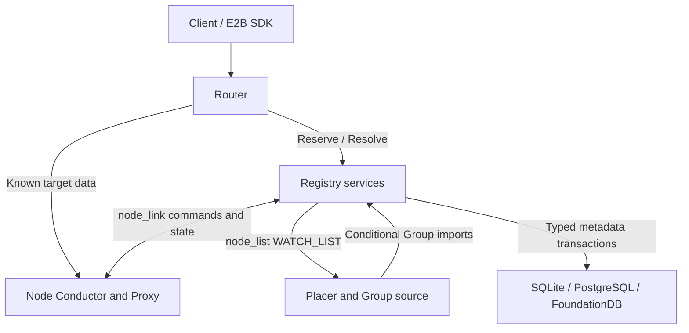
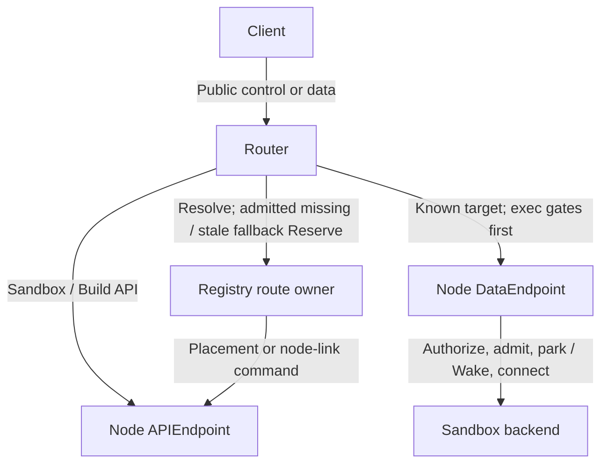

[English](cluster.md) | [简体中文](cluster_zh.md)

<a id="overview"></a>

# 集群控制

本篇按集群能力和状态所有权组织 Registry、Router 与 Placer。先使用公共入口，再定义 Group 与配置各角色；membership/state 及 link 协议为运维与实现参考，最后维护故障和恢复。节点本地 Sandbox/Build 行为仍由各能力文档维护。

`cluster-ctl` 是大规模部署的集群控制面,由三个独立角色组成:

- `registry`：维护持久执行所有权、请求鉴权、Node 选点与节点连接。
- `router`:e2b 兼容统一入口,按 sandbox-group 定位 route owner,热路径直转 node。
- `placer`（可选）：从 `node_list` 选择静态导入目标，维护完整 Group 记录和有条件 Node 更新。

Registry 通过类型化 repository 访问 SQLite、PostgreSQL 或 FoundationDB 7.3.77 持久执行元数据。SQLite 仅支持单 Registry，共享部署使用 PostgreSQL 或 FoundationDB。事务与存储恢复由所选数据库负责；Registry 保留生命周期规则、node 连接归属与命令下发。Router 和 Placer 继续使用业务协议，不引入数据库 client。

**阅读路径：** [首次集群](#minimum-cluster) · [公共入口](#client-access) · [Group 与放置](#groups-and-placement) · [角色配置](#configuration) · [状态所有权](#membership-and-state) · [Link 协议](#protocols) · [故障与恢复](#failure-and-recovery)

<a id="minimum-cluster"></a>

## 首次集群：一个 SQLite Registry、一个 Router、两个 Node

这条路径直接维护 Node Group，不需要 Placer 或 FDB 服务。单 Registry 限制控制面的可用性，不限制计算 Node 数量。先在隔离环境完成验收，再开放生产准入。

### 1. 安装同一版本并准备两个 Node

按主项目[安装指南](https://github.com/kuasar-sandbox/kuasar-sandbox/blob/main/docs/installation_zh.md)选择一个聚合版本。在控制主机安装完整原生归档，包括 `run-cluster-ctl` 启动器和私有动态库；按[部署指南](https://github.com/kuasar-sandbox/kuasar-sandbox/blob/main/docs/deployment_zh.md)或 [node-infra 集群示例](https://github.com/kuasar-sandbox/kuasar-sandbox/blob/main/docs/node-infra_zh.md#cluster-attachment)准备两个原生 Node。每个 Node 都需要可用 KVM、独立持久 Node DB/加密密钥、Conductor/Proxy/Connector、兼容的 runtime/kernel，以及相同 artifact store 或命名文件位置的访问权限。仅在 node-a 存在的本地路径不是可移植模板。执行下述 Build 前，配置真实 Runner/Builder 预算与 Builder diff template。

将下表地址替换为实际 DNS 和接口：

| 角色 | 私有地址 | 配置 |
|---|---|---|
| Registry | `registry-1.example:7700` | `/etc/cluster-ctl/registry.yaml` |
| Router | 公共 `api.sandboxes.example.com` 与 `*.sandboxes.example.com` | `/etc/cluster-ctl/router.yaml` |
| node-a | API `node-a.example:3000`，data `node-a.example:3001` | 该 Node 的 Conductor 和 Proxy 配置 |
| node-b | API `node-b.example:3000`，data `node-b.example:3001` | 独立 Node 身份、状态和密钥 |

为 Registry 链路准备私有 CA 和各角色的客户端/服务端证书。Router 公共证书覆盖 API 与 sandbox 域名。Router 到 Node 的 API/data 是两个独立的私网明文 listener，只允许可信基础设施访问。

### 2. 配置并启动 Registry 和 Router

以下完整单成员 Registry 配置显式选择 SQLite：

```yaml
member:
  id: registry-1
  listen: ':7700'
  tls: {cert: /etc/cluster-ctl/tls/registry.pem, key: /etc/cluster-ctl/tls/registry.key, ca: /etc/cluster-ctl/tls/ca.pem}
membership:
  active: 1
  versions:
    - version: 1
      members:
        - {id: registry-1, advertise: 'https://registry-1.example:7700', node_advertise: 'registry-1.example:7700'}
  owners: {route_link: 1, node_link: 1, placer_link: 1, node_list: 1}
storage:
  backend: sqlite
  namespace: first-cluster/records-v2/
  sqlite_path: /var/lib/cluster-ctl/metadata.sqlite
```

创建持久目录 `/var/lib/cluster-ctl`，仅允许 Registry 服务用户访问；不能对同一文件运行第二个 Registry。Router 配置如下：

```yaml
domain: sandboxes.example.com
registry:
  bootstrap: registry-1.example:7700
  tls: {cert: /etc/cluster-ctl/tls/router-client.pem, key: /etc/cluster-ctl/tls/router-client.key, ca: /etc/cluster-ctl/tls/ca.pem}
ingress:
  listen: ':443'
  tls: {cert: /etc/cluster-ctl/tls/public.pem, key: /etc/cluster-ctl/tls/public.key}
auth:
  data_plane: enforce
```

分别执行 `run-cluster-ctl config ROLE --config FILE` 校验。安装交付的 `cluster-registry.service` 和 `cluster-router.service`，执行 `systemctl daemon-reload` 与 `systemctl start cluster-registry cluster-router`。这些 unit 使用 `/usr/bin` 中的程序，安装前缀不同时应对应调整 unit；其他 supervisor 使用相同角色命令。Router 开始监听尚不能证明 Node 可接纳工作。

### 3. 接入两个 Node 并创建 Group

在 node-a 的 Conductor 配置添加以下内容；node-b 使用自己的 ID、地址、证书，并将 `labels.node` 改为 `node-b`。Proxy 的 `data_listen` 配为 `node-a.example:3001`（bind 可使用实际本地接口地址）。

```yaml
api:
  domain: sandboxes.example.com
  listen: ':3000'
cluster:
  node_id: node-a
  node_link:
    endpoint: registry-1.example:7700
    tls: {cert: /etc/node-ctl/tls/node.pem, key: /etc/node-ctl/tls/node.key, ca: /etc/node-ctl/tls/ca.pem}
  api_endpoint: node-a.example:3000
  data_endpoint: node-a.example:3001
  labels: {pool: first-cluster, node: node-a}
```

执行 `node-ctl config conductor --config FILE` 和 `node-ctl config proxy --config FILE` 校验，再通过所选部署的正常 unit 启动每个 Node 的 Conductor/Proxy。node-infra 使用原生 overlay 路径与 `node-conductor.service`，不是 `node-ctl.service`。

在可信管理 shell 中生成**一对**租户根凭据，通过既有秘密管理方式保存并供两个 Node 的本地管理员使用。不要在每个 Node 分别生成不同凭据。

```sh
export MANIFEST_KEY=$(e2b-key-ctl gen-key)
export API_SECRET=$(e2b-key-ctl derive-api-secret)
export E2B_API_KEY=$(e2b-key-ctl gen-apikey)
```

在**每个 Node** 的管理环境提供同一组值，再通过本地 admin socket 执行：

```sh
umask 077
node-ctl manifest-key add --socket /run/sandbox/node-ctl.socket --label first-cluster
cat >first-cluster.json <<'JSON'
{"group":"first-cluster","expected_version":0,"context":{"target_port":49983}}
JSON
node-ctl group apply --socket /run/sandbox/node-ctl.socket -f first-cluster.json
```

保留每次 apply 返回的 `version`。零表示仅创建；已有 Group 应先读取，再明确按其 revision 做 CAS 更新，不能反复提交零。`group apply` 不安装根密钥；安装由本地 admin socket 完成，业务 Group 操作用 `E2B_API_KEY` 鉴权。应用客户端仅接收 API key，不接收任一根密钥或 Node 加密密钥。

### 4. 核验发布、Build 真实模板并设置默认值

在可信控制主机通过 Registry 检查**每个 Node**：

```sh
run-cluster-ctl status --registry https://registry-1.example:7700 \
  --ca /etc/cluster-ctl/tls/ca.pem \
  --cert /etc/cluster-ctl/tls/operator.pem --key /etc/cluster-ctl/tls/operator.key \
  --group first-cluster --node-id node-a
```

要求 `storage_readable:true`、`published:true`，`group_version` 等于本地 apply 返回 revision，且 `registration` 包含当前 Node ID、link owner 和 fence；对 node-b 重复检查。在设置默认模板前，默认 Create 的 `default_template_missing` 是预期结果，不妨碍 Build。单独成功调用 `/verify-key` 不能证明上述发布已经完成。重连或更新后，重新关联当前本地 revision 与 registration，不能用 Create 重试掩盖发布未完成。

在 SDK/Build 客户端Build 或应用需要出站访问时，先为两个 Node 配置可达的 egress gateway 与 DNS，
按[网络与 egress](sandbox-lifecycle_zh.md#network-and-egress)设置 `KUASAR_NETWORK_JSON`。
Gateway、Area 和返回路由须同时适用于两个 Node；E/S 模板保留逻辑网络，复制
artifact 不会部署或改写目标网络。首次流程使用一个共同可达的 egress 路径；
每 Node 独立 gateway 需要按 [Group 输入优先级](#groups-and-placement)明确配置请求或 Group。

设置 `E2B_API_URL=https://api.sandboxes.example.com`、`E2B_DOMAIN=sandboxes.example.com`、`KUASAR_GROUP=first-cluster`、`BUILD_KIND=sbx`。按[首个应用示例](https://github.com/kuasar-sandbox/kuasar-sandbox/blob/main/docs/templates_zh.md#first-application)准备按 digest 固定的 `APP_IMAGE`，执行完整 [Build HTTP 示例](node-build_zh.md#client-workflow)。设置 `KUASAR_GROUP` 后，该示例会在经 Router 的注册、触发和状态请求上均携带 Group 头。等待这个确切 Build 的 `ready` 结果，将其 canonical `e2b-sbx-...` TemplateID 在两个 Node 管理会话和 SDK 客户端中导出为 `TEMPLATE_ID`；transient ID 或示意字符串不是可运行模板。

在每个 Node 更新 Group 文件，填入 canonical template，保留 `target_port:49983`，并将 `expected_version` 设为该 Node 实际读取的 revision。例如该 revision 为 1 时：

```sh
python3 - <<'PY_GROUP'
import json, os
with open('first-cluster.json', 'w') as f:
    json.dump({'group': 'first-cluster', 'expected_version': 1,
               'context': {'templateID': os.environ['TEMPLATE_ID'], 'target_port': 49983}}, f)
PY_GROUP
node-ctl group apply --socket /run/sandbox/node-ctl.socket -f first-cluster.json
```

再次核验每个新返回 revision 的发布，此时要求 `eligible:true`；为 false 时检查固定 reason。只读状态是某一时刻的观测，不是容量预留；真实请求仍由 Node 对资源与 artifact 做最终准入。

### 5. 验证 SDK 并保留恢复输入

使用相同 Group/API key 和 canonical TemplateID 执行下方[客户端验收示例](#client-onboarding)，经 Router 完成 Create、exec、files、pause、connect、delete。分别设置 `KUASAR_NODE=node-a` 和 `KUASAR_NODE=node-b` 各运行一次，覆盖两个 Node。可选 Placement 头使用上面显式配置的 `node` label；Node ID 不会自动成为 label。

按各自保留规则保存 Registry 元数据、每个 Node 自己的 DB/加密密钥、租户根凭据、Group 输入及 artifact 闭包。需要共享控制面时，再按[元数据存储](cluster-storage_zh.md)将 SQLite 改为受支持的 PostgreSQL/FDB 后端并配置多个 Registry member。切换后端不会迁移执行状态，切换前必须遵循该指南的明确重建/恢复边界。需要源导入与自动凭据续期时再添加 [Placer](#placer-configuration)。这两步都不是初始双 Node 集群的前提。

<a id="client-access"></a>

## 公共入口与身份

集群公共 Create 和 Build 注册拒绝单机 `kuasar-sandbox.identity` / `X-Kuasar-Sandbox-Identity` 扩展，身份分配权仍属于 Registry。参见[创建时指定沙箱身份](sandbox-lifecycle_zh.md#create-identity)。

`cluster-ctl router` 是 cluster 的北向入口,同时承载 e2b 控制面和数据面。它不持路由权威,
不订阅 route 或 node_list;它通过 group 定位 route owner.显式 create/connect/exec-session 调用对应
Reserve operation;数据面 cache miss 先 Resolve.RouteResolve 同时返回 `APIEndpoint` 与
`DataEndpoint`,用途固定.只要 route 已有 `NodeSandboxID + DataEndpoint`,
普通数据面即使 paused/starting 也直接连接最终 node proxy,由 node 负责鉴权后的 parking、Wake
和 backend 建连.Exec CONNECT 是例外:Router 在 public 200 后先读取并授权首个 ctl frame,
通过后才连接最终 node.`Reserve(operation=data)` 只保留为 request admission 之后的 target
缺失、Raw 发送前的 typed stale 或普通数据面的兼容 fallback。

<a id="client-onboarding"></a>

### 最小集群客户端验收

先完成[首次集群配置](#minimum-cluster)，或使用已由 Node 直接维护、可选 Placer 导入的 Group。以下是单 Group 客户端验收路径，不是 HA 参考配置。

1. 注册具有匹配 runtime/kernel、工件访问和目标 selector label 的合格节点，确认
   node-link full sync 及该 Group 的完整 GroupSupport 发布。使用精确 ready Build 发布的真实 canonical `e2b-img/sbx/snp-...` ID。通过 Node admin socket 或受信 importer 安装完整根凭据对；只给客户端该 APISecret 签发的 API key。
2. SDK 命令/文件测试使用 Group 示例 `target_port=49983`，明确仅限 envd。
   如需测试其他应用端口，使用无固定端口约束的 group 或为该端口配置 group；
   49983 不代表所有服务。
3. 配置公共 Router TLS、`api.<domain>` 及 sandbox host DNS/证书，使用
   `auth.data_plane: enforce`。Registry TLS 独立。当前 Router→Node 的
   APIEndpoint/DataEndpoint 必须为可达的**内部明文** listener，分别指向
   Conductor/Proxy，并用私有网络访问控制保护。公共 HTTPS 不加密此跳；不能
   把 TLS-only 节点 listener 当作明文 endpoint。
4. 设置精确 Group 名 `KUASAR_GROUP`、可用 `TEMPLATE_ID`，复用 API URL/key/
   domain/CA。项目固定 **e2b==2.25.1**，Create 及后续控制/数据请求传同一
   Group 和调用方选择的 route key：

```python
import json, os, uuid
from e2b import Sandbox

if not __debug__:
    raise RuntimeError("Run this recipe without Python optimization (-O/-OO or PYTHONOPTIMIZE).")

headers = {
    "X-Kuasar-Sandbox-Group": os.environ["KUASAR_GROUP"],
    "X-Kuasar-Route-Key": str(uuid.uuid4()),
}
if os.environ.get("KUASAR_NODE"):
    headers["X-Kuasar-Sandbox-Placement"] = json.dumps({
        "node_selectors": [{"node": os.environ["KUASAR_NODE"]}]})
options = dict(api_url=os.environ["E2B_API_URL"],
               api_key=os.environ["E2B_API_KEY"],
               domain=os.environ["E2B_DOMAIN"], headers=headers)
sandbox = Sandbox.create(os.environ["TEMPLATE_ID"], timeout=300, **options)
sid = sandbox.sandbox_id
print("Retain group, route key, stable SID:", headers, sid)
try:
    assert sandbox.commands.run("printf cluster-ok").stdout == "cluster-ok"
    sandbox.files.write("/tmp/cluster-proof", "cluster-state")
    sandbox.pause()
    sandbox = Sandbox.connect(sid, **options)
    assert sandbox.files.read("/tmp/cluster-proof") == "cluster-state"
finally:
    sandbox.kill()
```

SDK `ConnectionConfig.sandbox_headers` 将自定义头合入 envd 请求，命令/文件
客户端使用该配置。重连创建新客户端，须再次传 `options`。主动选择 route key
可避免依赖 SDK 暴露 Router 额外的 `routeKey` 返回字段。应用若跨进程运行，
持久保存 `(group, route key, stable SID)`。头传递已对照 2.25.1 源码，不能
推广到所有 SDK 版本。SDK 不创建 group、不签发根密钥、不恢复 Registry 状态，
也不会为浏览器访问 `get_host(port)` 自动注入这些头。

应用端口请求须由应用/网关传递 Group、route key、stable sandbox identity、
目标端口及对应 scoped forward token（[寻址](#router-addressing)–[控制面](#router-control-plane)）；不得把租户 API key 泄露给
Guest。分别验证 SDK 命令/文件与应用端口的认证请求。在隔离验收 group 内检查
缺少 Group、错误凭据及未授权目标均失败，且不会激活其他沙箱。Create 省略
route key 时可获得新生成的 key；缺少 route key 的拒绝应在需要现有 route 的
后续操作（如 connect、pause、数据请求）上验证。检查
节点 endpoint 选择，证明控制和数据使用各自 listener。

成功标准是真实 create、命令/文件往返、pause/resume、kill；Registry stub 测试
不能证明 VM 路径。NoNode 时查当前 Group 发布、selector、健康/容量和工件；控制成功
而数据失败时查头、target_port、DNS/TLS、Proxy 内部入口。身份不符立即停止。
只 kill 测试所属实例；移除输入文件不是实例清理，也不会立即撤销已绑定行
的凭据。共享模板/密钥应保留至保留策略允许删除。

dead/deleting Sandbox 保留管理定位。按 ID 查询、Reset、checkpoint 导出/删除及父对象 Delete 使用节点 APIEndpoint 与既有归属校验，不提供业务 DataEndpoint。仍占用的 group/route_key 在父对象最终删除前拒绝 Create。节点与集群 Create 同样保留 autoReset（默认 false）；Reset 成功不启动 VM。

Create 的可空 `idleTimeout` 沿 route-link reserve、Registry 持久化记录、node-link
create 和有效路由/列表视图完整传递；0 保留为立即启用策略。Pause 仍经 HTTP 转发，
`ifIdleSince` 原样到达最终 Conductor，由该节点接收时钟校验，不新增 node-link Pause。

<a id="router-addressing"></a>

### 寻址

| 请求 | 必需身份 | 行为 |
|---|---|---|
| create | group + route_key(可缺省生成) | 提取并校验 resource patch 及本次请求的 restore/credentials/checkpoint,定位 route owner 后随 `ReserveSandbox` 传递 |
| kill | group + route_key + sandbox_id | 定位 route owner 后由 registry 经 node-link 下发 `CmdDelete` |
| connect | group + route_key + stable sandbox_id | 调用 `operation=connect` Reserve;registry 经 node-link 下发 CmdConnect,不 Resolve 或转发 node HTTP `/connect` |
| exec session | group + route_key + stable sandbox_id | 调用 `operation=exec-session` Reserve;Registry 验证 API key,经 node-link 下发 CmdExecSession,只对外返回 ExecAccessToken |
| get/stats/pause/timeout/export | group + route_key + stable sandbox_id | route owner 解析当前 NodeSandboxID 与 APIEndpoint,Router 重写路径后转发到 node conductor;stats body 无 SID,无需响应身份适配;APIEndpoint 缺失时 fail closed |
| list/get | group | 有界分页读取 group 分片；单个 sandbox 的查询另需上表中的完整身份 |
| data plane | group + route_key + stable sandbox_id + target | 已知 NodeSandboxID/DataEndpoint 即直接建立一次性 node CONNECT,包括 paused/starting;target 缺失或 typed stale 才 fallback `operation=data`;miss 先 Resolve |
| build register | group + build_id | 规范化 body/Builder header 为 Build.Resources,独立解析目标 Sandbox ResourcePatch,再调用 `ReserveBuild`;选中节点执行最终 registration admission |
| build cancel | group + build_id | 每次重新 ResolveBuild, 按当前 APIEndpoint 转发; 不重选节点 |
| build trigger/status/files | group + build_id | ResolveBuild 返回 APIEndpoint;缓存并转发到 node conductor,缺失时不回退 DataEndpoint |
| build delete | group + transient TemplateID | 在既有投影定位原节点 APIEndpoint, 原样转发 Query/Header, 节点最终鉴权和执行 |

`route_key` 是 group 内 route 定位键,`sandbox_id` 是稳定公开身份。Registry 在首次 create 时生成
SandboxID;同节点 resume、跨节点迁移和 re-place 不改变它。受保护 route 另携当前
`node_sandbox_id=<sandbox_id>-g<N>`。Router 使用稳定 SandboxID 寻址,只在 node 边界替换为
NodeSandboxID;公开响应不暴露 NodeSandboxID。

受保护 route 中的 `stable_id` 是同一 sandbox 跨 NodeSandboxID 变化保持的 StableID；cluster
始终要求 `StableID == SandboxID`。Router 保留该字段作为现有 credential projection，并用它
校验 KAT `sid`，但 cache/route lookup 仍使用 `(group, route_key, SandboxID)`，不会把 StableID
当作 node-local lookup key 或建立唯一索引。

create 可在 body metadata 中携 `kuasar-sandbox.resource`、traffic、restore、credentials 与 checkpoint。
`X-Kuasar-Sandbox-Resource` 与 `X-Kuasar-Sandbox-Traffic` 只覆盖各自 patch 中明确出现的 leaf；resource 的公开面严格限制为
capacity/allocatable/startup，并与 group defaults 使用同一 merge helper；traffic 使用共享的 max-inflight patch 校验与叶子合并。restore/credentials
Header 覆盖同名完整 object,checkpoint Header 按字段覆盖。router 始终解析并严格校验 body,
所以合法 Header 不能隐藏非法低优先级 resource/traffic/checkpoint。未提供 restore、`{}` 与显式
`off` 均为关闭;只有本次 create 显式提供 `memory` 才启用。create body 上限为 16 MiB,
超限返回 **413**。

Create 的 `checkpoint.max_checkpoints` 仅能放在 `X-Kuasar-Sandbox-Checkpoint` 或
`metadata["kuasar-sandbox.checkpoint"]` 内；旧的顶层 body 字段返回 400。配额允许正整数或 null，
未指定时取 1，并与快照缺省一样按 Header 非 null 字段覆盖 metadata。Router 把配额提取到既有的
内部 Reserve typed 字段，转发的 checkpoint config 只保留 `merge_ref`/`drop_caches`。
已接纳配额在 Reserve 重试和 replacement 间保持不变（[Checkpoint policy 输入](sandbox-lifecycle_zh.md#request-checkpoint)）。

Router 按 [Registry Reserve 协议](#reserve) 为共同的 `POST /route-link/v2/reserve` 端点组装请求，传递对应操作的已认证上下文并保留期望的稳定身份。Create 在准入前严格归一化；Connect 保留可选 memory 选择及其缺省状态；exec-session 先严格解析公共 TTL/conditions 再转换为 Registry typed request；Data 使用既有 access-token/service/port 上下文。

精确 query/Header/body schema 由 Registry 规范唯一维护，并在其边界重复校验。Conditions 不借无关 metadata、query 参数或配置 Header 传递；本篇只定义转换边界，不再维护一份可能失步的 schema 表。

connect/exec-session/data 中的 `sid` 均是客户期望的稳定 SandboxID,用于防止 route_key 被删除重建后请求
跨越 lineage。

#### Sandbox 列表分页

**兼容性变更：** cluster `GET /v2/sandboxes`（及 `/sandboxes` 别名）默认返回一页，
不再一次返回整个 group。响应保持原有 JSON 数组与 item 字段。需要完整列表的客户端
必须读取 `x-next-token` 响应头，并作为下一次请求的 `nextToken` 继续，直到该响应头
消失；只要响应头仍存在，短页或空数组都不表示结束。

`limit` 默认 100，允许 1 至 1,000 的整数。它限制每次请求检查的 route 记录数，
之后再做逐对象鉴权与状态过滤，因此可见结果可能少于 limit。Registry 每个存储事务
最多读取 128 条。省略 `state` 时选择 `ready`、`pausing`、`paused`；显式过滤还支持
`reserved`、`dead`、`deleting`，`running` 是现有 cluster `ready` 投影的别名，
响应中的状态值保持不变。非法 limit、未知 state、重复分页参数及非法续读 token
返回 400。Node 的 `starting` 报告未保存为独立 cluster route 状态，不支持该过滤值。

一次遍历应保持相同 group、state 和 API token；改变任一项须去掉 `nextToken`
重新开始。每页重新验证 API token，每个返回对象仍校验完整 MAC。公开游标使用
server-only namespace key 和 XChaCha20-Poly1305 加密并认证，空页的游标不会暴露
被过滤的其他 root 的 `route_key`。该保护隐藏对象名称，不隐藏页数、空页和 token
长度。同一 metadata namespace 的 Registry peer 或重启进程可以继续读取。分页不
提供跨请求快照；并发创建、删除及状态变化可能改变遍历时看到的集合。

只有已鉴权的列表需要续读时，namespace 才原子初始化一个随机 32-byte 游标加密 key。
Registry 仅缓存成功读取的 key，不为每页写入持久 cursor session。该不可变记录应随
namespace 一起进入一致数据库备份，并随元数据恢复；恢复后按既有恢复合同重启缓存
消费者。新 namespace 会有不同 key，旧游标须丢弃。损坏或已有删除历史的 key
fail closed，不能静默重建。当前无公开删除或轮换 API，未来轮换协议须明确旧游标
版本的接受边界。

<a id="router-control-plane"></a>

### 控制面

API key 鉴权不可关闭。每次控制请求将原始 key 交给 Registry，在生命周期副作用前校验完整 MAC。新准入使用已发布 Group 支持；已有对象使用保留的凭据绑定。控制操作和 Build 后续请求都按具体对象重新鉴权。新建/导入命令将 key 和 expected Group version 交给 Node 准入，key 不进入持久记录、ACK 或日志。ManifestKey 只用于内容路径。

| 操作 | 行为 |
|---|---|
| create | 调用 `operation=create` Reserve,传递 leaf-merged resource 与请求级 restore/credentials/checkpoint;credentials 在写普通 metadata 前分离 |
| kill | route owner 精确匹配 group + route_key + sandbox_id,经 node-link 下发 `CmdDelete` |
| connect | 调用 `operation=connect` Reserve;Registry 对当前 NodeSandboxID 下发 CmdConnect,验证 typed ConnectResult 后返回;Router 不 Resolve,不二次转发 node HTTP `/connect` |
| exec session | 严格解析 64 KiB body,调用 `operation=exec-session` Reserve;Registry 验证原始 API key 并下发 CmdExecSession;Router 只投影 ExecAccessToken |
| get/pause/timeout/export | Resolve 当前 route,只使用 APIEndpoint,把公开 SandboxID 路径替换为 NodeSandboxID 后转发;typed get 响应重写回稳定 SandboxID |
| get/list | 读 group route_link |
| build register | 生成稳定 build_id/template_id,严格合并 register resource body/Header/E2B capacity leaf 后调 ReserveBuild;node 在保存 build 前再次校验 |
| build cancel | 每次按 group+build_id 重新 ResolveBuild, 使用当前原节点 APIEndpoint 转发, 不使用旧缓存 |
| build trigger/status/files | 按 group+build_id 定位 node,只缓存和使用 BuildReserveResult.APIEndpoint 后转发 |
| build delete | 仅 transient TemplateID; 从既有投影定位原节点, 原样转发 Query/Header |

DELETE `/templates/{transientID}?cancel=true` 与 `X-Kuasar-Sandbox-Builder: {"cancel":true}` 共用节点动作 parser. 两种输入分别严格校验. Header.cancel 显式值 > Query.cancel > false; `{}` 保留 Query, 显式 false 覆盖 true. Router 不将它解析为注册 BuildOptions. 查询失败或归属不完整返回 503; 节点不可达返回 502, 不能当作删除成功或猜测 404. DELETE 202 保留节点的相对 Status Location; 节点最终硬删除才代表完成. 详见 [Build 动作](node-build_zh.md#cancel-and-delete-a-build-record).

Sandbox control,Build follow-up 与 ordinary data/CONNECT/native exec 使用不同的 node endpoint.
control/build 缺少 APIEndpoint 时不回退 DataEndpoint;data/exec 缺少 DataEndpoint 时不回退
APIEndpoint.

connect 的 Node Ack 只投影 NodeSandboxID、TemplateID、Profile 和 Envd/Traffic/ForwardAccessToken;不返回
root 凭据或 fingerprint。Router 校验 Ack 与受保护 Route 一致,再组装仅包含稳定 SandboxID 和
profile 对应公开 token 的 e2b 响应。node 已同步完成校验、可选迁移导入、deadline 持久化和
凭据读取;resume 在 Ack 后异步进行。

Exec session 的 public endpoint 是 `POST /sandboxes/{stableSandboxID}/exec-sessions`.请求必须携
group,route-key 和原始 `X-API-KEY`,可选 `X-Kuasar-Migration-Token`.body 只允许空、
`{}` 或严格的 `ttlSeconds` + `conditions:[{"expr":"..."}]`;完整原始 body(含尾随空白)
上限 64 KiB.条件缺失与 `[]` 都是 unrestricted 并规范化为 nil;显式 `null`、unknown/duplicate
字段、空 expr、第二个 JSON value、负数或 TTL/condition bounds 溢出返回 400.

Router 将 API key 送到 Registry verifier,但不把它写入 command;CmdExecSession 明确携
APISecretFingerprint、expected Profile、TTLSeconds、ExecConditions 和可选
MigrationToken/cluster context.Node 是唯一 signer,在任何 activation mutation 前权威编译
conditions并签名,在 Ack 中只返回 `ExecSessionResult`,然后按既有 eager 合同异步 resume.
Conditions 不进入 Route/record/event/metadata/log;#240 的 deferred activation 仍是独立工作.
Registry 把该 result 与当前 stable lineage 的 Route 汇合;Router 验证两者一致后返回:

```http
HTTP/1.1 201 Created
Cache-Control: no-store
Content-Type: application/json

{"execAccessToken":"kat1..."}
```

响应不包含 session ID,exp,NodeSandboxID,ServiceSecret 或 route.运行时失败返回固定
脱敏错误,不原样转发 node Ack reason 或内部路径.异步 resume 在 Ack 后失败不回溯
修改已返回 token,后续连接按当前 route/state 失败.

<a id="router-data-plane"></a>

### 数据面

Router 先分离普通 legacy target 和 native exec 逻辑服务:

- 普通 HTTP 只使用 Host/`E2b-Sandbox-Id + E2b-Sandbox-Port` 的 legacy port;
  除精确值 `exec` 外，不解释 `E2b-Sandbox-Service`，该 Header 作为应用层 Header 在内层请求中保留。
  非 CONNECT 请求选择 `exec` 时，在 route lookup 或 activation 前返回 **405** 与 `Allow: CONNECT`。
- 未携 service 的 CONNECT 同样使用 legacy raw port.
- `E2b-Sandbox-Service: exec` 是已接入的 portless CONNECT target,可与 port 并存,
  但 port 不参与 backend 选择.
- `forward|e2b:envd|e2b:code-interpreter` 的完整 cluster service-aware 转发合同由
  [#63](https://github.com/kuasar-sandbox/orchestrator/issues/63) 跟踪.当前 cluster 入口不将这三个
  Header 值描述为已支持的 backend selector;最终 Node 依其本地受信 profile 选择 backend.

Legacy sid-host 数据面路径先校验凭证:

- e2b profile 的 49983/49999 端口必须带 `X-Access-Token: <envd_access_token>`。
- e2b 其它端口与 bare 的所有端口必须带
  `X-Access-Token: <forward_access_token>`.bare 的 49983/49999 也是普通 TCP forward,
  不是 501 控制端口.
- `traffic_access_token` 供外部网关及 e2b 数据面组件使用,cluster router 不消费。
- envd 预签名文件 URL 可不带 token,但仅限 `port=49983`、`GET/POST /files`、非空 `signature` query。
- 同一请求若带了非空但错误的 `X-Access-Token`,不回退到 signature。

普通 token 请求转发时复用客户端提供的 `X-Access-Token`:

```text
CONNECT sandbox:<port> HTTP/1.1
E2b-Sandbox-Id: <node_sandbox_id>
E2b-Sandbox-Port: <port>
X-Access-Token: <client X-Access-Token>
```

客户请求的 Host/路径使用稳定 SandboxID.Router 向 node proxy 建立外层 CONNECT 时使用当前
NodeSandboxID;普通 HTTP 的内层 Host 也改为 `<port>-<node_sandbox_id>.<domain>`。内层请求已有
`E2b-Sandbox-Id` 时把值替换为 NodeSandboxID,保留该 Header 供用户应用感知当前 node-local ID。

对于不带 token 的 envd `/files` signature 请求,router 先使用受保护 route 中的 `EnvdAccessToken` 验签。
该校验发生在任何 node CONNECT 或 Reserve/激活之前;验签失败直接返回 401,不得唤醒 sandbox。
验证通过后,router 仅在到 node proxy 的外层 CONNECT 携带该 `EnvdAccessToken`,由 node proxy 完成最后一跳
鉴权;隧道内 HTTP 请求保持原样且不注入 `X-Access-Token`,让 envd 使用原 URL 中的 signature 再次验证。
普通 token 请求在外层 CONNECT 和隧道内 HTTP 请求中都保留客户端原始 `X-Access-Token`。

Router 完成本地鉴权后,若 route 已有 `NodeSandboxID + DataEndpoint`,不再按 state 在 Registry
等待 READY:paused/starting 与 ready 一样立即建立一次性 node CONNECT。最终 node proxy 按
`LookupRoute → authorize → BeginParking → ActivateRoute/Wake → fresh Route → dial` 处理等待,
所以获准请求的 parking 只在最终 node 统计,cluster router/Registry 不重复计数。普通请求在
Router 的 `enforce` 模式下,无效 token 在 node CONNECT/Reserve 前失败。Router 的文件 signature
校验及 `/files` 显式 token 校验在所有 Router 模式下均强制执行,exec 也始终 enforce。
普通请求的 Router `log` 模式记录本地 token 不匹配后继续,`off` 跳过该本地 token 检查。
最终 node proxy 独立应用自身的有效鉴权策略:要阻止无效普通凭据触发 Wake/Resume/parking/backend
dial,必须让 node proxy 保持 `enforce`。如果目标 node 也使用 `log` 或 `off`,它就可能接纳该
请求并激活后端。Router 配置不会覆盖 node 的策略。

只有 target 缺失时才先调用 `operation=data` fallback。普通请求把客户 token 传给 Registry;
签名 `/files` 把已用于验签的受保护 EnvdAccessToken 传给 Registry。若已知 node 在接受内层
请求前返回 typed `not_found`/`unauthorized`,Router 淘汰该 node-local target,调用同一
ReserveData 让 Registry 对当前 lineage 复验 credential、取得 fresh route,然后只重试一次。
fallback 返回不同 stable identity 或仍无完整 target 时 fail closed。`auth.data_plane=off` 只
跳过 Router 对普通请求的本地 token 闸门;带显式错误 token 的 `/files` 在任何模式下都不回退
signature。

Exec CONNECT 使用单独的三阶段 KAT + request admission 合同:

```text
client CONNECT
  stable SandboxID + service=exec + X-Access-Token=KAT
    ↓ side-effect-free cache/Resolve
Router verifies StableID + ServiceSecret, then compiles CEL
    ↓ flush public 200; read strict first ctl frame; recheck expiry; evaluate
    ↓ admission passed (no node/Reserve before this point)
node CONNECT
  current NodeSandboxID + service=exec + optional original port + same KAT
    ↓ node independently verifies KAT + CEL and reads/evaluates first frame
    ↓ parking → ActivateExec/Wake → ctl.sock; Raw written exactly once

missing/stale target, only after public request admission and before Raw send:
  Reserve(operation=data, same KAT + service=exec)
    ↓ Registry re-verifies and returns fresh current Route
  retry one node CONNECT
```

Exec 始终 enforce,不受 `auth.data_plane=off|log|enforce` 影响.EnvdAccessToken,
ForwardAccessToken 或 TrafficAccessToken 不能代替 exec KAT.KAT 缺失,过期,签名错误,
SID/audience 错误时在 public 200 前返回 401,且不能触发 Router Reserve、node CONNECT、
Registry CmdConnect、Node parking 或 resume.ExecRequest/condition 在 200 后失败时返回统一
`{"type":"error","msg":"exec request rejected"}`,同样无这些副作用.已有 node target 的
paused/starting 路径不增加 Registry 调用.Router 和 Node 都执行完整 gate,纯 transport relay
不解析 token/CEL/ExecRequest.只有 missing/stale fallback 由 Registry 复验;Reserve 后 Router
必须重验 stable lineage/credential 并使用 current NodeSandboxID,不能复用旧 target.

Router 在 public 200 后先执行首帧 gate,通过后才建立下一跳;最终 Node 从本地 route 再次校验
`StableID + ServiceSecret`,回复 node CONNECT 200 后再次执行首帧 gate,通过后才 parking、
activation 和连接 `<run_root>/sandboxes/<NodeSandboxID>/ctl.sock`.Router 不拨 `ctl.sock`.

KAT 绑定 StableID，不绑定 NodeSandboxID 或其 generation。因此，同一 lineage 的 resume、migration 或 replacement 本身不要求重新签发 token；有效期、claims 和当前凭据校验仍然适用。每次新的 node CONNECT 都使用当前 NodeSandboxID。

最终 Node Proxy 的 ordinary HTTP/non-exec CONNECT 达到 per-Sandbox 上限时返回
`429` + `X-Kuasar-Proxy-Error: max_inflight_reached`。Router 原样透传 status、header 和
fixed body;该 typed response 不是 stale route,不淘汰 cache、不调用 Reserve、不换 node 重试。
Router 不实现第二套 limiter,因此限制仍由目标 Proxy 对同一 Sandbox 的全部 worker 统一执行,
而不是 cluster-wide 或 per-Router capacity。native exec 的 admission 位于 Node 的 CONNECT 200
与 CEL/首帧校验之后;达到上限时 Node 写已有 generic ctl error 并关闭,Router 只透明中继该 frame,
不会合成 HTTP 429。

CONNECT 长连接使用同一 route resolution,但 tunnel 自身不复用。连接断开后保留 route cache 至 idle/TTL
或 fail-fast 失效.Router→Node CONNECT 的 response reader 已预读字节会随 tunnel 保留;
中继在单向 EOF 时只传播 half-close,等待另一方向的 `exec_ack`,stdout/stderr 和 exit status
完整结束,不在首个 `io.Copy` 返回时截断 tunnel.Raw 尚未写给任何 node 前允许一次 typed stale
retry;Raw 一旦写入 node 后禁止 retry/reroute/replay,node ctl error 透明转发,不合成第二个 error.

<a id="public-sandbox-identity"></a>

### 身份

- route 定位键:`(group, route_key)`。
- 稳定公开身份:`sandbox_id`。Registry 在首次 create 时生成,同节点 resume、跨节点迁移和
  re-place 均不改变;公开 API、Host 和 router cache key 使用该 ID。
- 稳定 sandbox 身份:`stable_id`。cluster invariant 固定为 `stable_id == sandbox_id`；它在
  NodeSandboxID 变化时保持不变，并绑定 ServiceSecret 与 KAT `sid`。该重复投影为现有受保护
  credential state，本次不去重。StableID 不是 node-local lookup key，也不增加唯一索引；
  身份保持型 migration/copy 可以让多个 node-local sandbox 共享同一 StableID。
- Registry durable JSON state 直接使用 `stable_id`，不保留旧字段 fallback；pre-release
  部署必须清理并重建旧 preview state。
- 节点执行身份:`node_sandbox_id = <sandbox_id>-g<sandbox_generation>`。首个候选为 g0;候选
  冲突/失败或跨节点迁移消费下一个 generation,同节点 resume 保持当前 NodeSandboxID。
  NodeSandboxID 是不透明的 node-local ID,权威映射在 Registry 归属表,组件不从字符串反向解析。
- node 事件不携带 group/route_key/SandboxGeneration。Registry 以 `(node_id,node_sandbox_id)` 查归属表
  恢复稳定身份和 group 上下文;不存在跨 group 的 SandboxID 索引。

<a id="cluster-credentials"></a>

### 密钥与鉴权

同一 group/租户范围内有两个用途分离的根凭据域:

| 名称 | 持有者 | 用途 |
|---|---|---|
| `APISecret` | provider/placer/node/registry | 签发并验证 API key及后续用途明确的认证材料;完整 SHA-256 指纹标识凭据对 |
| `ManifestKey` | provider/placer/node | 解密 manifest/镜像/快照内容,封装 pull token;router 不接触 |

两者都是 32B / 64-lowercase-hex。APISecret 缺省时,placer 在物化 inline ManifestKey 时使用固定 KDF:

```text
APISecret = HMAC-SHA256(decodeHex(ManifestKey), "kuasar-api-secret-v1")
```

API key 只由 APISecret 签发/验证。API key 内 `SHA256(APISecret)[:12]` 仅作候选预筛;
node-link、生命周期命令和业务记录使用完整 64-hex `SHA256(APISecret)`。ManifestKey 也携带
自己的完整 64-hex SHA-256 指纹,用于校验成对交付的内容键。

导入来源可使用 inline/ref typed secret。可信 Group 维护命令解析完整凭据对，并在同一 Node 事务中安装 pair 和执行 Group CAS；公开 Group body 不携带 root。Pair 到期或轮换不会改写已有对象绑定的凭据。管理操作按具体对象保留的 root 鉴权，不改用最新 Group 默认值。

ServiceSecret 不是第三个 group root,而是每个 node Sandbox 业务记录的独立 service credential。缺省值由
该 Sandbox 已绑定的 APISecret 和 `StableID()` 以固定 domain 派生;也可由本次 create 的
`kuasar-sandbox.credentials` object 显式指定。Registry 在 route/ref/command 副作用前按 placement
Profile 校验并规范化该 object,node 再次校验、分离后把 ServiceSecret 与 Envd/Traffic/Forward token
加密写入 Sandbox 业务行。普通 metadata、guest 配置和 node-stub 观测面均不保留 credentials object。

ForwardAccessToken 和 ExecAccessToken 都使用 `kat1`,但 audience 明确分离.
ExecAccessToken 的 canonical payload 是 `v,session_id,sid,aud[,exp][,conditions]`,其中 session ID 是
UUIDv7,`sid=StableID`,`aud=exec`,不包含 `iat`；只有请求了限制条件时才携带规范化的 CEL source
string array `conditions`。ServiceSecret 解码为 32-byte key 后
直接执行 HMAC-SHA256,不增加 exec-specific 派生层.create/get/list 不返回缺省
ExecAccessToken;每个 exec-session API 调用独立签发,服务端不建 session row,revoke
或 single-use/replay 状态.

Registry 从权威 Node 事实保留受保护的对象凭据，不采纳 ManifestKey 原文或 proxy/MMDS 专用 MmdsSecret。RouteLink v2 分为控制投影（API endpoint 和公开结果 token）与数据投影（data endpoint 和 service 鉴权材料）；两者均不含 APISecret、ManifestKey 或 root 指纹。只有数据投影进入 Router 数据缓存。Create 凭据覆盖从 metadata 分离，随 RESERVED 冻结，READY 后清除。Root 不得出现在公开响应、普通列表、日志和观测接口。

<a id="groups-and-placement"></a>

## Group、provider 与放置

Node 是 Group 定义及新 Sandbox/Build 输入上下文的权威。Registry 从 Node 已发布的 Group 支持中选择节点。Placer 负责导入定义和维护有条件的 Node 更新；Create、Build 和 API-key 鉴权不再调用 Placer。

### Node Group 权威

Node HTTP/UDS API 与可信 NodeLink 命令调用同一业务实现。公开接口使用 `X-API-KEY`，完整 MAC 校验通过后才能读取私有上下文或查看版本；短指纹只作候选预筛。当前凭据对授权创建 Group，保留的 owner root 继续授权管理已有 Group 和对象。

| 操作 | Node API |
|---|---|
| 分页列举可见名称和版本 | `GET /groups?limit=128&cursor=...` |
| 读取私有上下文 | `GET /groups?group=...` |
| 创建/更新 | `PUT /groups?group=...`，body 为 `{"expected_version":0,"context":{...}}` |
| 删除 | `DELETE /groups?group=...&expected_version=...` |

Group 名称放在 query 中，名称中的 `/` 不参与 URL 路径解析。更新必须携带观察到的版本；零版本只创建从未存在的 Group。删除保留 tombstone，重建必须显式使用其已知版本。列表最多 128 条；body 和 NodeLink envelope 上限为 1 MiB，context 预算为 envelope 预留空间。未知/重复字段、非法模板、接口未定义的凭据或 placement 字段均被拒绝。

Context 可含 `templateID`、`sandbox_config`、`image_repo`、`registry_auth`、`target_port`、`project_id` 和 metadata。仓库私有凭据保留在 Node；Registry 只接收鉴权和选择所需的 Group 版本、完整 API 指纹及可选默认模板。Group 快照/增量有界、有序，并绑定原 Node 注册代次。快照未完成时不能参与选择；缓冲溢出或序列错误通过重连和完整快照恢复。

本地业务文件仅通过显式命令导入：

```sh
node-ctl group apply --socket /run/sandbox/node-ctl.socket -f /etc/sandbox/groups
```

命令从 `E2B_API_KEY` 读取凭据，经同一 UDS `/groups` 接口提交单文件或目录中按名称排序的普通 `.json` 文件。文件包含 `group`、`context` 对象和可选 `expected_version`。未给版本时只 GET 一次，再 CAS 一次；删除后的 Group 使用授权返回的 tombstone 版本。冲突直接报告，不重新读版本抢回更新。目录逐项提交，失败指出对应文件且不回滚成功项；不隐式安装根密钥，不 watch，也不按缺项 prune。

### Registry 选择和请求输入

Create 可传规范的显式 `templateID`，省略/null 则使用目标 Group 默认模板。Node 优先校验已有对象及其完整绑定；新对象在初始准入检查 Group 版本并复制输入。复制后，即使 Group 被更新或删除，该次调用仍继续使用已复制输入。默认模板 Create 合并 Node 持有的默认配置和请求覆盖；显式模板只使用请求配置。Build 使用 Node 复制的仓库及鉴权上下文，Registry 不额外维护一份默认配置来源。

可选 `X-Kuasar-Sandbox-Placement` JSON header 与 `kuasar-sandbox.placement` metadata 使用同一 schema：`{"node_selectors":[{"pool":"gpu"}]}`。对象之间为 OR，对象内条件为 AND。两个来源都要校验；header 存在时整体替代 metadata 约束，包括空对象 `{}`。约束不会持久化进 Sandbox metadata。预算为 8 KiB、32 个分支、每分支 32 项、总计 256 项，并限制键和值的长度。

Registry 有界扫描已正式发布的 Group 支持，校验完整 API-key MAC，再过滤 Node 存活、draining/zone、请求 selector、runtime 兼容性和 Build 准入容量。对不同候选采样后按负载选择；intent 事务再次检查选定 publication、原注册代次和相关 Node 条件。`placement.candidates`、`placement.zone_admit_max` 属于 Registry 配置。

有效的历史无注解 SNP 继续可用。带注解的 SNP 额外要求同一 Node 的 runtime label 同时匹配 bundle basename 和声明 digest。非法注解直接失败，不剥离注解或回退。调度不读取 artifact，也不猜测宿主默认 runtime。对于 opaque migration token，由目标 Node 解密并校验实际恢复模板；Registry 不用 Group 默认值或历史 initial template 推断其 runtime 要求。

### Runtime 目录与选点诊断

Conductor **仅在启动时**从 `sandbox.boot.runtime` 的字面父目录扫描以 `.bundle` 结尾的文件/符号链接，重建保留 runtime labels。例如 `/opt/boot/current.bundle` 指向版本目录时，扫描边界仍是 `/opt/boot`，不是符号链接目标的父目录。每个有效项必须具有合法 basename 和 Bundle 声明 digest；无效项会记录诊断并被忽略。手写的 `kuasar-sandbox.boot/` 前缀 label 会被移除，不能伪造支持能力。

将仍被快照依赖的 runtime 按其声明的精确 basename 安装到上述目录，并保持引用中的字节不可变。进程不会 watch 新文件或下载 runtime。按正常节点维护流程重启 Conductor 重新扫描，再等候新 registration/full support 发布完成。只改 label、主 runtime 符号链接目标或 Group template，不会让运行中的进程重新扫描。旧快照仍依赖的 bundle 应继续保留；默认 runtime 兼容不能证明所有 captured basename 都已通告。同一 Node 的一个 basename 只能通告一个 digest。旧新快照若记录了相同 basename 但内容不同，应保留各自兼容的 Node pool；未来捕获使用不同的不可变 basename。重命名引用或改写注解不能产生兼容性。

`run-cluster-ctl status --registry URL --group GROUP --node-id NODE` 使用 `E2B_API_KEY` 只读检查一个已认证的 Group/Node；按 Registry TLS 配置提供 `--ca`、`--cert`、`--key`。加 `--template-id TEMPLATE_ID` 可检查显式 canonical 模板而非 Group 默认值。它不执行生命周期写入，不暴露私有 Group 上下文、根凭据、指纹或 token。只有与同一当前 registration 和认证根对应的完整发布才暴露 revision/registration。旧对象保留的 key 仍可管理该对象，但不能证明当前 Group support。

| 观测 | 排查动作 |
|---|---|
| `published:false`、`support_unavailable` | 对照本地 Group revision、正确 API key、NodeLink registration 和完整发布；进程监听或 key verification 不足以证明就绪 |
| `node_unavailable` | 检查 NodeLink owner/重连与 heartbeat 证据；不能在其他 Node 重试可能已执行的 Create |
| `draining` / `zone_rejected` | 检查原生 Node drain/resource pressure，保留其准入决定 |
| `default_template_missing` | Build/发布并条件更新 Group 默认值，或检查显式 template |
| `runtime_unavailable` | 检查精确 basename/digest、目录边界及维护重启后的完整发布 |
| `eligible:true`，实际准入失败 | 检查目标 Node 的资源、artifact/network 和请求 selector；status 不预留容量 |
| Placer conflict / key expiry | 检查明确执行 `placer apply` 的逐 target 结果、source lease 日志和本地 `manifest-key list` expiry；根据观测 revision 解决冲突，不静默覆盖手工 Group 修改 |

退出码零表示已认证的观测成功；`published`、`group_version`、`eligible` 应分别检查。`storage_readable:true` 只覆盖本次元数据/鉴权读取，不认证数据库 HA 或未来写入。`eligible` 检查该 Node 对默认/显式模板 Create 的前置条件，不包含请求 selector。`registration.fence` 是不透明比较 token，不是时间或凭据。实际工作使用逐对象 status 和原生 resource 工具诊断；不要把私有 Group read 内容写入共享日志。

### 受理、恢复与交付顺序

Intent 绑定稳定逻辑 ID 和明确的 Node 本地 generation。超时、丢失 ACK、普通 400/409/429、NotFound、报告中缺失，都不能证明未执行；清理责任保留到权威对象事实或现有回收规则解决。迟到失败不能倒退新事实。只有 Node 初始准入、复制输入和 core 副作用之前产生的结构化 `GroupVersionConflict`，才可通过原注册及精确 intent 的原子检查撤销这次新投递。冲突返回调用方，Registry 不隐式重试隐藏它。不增加持久执行日志，也不承诺 exactly-once。

先发布并交付实际可用的 reader SDK、工具及二进制，再允许 producer 输出带注解的引用。RouteLink v2 分离控制和数据投影，不把不兼容的旧 peer 当成兼容客户端。部署时应先完成消费端和协议升级，再启用新 writer。

### Placer 导入与显式 apply

Placer 使用有界 `Range` 加完整 `Read` 的 source 接口。一次维护操作只读取一次完整记录，并从同一值派生 context、凭据对和静态目标。文件和嵌入式来源复用同一适配器。静态 selector 和可选 shuffle sharding 决定所有维护目标，包括 draining、热点和当前缺少 runtime 的 Node；导入不使用 P2C。空交集不能扩大成全选。

取得 source lease 后，文件来源每轮只读取并校验一次目录，所有分页和目标读取复用这份不可变快照。本轮扫描后的文件变化在下一轮生效；该快照只在本轮内保持稳定，不保证扫描文件期间的文件系统原子快照。

Ready importer 经 Registry 竞争有界、带 fence 的 source lease。页内所有项成功才以原 owner/run/term 推进 cursor；Registry 在转发命令前再次校验 lease。可信命令可在同一 Node SQLite 事务安装完整 key pair 并更新 Group；这条导入路径不向 Registry 写入独立的 desired-key 缓存。

后台导入可创建缺失的 Group 或续租未变化的上下文；定义不同则报告冲突，不静默覆盖手工修改或复活 tombstone。`cluster-ctl placer apply --config ...` 复用同一来源和适配器执行一次显式遍历：读取各目标版本，只做一次有条件更新，按目标输出冲突和部分成功结果，不输出私有上下文或密钥。

响应丢失后保留原定义、expected version 和绝对 key 到期时间。后续读到相同 context 只能证明 context 当前状态，不能证明 key 续租成功；只有对应的正向 Node ACK 才确认续租。未知写使用原条件重试；版本已变化则报告冲突，不自动重选版本。内存缓存有上限，可淘汰已确认的优化项，不能为新写丢弃未决写。来源移除或目标集合缩小不会隐式删除 Group；删除需要显式 Node 操作。

<a id="placement-responsibilities"></a>
<a id="placer-responsibilities"></a>
<a id="placer-principles"></a>
<a id="placer-provider--importer"></a>
<a id="placer-import-reconciliation"></a>
<a id="placer-source-owner-selection"></a>
<a id="placer-page-processing"></a>
<a id="placer-selector-patch-refresh"></a>
<a id="placer-placement"></a>
<a id="placer-registry-selection-of-a-placer"></a>
<a id="placer-placesandbox"></a>
<a id="placer-placebuild"></a>
<a id="placer-key-distribution"></a>
<a id="provider-import-boundary"></a>
<a id="configuration"></a>

## 角色配置与节点接入

下文按配置类型维护精确字段。共享 Conductor 路径与加载语义仍见[节点运行](node_zh.md#conductor-configuration)；平台的地址、DNS 与发布组合由主项目部署指南维护。

<a id="registry-configuration"></a>

### Registry 配置与监听

registry 默认只有一个控制面监听。node_link 可以配置独立监听用于隔离 node 长连接流量,但不改变 owner
规则。下面三成员示例展示 membership 与时序字段；`https://` advertise 还要求匹配的
`member.tls` 配置与对端信任，单凭地址不会启用 TLS。内置默认配置只有一个成员，各业务范围只有一个服务候选；独立配置外部数据库。

```yaml
member:
  id: A
  listen: "0.0.0.0:7700"       # registry 统一控制面监听

membership:
  active: 1
  # next: 2                    # joint 阶段目标版本
  # old_grace: 1               # cutover 后保留旧 peer，以承接其已有 stream 的命令
  reload_ready_timeout: 10s
  versions:
    - version: 1
      members:
        - { id: A, advertise: "https://A:7700", node_advertise: "A:7700" }
        - { id: B, advertise: "https://B:7700", node_advertise: "B:7700" }
        - { id: C, advertise: "https://C:7700", node_advertise: "C:7700" }
  owners:
    route_link: 3
    node_link: 3
    placer_link: 3
    node_list: 3

node_link:
  # listen: ""                 # 空 = 复用 member.listen;非空 = 独立 node 长连接监听
  heartbeat_interval: 10s
  node_dead_after: 30s          # 断线节点最后心跳的过期阈值

route_link:
  park_timeout: 30s

storage:
  backend: fdb                 # fdb | postgres; this example has three Registry members
  namespace: kuasar-sandbox/cluster/records-v2/
  # postgres_dsn_env: CLUSTER_STORAGE_POSTGRES_DSN
foundationdb:
  cluster_file: /etc/foundationdb/fdb.cluster
  prefix: "kuasar-sandbox/cluster/"

placer_link:
  placer_label: placer.default

placement:
  candidates: 2
  zone_admit_max: yellow
```

默认 path:

```text
/cluster/membership
/node-link/*
/route-link/*
/placer-link/*
/internal/node-owner
/internal/node-link/relay
/internal/memberlist/packet
/internal/memberlist/stream
```

registry 对外地址写在 `membership.versions[].members[].advertise`;
redirect-capable node 使用 `membership.versions[].members[].node_advertise`。


<a id="native-build-and-runtime"></a>

### 原生构建、运行包与验证

`cluster-ctl` 的 SQLite/PostgreSQL 路径支持 CGO=0；启用 FDB 时才要求 CGO 与 `fdb` tag。下述 native 发行包仍包含 FDB 能力。其他三个命令保持 CGO=0。Native 构建使用对应 Linux x86_64 / aarch64 主机，提供 Go、C compiler、Python 3.9+ 与 `readelf`；不安装 Debian 系统包。纯 Go 构建和后端配置见[存储说明](cluster-storage_zh.md)。

```sh
make build-core
make build-cluster-native
make test-core
python3 -B scripts/with-test-fdb.py -- make test-cluster-native
```

`make build` 组合两条构建路径。Native target 只取得 [cluster-native-lock.json](../scripts/cluster-native-lock.json) 中 SHA256 锁定的官方 7.3.77 client/SDK 与 Debian runtime，检查 ELF 依赖和符号版本闭包，再通过包内 loader 执行真实命令的 `--version`。SDK 来自官方 clients 包，因为该版本独立 headers tar 缺少必需头文件。Native 测试覆盖 driver、command 装配，以及同一套 cluster-stub 业务测试在真实、显式选择的测试数据库上的行为。`with-test-fdb.py` 只启动和清理自己的隔离本地测试库；也可显式设置 `FDB_CLUSTER_FILE` 指向已有测试库。缺少变量会报错，不会跳过 native gate。

发行包包含 `bin/cluster-ctl`、`bin/run-cluster-ctl`、`lib/cluster-ctl/` 下固定运行库，以及 `share/licenses/orchestrator/native/` 下许可证和来源锁。Launcher 以显式 library path 调用包内 loader；应完整安装 archive 并通过 `run-cluster-ctl` 启动角色。配套 systemd unit 使用 `/usr/bin/run-cluster-ctl`。官方 x86_64 client 要求 AVX，此要求独立于 Go 的 `GOAMD64`。ARM 包使用原生 ARM 运行库，不带模拟器专用设置。

选择 FDB 时，Registry 需要可读取的 cluster file，并与 peer 使用相同 storage namespace；Coordinator 文件写权限按数据库部署配置。Router/Placer 不打开 Registry 存储。Archive 提供 FDB client runtime，不安装生产数据库；数据库冗余和恢复由部署负责。

发行校验继续保留 source revision、选定依赖及 Go module 检查。只有 cluster-ctl 允许 CGO=1 并要求 `fdb` tag，其他 payload 和 trusted archive validator 保持 CGO=0。Native library 名称、字节、loader、license 与 provenance 都受固定 allowlist 约束。Validate 不执行异架构 payload，不下载依赖。`make test-release` 包含实际 native linkage/launcher 与打包负例，使用匹配当前主机架构的 fixture。

FDB 后端的产品 cluster 用例通过[声明的 helper inventory](../release/helper-inputs.json)接收固定 `fdbserver-test`、`fdbcli-test`。source-build 校验官方包 hash 与可执行文件/runtime 兼容性；各 FDB 用例拥有自己的 single-SSD 数据库、连接文件和 namespace。SQLite 用例拥有持久本地测试文件；PostgreSQL 用例使用随输入准备的 digest 固定镜像。prepared runtime 只使用交付产品/helper，不编译、不下载依赖、不选择宿主默认数据库；各 fixture 只清理自己的资源。这验证部署接线，不证明生产数据库冗余。

<a id="router-command"></a>

### Router 命令

```text
run-cluster-ctl router --config /etc/cluster-ctl/router.yaml
```

<a id="router-configuration"></a>

### Router 配置

```yaml
domain: sandboxes.example.com

registry:
  bootstrap: registry-1.example:7700

ingress:
  listen: ":443"

auth:
  data_plane: enforce
  cache_ttl: 60s

cache:
  route_ttl: 5m
  idle_timeout: 2m
```

| 字段 | 说明 |
|---|---|
| `domain` | cluster 服务域 |
| `ingress.listen` | 控制面和数据面入口 |
| `ingress.tls` | 通配证书 |
| `registry.bootstrap` | registry bootstrap endpoint,用于拉取 membership |
| `registry.tls` | 到 registry 控制面的 mTLS |
| `auth.data_plane` | 数据面凭证校验:`enforce` / `log` / `off` |
| `auth.cache_ttl` | API key 校验缓存 |
| `cache.route_ttl` | 路由解析缓存 TTL |
| `cache.idle_timeout` | 路由缓存闲置淘汰时长;不是 tunnel 空闲关闭计时器 |
| `metrics_listen` | Prometheus 端点 |

Router 对外 ingress 可以终止 TLS,到 registry 的控制连接也可使用独立 mTLS.但当前
Router→node 的 `APIEndpoint` 和 `DataEndpoint` 固定使用明文 HTTP/CONNECT;节点注册必须
提供两个不同用途且可达的明文内部 listener,不能把启用 TLS 的 node listener 直接填入这两个字段.

<a id="placer-command"></a>

### Placer 命令

```text
run-cluster-ctl placer --config /etc/cluster-ctl/placer.yaml
```

standalone placer 必须配置至少一个 `import_groups` source。嵌入式或生产集成可以直接注入自定义
完整记录 `SandboxGroupSource`。

<a id="placer-configuration"></a>

### Placer 配置

下例的 `https://` advertise 要求匹配的 `placer.tls` 证书/key 与对端信任；仅填写 URL
不会在 `placer.listen` 上启用 TLS。

```yaml
placer:
  id: placer-1
  listen: ":7800"
  advertise: "https://placer-1.example:7800"
  memberlist_label: placer.default

registry:
  bootstrap: registry-1.example:7700

import_groups:
  - source_id: example-file-source
    source_type: file
    path: /var/lib/kuasar/groups

placement:
  import_source_owner_count: 3
  import_source_lease_ttl: 15s
  import_refresh_interval: 1m
  # shuffle_sharding:
  #   - selector: { pool: gpu }
  #     shard_by: zone
  #     n: 2
```

| 字段 | 说明 |
|---|---|
| `registry.bootstrap` | registry bootstrap endpoint,用于拉取 membership |
| `placer.id` | placer 实例 id |
| `placer.listen` | placer HTTP API 监听 |
| `placer.tls` | listener/memberlist TLS 证书与 key；配置 CA 时还要求验证客户端证书 |
| `placer.advertise` | registry 调用 placer 的地址,同时作为 placer memberlist HTTP transport 地址 |
| `placer.memberlist_label` | placer memberlist label,默认 `placer.default` |
| `import_groups[]` | standalone placer 的 group source;内置 `source_type=file` |
| `placement.import_source_owner_count` | 每个 source 可参与 lease 竞争的 placer 候选数 |
| `placement.import_source_lease_ttl` | registry 侧 source lease TTL |
| `placement.import_refresh_interval` | 导入维护轮次的间隔 |
| `placement.shuffle_sharding` | shuffle-sharding 规则 |

对一个 group 调 placer 的 failover 候选数。它不是 registry 内部 `placer_link` namespace 的 owner count。

<a id="node-attachment-configuration"></a>

### 节点接入配置

以下字段属于 Conductor 配置；共享加载、路径与环境变量规则见[节点运行](node_zh.md#conductor-configuration)。

| 字段 | 默认 | 说明 |
|---|---|---|
| `cluster.node_link.endpoint` | 空 | registry 的 node_link 地址([集群接入(node-link)](#node-attachment));空 = 独立模式,不接入集群 |
| `cluster.node_link.tls` | 空 | node_link mTLS 证书 / key / CA(`{cert,key,ca}`;生产必配,[集群接入(node-link)](#node-attachment) / cluster.md) |
| `cluster.node_id` | (接入集群必填) | 本节点唯一标识(node-link 注册,cluster.md) |
| `cluster.labels` | 空 | 节点标签 `{zone,pool,slot,node}`(placer nodeSelectors 匹配,cluster.md) |
| `cluster.api_endpoint` | (接入集群必填) | conductor control API 的显式 `host:port` advertised endpoint;不得从 `api.listen` 推导 |
| `cluster.data_endpoint` | (接入集群必填) | Proxy sandbox data 的显式 `host:port` advertised endpoint;不得从 `proxy.data_listen` 推导 |

<a id="node-attachment"></a>

### 集群接入(node-link)

配 `cluster.node_link.endpoint`([配置](node_zh.md#conductor-configuration))时,`node-ctl conductor serve` 拨 registry 把本节点接入集群,交由
`cluster-ctl registry/router/placer` 编排。node-link 复用 routesync 的帧化 JSON over h2c 引擎
(node-proxy.md [routesync 与共享路由视图](node-proxy_zh.md#route-synchronization)),但角色相反:node 是本节点路由 / 构建权威,registry 是订阅者和命令下发方.

本节只讲 node 侧行为。registry 的 owner 选择、redirect/relay、类型化元数据事务和 membership 变更由
[cluster_zh.md](cluster_zh.md) 定义。

```text
node-ctl conductor serve
  │ dial registry node_link endpoint
  │ register node profile
  │ stream heartbeat + sandbox route events
  │ stream Build full snapshot + live BuildUpsert/BuildDelete
  │ receive create/connect/exec_session/delete/key/build commands
  ▼
registry node_link owner or relay holder
```

集群下两条到节点的路径:

- **node-link**:注册、心跳、sandbox route 事件、Build snapshot/delta、命令、manifest key 租约。
- **router 转发到本节点控制面 / 数据面**:pause/timeout、Build status/files 使用节点 APIEndpoint；父 Sandbox Delete 则调用 Registry，由 node-link 下发 CmdDelete。数据使用独立的 Proxy DataEndpoint 和当前 NodeSandboxID。普通 token 请求保留调用方 token；已验签的无 token 文件请求只在外层 CONNECT 添加 EnvdAccessToken，不向内层 HTTP 注入（见[数据面](#router-data-plane)）。

<a id="roles-and-topology"></a>

## 概述

<a id="overall-topology"></a>

### 总体拓扑



稳态数据面不经过 registry.只有显式 create/connect/exec-session,以及数据面 target 缺失或
typed stale fallback 路径需要 registry:

- `POST /route-link/v2/reserve` 以 `operation=create|connect|exec-session|data` 区分四种操作.create 直接
  Reserve;connect/exec-session 由 registry 经 node-link 完成;data 只在 route 缺少完整 node target 或
  node proxy 返回 typed stale 时 Reserve。未知 route 不会隐式创建 sandbox。显式 build register 调用
  `ReserveBuild`。
- Registry 校验请求凭据，并通过有界 GroupSupport 查询选择 Node。
- registry 经 node owner 下发 create/connect/exec_session/delete/build/key 命令.
- node 经 node_link 上报 sandbox/build 状态和低频节点目录。

<a id="design-principles"></a>

### 设计原则

1. **group 是业务分片键**:所有 cluster 北向请求必须携带 `X-Kuasar-Sandbox-Group` 或等价 group
   身份。当前不支持无 group 的 cluster 数据面入口。
2. **持久元数据由所选数据库保存**：Registry 进程故障不会擦除元数据。数据库可用性由其配置的冗余和故障域决定，不取决于 Registry owner 数。SQLite 只支持单 Registry；共享 PostgreSQL/FDB 可使用多个成员。完整元数据丢失后，仍不能依据不完整节点报告构造执行归属。
3. **操作保持类型化范围**：Route/Build 使用 group 与记录身份，node 操作使用 NodeID，低频目录按 bucket 有界分页。不能把无关局部列表拼成权威事实。
4. **原子性对应业务不变量**：耦合的 intent/ownership、生命周期 fence 与投影通过类型化事务提交，Registry 成员不维护彼此的元数据副本。
5. **成员健康不参与分片计算**:成员表来自版本化配置;`LocateN` 输入只使用 membership members。
   memberlist 只做健康检测和 meta 传播。
6. **node 是运行态真相之源**:sandbox/build 是否仍存在以 node 上报为准。整机重启会丢失运行进程；保留的 durable row 仍须按实际 unit、checkpoint 与 cleanup ownership
   reconcile。conductor 进程重启可接管仍存活的 unit，不能把两者写成无条件清空持久行或自动重建全部旧 sandbox；见 [状态所有权与灾备边界](#registry-state-ownership-and-disaster-recovery-boundaries)–[Registry 可靠性](#registry-reliability)。
7. **placer 不拥有生命周期**：Placer 维护静态目标上的 Group，Registry 从已发布支持选址，Node 准入复制业务输入并执行现有生命周期。
8. **router 不订阅海量 group**:create Reserve 返回 READY 或失败;data Reserve 也可返回 PAUSING;connect/exec-session
   Reserve 在 node 同步准备完成后返回,不等待异步 resume.router 只维护有界 route cache;
   在途请求不作为新请求的路由来源.

<a id="role-boundaries"></a>

### 角色边界

| 角色 | 职责 |
|---|---|
| registry member | 承载业务协议、实际 node 连接与 membership，通过类型化 repository 访问持久元数据 |
| router | e2b 统一入口;按 group 定位 route owner;cache miss 时 Resolve,按 create/connect/exec-session/data 调用 Reserve;热路径使用本地 route cache |
| placer | 消费 `node_list`，导入完整 Group 定义，执行条件维护和显式 apply |
| node | 运行 sandbox/build;通过 node_link 上报全量清单和事件;接收 create/connect/exec_session/delete/build/key 命令 |

<a id="membership-and-state"></a>

## Membership、持久状态与所有权

以下是 Registry 一致性与角色成员关系契约，不增加公共 Sandbox API。

<a id="registry-membership-and-health-detection"></a>

### Membership 与健康检测

<a id="registry-versioned-membership"></a>

#### 版本化成员表

Registry 成员表来自运维分发的配置文件，每个版本具有稳定 label：`registry.<version>.<sha256(sort(member_ids))>`。这是服务成员表；PostgreSQL/FoundationDB 独立维护数据库拓扑，SQLite 仅允许一个 Registry。

| 视图 | 业务用途 |
|---|---|
| `active` | 当前 route、node、node_list、placer_link 服务候选 |
| `next` | 受控连接转换期间预备的候选视图 |
| `old_grace` | 为已有 node stream 与转发 owner RPC 保留的旧 peer，不参与新连接 owner 选择 |

Reload 可从 stable 加载/取消 `next`，再将已配置的 `next` 晋升为 `active` 并保留 `old_grace`；不能从 stable v1 直接跳到 stable v2。转换仍受 memberlist readiness 约束。所有视图使用同一元数据数据库，转换不包含 Registry 存储 quorum 或 snapshot transfer 阶段。

<a id="registry-memberlist-boundaries"></a>

#### memberlist 边界

```text
membership config                       memberlist
  defines member ids                      observes liveness
  defines advertise URLs                  propagates tiny meta
  input to LocateN                        does not reshard
  controlled by reload                    does not own member list
```

每个 registry membership label 对应独立 memberlist 域。memberlist transport 复用控制面 HTTP:

```text
registry A /internal/memberlist/*  ◄────►  registry B /internal/memberlist/*
label=registry.1.hash(A,B,C)
```

memberlist 只用于:

- 判断配置成员是否运行期可达。
- 发布 registry/placer 的 ready meta。
- 给 RPC fail-fast / cooldown 提供信号。

memberlist 不用于:

- 维护 registry 成员清单。
- 改变 `LocateN` 输入。
- 做数据复制。
- 把 suspect/dead 转化为 reshard。

<a id="registry-placer-memberlist-domain"></a>

#### placer memberlist 域

placer 使用独立 label,默认 `placer.default`。registry 不配置 placer 列表,而是作为
`role=observer` 加入 placer memberlist。`POST /placer-link/register` 只提供 seed,用于 registry 初始 join。
ready placer 由 placer memberlist meta 表达:

```json
{"role":"placer","id":"s1","advertise":"https://s1:7800","ready":true,"ready_label":"registry.2.hash"}
```

registry 只把 `role=placer && alive && ready=true && ready_label==active_registry_label` 的成员作为
source lease 的 importer 竞争候选。

<a id="registry-registry-state-model"></a>

### Registry 状态模型

Registry 通过一份共享仓储实现，将执行元数据持久化到 SQLite、PostgreSQL 或 FoundationDB 7.3.77。SQLite 限于单 Registry；多 Registry 使用同一共享数据库与 namespace。数据库负责事务、冲突检测和持久恢复，Registry 负责业务转换与实际 node 连接。配置、通用契约与 schema v2 升级边界见 [存储后端说明](cluster-storage_zh.md)。

<a id="registry-data-hierarchy"></a>

#### 分层目标与最小接口

| 层次 | 目标 | 对调用方的最小接口 |
|---|---|---|
| Router / Placer | 鉴权转发，或向已校验的静态目标条件导入 Group | 既有 route_link / placer_link / node_list HTTP 契约 |
| Registry 业务服务 | 校验生命周期与归属、下发命令、处理节点报告 | Route、Build、Node、Ownership、KeyPair、Directory、ImportSource 类型化能力 |
| `internal/cluster/metadata` | 定义中立记录、完整版本、领域结果与有界列表 | `Versioned[T]`、`Version`、领域 repository 方法、`Invalidation`、`ObservationAdmission` |
| `internal/cluster/metastore` | 共享业务仓储实现 | 原子的生命周期、索引和归属操作 |
| `internal/storage/record` | 通用记录、版本、分块与完整性 | 有条件的多记录事务及失效条件 |
| `internal/storage` | 有序字节事务契约 | 读写、有界扫描、提交结果和观察 |
| `internal/storage/sqlengine`、`internal/fdbdriver` | 数据库连接、事务、通知加速与错误映射 | 通用引擎，不依赖业务包 |
| SQLite / PostgreSQL / FoundationDB | 持久存储 | 仅由 Registry 启动装配选择 |

仓库保持单一 Go module。只有 FDB driver 和 command 的 FDB 适配文件要求 `fdb && cgo`；SQLite/PostgreSQL 可使用纯 Go cluster-ctl。Registry/Router/Placer 继续只使用[业务 repository](../internal/cluster/metadata/repositories.go)，通用事务仅用于共享存储内部。不提供生产内存 backend 或旧复制回退。

<a id="registry-owner-resolution"></a>

#### 业务 owner 与存储位置

`membership.owners.route_link/node_link/placer_link/node_list` 控制 Registry 服务候选与 node 连接 affinity。`LocateN` 和 Placer Maglev 仍承担业务路由职责，不选择数据库存储副本，也不定义数据库复制因子。`ConnectionOwners` 只暴露本进程成员 ID 与某个 NodeID 的有序连接候选，不包含存储 API。


<a id="registry-namespace-schema"></a>

#### 类型化记录范围

| 能力 | 身份 | 持久内容及原子边界 |
|---|---|---|
| Route | `(group, route_key)` | 稳定 sandbox 身份与当前 node generation；创建 intent 与精确 node ownership 同事务提交 |
| Build | `(group, build_id)` | 注册 intent、已接受的 node 投影、template index 与精确 node ownership；完成操作与最新合法投影合并 |
| Node | `node_id` | profile、不可变注册 fence、reaping claim 与低频目录投影 |
| Ownership | `(node_id, node_sandbox_id)` 或 `(node_id, build_id)` | 用于授权报告与清理的精确反向引用 |
| KeyPair | `(node_id, api_secret_fingerprint)` | desired pair、租约和匹配的 ACK；替换会使旧 ACK 失效 |
| Directory | 固定 256 个低频节点投影 bucket | 分页校验后的完整 view 与 bucket change token |
| ImportSource | `source_id` | 租约 owner、run ID、业务 term 与成功 page 的 cursor |
| PublicListCursor | namespace 内唯一的 `public-list-cursor-key/v1` 记录 | 不可变的 server-only 随机加密 key；首次原子初始化，Registry peer 后续只读复用 |

点操作只访问一个业务身份。列表接口接收范围限定的 opaque cursor 与有界 page size。较大 payload 由共享记录层在同一事务内分块，同时受公共预算与后端原生限制。列表 cursor 是范围内的续读位置，不保证跨事务固定快照。

<a id="registry-readwrite-protocol"></a>

#### 事务、版本与结果分类

存储版本是 **10-byte 的每逻辑键修订号**，在同一 namespace 内跨删除重建单调递增；JSON/text 保持 20 个十六进制字符。它不再是 FDB versionstamp，也不是全库提交顺序。完整十字节参与比较；node state_version、registration、import-source term 和 sandbox generation 保留各自业务语义。

CAS 比较完整十字节。可见记录缺失时以零表达 expected-absence；有效记录必须携带非零合法修订。删除后保留紧凑的持久修订单元，防止旧版本命中重建记录。版本仅在确认提交后返回。见 [record/version.go](../internal/storage/record/version.go)。

同一数据库历史、同一 Route 记录还可按完整字节序比较。Router 在较新 cache entry 仍驻留时拒绝迟到的旧响应，并拒绝相同版本却指向不同 node target 的响应。相同版本、相同 target 可刷新 endpoint，因为 node profile 可以独立变化。Eviction/TTL 会移除该条目的版本屏障，Router 不保存无界历史水位。恢复或新数据库历史不能与旧进程缓存混合排序。

引擎区分明确未提交的 `ErrRetry`、`Unavailable`、`Unknown`、非法输入和容量错误；共享 metadata 提供业务 `Conflict`。只有确定回滚才能在原始前提下重试；Unknown 不自动重放，超时不代表回滚。调用方确认持久状态后再派发节点副作用。

<a id="registry-invariants"></a>

#### 生命周期与归属不变量

- Route intent 与精确 sandbox ownership 在 dispatch 前原子提交。Rollback 校验本次完整版本和身份，迟到补偿不能擦除较新 generation。
- Build 注册 intent 与 node reference 同事务提交。Acceptance 与合法节点报告在事务内合并，保留已经推进的 ready/error 投影。明确拒绝只清理匹配 intent 与归属；ambiguous dispatch 保持原绑定。
- Register 返回不可变 node fence。Heartbeat/profile update 必须携带原始 fence；读取较新 profile 不会授权旧 stream 接管新注册。
- Reaping 原子 claim 预期的过期 profile，并撤回其目录项。每一页清理都验证 claim、记录版本和精确归属；符合条件的引用清空后才能 finalize，恢复执行的旧 worker 不能删除新注册数据。
- Registry 启动时及每个 `node_dead_after` 周期恢复持久 claim，并通过有界分页发现过期 profile，补偿 claim 前因进程退出而丢失的断连定时器。连接仍活跃或探测结果不确定时不发起新 claim；发现候选后的心跳和重新注册会使其原始版本失效。网络不可达不构成节点已断连的证明，后续继续重试；配置中已无 owner 时沿用既有 `NodeOwner` 契约。
- Key-pair ACK 必须匹配完整 current desired material 与 lease。过期、替换与迟到 ACK 不能确认另一组凭据。
- Import-source checkpoint 验证 owner、run ID、term 和 lease，page 全部成功后才前移 cursor。

这些约束由领域 repository 方法表达，消费者不能把原子操作拆成彼此独立的 generic write。

<a id="registry-watch-correctness"></a>
<a id="registry-watch"></a>

#### Read/observe 与目录发布

`ReadAndObserveRoute` 同事务读取 Route 和持久修订，建立观察时再次核对修订，封闭读取到订阅之间的竞态。返回一次性重读提示，不承担事件历史。FDB 使用原生 watch；SQL 合并检查持久条件，进程内唤醒及 PostgreSQL LISTEN/NOTIFY 仅用于加速。Reserve leader 在 mutation 前预留容量，顺序重臂复用；建立、活动观察和取消后的回收都计入 owner 预算，并保留目录容量。

目录保存 256 个 bucket token。`Load` 分页读取，校验 token，重读发生变化的 bucket，完整检查后才发布 view。`Observe` 先比较传入 token 再安装 watch；load 到 observe 之间的变化会立即触发 invalidation，避免漏唤醒。这是可供 placement 使用的已检查 view，不是长期持有的 MVCC 读取事务。

Registry 将其适配到既有 node_list 协议：reset、初始条目、bookmark，然后输出后续已检查 view 的差异。Token 是 bucket 版本的 opaque 编码。每次重连都重新执行 reset/bookmark，旧 token 不意味着可回放保留的事件历史。慢订阅者或错误断线后重新建立完整 view。Router 仍不订阅 Route 或 node_list。

<a id="registry-efficiency-boundaries"></a>

#### 规模与时延边界

千万级 sandbox 的设计目标不等于为每个 sandbox 分配 watch、Registry 副本或 cache entry。Router 热路径使用有界 cache 并直连 node；元数据写入只访问受影响的身份、精确索引与归属；列表及 reaping 使用分页。高频 node usage 不进入低频目录。

持久事务时延仍在冷 Reserve/注册路径中。性能比较必须对齐 workload、并发、数据量及持久化条件；旧内存/no-WAL 基线不能作为相同持久性下的时延承诺。接口、native ABI 与正确性测试通过，不等于已经达到千万对象容量或 p99 SLO；这些需要交付负载实测。

<a id="registry-gc"></a>

#### 删除与清理

数据库负责物理空间回收；领域删除仍使用完整 expected version 和精确归属。Node terminal retention 与有界、claim-fenced reaping 决定业务记录删除。共享层保留删除后的修订单元防止 ABA，不能按任意 TTL 清除；详见[修订保留与历史边界](cluster-storage.md#shared-implementation-and-engine-contract)。

<a id="registry-membership-changes"></a>

### Membership 变更

既有 active/next/old_grace 顺序控制服务发现、node-link affinity 和 peer 可达性。Active/next 重叠期间，client 与 `ConnectionOwners` 使用配置的候选视图；cutover 后 old_grace peer 仍可接收其已经持有 stream 的命令。新连接使用当前 owner 候选。

此过程不搬迁元数据，不建立数据库写 quorum，也不复制 group/node snapshot。共享后端的成员始终访问同一数据库和 namespace；数据库拓扑、冗余、backup/restore 独立于 membership 管理。SQLite 拒绝多成员配置。Reload 仍要求受控 active → next → active 转换。

<a id="router-membership"></a>

### Registry Membership

router 启动后通过 bootstrap 拉取 registry membership:

```text
GET /cluster/membership
```

返回 active / next / old_grace registry members、membership label 和 owner count。router 对每个 group 用
`LocateN(group, active.members, route_link.owner_count)` 定位 route owner。

刷新 membership 时,router 尝试 bootstrap 和已知成员,选择 active version 最新的结果。route_link 请求遇到
5xx/409 时刷新并重试一次。

router 不参与 registry 成员健康检测,不订阅 route,也不订阅 node_list。

<a id="placer-membership"></a>

### placer memberlist 域

placer 启动后加入 `placer.memberlist_label` 指定的 placer memberlist,并周期性向 active / next registry
成员注册 seed:

```json
{"id":"s1","advertise":"https://s1:7800","memberlist_label":"placer.default"}
```

```text
placer S1 ── register seed ──► registry A
    │                            │
    └──── placer.default memberlist ◄──── registry observer
```

placer ready 条件:

- 已拉取当前 registry membership。
- 一个 active node_list WATCH_LIST 已完成 reset/bookmark。

Group import 不构成全局 ready 门槛。Registry 只在请求 Group 的完整支持发布中选择；未命中时返回 NoNode /
不可用,不阻塞其他 group。

source lease 竞争者是 memberlist meta 发布的 ready importer：

```json
{"role":"placer","id":"s1","advertise":"https://s1:7800","ready":true,"ready_label":"registry.2.hash"}
```

`placer_link/register` 不是 ready 状态源,也不是 placer 目录存储。

<a id="protocols"></a>

## 路由、命令与 link 协议

按集成或故障所涉及的协议阅读。Node 事件、Registry 所有权与 Router cache 的权威不同；复制投影不会转移所有权。

<a id="node-link"></a>

### node_link

<a id="registry-connection-redirect-and-relay"></a>

#### 连接、redirect 与 relay

Node 可接入任一 Registry 成员。接入成员通过 `ConnectionOwners` 在配置视图上按 `LocateN(node_id, N)` 获得有序的业务连接候选。

| 接入成员 | 处理 |
|---|---|
| 自身是连接候选 | 接收 stream，并通过类型化 Node repository 持久化 registration/profile |
| 自身不是候选，且 node 支持 redirect | 返回配置的候选 endpoint，由 node 重连 |
| 自身不是候选，且没有可用 redirect | 按候选顺序逐个 relay，直到某个 owner 接受 |

Profile 的 `link_owner` 标识实际持有 h2 stream 的 Registry 进程，route-owner 的 create/connect/delete/build/key 命令仍通过 node-owner RPC 到达它。应用访问的是所选共享数据库中同一份持久元数据；接收 stream 不启动 peer 元数据复制。

`old_grace` 期间，旧成员可以继续作为 `link_owner` 接收转发命令。Node 断开后使用当前候选重连。不可变 registration fence 防止重叠旧 session 接管新 profile 或擦除其 ownership。

<a id="registry-node-records"></a>

#### node 记录

node_link 维护以下类型化记录域:

- `profile`:node_id,labels,runtime_digest,api_endpoint,data_endpoint,Build registration/execution capacity 与 durable usage,draining,liveness,link_owner;heartbeat 的 `allocated` memory 是本节点全部 sandbox 的 NodeReservation 之和,`pool` 是 node allocatable pool,不是 host `memory.current`,VMM charge 或 guest demand;其中低频 `node_list` 投影包含两个 endpoint 与 capacity,usage 保留在 node owner 的实时 profile 中.
- `sandbox`:该 node 上 sandbox 的
  `node_sandbox_id -> {sandbox_id,sandbox_generation,group,route_key,profile,api_secret_fingerprint}`
  完整归属表。
- `build`:该 node 上 build 的 `build_id -> {group,template_id}` 完整归属表。
- `key_pair`：显式管理路径维护的 APISecret+ManifestKey 缓存；Group 导入不会写入这份缓存。

心跳只更新 `profile` 中的 runtime/liveness 字段，不得重写 `sandbox`、`build`、`key_pair` 记录。sandbox/build 表由 cluster 在任务下发前写入。registration usage 只统计无 cancel/delete 意图的 registered/waiting/building 行. execution usage 独立统计全部 claim, 包含取消及清理中的任务. 意图提交释放注册容量; exact host cleanup 与终态提交后才释放执行容量. 无归属终态历史不占准入额度. 归属保留到显式删除或节点 terminal retention 实际删除 Build 行并发送 `BuildDelete`;
Registry 随后 exact-delete 对应 Build projection 与 owner ref。Group 维护直接在 Node 原子更新 pair 和 context。
node 不生成 group/route-key,但会校验并独立持久化 node-link 下发的 sandbox system context;
build 的 cluster group 是节点 Build 行的独立系统字段,不进入 portable metadata。高频 profile 更新不重写无关 ownership 记录。

同一 node 内 `node_sandbox_id` 归属以 CAS 写入:相同完整归属重放为幂等刷新,不同归属返回
冲突且不得覆盖旧值。create 在下发 node 命令前遇到该冲突时,仅回滚本次 RESERVED
record,保持稳定 `sandbox_id`,消费下一个 `sandbox_generation` 并生成新 `node_sandbox_id`
后重试。node 端在异步 launch 前同步拒绝已有或正在创建的 node-local ID。

node_link 流按事件重要性处理:

- `upsert/delete` route event、`cmd_ack` 和 `BuildUpsert/BuildDelete` 是收敛关键事件,必须在读循环中立即处理。
- heartbeat 是最新值语义。registry 读循环只把最新 heartbeat 投递给每 node 一个异步合并 updater;updater 慢时
  旧 heartbeat 可被覆盖。
- node 侧发送也分优先级:command ack 与 Build delta 先进 high-priority outbox;heartbeat 只保留最新一条。
- `StreamAuthority` 在写侧优先刷新 route event,避免 route READY/DEAD 排在心跳后面。

这样 Reserve 的 READY route report 不会被心跳持久化阻塞。node-local `starting` upsert
只为节点 proxy/MMDS 暴露 launch 身份:node_link owner 在全量同步时将其计入 seen set,
但不把它增加为 route_link 业务状态，也不覆盖既有 RESERVED/PAUSED；后续 running/pausing/paused/dead/deleting Upsert 与最终 Delete 推进 route_link。正常的 Create Ack 后失败发布保留数据的 dead，不是 Delete，父对象硬删除前不能替换。若实际 Delete 仍命中 in-flight create 的 RESERVED fence（不包括原 paused resume），Registry 通过该 fence 恢复 Reserve 前 route（全新 create 则删除 reservation），不能先删
RESERVED 行使旧 route 失去回滚锚点。sandbox 事件携带 NodeSandboxID、profile
与 node-owned 执行态;nodelink owner 以 `(node_id,NodeSandboxID)` 查本节点归属表得到稳定
SandboxID、SandboxGeneration 和 group/route_key,再更新 route_link。迟到 READY 若没有归属表项则被忽略：Registry 无权删除可能是 standalone 的 node-local sandbox。若归属 ref 仍在，但它指向的 route 已不存在或被替换，才可清理这个过期实例。

Connect 或 ExecSession 在已有迁移路径上提交新节点 generation 时，清除源节点的实例 ID 和状态版本。新节点首次获授权的投影建立本地实例身份，原节点的迟到报告仍受 generation 约束。

dead 与 deleting 保留受保护管理记录及精确节点归属。live update 和全量快照包含这些不可
业务路由的状态、instance_id、状态版本与 auto_reset。节点接纳 Delete 发布 deleting，仅父记录
最终硬删除才发布 Delete。重连、全量对账与节点目录 sweep 保留 group/route_key；Registry
拒绝旧版本和错误对象实例。查询、Reset、按 checkpoint ID 导出/删除及 Sandbox Delete 解析
当前 APIEndpoint；DataEndpoint 为空。节点不可用返回临时失败，不丢弃管理归属。

node 的 CmdCreate `cmd_ack` 只在其已 claim 唯一 launch attempt、insert durable
`starting,run_id=""` 并 cache/publish starting 后返回;Ack 是 node-local launch acceptance,
不是 READY。后续资源准备/runner/runtime failure 发布保留数据的 dead，并阻止父对象删除前的替换。CmdConnect Ack 前则完成旧 runner/network/RunDir ownership cleanup，在 paused→starting
原子 acceptance 中恢复 canonical RunDir/UDS 并提交 deadline，再发布 starting；其 restore failure
发布 paused Upsert,不得进入 fresh-create Delete 分支。
CmdDelete Ack 表示 node 已持久接纳 `deleting`,不等待 node-local finalizer 完成;
pending 重放幂等.standalone 与 cluster Delete 使用同一 finalizer,node-link 不拥有另一套 cleanup
或路径推导;Ack 返回前发布 deleting 管理 Upsert 撤销业务路由；最终 route Delete 与 terminal observation
只在 hard-delete 后发送。

高频水位和 liveness 不投影到 node_list。node_list 只承载注册时的 labels/capacity/endpoint/runtime 等目录字段
以及 draining 变化。node owner 持有的当前 node-link 连接是唯一存活权威；route owner 在 create/build 提交前
验证连接，失败候选加入本次 placement 的排除集合并重选。注册将 profile、不可变 fence 与目录投影原子提交，
失败时拒绝订阅。Profile 更新若改变目录字段，会在同一事务中更新投影和 bucket token；
仅更新 usage/liveness 的 heartbeat 不改写目录。

<a id="registry-incremental-subscriptions"></a>

#### 增量订阅

node owner 发起订阅时可传 opaque rev 字符串。当前格式为 `source_fingerprint:seq`，由 node 私有解析，调用方仍须将 token 视为 opaque。
fingerprint 匹配且 changelog 可用时 replay 增量，否则全量 resync。1h–6h 随机打散周期的全量
resync 是原设计建议，当前没有实现该周期 timer；实际全量同步由连接、resume token 与 replay window 条件触发。

全量订阅开始前,nodelink owner 捕获本节点 sandbox 归属表基线。bookmark 表示本轮同步结束时,只清理
基线中未按 node_sandbox_id 出现的条目;清理前再次读取并确认当前完整稳定/节点代际归属
仍等于基线,从而保护
同步期间新下发或重新绑定的任务。增量 replay 的 bookmark 只推进 resume token,不做缺失清理。

Build projection 不使用 route replay window。每个 node-link session 都要求
`BuildSyncBegin → BuildUpsert* → BuildSyncEnd`，其中 snapshot 包含节点 SQLite 仍保留的全部 cluster
Build（registered/waiting/building 以及 retention 内 ready/error）；节点在 range 前先订阅 live delta，
所以同步期间的 Upsert/Delete 排在 End 后且不会丢失。nodelink owner 同样只清理连接建立前捕获、
End 时仍保持 exact `(NodeID, BuildID)` binding、且本轮未出现的 post-registration 基线 ref；
Registry-owned `BuildStarting` ambiguous dispatch intent 不属于节点 projection，空 snapshot 不能删除。
这样 live Delete 丢失可由重连修复，而同步期间新注册/换绑不会被旧 snapshot 删除。缺 Begin/End、重复 bracket 或 Bookmark
先于 End 都 fail closed；Registry 不运行独立 Build terminal TTL。

<a id="node-registration-and-redirect"></a>

#### 注册与 redirect

节点拨 registry 的 node_link endpoint 后,首帧发送:

```text
register{
  node_id,
  labels,
  capacity,
  build_registration_capacity,
  build_execution_capacity,
  api_endpoint,
  data_endpoint,
  runtime_digest,
  accept_redirect
}
```

若接入成员不是该 node 的 node_link owner,且节点支持 redirect,registry 可返回 owner `node_advertise`
列表。node 会按返回顺序重连 owner;失败时尝试下一个目标。若没有 redirect 目标或未启用 redirect,接入成员
可以 relay 到首个可用 owner。

<a id="node-heartbeats-and-the-low-frequency-directory"></a>

#### 心跳与低频目录

节点周期发送:

```text
heartbeat{zone, allocated, pool, build_registration_usage,
          build_execution_usage, counts, draining}
```

两级 Build capacity 在首个 `register` frame 中发送；沙箱水位取自资源控制器
(node-resource.md)。`allocated` 的 memory 分量是本节点全部 sandbox 的
NodeReservation 之和,`pool` 是 node allocatable pool；两者都不是 host
`memory.current`、VMM charge 或 guest demand。两级 Build usage 由节点 SQLite 中每条
非终态 Build.Resources / execution claim 精确求和,不是 active count × 默认向量。`draining` 由节点侧
资源 drain 或维护策略置位。普通 heartbeat 只更新 node_link profile 中的 liveness 和本地水位，不更新
node_list；首次注册和 draining 变化驱动低频目录投影。registry node owner 持有的当前连接是 placement
提交时唯一的存活判断。

<a id="node-sandbox-and-build-projections"></a>

#### Sandbox 与 Build 投影

节点作为权威上报本机执行态:

```text
sandbox{
  sid, profile, state(starting|running|pausing|paused|dead|deleting), instance_id, pressure_version, auto_reset, artifact_location, template_id,
  stable_id, api_secret, api_secret_fingerprint,
  manifest_key_fingerprint, service_secret,
  envd_access_token, traffic_access_token, forward_access_token,
  mmds_secret
}
delete{sid}
build_sync_begin{}
build_upsert{build_event:{build_id, state, template_id, persist_id?, reason?}}
build_delete{build_event:{build_id, template_id}}
build_sync_end{}
bookmark{full_sync}
```

dead 和 deleting 都是不可业务路由的管理投影。live update 与全量快照保留精确 node/Sandbox
定位、凭据、instance_id、状态版本和 auto_reset。Delete 接纳发布 deleting；父记录硬删除成功后
才发布 delete{sid}。丢失增量消息由下次全量快照修复；仍有数据或清理责任的 group/route_key
不能被 Create/reserve 覆盖。Registry 拒绝旧状态版本和不匹配对象实例。重启继续 durable deleting
的未完成归属清理，已 exact-clear 的 network tuple 不再取得。

该 node route event 保留既有 `mmds_secret` 字段供节点 proxy/MMDS 路径使用;cluster Registry
物化受保护 route 时不采纳该字段。starting 只表示 node-local launch 正在进行,Registry
将它计入 full-sync seen set 但不改写 reserved/paused route;running/pausing/paused/dead/deleting/delete 驱动
cluster route 状态收敛。节点事件按以上用途显式携带其余凭据。

node 不在 sandbox event 中自报 Registry-owned 的 cluster context。nodelink owner 在任务下发前已维护
本节点完整的 sandbox/build 归属表,收到事件后以 `(node_id,sid)` 或
`(node_id,build_id)` 查表取得 group/route_key。sandbox event 的 `sid` 是 node-local NodeSandboxID;集群下由
Registry 以 `<stable-sandbox-id>-g<N>` 分配.node 不接收 SandboxGeneration,不解析该 ID;稳定 SandboxID
和代际由 Registry 归属表恢复,不存在跨 group 的 SandboxID 索引.

Sandbox 全量 Range 结束的 bookmark 带 `full_sync=true`。nodelink owner 仅将本轮出现的 sid 与
订阅建立前捕获的本节点归属表基线比较;清理前再次确认当前表项仍与基线一致,避免删除
同步期间新下发或重新绑定的任务。增量 replay 的 bookmark 只推进 resume token。

Build 事件分别保留注册 template_id 与终态 persist_id. 硬删除携带原 template_id, 迟到事件不能影响
同 BuildID 的新注册. 只有节点硬删除提交后才发 BuildDelete; error 行离开 observer 集合不等于硬删除.

当前仍存在的 post-registration Registry Build projection 使用独立 bracket:节点先订阅 live Build
变化，再发送 `build_sync_begin`、SQLite 中该节点仍保留的全部 cluster Build row、
`build_sync_end`；集合包含 registered/waiting/building，也包含 retention window 内的 ready/error。
Registry 以 NodeID session fence 接受这些 frame；新 node-link 生效后，旧重叠连接的 Build frame
不会再修改 projection。节点侧每个 Build durable transition 与其 live publication 也由无条件
per-Build fence 排序，不依赖 conductor Extension。
snapshot 期间发生的变化在 end 之后按顺序发送，慢订阅者会断线并重做完整 snapshot。Registry 在
`build_sync_end` 只删除连接建立前 immutable `(NodeID, BuildID, TemplateID)` binding 基线中未出现、且删除时
仍精确属于该节点的 post-registration projection/ref；Registry-owned `BuildStarting` ambiguous
dispatch intent 不是节点 projection，空 snapshot 不能将其当作 definitive rejection。同步期间的
新注册因此不会被误删，丢失的 live
`build_delete` 会由下次重连收敛。Registry 不运行独立 Build terminal TTL。
长 Build snapshot 不阻塞控制回执：同一个 stream writer 在 Build snapshot item 之间有界清空
command ACK 与合并后的 heartbeat；Build live changes 仍等 `build_sync_end` 后发送。

<a id="node-command-acceptance"></a>

#### 命令受理

registry 上行下发命令.serve 复用既有 e2b 生命周期原语([生命周期与状态机](sandbox-lifecycle_zh.md#state-and-ownership) / [Artifact lifecycle、转模板与迁移](sandbox-lifecycle_zh.md#capture-and-pause))执行,
所有 sandbox 操作的 `sid` 均是精确 NodeSandboxID.普通命令受理后回 `cmd_ack`,
终态经 sandbox route 或 BuildUpsert 事件上报。CmdCreate 只有在唯一 launch owner 已 claim、starting 行已
insert、cache/route starting 已发布、ordered route-applied barrier 成功且 lease 复核后才 Ack;该 Ack 表示 durable acceptance,不表示 READY。
CmdConnect 在 Ack 前清理旧 runner/network/RunDir ownership，并在 paused→starting 原子 acceptance
中恢复 canonical RunDir/UDS、提交最终 deadline 后 cache/publish；CmdExecSession 在 Ack 前完成可选
import、鉴权/签名及同一 resume acceptance。
三者随后均由共同 lifecycle root 异步 launch:

  | 命令 | 节点动作 |
  |---|---|
  | `create{cmd_id, sid, template_ref, profile, api_secret_fingerprint, group_api_key, expected_group_version, config, cluster, idle_timeout?, auto_pause_memory?, auto_reset?}` | 冷启 `template_ref` + 保存/合并 `config`([生命周期与状态机](sandbox-lifecycle_zh.md#state-and-ownership);snp 模板 = fresh Create 的快照恢复快启);新对象先完成 Group API-key 鉴权和 expected revision 校验，再复制 Node 上下文；已有精确对象使用保留的凭据绑定；`cluster={group,route_key,stable_id?}` 与 profile 作为系统字段独立持久化;credentials namespace 在写业务行前解析并剥离;Ack 前已是 `starting,run_id=""` 且有 active attempt、成功的 route/lease barrier |
  | `connect{cmd_id, sid, profile, api_secret_fingerprint, cluster, migration_token?, timeout_seconds?, memory?}` | `sid` 是 NodeSandboxID。target 已存在时忽略 token，校验完整指纹、profile 和 cluster context；对已有 paused S 的 false 是保留持久来源的一次 cold 尝试。target 缺失且带 KMT1 时，同步认证原始对并以命令 sid/context insert paused 行：false 永久选择 E-only；omitted/null 保留 token 来源；true 要求 S。随后用同一 selector 解析 ResumeMode（[Import 选择](sandbox-lifecycle_zh.md#import-selection)）。Ack 前完成旧 runner/network/RunDir 清理，并在 paused→starting acceptance 中恢复 canonical RunDir/UDS、持久化 deadline 与 resolved launch mode。Ack 携 `ConnectResult{NodeSandboxID,TemplateID,Profile,EnvdAccessToken,TrafficAccessToken,ForwardAccessToken}` 且不携 root/fingerprint；restore 异步，缺失且无 token 则拒绝 |
  | `exec_session{cmd_id, sid, profile, api_secret_fingerprint, cluster, ttl_seconds, exec_conditions, migration_token?}` | 复用 connect 的精确目标,可选同步 import,profile/cluster context 和完整 APISecret 指纹校验;新目标准入经可信 NodeLink 携 API key 和 expected Group revision，key 不持久化或写日志。节点权威编译 `exec_conditions`,再生成 UUIDv7 session ID,以实际签发时间计算可选 `exp`,Ack 仅携 `ExecSessionResult{ExecAccessToken}`;随后按既有合同异步 resume,不等待 READY;conditions 不写 Sandbox row/route/event/metadata |
  | `delete{cmd_id, sid, api_secret_fingerprint}` | 完整指纹必须与既有 Sandbox 业务行绑定一致;Ack 仍只表示 exact owner 已持久转为 `deleting`,不等待 node-local finalizer 完成;deleting 管理 Upsert 在 Ack 返回前发布，业务路由撤销不是 cleanup 完成证明;pending 重放幂等([进程管理(systemd 模板单元,启动时自动生成安装)](node_zh.md#systemd-pools) kill) |
  | `key_put{api_secret_fingerprint, api_secret_type, api_secret?, api_secret_ref?, manifest_key_fingerprint, manifest_key_type, manifest_key?, manifest_key_ref?, expires_unix}` / `key_drop{api_secret_fingerprint}` | `key_put` 原子校验并写入 / 重发续租完整凭据对;两项指纹均为 64-hex SHA-256。`key_drop` 按完整 APISecret 指纹 best-effort 清理,正确性依赖 TTL 淘汰([密钥与归属模型(APISecret + ManifestKey 凭据对,加密存 sqlite)](node-proxy_zh.md#credential-model));registry 的密钥分发见 cluster.md |
  | `build_register{build_id, template_id, profile, resources, group_api_key, expected_group_version, api_secret_fingerprint, config}` | `config.builder.target` 是 canonical register-only requested target，参与 replay digest/node validation；节点以同一 canonical Build.Resources 做最终、事务化 registration admission。最终 Sandbox Create 配置/resources、build-only options 与 cluster group 分开持久化；A/B resources 不从 target Sandbox resources 推导。definitive 无副作用拒绝才可换候选,歧义结果固定同节点/BuildID重试 |

保留 S 的自动 Import 在插入/Ack 前读取 S 与关联 E 元数据并检查 runtime 兼容性。节点本地
四秒 context 覆盖该检查与插入，caller 更早取消时提前结束；helper 管道收尾另有最多 250 ms。
Registry 的五秒 Ack 等待不会取消 node-link stream，因此不能充当检查时限。检查失败不插入
目标。新 E-only 导入在冷启动失败后仍为 E；本地已有 S 仍保留 S。并发插入的胜者保持权威。
这些规则属于已选节点的准入，不改变 placement 或重试协议。

无 `drain` 命令。节点排空 / 维护由节点侧发起(node-resource.md [命令行接口](node-resource_zh.md#resource-command) 的 resource drain 或本机维护策略),
集群侧只停止向其分配。

CmdCreate 的 Ack 后 launch failure 将 fresh starting 回滚为保留数据的 dead，并发 dead Upsert。
CmdConnect/ExecSession 恢复失败回到原 paused 来源并发 paused Upsert。终态管理记录在最终硬删除前
隔离 replacement reservation，不作为短暂 placement 失败处理。并发 cluster create/connect/delete
不能取得第二个 node-local launch owner。节点与集群 Create 沿用同一固定 autoReset 选择（默认 false）。

standalone 与 cluster Delete 共用同一个 node-local finalizer;node-link command 不拥有另一套
cleanup 或路径推导.finalizer 失败不会把 `deleting` 作为 ready,paused 或 starting 上报,
也不会延迟或重复 route withdrawal;terminal object observation 仍等待 hard-delete.

每个 exec-session API 调用是独立授权,因此使用新 CmdID 并签发新 KAT;resume
可以继续按 SID 查找同一 launch attempt.`CmdID` 只关联当前 Command 与 Ack waiter,node 不持久化
command digest 或 typed result,Registry 也不在断线、超时或 node 重启后自动重投同一
`CmdID`.本次调用失败后,API 重试是新的 operation;Connect 重新执行可重试的目标校验/恢复,
Exec Session 可以签发新 KAT.

<a id="node-disconnection-and-security"></a>

#### 断线与安全

断线后节点指数退避重连并重注册。Registry 在 Hello.resume_from 下发自己保留的 Sandbox route
revision，node 按该订阅者 cursor 重放；它不是 node register 字段。node replay window 允许时补增量，
否则逐条全量 route + bookmark。Build projection 每个新 session 都执行完整 bracket，不依赖 route token；
Registry 重启亦然。

node-link 生产走 mTLS(`cluster.node_link.tls`)。节点将下行 APISecret+ManifestKey 凭据对及创建期 credentials 加密持久化到本机存储，并在受信运行期使用。这不代表 Registry 存储端到端加密：受保护 Registry route 凭据仍为明文结构化字段，见[密钥与鉴权](#cluster-credentials)。沙箱级 token 属敏感数据，仅在可信链路内传输。

接入集群与本机 plugin 平面使用同一 routesync 引擎和线格式,仅订阅者 kind 不同。router 不订阅节点
plugin 平面,机群路由经 registry 聚合。

<a id="node-create-context"></a>

#### Node Create 系统上下文

集群下,该
create 由 node-link 的
`create` 命令触发;profile、group、route-key
和可选认证主体通过结构化系统上下文下发并独立持久化。事件回报 profile、node-owned
执行事实和受保护路由凭据投影,registry 从既有节点归属记录恢复其 cluster identity
([集群接入(node-link)](#node-attachment)、[沙箱配置传递链](sandbox-lifecycle_zh.md#request-configuration))。

<a id="node-system-context"></a>

#### Node 系统投影

`kuasar-sandbox.cluster` 不属于上述租户配置命名空间。cluster Build 的 group 使用独立
持久系统字段,不会进入 portable template metadata;普通 sandbox 的 `Profile`、`Group`、`RouteKey` 和可选
`StableID` 则通过 node-link 的结构化系统上下文下发并独立持久化,不进入用户
metadata。node 不在事件中回传 Registry 自有的 group、route key 或认证主体;Registry
通过节点归属记录恢复这些信息。

<a id="node-list"></a>

### node_list

Node_list 是类型化 Node 事务生成、通过 `NodeDirectory` 读取的低频投影。共享 repository 在每种后端使用固定 256 个 bucket，与 Registry 服务 membership 独立。业务路由 key `node_list` 仍用于选择 HTTP WATCH_LIST 服务候选。

<a id="placer-node-list"></a>

#### node_list WATCH_LIST

View 包含 NodeID、labels、runtime digest、分离的 API/Data endpoint、配置 capacity、Build registration/execution limit 与 draining。高频 usage/headroom 仍保留在 node owner 的 live profile。每个条目携带投影记录自身的完整 committed `Version`；Placer 拒绝缺失/未提交版本，并在合并已检查来源中的同一 node 身份时比较全部十字节。

1. Placer 同时只消费一个服务候选的完整 view。
2. Reset 创建 shadow snapshot，items 填充它，bookmark 原子发布该来源并标记 ready。
3. Registry 有界分页读取目录并验证 bucket change token，检查完成后才发布；随后 invalidation 触发新的 checked load，并输出相对上次完整 view 的差异。
4. Token 是 opaque bucket-version bookmark。每次重连重新 reset/bookmark，不按事件历史回放，也不使用 Registry 本地数值 revision。
5. 普通 heartbeat usage 不更新目录。低频 profile/draining/liveness 变化及 reaping 在同一事务更新投影与对应 bucket token。

断线/failover 时，Placer 清除旧来源，等待新候选 bookmark 后才 ready。它不能将多个局部服务 snapshot 拼成权威目录，也不扫描 node ownership 重建目录。数据库错误与容量失败向上传递，部分 load 绝不冒充完整 node list 发布。

<a id="route-link"></a>

### route_link

RouteLink v2 将 ControlRoute 与 DataRoute 分离。控制请求按具体对象鉴权并只返回 API endpoint 和公开 token；数据请求只返回 data endpoint 与 service 鉴权材料。Router 不接收租户 root，也不接受旧的合并投影。

<a id="route-record"></a>

#### route 记录

| 字段 | 说明 |
|---|---|
| `group` | 分片键 |
| `route_key` | group 内 route 定位键 |
| `sandbox_id` | 稳定公开 SandboxID |
| `node_sandbox_id` | 当前 node-local 执行 ID |
| `sandbox_generation` | 当前 NodeSandboxID 的 Registry-owned 代际 |
| `next_sandbox_generation` | 下一可分配代际;只由 Registry 持久化,不下发 node |
| `state` | `reserved` / `ready` / `pausing` / `paused` / `dead` / `deleting` |
| `instance_id` / `state_version` | 节点父对象实例和单调生命周期投影版本 |
| `auto_reset` | 不可变 Create 选择，旧缺省值为 false |
| `node_id` | 当前承载节点 |
| `profile` | 创建意图确定的 sandbox profile,与 node 归属及事件事实一致 |
| `api_secret_fingerprint` | sandbox 业务记录绑定的完整 APISecret 指纹;生命周期命令和归属清理据此防止跨 binding 操作 |
| `manifest_key_fingerprint` | 与 APISecret 配对的 ManifestKey 完整指纹;route 不保存或投影 ManifestKey 原文 |
| `stable_id` | 跨 NodeSandboxID 变化保持的 sandbox identity；cluster 中等于 `sandbox_id`，并绑定 ServiceSecret/KAT |
| `api_secret` | 当前 sandbox 已绑定的 APISecret;仅存在于受保护 Registry/Node 存储，不进入 Router 投影 |
| `service_secret` | 当前 sandbox 持久化的 service credential;用于签发和验证用途明确的 KAT token |
| `envd_access_token` | e2b envd 端口使用的数据面 token |
| `traffic_access_token` | 外部网关及 e2b 数据面组件使用的 token,cluster 平台层不消费 |
| `forward_access_token` | bare/e2b 的其他 forward 目标使用的数据面 token |
| `target_port` | Group support 中的强制数据面端口;为 0 时请求必须显式携带端口 |
| `updated_at` | timeout/reconcile 使用 |

状态机:

```text
none -> reserved -> ready
ready -> pausing -> paused -> reserved -> ready
ready/pausing/paused/reserved -> dead
dead -> paused (Reset)
any retained state -> deleting -> tombstone (final deletion)
```

`pausing` 保留当前节点绑定. Router 将鉴权后的数据转发到该节点, 由 node Proxy park
并请求 Wake; Pause/Resume 时序仍由 conductor 负责. 相同 route key 的 Create 也向
原 pausing owner 发送 Connect 并等待 running, 不重新 placement 或创建新 generation.
删除 checkpoint 转发其子资源
API 路径, 不调用删除 sandbox 的控制命令.

保留中的 dead/deleting 父对象占用 group/route_key，Create/reserve 不能覆盖。Reset 成功将
同一管理记录更新为 paused，最终删除才释放定位。重连/全量快照恢复投影，旧实例/版本事件
不能覆盖后续运行。本改动不增加跨节点磁盘恢复或节点失联替换策略。

<a id="reserve"></a>

#### Reserve

```text
POST /route-link/v2/reserve
  ?operation=create|connect|exec-session|data
  &group=<group>&route_key=<route-key>
  [&sid=<stable-sandbox-id>][&port=<effective-port>]
  [&timeout=<seconds>]
```

Reserve body 按 operation 使用独立 typed schema:create 携 create config,exec-session 携
`{"ttl_seconds":N,"conditions":["..."]}`；connect 可带可选的 `{"memory":true|false}`（最多 64 KiB），保留 absent/null 选择；data body 为空。本内部协议的 create body 是可选 `config` map 及独立的 `max_checkpoints`、`idle_timeout`、`auto_pause_memory`、`auto_reset` typed 字段，最多 16 MiB。四种 operation 的凭据和
完成条件不同;Registry 对 exec-session body 再做严格 schema/bounds 校验,不接受旧的
`ttl_seconds` query 或把 conditions 塞入 Header/metadata/config map:

- `create`:query 只携 group/route_key,Header 携 `X-API-KEY`,config map 只允许 `kuasar-sandbox.resource`、`kuasar-sandbox.traffic`、`kuasar-sandbox.restore`、`kuasar-sandbox.credentials` 与
  `kuasar-sandbox.checkpoint`；`max_checkpoints`（默认 1）、`idle_timeout`、`auto_pause_memory`（默认 true）与 `auto_reset`（默认 false）是独立 typed body 字段，拒绝 `memory`。Router 已提取公开 checkpoint 配额，此处 config 命名空间只携 `merge_ref`/`drop_caches`。`idle_timeout` 是可表示为 duration 的非负整数秒；absent/null 关闭策略，0 仍表示启用，它不是 config namespace。Registry 在 placement 和 route 写入前校验并归一化 resource/traffic patch；Node 仅在默认模板创建时将请求叶子与本次复制的 Group 默认值合并。Registry 在选点和 route 写入前使用保留的 Group 支持做完整 API key MAC 校验,生成稳定
  SandboxID 和首个 NodeSandboxID,下发 CmdCreate。node Ack 只表示 durable starting + active
  attempt;Registry 仍等待 node READY 事件后才向北向 create 返回 `Route`。并发 create 在
  Registry 内合并。
- `connect`:query 必须携期望的稳定 `sid`,可选 `timeout`;body 只允许可选 `memory`，不允许非空 config 或非 null 的 max_checkpoints/idle_timeout/auto_pause_memory/auto_reset，selector 原样进入 CmdConnect；Header 携 `X-API-KEY`,可选
  `X-Kuasar-Migration-Token`。Registry 使用 route 业务记录已绑定的 APISecret 验证 API key,
  对精确 NodeSandboxID 下发 CmdConnect。目标节点不可用且已提供 migration token 时,Registry
  排除原节点、分配新 generation 并向新节点下发 CmdConnect。node 同步完成校验、按同一 memory
  selector 可选 import（新目标的 false 永久选择 E-only）、旧 runner/network/RunDir ownership 清理、
  paused→starting 时恢复 canonical RunDir/UDS、
  deadline 持久化和凭据读取,Ack
  返回 typed `ConnectResult`;Registry 校验其
  NodeSandboxID/TemplateID/Profile/三项公开 token 与 route 一致后返回 `Route + Connect`。
  resume 异步进行,connect 不等待 READY,也不在 Router 合并不同请求。
- `exec-session`:query 必须携期望的稳定 `sid`;typed body 携非负 int64 `ttl_seconds` 和
  已规范化的 CEL source string array;
  Header 携原始 `X-API-KEY` 和可选 `X-Kuasar-Migration-Token`.Registry 以 route 业务
  记录已绑定的 APISecret 验证 API key,并校验 expected stable SID,新目标的 Group 准入还经可信 command 携带该 key 和 expected revision；key 不进入 Ack、持久记录、日志或错误文本。Registry 向
  当前/新候选 NodeSandboxID 下发 `CmdExecSession{APISecretFingerprint,Profile,
  TTLSeconds,ExecConditions,MigrationToken?,Cluster?}`.其它 command kind 携
  `ExecConditions` 时必须拒绝.Node 同步完成可选 import,对象/凭据/context 校验,权威 CEL
  编译和 KAT 签名,Ack 仅携 `ExecSessionResult{ExecAccessToken}`,然后按既有合同异步 resume.
  编译/mint 失败发生在任何 resume mutation 之前.Conditions 只在本次 public request、
  Reserve body、Command 和 token 中存在,不持久化到 Route、SandboxRecord、event 或 metadata,
  日志也不输出 source.
  MigrationToken 只在本次 Reserve/command wire 内存活,不写 route/SandboxRecord,不进入日志或
  错误文本,Node 在同步 import 消费后丢弃.
  Registry 验证 typed result 后重读当前 route,返回 `Route + ExecSession`,不等待 READY;
  Router 只向客户端投影 `execAccessToken`.已是 READY/RESERVED 的 route 不因 token 签发改写
  其 revision 或占用其它 workflow 的 rollback fence;PAUSED 才按现有激活语义进入
  RESERVED.每个 API 调用使用独立 CmdID 并签发新 KAT,不与其它 exec-session
  Reserve 合并.
- `data`:query 必须携期望的稳定 `sid`;legacy 目标可选携有效 `port`,Registry 会将它
  与 route `target_port` 合并为鉴权目标;exec 逻辑服务不要求 port.Header 携
  `X-Access-Token`,exec 另携
  `E2b-Sandbox-Service: exec`.Registry 对普通目标按 profile/端口选择 EnvdAccessToken
  或 ForwardAccessToken;exec 则以 `StableID + ServiceSecret` 验证 KAT.
  鉴权在任何 route CAS/CmdConnect 之前完成.READY 或 PAUSING 直接返回;
  PAUSED 先 CAS RESERVED 并下发 CmdConnect;RESERVED 等待当前稳定 lineage 的事件。只在获得
  READY 或 PAUSING 且 DataEndpoint 有效时返回 `Route`。不存在的 route 直接返回 not found,不创建
  sandbox。

`Route` 是受保护结果,同时携稳定 SandboxID,当前 NodeSandboxID,`APIEndpoint`,
`DataEndpoint` 和 `route_revision`.两个 endpoint 都来自按 NodeID 查询的当前 node runtime/profile,
不复制进 SandboxRecord;control/build 固定使用 APIEndpoint,data/exec 固定使用 DataEndpoint.
Router→node 当前固定使用明文 HTTP/CONNECT,所以这两个值必须指向各自可达的明文内部 listener;
对外 TLS 在 Router 终止,node-link mTLS 与此独立.
`route_revision` 是 Route 记录自身完整 10-byte committed version，以 20hex 编码；供 Router 在较新条目仍缓存时拒绝迟到结果。Router 不订阅 route_link 更新。

CmdConnect/CmdExecSession 的 `CmdID` 只关联当前 Command 与 Ack waiter,不是持久幂等键.
Registry 不在 Ack 超时、链路中断或 node 重启后自动重投同一个 Command/`CmdID`;本次调用
返回临时失败,API 重试创建新的 operation 和 `CmdID`.Connect 依靠 target insert-only、对象
绑定校验和 node-local launch ownership 保持可重试;Exec Session 重试可以签发新的 KAT.系统不持久化
command digest、Ack/result 或临时去重状态.

孤儿清理由 nodelink owner 和 route owner 共同收敛:先以 `(node_id,node_sandbox_id)` 查归属表；没有表项则忽略报告，不因此授权删除。有匹配归属 ref 时，route 不存在或 lineage 不匹配才下发 delete/kill 到该 node；ref 保留到最终 Delete。该过程不经过
数据面,不依赖 access token 或全局 sandbox ID 查询。全量同步、孤儿清理和节点回收均比较
`(group,route_key,sandbox_id,node_sandbox_id,sandbox_generation,profile,api_secret_fingerprint)` 完整归属,
避免迟到事件跨代际或凭据 binding 删除新记录。

<a id="placer-link"></a>

### placer_link 与 placer

<a id="placer-discovery"></a>

#### placer 发现

```text
placer S1
  │ POST /placer-link/register {id, advertise, memberlist_label}
  ▼
registry observer joins placer.default memberlist
  │
  ▼
ready placer view from memberlist meta
```

Memberlist 提供 source lease 的 ready importer 候选，不参与 Create/Build 请求路径。Source 分页、lease fence 和有条件 Node 命令遵循 [Group 导入](#groups-and-placement)；不再暴露 Place、verify-key 或 selector-patch 入口。

<a id="importsource"></a>

<a id="router-boundary"></a>

### router

Router 是无状态的北向 E2B 控制/数据统一入口。Registry 经本篇协议提供已认证且按 group 分区的路由与 Build 状态；节点仍是生命周期和资源权威。客户端保留稳定 SandboxID，选中的节点目标可以变化。受保护路由凭据不得经公共观察或普通 watch/list 响应暴露，见[集群凭据](#cluster-credentials)。

[公共入口](#client-access)定义按操作的请求转换、API/data endpoint 选择、native exec token 与首帧准入；[Router cache](#router-route-cache)定义 key/revision、查询与重试；[成员关系](#router-membership)定义 Registry discovery。Registry 接受、持久化与返回的 Reserve/Resolve schema 由 [route_link](#route-link)定义，调用方行为不重新定义该 schema。

即使 pausing/paused/starting，只要 node target 完整便可转发，parking/activation 仍由 node 负责。普通数据查询或 stale-route 重试都不允许创建未知 Sandbox、跳过鉴权或重放已准入 exec 字节。

<a id="router-request-path"></a>

### Router 请求决策

<a id="router-request-path-2"></a>

#### 请求路径



<a id="router-principles"></a>

#### 原则

1. **每个请求必须有 group**:`X-Kuasar-Sandbox-Group` 是 cluster 控制面和数据面的分片依据。
2. **Reserve 操作显式分类**:create 只在 READY 时返回;data 也可返回 PAUSING;connect/exec-session 在 node
   同步准备并返回 typed result 后完成,不等待异步 resume.router 不订阅 route watch.
3. **热路径优先使用 route cache**:近期解析且具有 node target 的 route 命中时,无论
   ready/paused/starting,新请求都不触发 Resolve/Reserve;
   在途请求不作为新请求的路由来源。
4. **fail-fast 失效**:node 在接受内层请求前返回 typed not-found/unauthorized 时,router 淘汰
   旧 target,经 ReserveData 重验同一 credential 并刷新 route 后只重试一次.Exec 仅在 Raw
   尚未发给任何 node 时允许该 retry。连接失败仍淘汰,后续请求重新 Resolve。
5. **数据面字节不进 registry**:registry 只参与显式 create/connect/exec-session、cache miss Resolve,
   以及 target 缺失或 typed stale 时的 data Reserve fallback。
6. **按对象鉴权**：Registry 对每次控制和 Build 操作校验完整 API key；已有对象使用其保留的 root。控制投影只含 API endpoint 和公开 token，数据投影只含 data endpoint 和 service 鉴权材料。Router 不接收 APISecret 或 ManifestKey。

<a id="router-route-cache"></a>

### 缓存模型

<a id="router-decision-order"></a>

#### 决策顺序

```text
request
  │
  ├─ cache hit with NodeSandboxID + DataEndpoint
  │     └─► forward to node (ready/paused/starting)
  ├─ cache hit without a complete node target
  │     └─► operation=data Reserve, then forward
  │
  └─ miss
        └─► Resolve via route owner
              ├─ complete node target ──► cache route, then forward
              └─ missing node target ───► Reserve, cache route, then forward
```

route resolution cache 是热路径优化,避免每个新 HTTP request 都打 registry。是否直接转发只取决于
route 是否已有完整 `NodeSandboxID + DataEndpoint`,不取决于 ready/paused/starting 状态;最终 node
负责 parking、Wake 和 backend 建连。router 不靠全量 route stream 保持一致。

<a id="router-route-resolution-cache"></a>

#### route resolution cache

只有 DataRoute 进入缓存；控制和 Build 后续请求每次都重新鉴权，缓存 endpoint 不能替代对象鉴权。

key:

```text
(group, route_key, sandbox_id)
```

value:

```text
{node_id, data_endpoint, sandbox_id, node_sandbox_id, profile, stable_id, service_secret,
 envd_access_token, traffic_access_token, forward_access_token,
 target_port, route_revision, expires, last_used}
```

该 cache 是 router 进程内的受保护状态,不得通过公开响应、日志或观测接口输出 root/token。
`envd_access_token` 用于 e2b envd 端口,`forward_access_token` 用于其他 forward 目标。
`traffic_access_token` 随受保护 route 保存并在 create 响应中返回,cluster router 不用它执行数据面鉴权。

`route_revision` 是 Route 记录自身完整 10-byte committed stamp，以固定 20hex 编码。同一数据库历史与 cache identity 下，比较全部字节：较旧版本不能覆盖驻留条目，相同版本但 NodeSandboxID 不同也拒绝覆盖；相同版本与 target 可刷新 endpoint。零值与未提交版本不得入缓存。Eviction/TTL 移除该条目屏障，不保留跨 eviction 的无界历史。

端口不从 route_key 解析.Legacy 实际端口来自
`E2b-Sandbox-Port`,`<port>-<sandbox_id>` Host,CONNECT authority 或 route_link 返回的
`target_port`.`target_port>0` 表示强制端口:请求未显式带端口时使用它;请求显式
端口与它不一致时拒绝 400.所有来源都缺失时,legacy 拒绝 400,
Router 不默认 49983.`exec` 是无端口逻辑服务;请求可以携带 port,
但 Router 不用它选择 backend,缺失 port 也不拒绝.其它显式 service 的 port 合同
属于 #63 边界.

<a id="router-in-flight-requests"></a>

#### 在途请求

在途请求计数只表示某个 `(group, route_key, stable sandbox_id)` 正在转发。每个请求在开始转发后
持有自身的 route 副本,不再依赖 cache 条目。该计数不作为新请求的路由来源,不保存、复用或
共享任何数据面 TCP 连接,也不阻止更高 RouteRevision 替换当前 NodeSandboxID。

```text
client A ── data request ──┐
client B ── data request ──┼─ same resolved route ─► each request opens its own CONNECT to node proxy
client C ── CONNECT ───────┘
```

同一路由的新请求只能从 route cache 取当前 decision,转发到 node proxy 时总是重新建立一次性
CONNECT。普通 HTTP 请求也先对 node proxy 发 CONNECT,再在隧道内发送一条 HTTP 请求;外部 CONNECT
请求则把该隧道直接交给客户端。这样不会出现不同沙箱或不同端口复用同一条 router→node TCP 连接。

<a id="router-reserve-concurrency"></a>

#### Reserve 并发

Router 不合并 Reserve 请求,避免把不同 operation、凭据、timeout 或 migration token 合并到同一次调用。
Registry 只对并发 create 合并创建状态机;data 通过 route CAS 和稳定 lineage wait 收敛同一次激活;
connect 的每个请求均针对当前 NodeSandboxID 独立下发 CmdConnect;exec-session 的每个
API 调用也使用独立 CmdID 和 ExecSessionResult,不共享 token.未知 route 的数据面请求只
Resolve,不会隐式创建 sandbox。

<a id="router-invalidation"></a>

#### 失效

以下情况淘汰缓存:

- node proxy 在 CONNECT 握手阶段返回带 `X-Kuasar-Proxy-Error: not_found|unauthorized` 的 404/401。
- node data_endpoint 连接失败。
- route TTL 或 idle timeout 到期。
- 成功的 Create、Connect 或 exec-session 响应确认了另一个 Node/本地实例，且修订不早于缓存 route。此时淘汰旧数据目标；控制响应不填充数据缓存。

握手成功后的 HTTP 401/403/404 是沙箱内应用或 envd 的响应,不淘汰 route。带上述 typed error 的
握手失败会淘汰旧 target,以同一请求 credential 调用 `ReserveData` 复验并取得 fresh route,然后只
重试一次。普通连接失败只淘汰 cache,后续请求重新 Resolve;不为此维护 router route 订阅。

<a id="cluster-build"></a>

### Build

Build 记录由 group-scoped `BuildRepository` 访问。node 拥有 durable registration/execution
claim 和 usage；node-link owner 持有当前连接与 profile 投影供 Registry 检查。首次注册在复制输入前核对所选 Group 修订；已有持久 Build 优先解析，之后的 Group 变化不会改写其原始输入。

```text
router build register
  │ stable build_id/template_id + explicit profile
  ▼
route owner ReserveBuild
  │ Registry selects one Node from published Group/auth support, Placement and capacity
  ▼
node owner: live connection + current registration usage check
  │
  ▼
route_link BuildStarting intent CAS + exact node_link build ref
  │
  ▼
node_link build_register → node durable registration admission
  │ ACK accepted: retain exact target; definitive rejection: clean/reselect
  │ ambiguous dispatch: keep intent pinned to this node/BuildID
  ▼
node BuildUpsert projects state; heartbeat projects durable usage
  │ exact execution cleanup precedes terminal commit / execution release
  │ ready/error no longer counts toward registration; history remains
  ▼
node TTL deletes history; BuildDelete removes projection/ref
```

`ReserveBuild` 返回当前 node 的 `APIEndpoint`;Router 的 build status/trigger/files/log 等后续
control HTTP 只缓存并拨该地址.结果不保留旧 `DataEndpoint` alias,BuildRecord 也不复制 endpoint.

北向 `/v3/templates` 将省略的 profile 按 e2b 端点语义解析为 `e2b`;进入集群内部后 profile 必须
显式存在。`builder.target` 通过 `X-Kuasar-Sandbox-Builder` 请求头或 `metadata["kuasar-sandbox.builder"]` 提供，注册后不可更改：Image、top-level
Sandbox E、memory Sandbox 三种 target 均随 canonical builder JSON、Registry replay identity、
`build_register` 和节点 Build row 传递；构建声明或从来源模板继承 workspace 时，须在注册时显式指定 Sandbox 目标。无 workspace 的构建可以省略目标，由 worker 根据最终生效的 start/ready 命令自动选择。
route owner 将 profile、target/config identity 与 所选 Group entry 的 `APISecretFingerprint` 持久化进
BuildRecord,并随 `build_register` 下发,节点按该完整指纹从同一凭据对写入本地 build,同时将
profile 写入 BuildSpec;缺失或非法值直接拒绝,不得静默改写。bare build 可选择三种 target，
但仍不接受 e2b 专属的 start/ready 命令。

Build Register 与普通 Create 共用 resource/network/launch/init/mounts/files/metadata 的 strict
header/metadata 归一化，也传递 `envVars`。Registry 的 durable BuildRecord 保存非秘密 config/env
和 credentials/MMDS values 的不可逆 digest。公开 Build Register `secure` 返回 HTTP 400，包括 false/null。
历史 secure 值继续保留在内部 dispatch、持久状态和注册重放身份中，以完成旧的在途 intent；
它不影响执行或目标校验。原始 credentials 与 MMDS initial values 只存在于
本次 dispatch envelope，节点验证后分别加密进 task-local Build 状态。显式 Image/顶层 Sandbox E
对 instance-only 输入的拒绝、restore 的无条件拒绝、target 与输出 ref 的一致性由 Router、Registry、
节点和 worker 各自 fail closed，不能靠某一跳的过滤作为信任边界。

Registry 筛选已发布的 Group/auth 支持、请求 Placement 与配置容量，验证 node 当前连接和 registration usage headroom，先持久化
immutable `BuildStarting` dispatch intent 与 `(node_id,build_id)` owner ref，再下发 `build_register`。
Node 的 durable registration transaction 是唯一权威准入决定；Registry 没有 `AdmitBuild` lease
或终态 `ReleaseBuild` RPC。明确余量不足或 definitive admission rejection 可在 exact intent cleanup
后排除并重选。timeout、reset、disconnect、ACK 丢失或无效/不确定 acceptance 会保留当前 node/BuildID
binding；重试必须向同一目标重放完全相同的 stored definition 与 credential/MMDS digest，不得把
ambiguous registration 静默改放另一节点。相同 build_id 在不同 node 上仍是独立 node-local binding。

BuildUpsert/Delete 只携带 node-local Build 投影；nodelink owner 以 immutable `(node_id,build_id)` ref
查得 group。终态 Upsert 更新查询投影，durable node heartbeat 报告 claim usage。exact execution owner
cleanup 后的 terminal commit 释放 execution ownership; cancel/delete 意图提交已提前释放 registration usage. 显式删除(包括清理后的持久 delete 意图)或节点 TTL 实际删除行后, 携带不可变 transient TemplateID 发送 BuildDelete, Registry 只删除匹配的 projection/ref. 源码见 [durable usage query](../internal/store/build_admission.go) 与 [registration transaction](../internal/store/mmds_route_secret_values.go)。北向查询与 router cache 始终带 group。节点把每次 Build durable transition 与对应 live publication 放在无条件的
per-Build fence 内；该顺序不依赖 conductor Extension 是否启用，因此 waiting 不会在 building/terminal
之后迟到覆盖 Registry projection。

ready/error status、临时 TemplateID、name/alias 与本机/Registry Build list 可用到显式删除或节点
`builder.terminal_ttl` 到期. canonical TemplateID 自编码 profile、kind 与 portable
artifact ref，Build row 删除后仍可长期用于 img/sbx/snp Create；Create 不从旧 Build projection 或
metadata 恢复 IMG 配置；canonical `fromTemplate` 同样不依赖旧 projection。Registry 不另设 timer，
也不延长节点定义的窗口。重叠连接期间，Registry 只接受当前 active node-link session 的 Build
frames；会话替换与 Build store mutation 由同一 NodeID fence 排序，旧连接不能删除新一代同 ID Build。
reconnect snapshot 期间，节点仍通过同一个 stream writer 有界穿插 command ACK/heartbeat；Build live
changes 继续缓存在独立 subscription 中，必须等 `build_sync_end` 后才发送。

Cancel 以 group + BuildID 定位原节点. DELETE 在既有 Build 投影中以 group + 不可变注册 transient TemplateID 定位; 成功后 PersistID 单独保留. Router 原样转发 DELETE Query 与 Builder Header, 由节点动作 parser 和 ownership 校验裁决. Header 的显式 cancel > Query > false; {} 不覆盖 Query. 节点不可达、投影不完整或权威查询失败返回服务错误. Registry 不提前删归属、不释放节点执行用量、不把取消改派其他节点. BuildStarting 歧义注册与既有 binding 合同保持不变. 状态、重试、恢复和协调升级/回退见 [Build 动作](node-build_zh.md#cancel-and-delete-a-build-record).

Build 放置继续使用 registration headroom,由选中节点的持久准入事务最终裁决. 节点保留
execution 准入, FIFO 和 exact run-id 归属,注册不做 systemd quota 编码校验. Build.Resources
同时解析 A/B Sandbox 规格,目标 Sandbox 独立解析. 节点 Builder unit/slice 负责生命周期
与委托,阶段 VMM 资源限额仅由 sandbox-ctl 执行.

<a id="failure-and-recovery"></a>

## 故障、恢复与运行边界

<a id="registry-state-ownership-and-disaster-recovery-boundaries"></a>

### 状态所有权与灾备边界

node 是 sandbox/build 执行状态的事实源。`route_link` 中的 sandbox/build record、`node_link` 中的
反向 ownership 和 admission 都是由节点事实派生的路由、查询或调度投影,不能由 operator 文件创建或
转移。terminal build 仍是一次节点执行的查询投影;可持久复用的是 build 产出的 template/manifest,
不是 BuildRecord。

所选后端的一致数据库 backup/restore 保存的是数据库记录，与应用层 import 不同。恢复须与 node 事实协调，并重启旧数据库历史的缓存消费者；恢复元数据本身不能证明旧进程仍然存在。registry 正常控制面不提供执行态 import/export。尤其禁止导入现有 SID、NodeID、READY/PAUSED 状态、
build execution、node ref、admission 或本机 checkpoint。节点虽持久化 cluster sandbox 的独立系统上下文,
但当前 node-link full report 不回传 Registry-owned identity;元数据数据库不可恢复地丢失时不能仅靠 route event
重建 ownership,也不能预装 ownership 让旧事件看似合法。这条显式 recovery/bootstrap 协议尚未实现;
[issue #34](https://github.com/kuasar-sandbox/orchestrator/issues/34) 是以 not planned 关闭的历史提案,不是可用恢复步骤;当前不得用手工写入执行 row 规避该限制。

以 not planned 关闭的历史提案 [issue #33](https://github.com/kuasar-sandbox/orchestrator/issues/33)
曾将带 migration token 的**未绑定持久 route**设计为可移植 paused sandbox 的灾备对象,而不是 SandboxRecord。
该设计不携带旧 SID/NodeID/admission,拟重新 placement,由目标 node 校验 remote snapshot 并创建新身份,
再由 READY 上报建立运行态 route。此 recovery-only workflow 尚未实现,正常 route_link API 不提供该能力。

Manifest Bundle 不改变 migration token/KMT wire：既有 source 字段标识 E-only 或精确 S/E 对，
其中可以使用 Bundle ref。保留 S 的 Import 只在租户 helper 中读取 S 与关联 E 元数据进行 runtime
准入。目标 node 的 task-local launch preflight 读取根 Bundle 的连续 metadata prefix，从平面
`bundle/refs` 收集本次选定启动所需的 located 来源，并用 `checkpoint.remote.ref_location_parent`
确定性派生 mapping；同目录 sibling 无需 mapping，cold 选择不依赖仅用于内存的 closure。
共享 Conductor 不打开或递归扫描被引用 Bundle。export/promote 继续委托 sandboxer 原样发布根
Bundle 及其无 location sibling，带 location 的外部依赖保持原地址。

Group 输入和租户根凭据由其管理入口/导入源保留。Node 数据库持有已应用的 Group 上下文和对象凭据绑定；可选 Placer 不能替代 Node 或 Registry 备份。
当前协议对完整 registry 执行态丢失没有 operator runtime import 兜底;#33/#34 是历史提案,不是实现承诺;系统必须明确报告不可恢复,
而不是构造可能与节点冲突的 route/build ownership。

<a id="registry-reliability"></a>

### Registry 可靠性

| 事件 | 行为 |
|---|---|
| router 崩溃 | 丢本地缓存;重启后 cache miss 重新 Resolve |
| placer 崩溃 | 已有 Node Group 继续服务；其他 source lease owner 可恢复有条件导入，新定义等待成功导入 |
| node_link 断线 | node owner 立即拒绝该 node 的新提交；route owner 排除并重选；断线节点最后心跳超过 node_dead_after 后，通过 revision fence 接管过期 profile，清理目录和符合条件的执行投影；dead/deleting Sandbox 管理行及精确归属仍保留，in-flight reservation 不被 sweep；node 重连后全量/增量重报 |
| conductor 进程重启 | 依据 systemd unit reconcile durable row：接管活 sandbox/builder，重试 deleting/paused cleanup、已接纳的中断 restore，并清理/失败缺失的新执行；这不是整机重启 |
| node 整机重启 | 运行进程丢失。SQLite/artifact 保留时仍 reconcile paused row、已接纳的中断 restore、cleanup owner 和保留的 Build；缺失执行经节点上报/exact route 清理收敛，不无条件删除全部 durable row 或自动重建全部旧 sandbox |
| registry 单成员故障 | 共享 PostgreSQL/FDB 的其他服务候选仍可访问持久元数据；单 SQLite Registry 需要重启。stream owner 故障的 node 重连，registration fence 拒绝重叠旧 session |
| 所选数据库不可用或无法提交 | 元数据操作失败或返回明确 Unknown commit 结果，不回退到 Registry 本地写入 |
| Registry 元数据不可恢复地丢失但 node 存活 | 普通 route event 无法重建丢失 ownership，应用 recovery/bootstrap 协议仍不可用（#34 是历史提案） |
| membership 变更 | 改变服务候选与 node-link affinity；各视图继续使用同一数据库和 prefix |
| 整集群下电 | 运行进程丢失；保留的 node durable row/checkpoint 只有在存储和所需 Registry ownership 完整时才可 reconcile，不构成完整集群恢复保证。provider 数据与 portable template/manifest 仍可复用，但不能恢复丢失的 Registry 执行归属。migration-token route 恢复（#33）是未实现的历史提案，不是执行 row import 或可用兜底 |

<a id="registry-performance"></a>

### Registry 性能

- 数据面热路径:router 命中完整 node target 后直转 node,包括 pausing/paused/starting,不访问 registry。
- 控制面冷路径：Group → Registry 完整 MAC 鉴权和有界 GroupSupport 选择 → 原子 intent/ownership → 原始 Node 连接 → Node Group 准入。普通错误和未知投递保留清理责任，只有初始结构化版本冲突允许精确退役。
- 海量 group:router 不订阅 group;registry 不跨 group 扫描;placer import 按 source_id 独立分页。
- 海量 node:profile/ownership 按 NodeID 定界；bucketed node_list 只承载低频目录，不承载高频水位。
- membership 变更:不搬迁元数据或执行 peer read-repair；连接重注册与报告通过共享数据库协调业务状态。

<a id="registry-cluster-stub-e2e"></a>

### 集群 stub e2e

`node-stub-ctl` 是本仓 cluster e2e 节点桩。它使用真实 node_link 协议接入 registry,一个进程可模拟多个
node,但不启动 microVM.每个进程使用彼此不同的 admin,API 和 Data listener;ready JSON 返回
`admin`,`api`,`data`,每个 node 注册 APIEndpoint 与 DataEndpoint.除 microVM/应用进程外,它模拟节点控制面行为:

- 注册 node、心跳、drain、水位和 build 预算。
- 接收 `key_put/key_drop/create/connect/exec_session/delete/build_register` 命令并返回 ack.
- 按 sandbox 行为配置发布 READY/dead route event。
- 发布 Build full snapshot、BuildUpsert 与 BuildDelete；可在重连时用空 snapshot 收敛丢失的 Delete。
- admin listener 只提供 node-stub-ctl 管理查询;API listener 只模拟 conductor control API;
  Data listener 只模拟 ordinary data,CONNECT 与 exec.
- 支持 `restart-link`、`reboot-empty`、`crash/start` 等节点动作。

源码 stub 集成使用 `REQUIRE_CLUSTER_STUB=1 bash test/source/cluster_stub.sh`，
也由必需的 `make test-source` 执行。它使用所选源码工作区，启动真实控制面进程而不启动
MicroVM。默认使用隔离 FDB；`CLUSTER_STUB_BACKEND=sqlite|postgres` 选择其他真实后端。必需 source gate 执行各后端支持的拓扑矩阵，并在 PostgreSQL 事务/repository 契约前明确创建测试库，不能因 DSN 缺失而静默漏测。准备后的产品 E2E 使用[统一公开 runner 和独立用例](../CONTRIBUTING_zh.md#node-validation)。
`test/source/cluster_stub.sh` 覆盖 N=1 registry、多 registry、membership joint/old_grace cutover、group
import、key 分发、显式 create/Reserve、稳定 SandboxID 的 CmdConnect、SandboxID 与 NodeSandboxID
转换,control/build 命中 API listener,data/exec 命中 Data listener,ExecSession Reserve/CmdExecSession 签发,
`service=exec` KAT 拒绝/双层校验与第二跳 buffered tunnel,route cache,BuildRegister,
孤儿 route 清理、Build Delete 丢失后的 reconnect full-sync 收敛和节点清空收敛。
桩的 `reboot-empty` 故意清空模拟状态，不是实际 conductor 启动删除 durable SQLite row 的证明。

常规 prepared-product 用例分别覆盖：

| 用例 | 真实路径 |
|---|---|
| `orchestrator.cluster-lifecycle.sh` | FDB + Placer 生命周期/Build、Router 重启与保留状态 |
| `orchestrator.cluster-lifecycle-sqlite.sh` | 一个 SQLite Registry + 两个 Node，无 Placer；直接 root/Group apply、CRUD/CAS/tombstone/重建、Registry 重启与 VM 生命周期 |
| `orchestrator.cluster-lifecycle-postgres.sh` | 三个 PostgreSQL Registry + 两个 Node，执行同一直接 Group 与 VM 验收 |
| `orchestrator.cluster-recovery.sh` | 三个 FDB Registry；重启真实 redirect NodeLink owner，等待新发布后单次 Create/data/Delete |
| `orchestrator.cluster-reset.sh` | dead 所有权保留、Reset/Wake 与精确父对象删除 |
| `orchestrator.cluster-faults.sh` | 交付 NodeLink fault relay，验证真实执行中的模糊 ACK 和初始 Group version conflict |
| `orchestrator.cluster-migration.sh` | 真实 VM migration/KMT 与迟到 source 清理 |
| `orchestrator.cluster-legacy-runtime.sh` | 真实当前 capture 的无注解引用，以及不同的有效 runtime identity；验证选点和最终 Node 拒绝。这是引用兼容性，不声称旧 producer 来源。 |

readiness 将 Node 已提交 Group revision 与同一当前 registration 的 Registry 完整发布对应；仅 key verification 不能开放门禁。owner 恢复用例先确认真实 redirect owner，再重启它；恢复 readiness 必须先于单次 Create。只读 guest health 轮询不授权重放有副作用操作。最终清理从 Registry 稳定身份追踪到实际 node-local generation。语法/helper/source gate 不能替代必需原生 KVM 运行；声明了 PostgreSQL 镜像或 fault relay 的用例必须获得相应 prepared 输入，缺少 helper 是失败，不是静默跳过覆盖的理由。

<a id="router-reliability"></a>

### Router 可靠性

| 事件 | 行为 |
|---|---|
| router 崩溃 | 本地缓存丢失;LB 切走;重启后 cache miss 重新 Resolve |
| registry moved | 刷新 membership 并重试 |
| registry owner 故障 | owner set 内按顺序 failover |
| Reserve timeout | 返回 503/504;当前请求结束,Router 不保留 Reserve flight |
| typed stale cache | 淘汰旧 target,ReserveData 重验并刷新后只重试一次 |
| typed `max_inflight_reached` | 原样透传 429;不淘汰 route、不 Reserve、不换 node 重试 |
| node API endpoint 失败 | 当前 control/build 请求失败;后续请求重新 Resolve,不改拨 DataEndpoint |
| node data endpoint 失败 | 淘汰 route cache,下一次请求重新 Resolve,不改拨 APIEndpoint |
| 旧代际迟到 | 低 RouteRevision 或同 revision 但不同 NodeSandboxID 不覆盖 cache;旧请求失败不驱逐新代际 |

<a id="router-performance"></a>

### Router 性能

- 已知 node target cache 命中:不论 ready/paused/starting,本地 route resolution + 一条新的
  router→node CONNECT;parking/Wake 在 node 完成。
- data miss:一次 registry Resolve;只有 target 缺失或 typed stale 才增加 data Reserve。
- router 不因 group 总量增长而维护全量 route 流。
- per-Sandbox max inflight 只在最终 node Proxy 执行;router 无全局 limiter、共享 counter 或重试放大。
- 控制面转发可使用 HTTP transport 连接池,连接池按 `api_endpoint` 隔离;数据面转发不使用 pooled transport.

<a id="placer-reliability"></a>

### Placer 可靠性

Importer 故障会停止新维护和续租；Registry 仍可鉴权已有对象并从已发布 Group 选址，Node 的 key 到期继续约束新准入。WATCH_LIST 断开后需完整重新订阅，source lease 丢失会阻止后续转发和 checkpoint。条件写冲突直接报告；未知结果保留原写入，读到相同 context 不等于续租成功。

<a id="placer-performance"></a>

### Placer 性能

Node view 和 source page 均有界。Import 遍历静态目标，不负责每个请求的调度。已确认 lease binding 是有界优化；未决写在协调完成前占用容量。Registry 对已发布支持采样执行 P2C，不调用 Placer 或读取 artifact。验收应在相同负载下对比 Registry 请求时延和导入/报告开销。

<a id="related-contracts"></a>

## 相关契约

<a id="registry-see-also"></a>

### Registry 引用

- [cluster_zh.md](#client-access) — router 入口、route cache 和数据面转发。
- [cluster_zh.md](#groups-and-placement) — group provider/importer、WATCH_LIST、Place 与 key distribution。
- [node_zh.md](node_zh.md) — node-ctl 单机主机与 node-link 节点侧行为。
- [node-proxy_zh.md](node-proxy_zh.md) — node 数据面 proxy、routesync 与 CONNECT。
- [部署文档](https://github.com/kuasar-sandbox/kuasar-sandbox/blob/main/docs/deployment_zh.md) — 部署拓扑、端口、启停与故障域。

<a id="router-see-also"></a>

### Router 引用

- [cluster_zh.md](cluster_zh.md) — registry membership、route_link、Reserve 与数据模型。
- [cluster_zh.md](#groups-and-placement) — 对象鉴权、Group 选址和导入来源。
- [node-proxy_zh.md](node-proxy_zh.md) — node 内部数据面转发、CONNECT 和 envd signature。

- [Router 实现](../internal/router/router.go) — 鉴权模式、缓存寿命、端点选择和 exec admission。

<a id="placer-see-also"></a>

### Placer 引用

- [cluster_zh.md](cluster_zh.md) — Registry membership、类型化共享元数据、node_link、route_link、placer_link 总设计。
- [cluster_zh.md](#client-access) — router Reserve 消费、route cache 和数据面转发.
- [node_zh.md](node_zh.md) — node-link 节点侧注册、心跳、命令执行和 key TTL。
