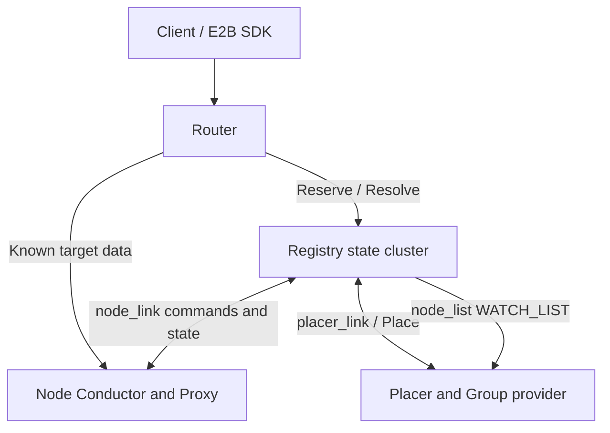
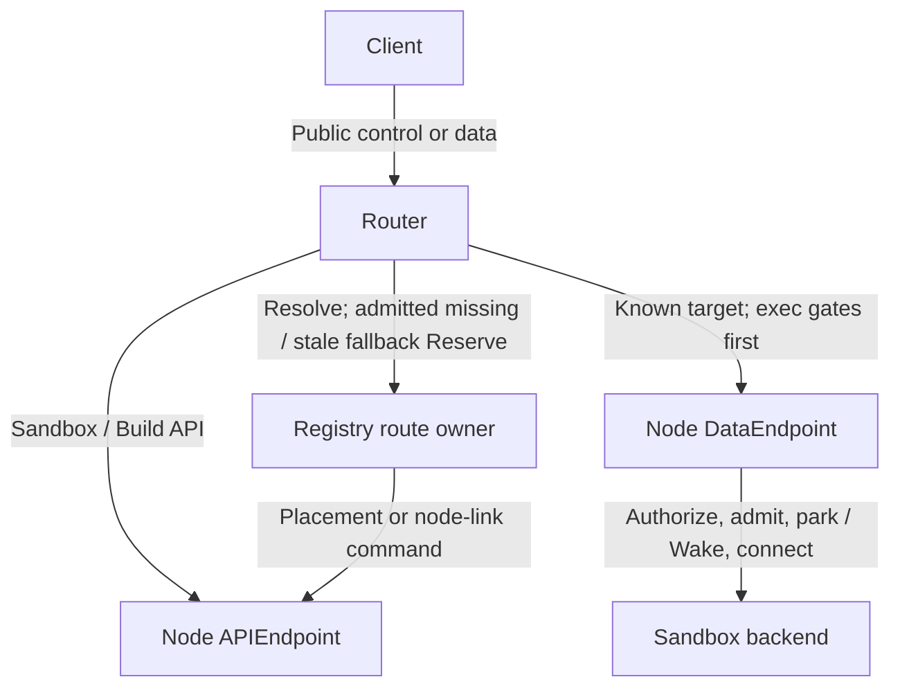

[English](cluster.md) | [简体中文](cluster_zh.md)

<a id="overview"></a>

# 集群控制

本篇按集群能力和状态所有权组织 Registry、Router 与 Placer。先使用公共入口，再定义 Group 与配置各角色；membership/state 及 link 协议为运维与实现参考，最后维护故障和恢复。节点本地 Sandbox/Build 行为仍由各能力文档维护。

`cluster-ctl` 是大规模部署的集群控制面,由三个独立角色组成:

- `registry`:有状态可靠集群,维护 node / route / placer import 等执行态。
- `router`:e2b 兼容统一入口,按 sandbox-group 定位 route owner,热路径直转 node。
- `placer`:group provider/importer 与放置调度器,消费 `node_list`,向 registry 提供 Place / verify-key。

Registry 的基础能力是按 `namespace + shard key + recordSet + record key` 组织的一致性 KV。所有
`node_link`、`route_link`、`node_list`、`placer_link` 记录都复用这套模型:分片间不遍历,分片内全复制,
通过 quorum 读写、CAS、WATCH 和 read-repair 收敛。

**阅读路径：** [公共入口](#client-access) · [Group 与放置](#groups-and-placement) · [角色配置](#configuration) · [状态所有权](#membership-and-state) · [Link 协议](#protocols) · [故障与恢复](#failure-and-recovery)

<a id="roles-and-topology"></a>

## 概述

<a id="overall-topology"></a>

### 总体拓扑



稳态数据面不经过 registry.只有显式 create/connect/exec-session,以及数据面 target 缺失或
typed stale fallback 路径需要 registry:

- `POST /route-link/reserve` 以 `operation=create|connect|exec-session|data` 区分四种操作.create 直接
  Reserve;connect/exec-session 由 registry 经 node-link 完成;data 只在 route 缺少完整 node target 或
  node proxy 返回 typed stale 时 Reserve。未知 route 不会隐式创建 sandbox。显式 build register 调用
  `ReserveBuild`。
- registry 调 placer `PlaceSandbox` / `PlaceBuild`。
- registry 经 node owner 下发 create/connect/exec_session/delete/build/key 命令.
- node 经 node_link 上报 sandbox/build 状态和低频节点目录。

<a id="design-principles"></a>

### 设计原则

1. **group 是业务分片键**:所有 cluster 北向请求必须携带 `X-Kuasar-Sandbox-Group` 或等价 group
   身份。当前不支持无 group 的 cluster 数据面入口。
2. **registry 是可靠状态集群**:执行态由 registry 成员直接复制。配置三个 owner 的逻辑 owner set 容忍单成员故障，单 owner 配置没有冗余；
   整套 registry 丢失执行态后不要求自动恢复运行中 sandbox。
3. **分片间不遍历**:registry 不能跨 group/node shard 扫描,不能把多个无关 shard 的局部结果合并成事实。
4. **分片内全复制**:同一 `namespace + shard key + recordSet` 的 owner 均持有完整视图,可响应点读、
   CAS 和 WATCH。非 owner 可作为协调者转发点读/CAS,但不能提供本地完整 Snapshot/WATCH。
5. **成员健康不参与分片计算**:成员表来自版本化配置;`LocateN` 输入只使用 membership members。
   memberlist 只做健康检测和 meta 传播。
6. **node 是运行态真相之源**:sandbox/build 是否仍存在以 node 上报为准。整机重启会丢失运行进程；保留的 durable row 仍须按实际 unit、checkpoint 与 cleanup ownership
   reconcile。conductor 进程重启可接管仍存活的 unit，不能把两者写成无条件清空持久行或自动重建全部旧 sandbox；见 [状态所有权与灾备边界](#registry-state-ownership-and-disaster-recovery-boundaries)–[Registry 可靠性](#registry-reliability)。
7. **placer 不拥有生命周期**:placer 只做 group 导入、selector patch、shuffle-sharding、P2C 与 Place
   建议。node owner 检查当前连接与 usage；Build 注册最终准入由 node 的 durable transaction 决定。
8. **router 不订阅海量 group**:create/data Reserve 返回 READY 或失败;connect/exec-session
   Reserve 在 node 同步准备完成后返回,不等待异步 resume.router 只维护有界 route cache;
   在途请求不作为新请求的路由来源.

<a id="role-boundaries"></a>

### 角色边界

| 角色 | 职责 |
|---|---|
| registry member | 组成 registry 自聚簇,承载 `route_link` / `node_link` / `node_list` / `placer_link` 执行态和 membership |
| router | e2b 统一入口;按 group 定位 route owner;cache miss 时 Resolve,按 create/connect/exec-session/data 调用 Reserve;热路径使用本地 route cache |
| placer | 消费 `node_list` WATCH_LIST;通过 provider/importer 导入 group;维护 placement 与 selector patch;提供 Place / verify-key |
| node | 运行 sandbox/build;通过 node_link 上报全量清单和事件;接收 create/connect/exec_session/delete/build/key 命令 |

<a id="client-access"></a>

## 公共入口与身份

集群公共 Create 和 Build 注册拒绝单机 `kuasar-sandbox.identity` / `X-Kuasar-Sandbox-Identity` 扩展，身份分配权仍属于 Registry。参见[创建时指定沙箱身份](sandbox-lifecycle_zh.md#create-identity)。

`cluster-ctl router` 是 cluster 的北向入口,同时承载 e2b 控制面和数据面。它不持路由权威,
不订阅 route 或 node_list;它通过 group 定位 route owner.显式 create/connect/exec-session 调用对应
Reserve operation;数据面 cache miss 先 Resolve.RouteResolve 同时返回 `APIEndpoint` 与
`DataEndpoint`,用途固定.只要 route 已有 `NodeSandboxID + DataEndpoint`,
普通数据面即使 paused/starting 也直接连接最终 node proxy,由 node 负责鉴权后的 parking、Wake
和 backend 建连.Exec CONNECT 是例外:Router 在 public 200 后先读取并授权首个 ctl frame,
通过后才连接最终 node.`Reserve(operation=data)` 只保留为 request admission 之后的 target
缺失、Raw 发送前的 typed stale 或普通数据面的兼容 fallback。

<a id="client-onboarding"></a>

### 最小集群客户端验收

从现有 [Registry](cluster_zh.md)、[Placer 配置及 file provider](#groups-and-placement)
和[部署顺序](https://github.com/kuasar-sandbox/kuasar-sandbox/blob/main/docs/deployment_zh.md)
开始。这里是单 group 验收，不是 HA 参考配置。

1. 注册具有匹配 runtime/kernel、工件访问和目标 selector label 的合格节点，确认
   node-link full sync 及该 group 的 ready placer。复用 provider JSON，把示意
   `tmpl-1` 换成精确 ready Build 发布的真实 canonical `e2b-img/sbx/snp-...` ID。
   按受保护 provider 契约配置 ManifestKey/APISecret，只给客户端该 APISecret
   签发的 API key。
2. SDK 命令/文件测试使用 provider 示例 `target_port=49983`，明确仅限 envd。
   如需测试其他应用端口，使用无固定端口约束的 group 或为该端口配置 group；
   49983 不代表所有服务。
3. 配置公共 Router TLS、`api.<domain>` 及 sandbox host DNS/证书，使用
   `auth.data_plane: enforce`。Registry TLS 独立。当前 Router→Node 的
   APIEndpoint/DataEndpoint 必须为可达的**内部明文** listener，分别指向
   Conductor/Proxy，并用私有网络访问控制保护。公共 HTTPS 不加密此跳；不能
   把 TLS-only 节点 listener 当作明文 endpoint。
4. 设置精确 provider `KUASAR_GROUP`、可用 `TEMPLATE_ID`，复用 API URL/key/
   domain/CA。项目固定 **e2b==2.25.1**，Create 及后续控制/数据请求传同一
   Group 和调用方选择的 route key：

```python
import os, uuid
from e2b import Sandbox
headers = {
    "X-Kuasar-Sandbox-Group": os.environ["KUASAR_GROUP"],
    "X-Kuasar-Route-Key": str(uuid.uuid4()),
}
options = dict(api_url=os.environ["E2B_API_URL"],
               api_key=os.environ["E2B_API_KEY"],
               domain=os.environ["E2B_DOMAIN"], headers=headers)
sandbox = Sandbox.create(os.environ["TEMPLATE_ID"], timeout=300, **options)
sid = sandbox.sandbox_id
print("Retain group, route key, stable SID:", headers, sid)
try:
    assert sandbox.commands.run("printf cluster-ok").stdout == "cluster-ok"
    sandbox.files.write("/tmp/cluster-proof", "cluster-state")
    sandbox.pause()
    sandbox = Sandbox.connect(sid, **options)
    assert sandbox.files.read("/tmp/cluster-proof") == "cluster-state"
finally:
    sandbox.kill()
```

SDK `ConnectionConfig.sandbox_headers` 将自定义头合入 envd 请求，命令/文件
客户端使用该配置。重连创建新客户端，须再次传 `options`。主动选择 route key
可避免依赖 SDK 暴露 Router 额外的 `routeKey` 返回字段。应用若跨进程运行，
持久保存 `(group, route key, stable SID)`。头传递已对照 2.25.1 源码，不能
推广到所有 SDK 版本。SDK 不创建 group、不签发根密钥、不恢复 Registry 状态，
也不会为浏览器访问 `get_host(port)` 自动注入这些头。

应用端口请求须由应用/网关传递 Group、route key、stable sandbox identity、
目标端口及对应 scoped forward token（[寻址](#router-addressing)–[控制面](#router-control-plane)）；不得把租户 API key 泄露给
Guest。分别验证 SDK 命令/文件与应用端口的认证请求。在隔离验收 group 内检查
缺少 Group、错误凭据及未授权目标均失败，且不会激活其他沙箱。Create 省略
route key 时可获得新生成的 key；缺少 route key 的拒绝应在需要现有 route 的
后续操作（如 connect、pause、数据请求）上验证。检查
节点 endpoint 选择，证明控制和数据使用各自 listener。

成功标准是真实 create、命令/文件往返、pause/resume、kill；Registry stub 测试
不能证明 VM 路径。NoNode 时查 group 导入、selector、健康/容量和工件；控制成功
而数据失败时查头、target_port、DNS/TLS、Proxy 内部入口。身份不符立即停止。
只 kill 测试所属实例；移除 provider 文件不是实例清理，也不会立即撤销已绑定行
的凭据。共享模板/密钥应保留至保留策略允许删除。

dead/deleting Sandbox 保留管理定位。按 ID 查询、Reset、checkpoint 导出/删除及父对象 Delete 使用节点 APIEndpoint 与既有归属校验，不提供业务 DataEndpoint。仍占用的 group/route_key 在父对象最终删除前拒绝 Create。节点与集群 Create 同样保留 autoReset（默认 false）；Reset 成功不启动 VM。

Create 的可空 `idleTimeout` 沿 route-link reserve、Registry 持久化记录、node-link
create 和有效路由/列表视图完整传递；0 保留为立即启用策略。Pause 仍经 HTTP 转发，
`ifIdleSince` 原样到达最终 Conductor，由该节点接收时钟校验，不新增 node-link Pause。

<a id="router-addressing"></a>

### 寻址

| 请求 | 必需身份 | 行为 |
|---|---|---|
| create | group + route_key(可缺省生成) | 提取并校验 resource patch 及本次请求的 restore/credentials/checkpoint,定位 route owner 后随 `ReserveSandbox` 传递 |
| kill | group + route_key + sandbox_id | 定位 route owner 后由 registry 经 node-link 下发 `CmdDelete` |
| connect | group + route_key + stable sandbox_id | 调用 `operation=connect` Reserve;registry 经 node-link 下发 CmdConnect,不 Resolve 或转发 node HTTP `/connect` |
| exec session | group + route_key + stable sandbox_id | 调用 `operation=exec-session` Reserve;Registry 验证 API key,经 node-link 下发 CmdExecSession,只对外返回 ExecAccessToken |
| get/stats/pause/timeout/export | group + route_key + stable sandbox_id | route owner 解析当前 NodeSandboxID 与 APIEndpoint,Router 重写路径后转发到 node conductor;stats body 无 SID,无需响应身份适配;APIEndpoint 缺失时 fail closed |
| list/get | group | 读取 group 分片;单个 sandbox 的查询另需上表中的完整身份 |
| data plane | group + route_key + stable sandbox_id + target | 已知 NodeSandboxID/DataEndpoint 即直接建立一次性 node CONNECT,包括 paused/starting;target 缺失或 typed stale 才 fallback `operation=data`;miss 先 Resolve |
| build register | group + build_id | 规范化 body/Builder header 为 Build.Resources,独立解析目标 Sandbox ResourcePatch,再调用 `ReserveBuild`;选中节点执行最终 registration admission |
| build cancel | group + build_id | 每次重新 ResolveBuild, 按当前 APIEndpoint 转发; 不重选节点 |
| build trigger/status/files | group + build_id | ResolveBuild 返回 APIEndpoint;缓存并转发到 node conductor,缺失时不回退 DataEndpoint |
| build delete | group + transient TemplateID | 在既有投影定位原节点 APIEndpoint, 原样转发 Query/Header, 节点最终鉴权和执行 |

`route_key` 是 group 内 route 定位键,`sandbox_id` 是稳定公开身份。Registry 在首次 create 时生成
SandboxID;同节点 resume、跨节点迁移和 re-place 不改变它。受保护 route 另携当前
`node_sandbox_id=<sandbox_id>-g<N>`。Router 使用稳定 SandboxID 寻址,只在 node 边界替换为
NodeSandboxID;公开响应不暴露 NodeSandboxID。

受保护 route 中的 `stable_id` 是同一 sandbox 跨 NodeSandboxID 变化保持的 StableID；cluster
始终要求 `StableID == SandboxID`。Router 保留该字段作为现有 credential projection，并用它
校验 KAT `sid`，但 cache/route lookup 仍使用 `(group, route_key, SandboxID)`，不会把 StableID
当作 node-local lookup key 或建立唯一索引。

create 可在 body metadata 中携 `kuasar-sandbox.resource`、traffic、restore、credentials 与 checkpoint。
`X-Kuasar-Sandbox-Resource` 与 `X-Kuasar-Sandbox-Traffic` 只覆盖各自 patch 中明确出现的 leaf；resource 的公开面严格限制为
capacity/allocatable/startup，并与 group defaults 使用同一 merge helper；traffic 使用共享的 max-inflight patch 校验与叶子合并。restore/credentials
Header 覆盖同名完整 object,checkpoint Header 按字段覆盖。router 始终解析并严格校验 body,
所以合法 Header 不能隐藏非法低优先级 resource/traffic/checkpoint。未提供 restore、`{}` 与显式
`off` 均为关闭;只有本次 create 显式提供 `memory` 才启用。create body 上限为 16 MiB,
超限返回 **413**。

Router 按 [Registry Reserve 协议](#reserve) 为共同的 `POST /route-link/reserve` 端点组装请求，传递对应操作的已认证上下文并保留期望的稳定身份。Create 在准入前严格归一化；Connect 保留可选 memory 选择及其缺省状态；exec-session 先严格解析公共 TTL/conditions 再转换为 Registry typed request；Data 使用既有 access-token/service/port 上下文。

精确 query/Header/body schema 由 Registry 规范唯一维护，并在其边界重复校验。Conditions 不借无关 metadata、query 参数或配置 Header 传递；本篇只定义转换边界，不再维护一份可能失步的 schema 表。

connect/exec-session/data 中的 `sid` 均是客户期望的稳定 SandboxID,用于防止 route_key 被删除重建后请求
跨越 lineage。

<a id="router-control-plane"></a>

### 控制面

API key 鉴权不可关闭.create/connect/exec-session 把客户端原始 API key 交给 Reserve,
由 Registry 在任何生命周期副作用前完成验证:create 的 group admission 经 ready placer 使用
provider APISecret,connect/exec-session 使用 Sandbox 业务记录已绑定的 APISecret.其它控制操作
由 router 调 route owner `verify-key`,route owner failover 到 ready placer 验证.ManifestKey
只用于内容路径,不参与 API 鉴权.

| 操作 | 行为 |
|---|---|
| create | 调用 `operation=create` Reserve,传递 leaf-merged resource 与请求级 restore/credentials/checkpoint;credentials 在写普通 metadata 前分离 |
| kill | route owner 精确匹配 group + route_key + sandbox_id,经 node-link 下发 `CmdDelete` |
| connect | 调用 `operation=connect` Reserve;Registry 对当前 NodeSandboxID 下发 CmdConnect,验证 typed ConnectResult 后返回;Router 不 Resolve,不二次转发 node HTTP `/connect` |
| exec session | 严格解析 64 KiB body,调用 `operation=exec-session` Reserve;Registry 验证原始 API key 并下发 CmdExecSession;Router 只投影 ExecAccessToken |
| get/pause/timeout/export | Resolve 当前 route,只使用 APIEndpoint,把公开 SandboxID 路径替换为 NodeSandboxID 后转发;typed get 响应重写回稳定 SandboxID |
| get/list | 读 group route_link |
| build register | 生成稳定 build_id/template_id,严格合并 register resource body/Header/E2B capacity leaf 后调 ReserveBuild;node 在保存 build 前再次校验 |
| build cancel | 每次按 group+build_id 重新 ResolveBuild, 使用当前原节点 APIEndpoint 转发, 不使用旧缓存 |
| build trigger/status/files | 按 group+build_id 定位 node,只缓存和使用 BuildReserveResult.APIEndpoint 后转发 |
| build delete | 仅 transient TemplateID; 从既有投影定位原节点, 原样转发 Query/Header |

DELETE `/templates/{transientID}?cancel=true` 与 `X-Kuasar-Sandbox-Builder: {"cancel":true}` 共用节点动作 parser. 两种输入分别严格校验. Header.cancel 显式值 > Query.cancel > false; `{}` 保留 Query, 显式 false 覆盖 true. Router 不将它解析为注册 BuildOptions. 查询失败或归属不完整返回 503; 节点不可达返回 502, 不能当作删除成功或猜测 404. DELETE 202 保留节点的相对 Status Location; 节点最终硬删除才代表完成. 详见 [Build 动作](node-build_zh.md#cancel-and-delete-a-build-record).

Sandbox control,Build follow-up 与 ordinary data/CONNECT/native exec 使用不同的 node endpoint.
control/build 缺少 APIEndpoint 时不回退 DataEndpoint;data/exec 缺少 DataEndpoint 时不回退
APIEndpoint.

connect 的 Node Ack 只投影 NodeSandboxID、TemplateID、Profile 和 Envd/Traffic/ForwardAccessToken;不返回
root 凭据或 fingerprint。Router 校验 Ack 与受保护 Route 一致,再组装仅包含稳定 SandboxID 和
profile 对应公开 token 的 e2b 响应。node 已同步完成校验、可选迁移导入、deadline 持久化和
凭据读取;resume 在 Ack 后异步进行。

Exec session 的 public endpoint 是 `POST /sandboxes/{stableSandboxID}/exec-sessions`.请求必须携
group,route-key 和原始 `X-API-KEY`,可选 `X-Kuasar-Migration-Token`.body 只允许空、
`{}` 或严格的 `ttlSeconds` + `conditions:[{"expr":"..."}]`;完整原始 body(含尾随空白)
上限 64 KiB.条件缺失与 `[]` 都是 unrestricted 并规范化为 nil;显式 `null`、unknown/duplicate
字段、空 expr、第二个 JSON value、负数或 TTL/condition bounds 溢出返回 400.

Router 将 API key 送到 Registry verifier,但不把它写入 command;CmdExecSession 明确携
APISecretFingerprint、expected Profile、TTLSeconds、ExecConditions 和可选
MigrationToken/cluster context.Node 是唯一 signer,在任何 activation mutation 前权威编译
conditions并签名,在 Ack 中只返回 `ExecSessionResult`,然后按既有 eager 合同异步 resume.
Conditions 不进入 Route/record/event/metadata/log;#240 的 deferred activation 仍是独立工作.
Registry 把该 result 与当前 stable lineage 的 Route 汇合;Router 验证两者一致后返回:

```http
HTTP/1.1 201 Created
Cache-Control: no-store
Content-Type: application/json

{"execAccessToken":"kat1..."}
```

响应不包含 session ID,exp,NodeSandboxID,ServiceSecret 或 route.运行时失败返回固定
脱敏错误,不原样转发 node Ack reason 或内部路径.异步 resume 在 Ack 后失败不回溯
修改已返回 token,后续连接按当前 route/state 失败.

<a id="router-data-plane"></a>

### 数据面

Router 先分离普通 legacy target 和 native exec 逻辑服务:

- 普通 HTTP 只使用 Host/`E2b-Sandbox-Id + E2b-Sandbox-Port` 的 legacy port;
  除精确值 `exec` 外，不解释 `E2b-Sandbox-Service`，该 Header 作为应用层 Header 在内层请求中保留。
  非 CONNECT 请求选择 `exec` 时，在 route lookup 或 activation 前返回 **405** 与 `Allow: CONNECT`。
- 未携 service 的 CONNECT 同样使用 legacy raw port.
- `E2b-Sandbox-Service: exec` 是已接入的 portless CONNECT target,可与 port 并存,
  但 port 不参与 backend 选择.
- `forward|e2b:envd|e2b:code-interpreter` 的完整 cluster service-aware 转发合同由
  [#63](https://github.com/kuasar-sandbox/orchestrator/issues/63) 跟踪.当前 cluster 入口不将这三个
  Header 值描述为已支持的 backend selector;最终 Node 依其本地受信 profile 选择 backend.

Legacy sid-host 数据面路径先校验凭证:

- e2b profile 的 49983/49999 端口必须带 `X-Access-Token: <envd_access_token>`。
- e2b 其它端口与 bare 的所有端口必须带
  `X-Access-Token: <forward_access_token>`.bare 的 49983/49999 也是普通 TCP forward,
  不是 501 控制端口.
- `traffic_access_token` 供外部网关及 e2b 数据面组件使用,cluster router 不消费。
- envd 预签名文件 URL 可不带 token,但仅限 `port=49983`、`GET/POST /files`、非空 `signature` query。
- 同一请求若带了非空但错误的 `X-Access-Token`,不回退到 signature。

普通 token 请求转发时复用客户端提供的 `X-Access-Token`:

```text
CONNECT sandbox:<port> HTTP/1.1
E2b-Sandbox-Id: <node_sandbox_id>
E2b-Sandbox-Port: <port>
X-Access-Token: <client X-Access-Token>
```

客户请求的 Host/路径使用稳定 SandboxID.Router 向 node proxy 建立外层 CONNECT 时使用当前
NodeSandboxID;普通 HTTP 的内层 Host 也改为 `<port>-<node_sandbox_id>.<domain>`。内层请求已有
`E2b-Sandbox-Id` 时把值替换为 NodeSandboxID,保留该 Header 供用户应用感知当前 node-local ID。

对于不带 token 的 envd `/files` signature 请求,router 先使用受保护 route 中的 `EnvdAccessToken` 验签。
该校验发生在任何 node CONNECT 或 Reserve/激活之前;验签失败直接返回 401,不得唤醒 sandbox。
验证通过后,router 仅在到 node proxy 的外层 CONNECT 携带该 `EnvdAccessToken`,由 node proxy 完成最后一跳
鉴权;隧道内 HTTP 请求保持原样且不注入 `X-Access-Token`,让 envd 使用原 URL 中的 signature 再次验证。
普通 token 请求在外层 CONNECT 和隧道内 HTTP 请求中都保留客户端原始 `X-Access-Token`。

Router 完成本地鉴权后,若 route 已有 `NodeSandboxID + DataEndpoint`,不再按 state 在 Registry
等待 READY:paused/starting 与 ready 一样立即建立一次性 node CONNECT。最终 node proxy 按
`LookupRoute → authorize → BeginParking → ActivateRoute/Wake → fresh Route → dial` 处理等待,
所以获准请求的 parking 只在最终 node 统计,cluster router/Registry 不重复计数。普通请求在
Router 的 `enforce` 模式下,无效 token 在 node CONNECT/Reserve 前失败。Router 的文件 signature
校验及 `/files` 显式 token 校验在所有 Router 模式下均强制执行,exec 也始终 enforce。
普通请求的 Router `log` 模式记录本地 token 不匹配后继续,`off` 跳过该本地 token 检查。
最终 node proxy 独立应用自身的有效鉴权策略:要阻止无效普通凭据触发 Wake/Resume/parking/backend
dial,必须让 node proxy 保持 `enforce`。如果目标 node 也使用 `log` 或 `off`,它就可能接纳该
请求并激活后端。Router 配置不会覆盖 node 的策略。

只有 target 缺失时才先调用 `operation=data` fallback。普通请求把客户 token 传给 Registry;
签名 `/files` 把已用于验签的受保护 EnvdAccessToken 传给 Registry。若已知 node 在接受内层
请求前返回 typed `not_found`/`unauthorized`,Router 淘汰该 node-local target,调用同一
ReserveData 让 Registry 对当前 lineage 复验 credential、取得 fresh route,然后只重试一次。
fallback 返回不同 stable identity 或仍无完整 target 时 fail closed。`auth.data_plane=off` 只
跳过 Router 对普通请求的本地 token 闸门;带显式错误 token 的 `/files` 在任何模式下都不回退
signature。

Exec CONNECT 使用单独的三阶段 KAT + request admission 合同:

```text
client CONNECT
  stable SandboxID + service=exec + X-Access-Token=KAT
    ↓ side-effect-free cache/Resolve
Router verifies StableID + ServiceSecret, then compiles CEL
    ↓ flush public 200; read strict first ctl frame; recheck expiry; evaluate
    ↓ admission passed (no node/Reserve before this point)
node CONNECT
  current NodeSandboxID + service=exec + optional original port + same KAT
    ↓ node independently verifies KAT + CEL and reads/evaluates first frame
    ↓ parking → ActivateExec/Wake → ctl.sock; Raw written exactly once

missing/stale target, only after public request admission and before Raw send:
  Reserve(operation=data, same KAT + service=exec)
    ↓ Registry re-verifies and returns fresh current Route
  retry one node CONNECT
```

Exec 始终 enforce,不受 `auth.data_plane=off|log|enforce` 影响.EnvdAccessToken,
ForwardAccessToken 或 TrafficAccessToken 不能代替 exec KAT.KAT 缺失,过期,签名错误,
SID/audience 错误时在 public 200 前返回 401,且不能触发 Router Reserve、node CONNECT、
Registry CmdConnect、Node parking 或 resume.ExecRequest/condition 在 200 后失败时返回统一
`{"type":"error","msg":"exec request rejected"}`,同样无这些副作用.已有 node target 的
paused/starting 路径不增加 Registry 调用.Router 和 Node 都执行完整 gate,纯 transport relay
不解析 token/CEL/ExecRequest.只有 missing/stale fallback 由 Registry 复验;Reserve 后 Router
必须重验 stable lineage/credential 并使用 current NodeSandboxID,不能复用旧 target.

Router 在 public 200 后先执行首帧 gate,通过后才建立下一跳;最终 Node 从本地 route 再次校验
`StableID + ServiceSecret`,回复 node CONNECT 200 后再次执行首帧 gate,通过后才 parking、
activation 和连接 `<run_root>/sandboxes/<NodeSandboxID>/ctl.sock`.Router 不拨 `ctl.sock`.

KAT 绑定 StableID，不绑定 NodeSandboxID 或其 generation。因此，同一 lineage 的 resume、migration 或 replacement 本身不要求重新签发 token；有效期、claims 和当前凭据校验仍然适用。每次新的 node CONNECT 都使用当前 NodeSandboxID。

最终 Node Proxy 的 ordinary HTTP/non-exec CONNECT 达到 per-Sandbox 上限时返回
`429` + `X-Kuasar-Proxy-Error: max_inflight_reached`。Router 原样透传 status、header 和
fixed body;该 typed response 不是 stale route,不淘汰 cache、不调用 Reserve、不换 node 重试。
Router 不实现第二套 limiter,因此限制仍由目标 Proxy 对同一 Sandbox 的全部 worker 统一执行,
而不是 cluster-wide 或 per-Router capacity。native exec 的 admission 位于 Node 的 CONNECT 200
与 CEL/首帧校验之后;达到上限时 Node 写已有 generic ctl error 并关闭,Router 只透明中继该 frame,
不会合成 HTTP 429。

CONNECT 长连接使用同一 route resolution,但 tunnel 自身不复用。连接断开后保留 route cache 至 idle/TTL
或 fail-fast 失效.Router→Node CONNECT 的 response reader 已预读字节会随 tunnel 保留;
中继在单向 EOF 时只传播 half-close,等待另一方向的 `exec_ack`,stdout/stderr 和 exit status
完整结束,不在首个 `io.Copy` 返回时截断 tunnel.Raw 尚未写给任何 node 前允许一次 typed stale
retry;Raw 一旦写入 node 后禁止 retry/reroute/replay,node ctl error 透明转发,不合成第二个 error.

<a id="public-sandbox-identity"></a>

### 身份

- route 定位键:`(group, route_key)`。
- 稳定公开身份:`sandbox_id`。Registry 在首次 create 时生成,同节点 resume、跨节点迁移和
  re-place 均不改变;公开 API、Host 和 router cache key 使用该 ID。
- 稳定 sandbox 身份:`stable_id`。cluster invariant 固定为 `stable_id == sandbox_id`；它在
  NodeSandboxID 变化时保持不变，并绑定 ServiceSecret 与 KAT `sid`。该重复投影为现有受保护
  credential state，本次不去重。StableID 不是 node-local lookup key，也不增加唯一索引；
  身份保持型 migration/copy 可以让多个 node-local sandbox 共享同一 StableID。
- Registry durable JSON state 直接使用 `stable_id`，不保留旧字段 fallback；pre-release
  部署必须清理并重建旧 preview state。
- 节点执行身份:`node_sandbox_id = <sandbox_id>-g<sandbox_generation>`。首个候选为 g0;候选
  冲突/失败或跨节点迁移消费下一个 generation,同节点 resume 保持当前 NodeSandboxID。
  NodeSandboxID 是不透明的 node-local ID,权威映射在 Registry 归属表,组件不从字符串反向解析。
- node 事件不携带 group/route_key/SandboxGeneration。Registry 以 `(node_id,node_sandbox_id)` 查归属表
  恢复稳定身份和 group 上下文;不存在跨 group 的 SandboxID 索引。

<a id="cluster-credentials"></a>

### 密钥与鉴权

同一 group/租户范围内有两个用途分离的根凭据域:

| 名称 | 持有者 | 用途 |
|---|---|---|
| `APISecret` | provider/placer/node/registry/router/proxy | 签发并验证 API key及后续用途明确的认证材料;完整 SHA-256 指纹标识凭据对 |
| `ManifestKey` | provider/placer/node | 解密 manifest/镜像/快照内容,封装 pull token;router 不接触 |

两者都是 32B / 64-lowercase-hex。APISecret 缺省时,placer 在物化 inline ManifestKey 时使用固定 KDF:

```text
APISecret = HMAC-SHA256(decodeHex(ManifestKey), "kuasar-api-secret-v1")
```

API key 只由 APISecret 签发/验证。API key 内 `SHA256(APISecret)[:12]` 仅作候选预筛;
node-link、生命周期命令和业务记录使用完整 64-hex `SHA256(APISecret)`。ManifestKey 也携带
自己的完整 64-hex SHA-256 指纹,用于校验成对交付的内容键。

APISecret 和 ManifestKey 都是 typed secret,支持 inline 或 ref 带外交付。selector patch 要么携带
完整 pair(两项 typed carrier + 两项完整指纹),要么完全不携带凭据字段;半对必须拒绝。凭据分发只发生在
shuffle-sharding/import/selector patch 路径:

```text
placer selector patch
  │ target node set + APISecret/ManifestKey material/ref
  ▼
registry/node owner
  │ CAS node_link key_pair cache (record key = APISecretFingerprint)
  ▼
node_link heartbeat refresh
  │ key_put complete pair only when missing or near lease expiry
  ▼
node encrypted local key store
```

`key_put` 在 node 侧原子校验并安装完整 pair;同一 APISecret 完整指纹不得绑定不同 pair material。
`key_drop` 以完整 APISecret 指纹定位 pair,但不是正确性依赖。节点侧租约按 TTL 淘汰未续租条目。
凭据分发是 create/build 前置条件;drop、TTL 或 provider 更新都不修改已复制进现有 sandbox/build
业务记录的凭据对。

ServiceSecret 不是第三个 group root,而是每个 node Sandbox 业务记录的独立 service credential。缺省值由
该 Sandbox 已绑定的 APISecret 和 `StableID()` 以固定 domain 派生;也可由本次 create 的
`kuasar-sandbox.credentials` object 显式指定。Registry 在 route/ref/command 副作用前按 placement
Profile 校验并规范化该 object,node 再次校验、分离后把 ServiceSecret 与 Envd/Traffic/Forward token
加密写入 Sandbox 业务行。普通 metadata、guest 配置和 node-stub 观测面均不保留 credentials object。

ForwardAccessToken 和 ExecAccessToken 都使用 `kat1`,但 audience 明确分离.
ExecAccessToken 的 canonical payload 是 `v,session_id,sid,aud[,exp][,conditions]`,其中 session ID 是
UUIDv7,`sid=StableID`,`aud=exec`,不包含 `iat`；只有请求了限制条件时才携带规范化的 CEL source
string array `conditions`。ServiceSecret 解码为 32-byte key 后
直接执行 HMAC-SHA256,不增加 exec-specific 派生层.create/get/list 不返回缺省
ExecAccessToken;每个 exec-session API 调用独立签发,服务端不建 session row,revoke
或 single-use/replay 状态.

Registry 从 node route event 物化受保护 route 时,只采纳 APISecret、两项 root fingerprint、
StableID、ServiceSecret 和 Envd/Traffic/Forward tokens;不采纳 ManifestKey 原文或既有
node-link wire 中供节点 proxy/MMDS 使用的 MmdsSecret。Registry 本阶段以明文结构化字段保存
这些受保护 route 凭据,不增加额外加密层;它们只可由受保护 Reserve/Resolve 返回给可信 router,
不得进入普通 route watch/list、公开 create/get/list 响应、日志或观测接口。创建请求中的
`kuasar-sandbox.credentials` 在 Reserve 入口从普通 config 分离,仅随 RESERVED 记录冻结并在 CmdCreate 前临时
编码,READY 后清除。

<a id="groups-and-placement"></a>

## Group、provider 与放置

`cluster-ctl placer` 是独立放置调度器。它不持 node 连接,不拥有 sandbox 生命周期,也不实现 registry
状态复制。它通过 `SandboxGroupProvider` / `SandboxGroupImporter` 获取 group 配置与密钥材料,消费
registry 的 `node_list` WATCH_LIST,并向 registry 提供 `PlaceSandbox` / `PlaceBuild` / `verify-key`。

<a id="placement-responsibilities"></a>

### 概述

<a id="placer-responsibilities"></a>

#### 职责

```text
SandboxGroupProvider / Importer
          │
          ▼
      placer
          │  selector patch / Place / verify-key
          ▼
      registry
          │ node owner commands
          ▼
        node
```

placer 负责:

- group provider/importer 接入。
- `node_list` WATCH_LIST 消费。
- selector patch 与 APISecret/ManifestKey pair cache refresh。
- shuffle-sharding、静态 selector、runtime match、P2C。
- `PlaceSandbox` / `PlaceBuild` 建议。
- API key verify 的 provider 侧校验。

placer 不负责:

- 连接 node。
- 下发 `key_put` / create / delete / build 命令。
- 维护 route/build 执行态。
- 保存 registry 的 group/route 记录。

<a id="placer-principles"></a>

#### 原则

1. **registry 不实现 group provider**:Provider/Importer 属于 placer 或外部平台。
2. **WATCH_LIST 仅给 placer**:router 不消费 node_list。
3. **高频负载不走 WATCH_LIST**:WATCH_LIST 只承载低频目录字段;最终资源确认由 node owner admission 完成。
4. **source_id 是 import 执行单元**:多个 placer 配置相同 `source_id` 时,竞争同一条 source lease。
5. **shuffle 只影响新建**:不迁移正在运行的 sandbox。
6. **凭据对分发只影响 create/build 前置条件**:drop、租约过期或 provider 更新不修改已经复制到
   现有 sandbox/build 记录的凭据对。

<a id="placer-provider--importer"></a>

### Provider / Importer

placer 使用统一接口:

```text
SandboxGroupProvider:
  Get(group)
  GetPlacementHint(group)
  GetKey(group)       # typed manifest_key
  GetAPISecret(group) # typed APISecret

SandboxGroupImporter:
  Range(cursor, limit)
```

内置 file source 只用于本地开发和 e2e:

```yaml
import_groups:
  - source_id: example-file-source
    source_type: file
    path: /path/to/dir
```

该 source 枚举目录下的 `*.json` 文件。每个文件是一个 `SandboxGroupRecord` JSON。文件数量预期较小,
`Get/GetPlacementHint/GetKey/GetAPISecret` 可直接扫描目录解析。生产环境应通过接口接入实际 group 源。

示例:

```json
{
  "group": "/cell/project/app/group",
  "template_ref": "tmpl-1",
  "target_port": 49983,
  "api_secret": {"type": "inline", "value": "<64-lowercase-hex>"},
  "manifest_key": {"type": "inline", "value": "<64-lowercase-hex>"},
  "node_selectors": [{"pool": "default"}]
}
```

显式 `api_secret` 优先。inline `manifest_key` 缺省 `api_secret` 时,placer 按
`HMAC-SHA256(decodeHex(ManifestKey), "kuasar-api-secret-v1")` 派生默认值;
ref ManifestKey 无法在 placer 本地物化,必须显式提供 APISecret。两项 root 及 ref 的完整指纹
都必须是 64-lowercase-hex。

`target_port` 是数据面强制端口,随 Place 结果返回给 route_link/router。它不参与节点筛选;
节点筛选仍只由 `node_selectors` 与 shuffle-sharding 配置决定。

多个 source 的语义需要区分:

- Provider 点查可以按 source 顺序查找 group,若同一个 group 被多个 source 定义则报错。
- Importer Range 按 `source_id` 独立执行,不把多个 source 合并成一个 Range 视图。
- 每个 `source_id` 的 cursor/lease 独立维护。

group 从 provider 消失后,新的 Place 找不到该 group,verify-key 拒绝缺失凭据,两者均不能
继续使用已移除的 group。已经写入 node_link 的凭据对 cache 不主动删除,由 registry/node
侧 TTL 淘汰;现有 sandbox/build 的持久凭据副本保持不变。

<a id="placer-import-reconciliation"></a>

### Import Reconcile

<a id="placer-source-owner-selection"></a>

#### source owner 选择

每个 source 独立执行:

```text
readyPlacers = placer memberlist nodes where ready_label == active_registry_label
sourceOwners = LocateN(source_id, readyPlacers, import_source_owner_count)

sourceOwners race:
  POST /placer-link/import-source-lease
```

source lease 存在 registry shardkv:

```text
namespace = placer_link
shardKey  = import/source/<source_id>
recordSet = import
recordKey = state
```

lease 请求携带 `source_id`、`owner_id`、`run_id` 和 `ttl_ms`。只有 lease 胜者执行该 source 的
`Importer.Range(cursor, limit)`。

<a id="placer-page-processing"></a>

#### page 处理

```text
lease winner
  │ Range(cursor, limit)
  ▼
groups in page
  │ for each group:
  │   GetPlacementHint
  │   GetKey / GetAPISecret
  │   calculate effective selectors
  ▼
selector patch with fencing
  │
  ▼
registry refreshes node_link credential-pair cache
  │
  ▼
cursor checkpoint after whole page succeeds
```

selector patch 必须携带 `import_source_id/import_owner_id/import_run_id/import_term`。registry 只接受与当前
source lease 匹配的 patch。缺失 fencing 字段或 term/run_id 不匹配时拒绝。

`NextCursor==""` 表示本轮结束:cursor 清空并递增 round。失败或 owner 崩溃时 cursor 不推进,后续 lease
owner 从上次成功 cursor 继续或重放同一页。

<a id="placer-selector-patch-refresh"></a>

#### selector patch refresh

placer 按 `placement.selector_patch_refresh_interval` 续推 unchanged selector patch,用于维持 node_link
credential-pair cache。group 从 provider 消失时不主动删除 cache;TTL 到期后自动淘汰。

<a id="placer-placement"></a>

### Placement

<a id="placer-registry-selection-of-a-placer"></a>

#### Registry 选择 placer

registry 对 group 只做确定性 failover:

```text
readyPlacers = placer memberlist nodes where role=placer and alive and ready=true
               and ready_label == active_registry_label
candidates   = LocateN(group, readyPlacers, placer_link.placer_replica_count)
try candidates in order until success
```

registry 不对 placer 做 P2C。P2C 只用于 placer 内部从 node 候选中选择放置目标。

<a id="placer-placesandbox"></a>

#### PlaceSandbox

输入:

```text
group, route_key, sandbox_id, target_runtime_digest?, config?, exclude_node_ids?
```

`sandbox_id` 是 Registry 持有的稳定公开 SandboxID;placer 不分配、解析或接收 NodeSandboxID
和 SandboxGeneration.

流程:

```text
provider.GetPlacementHint(group)
  │
  ▼
filter node_list:
  selector match
  not draining
  not in exclude_node_ids
  zone <= admit max
  runtime digest match
  shuffle slot match
  │
  ▼
P2C over candidates
  │
  ▼
return node_id + create_spec + APISecret fingerprint + runtime/template hints
```

`node_list` 只提供低频目录,不判定 node 是否在线。route owner 在提交前向 node owner 查询当前
node-link 连接；断线、admission 拒绝或命令拒绝的候选加入 `exclude_node_ids`,随后重新 Place,直到选中
在线候选或 placer 返回无候选。node owner 是唯一存活权威。

<a id="placer-placebuild"></a>

#### PlaceBuild

输入:

```text
group, build_id, template_id, resources
```

Build placement 与 sandbox 类似,但 Placer 的低频视图只按 configured registration capacity
排除永远装不下单个 Build 的节点,不接收 heartbeat usage。当前 headroom 只在 Holder/节点边界读取:

1. placer 返回静态 capacity 可容纳的建议 node。
2. Registry 通过当前 Holder 确认 node-link 在线并读取最新 durable registration usage。
3. headroom 已不足时 Registry 排除该候选并重调度,尚不创建注册 intent。
4. Registry 持久化选中 node/build 的 STARTING intent,再发送 `build_register`。
5. node 在 SQLite 事务中作最终 registration admission；明确无副作用拒绝才允许排除候选,
   timeout/断连/ACK 丢失则固定该 node/BuildID 查询或重试。

<a id="placer-key-distribution"></a>

### Key Distribution

placer 主管 selector patch 和 APISecret/ManifestKey pair cache refresh:

1. 获取 group 的 typed `manifest_key` 和 `api_secret`;缺省 APISecret 只可由 inline ManifestKey 固定派生。
2. 根据 placement selectors 和 shuffle 结果得到目标 node set。
3. selector patch 要么携带完整 pair,要么完全不携带凭据字段。两项各带 typed carrier 和完整
   64-hex SHA-256 指纹;半对拒绝。
4. registry/node owner 以完整 `APISecretFingerprint` 为 record key,把 desired pair 写入 node_link
   `key_pair` recordSet,并在 owner set 内 CAS 复制。
5. node_link heartbeat 只对未获 `AckAccepted` 或已进入续租窗口的条目执行原子 `key_put`;只有匹配
   当前完整 desired pair 和 lease 的 ACK 才推进已交付状态。
6. 同一 APISecret 完整指纹只能绑定完全相同的 pair material;冲突不得覆盖。
7. 未续租 pair 由节点 TTL 淘汰,`key_drop` 以完整 APISecret 指纹定位,不作为正确性依赖。

凭据对是 create/build 前置条件。cache 删除、key_drop、租约过期或后续 provider 更新不影响已经复制
到现有 sandbox/build 业务记录的凭据对。

<a id="provider-import-boundary"></a>

### group provider 边界

registry 不实现 `SandboxGroupProvider` / `SandboxGroupImporter`。group 配置、placement hint、APISecret、
ManifestKey 属于 placer/provider。registry 只保存执行态和各 node 所需的凭据对 cache。

group 从 provider 消失后,新的 Place/verify-key 按 group 不存在处理。已经进入 node_link 的凭据对
cache 不主动删除,由 registry/node 侧 TTL 淘汰;已复制到现有 sandbox/build 记录的凭据对不受影响。

<a id="configuration"></a>

## 角色配置与节点接入

下文按配置类型维护精确字段。共享 Conductor 路径与加载语义仍见[节点运行](node_zh.md#conductor-configuration)；平台的地址、DNS 与发布组合由主项目部署指南维护。

<a id="registry-configuration"></a>

### Registry 配置与监听

registry 默认只有一个控制面监听。node_link 可以配置独立监听用于隔离 node 长连接流量,但不改变 owner
规则。下面三成员示例展示 membership 与时序字段；`https://` advertise 还要求匹配的
`member.tls` 配置与对端信任，单凭地址不会启用 TLS。内置默认配置只有一个成员，各 namespace
只有一个 owner。

```yaml
member:
  id: A
  listen: "0.0.0.0:7700"       # registry 统一控制面监听

membership:
  active: 1
  # next: 2                    # joint 阶段目标版本
  # old_grace: 1               # cutover 后保留旧成员作为 read-only shardkv 证书/快照来源
  reload_ready_timeout: 10s
  versions:
    - version: 1
      members:
        - { id: A, advertise: "https://A:7700", node_advertise: "A:7700" }
        - { id: B, advertise: "https://B:7700", node_advertise: "B:7700" }
        - { id: C, advertise: "https://C:7700", node_advertise: "C:7700" }
  owners:
    route_link: 3
    node_link: 3
    placer_link: 3
    node_list: 3

node_link:
  # listen: ""                 # 空 = 复用 member.listen;非空 = 独立 node 长连接监听
  heartbeat_interval: 10s
  node_dead_after: 30s          # node-link 断线后清理持久状态的等待时间

route_link:
  park_timeout: 30s

node_list:
  watch_retention: 10000

placer_link:
  placer_label: placer.default
  placer_replica_count: 3      # registry 调 placer 的 failover 候选数
  min_ready_placers: 1
  place_timeout: 2s
```

默认 path:

```text
/cluster/membership
/node-link/*
/route-link/*
/placer-link/*
/internal/registry-member/shardkv
/internal/node-owner
/internal/node-link/relay
/internal/memberlist/packet
/internal/memberlist/stream
```

registry 对外地址写在 `membership.versions[].members[].advertise`;
redirect-capable node 使用 `membership.versions[].members[].node_advertise`。

<a id="router-command"></a>

### Router 命令

```text
cluster-ctl router --config /etc/cluster-ctl/router.yaml
```

<a id="router-configuration"></a>

### Router 配置

```yaml
domain: sandboxes.example.com

registry:
  bootstrap: registry-1.example:7700

ingress:
  listen: ":443"

auth:
  data_plane: enforce
  cache_ttl: 60s

cache:
  route_ttl: 5m
  idle_timeout: 2m
```

| 字段 | 说明 |
|---|---|
| `domain` | cluster 服务域 |
| `ingress.listen` | 控制面和数据面入口 |
| `ingress.tls` | 通配证书 |
| `registry.bootstrap` | registry bootstrap endpoint,用于拉取 membership |
| `registry.tls` | 到 registry 控制面的 mTLS |
| `auth.data_plane` | 数据面凭证校验:`enforce` / `log` / `off` |
| `auth.cache_ttl` | API key 校验缓存 |
| `cache.route_ttl` | 路由解析缓存 TTL |
| `cache.idle_timeout` | 路由缓存闲置淘汰时长;不是 tunnel 空闲关闭计时器 |
| `metrics_listen` | Prometheus 端点 |

Router 对外 ingress 可以终止 TLS,到 registry 的控制连接也可使用独立 mTLS.但当前
Router→node 的 `APIEndpoint` 和 `DataEndpoint` 固定使用明文 HTTP/CONNECT;节点注册必须
提供两个不同用途且可达的明文内部 listener,不能把启用 TLS 的 node listener 直接填入这两个字段.

<a id="placer-command"></a>

### Placer 命令

```text
cluster-ctl placer --config /etc/cluster-ctl/placer.yaml
```

standalone placer 必须配置至少一个 `import_groups` source。嵌入式或生产集成可以直接注入自定义
`SandboxGroupProvider` / `SandboxGroupImporter`。

<a id="placer-configuration"></a>

### Placer 配置

```yaml
placer:
  id: placer-1
  listen: ":7800"
  advertise: "https://placer-1.example:7800"
  memberlist_label: placer.default

registry:
  bootstrap: registry-1.example:7700

import_groups:
  - source_id: example-file-source
    source_type: file
    path: /var/lib/kuasar/groups

placement:
  candidates: 2
  zone_admit_max: yellow
  import_source_owner_count: 3
  import_source_lease_ttl: 15s
  selector_patch_refresh_interval: 1m
  # shuffle_sharding:
  #   - selector: { pool: gpu }
  #     shard_by: zone
  #     n: 2
```

| 字段 | 说明 |
|---|---|
| `registry.bootstrap` | registry bootstrap endpoint,用于拉取 membership |
| `placer.id` | placer 实例 id |
| `placer.listen` | placer HTTP API 监听 |
| `placer.advertise` | registry 调用 placer 的地址,同时作为 placer memberlist HTTP transport 地址 |
| `placer.memberlist_label` | placer memberlist label,默认 `placer.default` |
| `import_groups[]` | standalone placer 的 group source;内置 `source_type=file` |
| `placement.candidates` | placer 内部 P2C 候选数量 |
| `placement.zone_admit_max` | 可放置最高水位 |
| `placement.import_source_owner_count` | 每个 source 可参与 lease 竞争的 placer 候选数 |
| `placement.import_source_lease_ttl` | registry 侧 source lease TTL |
| `placement.selector_patch_refresh_interval` | unchanged selector patch 刷新周期 |
| `placement.shuffle_sharding` | shuffle-sharding 规则 |

registry 侧 `placer_link.placer_label` 指定 placer memberlist 域;`placer_link.placer_replica_count` 指定 registry
对一个 group 调 placer 的 failover 候选数。它不是 registry 内部 `placer_link` namespace 的 owner count。

<a id="node-attachment-configuration"></a>

### 节点接入配置

以下字段属于 Conductor 配置；共享加载、路径与环境变量规则见[节点运行](node_zh.md#conductor-configuration)。

| 字段 | 默认 | 说明 |
|---|---|---|
| `cluster.node_link.endpoint` | 空 | registry 的 node_link 地址([集群接入(node-link)](#node-attachment));空 = 独立模式,不接入集群 |
| `cluster.node_link.tls` | 空 | node_link mTLS 证书 / key / CA(`{cert,key,ca}`;生产必配,[集群接入(node-link)](#node-attachment) / cluster.md) |
| `cluster.node_id` | (接入集群必填) | 本节点唯一标识(node-link 注册,cluster.md) |
| `cluster.labels` | 空 | 节点标签 `{zone,pool,slot,node}`(placer nodeSelectors 匹配,cluster.md) |
| `cluster.api_endpoint` | (接入集群必填) | conductor control API 的显式 `host:port` advertised endpoint;不得从 `api.listen` 推导 |
| `cluster.data_endpoint` | (接入集群必填) | Proxy sandbox data 的显式 `host:port` advertised endpoint;不得从 `proxy.data_listen` 推导 |

<a id="node-attachment"></a>

### 集群接入(node-link)

配 `cluster.node_link.endpoint`([配置](node_zh.md#conductor-configuration))时,`node-ctl conductor serve` 拨 registry 把本节点接入集群,交由
`cluster-ctl registry/router/placer` 编排。node-link 复用 routesync 的帧化 JSON over h2c 引擎
(node-proxy.md [routesync 与共享路由视图](node-proxy_zh.md#route-synchronization)),但角色相反:node 是本节点路由 / 构建权威,registry 是订阅者和命令下发方.

本节只讲 node 侧行为。registry 的 owner 选择、redirect/relay、shardkv 复制和 membership 变更由
[cluster_zh.md](cluster_zh.md) 定义。

```text
node-ctl conductor serve
  │ dial registry node_link endpoint
  │ register node profile
  │ stream heartbeat + sandbox route events
  │ stream Build full snapshot + live BuildUpsert/BuildDelete
  │ receive create/connect/exec_session/delete/key/build commands
  ▼
registry node_link owner or relay holder
```

集群下两条到节点的路径:

- **node-link**:注册、心跳、sandbox route 事件、Build snapshot/delta、命令、manifest key 租约。
- **router 转发到本节点 e2b 控制面 / 数据面**:pause/kill/timeout、build status/files 转发本机 e2b
  控制面;数据面经 router 注入 `E2b-Sandbox-Id` + `X-Access-Token` 后进入本机 proxy(node-proxy.md)。

<a id="membership-and-state"></a>

## Membership、复制状态与所有权

以下是 Registry 一致性与角色成员关系契约，不增加公共 Sandbox API。

<a id="registry-membership-and-health-detection"></a>

### Membership 与健康检测

<a id="registry-versioned-membership"></a>

#### 版本化成员表

registry 成员表只来自运维分发的配置文件。每个版本有稳定 label:

```text
registry.<version>.<sha256(sort(member_ids))>
```

registry 可同时持有三个视图:

- `active`:客户端定位 route/node/node_list/placer_link owner 的版本。
- `next`:joint 阶段的目标版本。写入必须同时满足 active quorum 和 next quorum。
- `old_grace`:cutover 后保留的旧版本。旧成员可作为 peer/node_link 接入或 node-owner RPC 目标,
  并作为 shardkv read-only set 提供旧 head 的 snapshot/certificate;但不参与写 owner set,也不能用旧视图提交写入。

```text
stable(v1)
  -> load_config(active=v1,next=v2)
  -> wait_memberlist_ready(v2)
  -> joint owner set: owners(v1) ∪ owners(v2)
  -> cutover active=v2, old_grace=v1
  -> retire(v1)
```

reload 只能从 stable 加载/取消 `next`,或从已配置的 `next` 切换为新的 `active`。不能从
stable(v1) 直接跳到 stable(v2)。

<a id="registry-memberlist-boundaries"></a>

#### memberlist 边界

```text
membership config                       memberlist
  defines member ids                      observes liveness
  defines advertise URLs                  propagates tiny meta
  input to LocateN                        does not reshard
  controlled by reload                    does not own member list
```

每个 registry membership label 对应独立 memberlist 域。memberlist transport 复用控制面 HTTP:

```text
registry A /internal/memberlist/*  ◄────►  registry B /internal/memberlist/*
label=registry.1.hash(A,B,C)
```

memberlist 只用于:

- 判断配置成员是否运行期可达。
- 发布 registry/placer 的 ready meta。
- 给 RPC fail-fast / cooldown 提供信号。

memberlist 不用于:

- 维护 registry 成员清单。
- 改变 `LocateN` 输入。
- 做数据复制。
- 把 suspect/dead 转化为 reshard。

<a id="registry-placer-memberlist-domain"></a>

#### placer memberlist 域

placer 使用独立 label,默认 `placer.default`。registry 不配置 placer 列表,而是作为
`role=observer` 加入 placer memberlist。`POST /placer-link/register` 只提供 seed,用于 registry 初始 join。
ready placer 由 placer memberlist meta 表达:

```json
{"role":"placer","id":"s1","advertise":"https://s1:7800","ready":true,"ready_label":"registry.2.hash"}
```

registry 只把 `role=placer && alive && ready=true && ready_label==active_registry_label` 的成员作为
Place / verify-key 候选。

<a id="registry-registry-state-model"></a>

### Registry 状态模型

<a id="registry-data-hierarchy"></a>

#### 数据层级

```text
namespace
  └── shardKey
        └── recordSet
              ├── commit Rev
              ├── recordKey -> value
              └── tombstone(recordKey)
```

- `namespace`:逻辑域,例如 `route_link`、`node_link`。
- `shardKey`:成员分片键,例如 group 或 node_id。
- `recordSet`:数据复制、Rev 和 WATCH 域。
- `recordKey`:recordSet 内的记录键。
- `Rev`:recordSet commit version。record 的 `rev` 是该 record 最后修改时的 recordSet Rev。

shard 是成员分片单位;recordSet 是数据复制单位。Rev 不放在 shard 层,否则会把一个 shard 内原本可独立
演进的 profile/sandbox/build/key 等数据域强行绑定。

<a id="registry-owner-resolution"></a>

#### owner 解析

```text
(namespace, shardKey)
        │
        ▼
ShardResolver
        │  LocateN(shardKey, versioned members, owner_count)
        ▼
owner set
   ┌──────────┬──────────┬──────────┐
   ▼          ▼          ▼
 registry A  registry B  registry C
 full copy   full copy   full copy
```

`membership.owners.route_link/node_link/placer_link/node_list` 分别控制各 namespace 的 owner 数量。
owner count 是 registry 内部复制因子。`placer_link.placer_replica_count` 只控制 registry 调 ready placer
的 failover 候选数,不是 `placer_link` namespace 的 owner count。

<a id="registry-namespace-schema"></a>

#### namespace schema

| namespace | shard key | recordSet | record key | 内容 |
|---|---|---|---|---|
| `route_link` | group | `sandbox` | route_key | route 记录 |
| `route_link` | group | `build` | build_id | build 执行态 |
| `node_link` | node_id | `profile` | `profile` | node profile、labels、liveness、link_owner、低频容量 |
| `node_link` | node_id | `sandbox` | node_sandbox_id | node 维度 sandbox 归属表,值含 sandbox_id + sandbox_generation + group + route_key + profile + api_secret_fingerprint |
| `node_link` | node_id | `build` | build_id | node 维度 build 归属表,值含 group |
| `node_link` | node_id | `key_pair` | api_secret_fingerprint | node APISecret+ManifestKey pair cache |
| `node_list` | `node_list` | `nodes` | node_id | 低频节点目录和 WATCH_LIST |
| `placer_link` | `import/source/<source_id>` | `import` | `state` | import source lease/cursor |

当前 recordSet 集合由固定 schema 定义。如果未来某 namespace 引入动态 recordSet 名称,recordSet 目录也必须
作为同 shard 下的保留 recordSet 维护,并遵守同一套 CAS/WATCH 规则。

<a id="registry-readwrite-protocol"></a>

#### 读写协议

shardkv 要解决的问题是:registry 不引入每 group/node 的 primary,但任意接入成员都能在目标 shard owner set
内完成 CAS、读取和 WATCH;同时在单成员故障、membership joint view、局部 repair、tombstone 回收时仍保持
recordSet committed history 单调一致。

解决思路是把“成员分片”和“数据复制”分开:

- `shardKey` 只决定 owner set。
- `recordSet` 是 CAS、Rev、WATCH 和提交证书的复制单元。
- 写入使用唯一 ballot `(round, writer_id)` 和两阶段 prepare/accept。
- accepted state 先不可见;只有被 quorum 选择出的 committed snapshot 才能安装到 committed view。
- committed snapshot 携带 `CommitCertificate`,让后续读写即使只看到一个最新副本也能证明该 Rev 已被 quorum
  决定。

shardkv 在每个 shard view 内区分两个集合:

- `WriteSets`:允许 prepare/accept/install 的集合。stable 为 active;joint 为 active+next;
  cutover old_grace 阶段为 active。
- `ReadSets`:允许 read/snapshot/certificate 验证的集合。stable 为 active;joint 为 active+next;
  cutover old_grace 阶段为 active+old_grace。

stable 模式提交条件是当前 `WriteSets` quorum;joint 模式提交条件是 active quorum + next quorum。
old_grace 只参与读取和证明旧 head,不参与新写提交。

```text
coordinator
   │ prepare(ballot)
   ├──────────────► owner A
   ├──────────────► owner B
   └──────────────► owner C
          quorum promise
   │ fetch committed snapshot from read members
   │ install current head on write owners
   │ accept(record, new_rev)
   ├──────────────► owner A
   ├──────────────► owner B
   └──────────────► owner C
          quorum accepted
   │ install(snapshot, commit_certificate)
   ├──────────────► owner A
   ├──────────────► owner B
   └──────────────► owner C
          quorum installed, laggards repaired best-effort
```

<a id="registry-invariants"></a>

##### 不变量

shardkv 的正确性建立在以下不变量上:

1. **复制单元是 recordSet**。同一 `(namespace, shardKey, recordSet)` 下只有一条单调递增的 `Rev`
   序列。一次 commit 最多改变一个 `recordKey`,但它占用整个 recordSet 的下一个 `Rev`。
2. **成员分片和数据复制分离**。`shardKey` 只决定 owner set;`recordSet` 决定 Rev、CAS 和 WATCH 域。
   同一 shard 下不同 recordSet 的 Rev 独立递增。
3. **ballot 全局作用于 recordSet**。`prepare` 会提升 recordSet 级 promise。这样不同 key 的并发写也会
   在同一 recordSet Rev 序列上定序,不会各自分配相同 `Rev+1`。
4. **accept 不可见**。owner 收到 `accept` 后只保存 pending accepted record,不写入 committed records,
   不触发 WATCH,不让普通读返回。只有带提交证书的 install 或 quorum 可验证的 snapshot 才进入
   committed view。
5. **每个 owner 持有完整 committed view**。ready owner 可以在本地提供 Snapshot/WATCH;未 ready 的本地
   view 只能参与 quorum 协议,不能作为完整本地读源。

系统假设 registry 成员是 crash/fail-stop 模型,不会伪造对端响应;通信可能超时、断开、重复,但请求体不被
拜占庭篡改。`UpdatedAt` 只服务 TTL/GC,不参与一致性排序。

<a id="registry-commit-certificates"></a>

##### 提交证书

accept quorum 已经决定了某个 `Rev` 的值,但只把 accepted state 留在内存里会带来一个可用性问题:如果
随后一个 accepted 成员故障,剩余 quorum 可能只看到一个最新副本和一个旧副本,无法通过“相同 snapshot
达到 quorum”恢复最新提交。

因此 coordinator 在 accept quorum 后生成 `CommitCertificate`:

```text
CommitCertificate {
  rev      = committed recordSet Rev
  digest   = hash(rev + canonical live records)
  ballot   = accepted ballot
  labels   = membership labels whose owner set accepted quorum
  members  = accept quorum member ids
}
```

`canonical live records` 只包含未删除记录。删除操作仍推进 recordSet `Rev`,因此 delete commit 会改变
`digest`;但过期 tombstone 是否仍被某个 owner 本地保留,不影响该 `Rev` 的逻辑 committed state。

install 把 full committed snapshot 和 certificate 一起写到 owner。之后 quorum 读 snapshot 时,可用两种方式
确认 committed head:

```text
case A: same (rev,digest) snapshot is returned by quorum
case B: one snapshot carries valid certificate, and certificate.members proves one ReadSet quorum
```

`case B` 允许“m1/m2 已提交, m3 当时故障;随后 m1 故障, m2+m3 仍可继续写”:m2 携带的 certificate 证明
`Rev` 已被 m1/m2 accept quorum 决定,coordinator 可把该 snapshot repair 到 m3 后继续分配 `Rev+1`。

`labels` 解决 membership 变更阶段的旧 head 识别问题。V1 稳定阶段提交的 certificate 带 `labels=[V1]`。
进入 V1+V2 joint 后,第一次触达某个冷 recordSet 时,V2 owner 可能还没有该 head;只要某个 snapshot 携带的
certificate 对 V1 owner set 满足 quorum,它仍然是已提交 head。coordinator 先把这个 head install/repair 到
joint owner set,再执行下一次写。joint 阶段产生的新 certificate 会同时带 V1/V2 labels,因为新写必须满足
old quorum + new quorum。

cutover 到 `active=V2,old_grace=V1` 后,V1 不再进入 `WriteSets`,但仍进入 `ReadSets`。冷 recordSet 第一次
由 V2 访问时,V1 certificate 仍可证明旧 head;registry 会把旧 head repair 到 V2 write owners 后继续读写。
一旦 V2 write owners 已持有带 certificate 的 committed head,后续读写只要求 V2 write quorum 在线;不再要求
V1 old_grace quorum 同时在线。
只有 `old_grace` 退出后,V1 certificate 才不再作为当前 shard view 的证明来源。切换期间仍禁止绕过 joint view
的 old-only 写和 new-only 写并发执行。

如果 coordinator 在 accept quorum 之后、install quorum 之前失败,下一次写的 prepare 会读到 pending accepted
record。新 coordinator 必须先用新 ballot 完成该 pending record 并安装 certificate,再处理自己的写。对调用方而言,
这种阶段性失败的 CAS 返回 `ErrQuorum` 时结果是 unknown:调用方必须按 `(recordKey, expectRev)` 重新读/重试,
不能假设该写一定未发生。

install 还必须遵守本地单调规则:

- 本地 view 已持有提交证书时,不能被更低 `Rev` 覆盖。
- 同一 `Rev` 下,只有 canonical digest 相同的 snapshot 才能互相替换;这用于 tombstone 保留/压缩形态转换。
- 同一 `Rev` 下 canonical digest 不同,代表两个不同 committed histories,必须拒绝并让上层重试/报冲突。
- 无证书本地 view 只视为待修复缓存,可被 quorum 选择出的 committed snapshot 覆盖。

<a id="registry-write-correctness"></a>

##### 写正确性

一次成功 CAS 的线性化点是 accept quorum 决定该 `Rev` 的时刻;成功返回则额外要求 install quorum 已保存
committed snapshot/certificate,保证后续即使另一个成员故障也能恢复该提交。

为什么两个不同值不能同时以同一 Rev 提交:

- 每次写使用唯一 ballot `(round, writer_id)`。
- 任意两个 quorum 在同一个 member set 内相交;joint view 要求 old quorum 和 new quorum 都满足,因此与
  old-only / new-only 操作也保持交集。membership 变更期间不能允许绕过 joint view 的 old-only 写和
  new-only 写并发执行。
- 相交 owner 在 prepare 后会拒绝更低 ballot 的 accept。
- 如果相交 owner 已保存 pending accepted record,后续更高 ballot 的 writer 会在 prepare 响应中看到它,
  并先完成该 record。新写不会跳过已 accepted 的 `head+1`。
- owner 拒绝 `rec.rev > local_rev+1` 的 accept,防止 coordinator 跳过中间 Rev。

因此 recordSet 的 committed history 是一条线性序列。CAS 的 `expectRev` 匹配的是目标 record 的最后修改
Rev;当目标 key 未变化而其他 key 推进了 recordSet Rev 时,该 key 的 `expectRev` 不会被无关写破坏。

<a id="registry-read-correctness"></a>

##### 读正确性

点读默认走 quorum,但不必每次都拉取 full snapshot:

```text
read(key) from all ReadSet members
  ├─ if same record version is visible on WriteSet quorum: return it and repair write laggards
  ├─ if ReadSet quorum reports not found and no ReadSet member reports a record: return not found
  └─ otherwise fetch committed snapshot, choose committed head, install/repair, then read key
```

返回某个 record version 的条件是该版本本身在 quorum 中可见。若该 key 在更高 Rev 被修改/删除,成功返回的
写已把新版本安装到 `WriteSets` quorum;读到的 `ReadSets` 与当前/旧提交证书集合相交,不会把旧版本误判为
quorum-visible。not found 也必须由 `ReadSets` quorum 证明;old_grace 阶段不能只凭 active 空副本判定旧
recordSet 不存在。若存在单副本高版本、或不同副本冲突,点读必须退回 committed snapshot 选择逻辑。

Snapshot/EnsureReady 总是先选择 committed head,再 install 到本地并标记 `(label, Rev)` ready。
若本地 recordSet 视图已经 ready,调用方可使用 `ReadOptions`:

| 选项 | 行为 |
|---|---|
| `ReadDefault` | quorum 读 |
| `ReadDefault + MinRev` | 本地 ready view 的 Rev 满足时直接读本地,否则回退 quorum |
| `ReadLocal` | 只读本地 ready view;未 ready 返回 local-view-behind |
| `ReadLocal + MinRev` | 本地 ready view 的 Rev 不足时返回 local-view-behind |

本地完整视图只由 `EnsureReady` / `Snapshot` / `Watch` 建立。普通 accept 只保存 pending accepted;
read-repair 可安装单条 committed record,但不会把该 recordSet 标记为完整 ready。

<a id="registry-watch-correctness"></a>

##### WATCH 正确性

WATCH 只基于 committed records:

- accept pending 不入 watch log,也不会唤醒订阅者。
- 连续单条 commit 以 put/delete delta 追加 watch log。
- install snapshot 若不是本地 `rev+1` 的单条提交,会 reset 订阅者,要求消费者重新接收完整 snapshot。
- token 包含 epoch、membership label、recordSet 身份和 recordSet Rev。epoch/label/recordSet 不匹配或 log 被压缩时,消费者必须
  重新订阅 reset。

因此 WATCH 是 committed view 的增量缓存,不是复制协议本身。复制和修复仍由 quorum read/CAS/install 保证。

<a id="registry-efficiency-boundaries"></a>

##### 效率边界

当前实现优先优化“海量 shard、每个 recordSet 小到中等规模”的场景:

| 操作 | RPC 轮次 | 载荷 | 说明 |
|---|---:|---|---|
| 点读命中 quorum-visible record | 1 | O(1) record | 热路径;可顺带 repair laggard |
| 点读全 quorum miss | 1 | O(1) record | 没有 ReadSet 成员返回该 key 时直接 not found |
| 点读冲突/落后 | read + snapshot/install | O(recordSet) snapshot | 用于确认 committed head |
| CAS | prepare + snapshot + head install + accept + commit install | snapshot/install 为 O(recordSet) | 冷路径；每阶段并行调用 owner set |
| Snapshot/Watch 初始 | snapshot + install | O(recordSet) | 建立本地完整 ready view |
| WATCH delta | 0 额外 RPC | O(1) event | 仅本地 committed install 后广播 |

`N=3` 时一次无冲突稳定写通常经过 5 个顺序阶段：prepare、snapshot read、当前 head install、
accept、新 commit install；各阶段内并行调用 owner。Reserve/create/build/import lease 都是冷路径,相对沙箱启动和构建
耗时可接受;router 数据面热路径不写 shardkv。成本主要随单个 recordSet 的记录数增长,不随全局 group/node
数量增长,因为 registry 不跨 shard 扫描。

设计约束:

- recordSet 不应承载无界大表。group 下 sandbox/build、node 下 sandbox/build/key、node_list 低频目录都应
  保持可分页/可淘汰/可按事实源重投影。
- 如果未来某 recordSet 需要高频大表写,应把提交证书改成基于前一 digest 的 delta certificate,或拆分
  recordSet;不能继续依赖 full snapshot install。
- member readiness 只做 fail-fast 和 liveness,不改变 quorum 计算;owner count=3 时运行期只承诺逻辑分片视角
  的单成员故障容忍。

<a id="registry-watch"></a>

#### WATCH

WATCH 是 recordSet 层能力。初始帧是 reset/snapshot，随后 bookmark 表示初始视图完整，再发送 live delta。

```text
watch(from token)
  -> reset(records, rev, token)
  -> bookmark(rev, token)
  -> put/delete(..., rev, token)
```

watch token 编码本地 epoch、shard view label、recordSet 身份和 Rev。epoch/label/recordSet 不匹配或 changelog 已压缩时,消费者必须
重新订阅并获取 reset + full snapshot。

route owner 内部也使用 shardkv watch log 唤醒本进程 waiter,但这不是 router watch。router 不订阅 route。

<a id="registry-gc"></a>

#### GC

GC 要解决的是本地存储和 WATCH reset snapshot 膨胀,不是数据迁移。它必须保持两个边界:

- 不跨 shard 枚举。
- 不改变 recordSet committed history。

tombstone 是 delete 后的保留记录,用于短期 `GetRecord`、WATCH reset 和调试;逻辑读写只关心“该 key 当前是否
存在”。因此 tombstone 保留期到期后可以只在本地删除。提交证书的 canonical digest 排除 deleted records,
所以同一 `Rev` 下“仍保留 tombstone”和“已压缩 tombstone”的 owner 是等价 committed snapshot,不会产生
同 Rev 冲突。

compactor 的执行规则:

- tombstone 保留期到期且 owner 成员 ready 时,删除本地 tombstone。
- compact 前先通过 recordSet 的 committed-head 选择修复本地视图,避免在落后副本上回收。
- 非 pinned namespace 的空闲本地 shard 到期后释放。

GC 不触发数据迁移。活跃记录仍由对应 namespace 的事实源和同 shard 读写触达。

<a id="registry-membership-changes"></a>

### Membership 变更

对同一个 shard key:

```text
oldOwners   = LocateN(shardKey, V1)
newOwners   = LocateN(shardKey, V2)
jointOwners = oldOwners ∪ newOwners

write/read quorum = quorum(oldOwners) + quorum(newOwners)
repair            = best-effort to jointOwners
```

示例:

```text
V1 owners for group G: A,B,C
V2 owners for group G: B,D,E

joint write sets: A,B,C + B,D,E
commit requires: quorum(A,B,C) + quorum(B,D,E)
```

普通并集 majority 不安全,因为它可能读不到只落在旧 quorum 的已提交值。重叠成员可同时计入 old quorum
和 new quorum。

membership 切换不是全局迁移任务。registry 不扫描所有 group/node。数据通过以下事实源自然进入新 owner:

- 活动 node 连接、心跳、sandbox/build 事件持续写入当前 node_link owner set。
- node owner 按当前 membership 持续把低频 profile 投影到 node_list。
- group 请求、node 上报、group-scoped list/export 触达对应 route_link recordSet 时做 catch-up/read-repair；这不增加 operator 执行态 export/import，边界见 [状态所有权与灾备边界](#registry-state-ownership-and-disaster-recovery-boundaries)。
- placer import/source lease、cursor、selector patch 通过 `placer_link` 当前 owner set 维护。

首次触达旧 recordSet 时,旧 membership certificate 可证明旧 head,随后由同一次读写 repair 到当前 `WriteSets`。
因此 joint/cutover 变更不需要跨 shard 扫描。cutover 后的 `old_grace` 继续作为 `ReadSets` 的 read-only 来源,
保证冷 recordSet 不会被 active 空副本误判为不存在。但 cutover 必须是受控动作:在 active/next joint 期间,
所有新写都必须使用 joint view;不能让部分成员提前只按 next view 写,否则不同 membership quorum 之间不再有协议保证。

<a id="router-membership"></a>

### Registry Membership

router 启动后通过 bootstrap 拉取 registry membership:

```text
GET /cluster/membership
```

返回 active / next / old_grace registry members、membership label 和 owner count。router 对每个 group 用
`LocateN(group, active.members, route_link.owner_count)` 定位 route owner。

刷新 membership 时,router 尝试 bootstrap 和已知成员,选择 active version 最新的结果。route_link 请求遇到
5xx/409 时刷新并重试一次。

router 不参与 registry 成员健康检测,不订阅 route,也不订阅 node_list。

<a id="placer-membership"></a>

### placer memberlist 域

placer 启动后加入 `placer.memberlist_label` 指定的 placer memberlist,并周期性向 active / next registry
成员注册 seed:

```json
{"id":"s1","advertise":"https://s1:7800","memberlist_label":"placer.default"}
```

```text
placer S1 ── register seed ──► registry A
    │                            │
    └──── placer.default memberlist ◄──── registry observer
```

placer ready 条件:

- 已拉取当前 registry membership。
- 一个 active node_list WATCH_LIST 已完成 reset/bookmark。

group import 不构成全局 ready 门槛。每个 Place 只解析请求中的 group;该 group 未命中时返回 NoNode /
不可用,不阻塞其他 group。

registry 只根据 memberlist meta 选择 ready placer:

```json
{"role":"placer","id":"s1","advertise":"https://s1:7800","ready":true,"ready_label":"registry.2.hash"}
```

`placer_link/register` 不是 ready 状态源,也不是 placer 目录存储。

<a id="protocols"></a>

## 路由、命令与 link 协议

按集成或故障所涉及的协议阅读。Node 事件、Registry 所有权与 Router cache 的权威不同；复制投影不会转移所有权。

<a id="node-link"></a>

### node_link

<a id="registry-connection-redirect-and-relay"></a>

#### 接入、redirect 与 relay

node 可以连接任意 registry 成员。接入成员先按 `LocateN(node_id,N)` 找到 node owner set。

```text
node X connects registry A

hash(node X) -> node owners = B,C,D

case 1: A ∈ owners
node X ─────► A
              │ subscribe node stream
              ├── replicate profile/sandbox/build/key ─► C
              └── replicate profile/sandbox/build/key ─► D

case 2: A ∉ owners, node supports redirect
node X ─────► A
              │ hello{redirect:[B,C,D]}
              ▼
node X reconnects B/C/D

case 3: A ∉ owners, no redirect target
node X ─────► A ── relay ──► first successful owner in B,C,D
```

relay 必须按 owner 顺序逐个尝试,首个成功响应者承接订阅。node profile 记录携带 `link_owner`,表示实际持有
h2 stream 的 registry 成员。route owner 下发 create/connect/delete/build/key 命令时,经 node-owner RPC
转发到 `link_owner`。

`old_grace` 阶段旧成员不进入 owner set,但可继续作为 `link_owner` 接收转发命令;node 断开后重连时按当前
membership 重新解析 owner。

<a id="registry-node-records"></a>

#### node 记录

node_link 维护以下 recordSet:

- `profile`:node_id,labels,runtime_digest,api_endpoint,data_endpoint,Build registration/execution capacity 与 durable usage,draining,liveness,link_owner;heartbeat 的 `allocated` memory 是本节点全部 sandbox 的 NodeReservation 之和,`pool` 是 node allocatable pool,不是 host `memory.current`,VMM charge 或 guest demand;其中低频 `node_list` 投影包含两个 endpoint 与 capacity,usage 保留在 node owner 的实时 profile 中.
- `sandbox`:该 node 上 sandbox 的
  `node_sandbox_id -> {sandbox_id,sandbox_generation,group,route_key,profile,api_secret_fingerprint}`
  完整归属表。
- `build`:该 node 上 build 的 `build_id -> {group,template_id}` 完整归属表。
- `key_pair`:selector patch 刷新的 APISecret+ManifestKey pair cache。

心跳只更新 `profile` recordSet 中的 runtime/liveness 字段,不得重写 `sandbox`、`build`、`key_pair`
recordSet。sandbox/build 表由 cluster 在任务下发前写入。registration usage 只统计无 cancel/delete 意图的 registered/waiting/building 行. execution usage 独立统计全部 claim, 包含取消及清理中的任务. 意图提交释放注册容量; exact host cleanup 与终态提交后才释放执行容量. 无归属终态历史不占准入额度. 归属保留到显式删除或节点 terminal retention 实际删除 Build 行并发送 `BuildDelete`;
Registry 随后 exact-delete 对应 Build projection 与 owner ref。key_pair 由 selector patch 更新。
node 不生成 group/route-key,但会校验并独立持久化 node-link 下发的 sandbox system context;
build 的 cluster group 是节点 Build 行的独立系统字段,不进入 portable metadata。这样高频心跳不会把无关 recordSet 的 CAS 队列拖慢。

同一 node 内 `node_sandbox_id` 归属以 CAS 写入:相同完整归属重放为幂等刷新,不同归属返回
冲突且不得覆盖旧值。create 在下发 node 命令前遇到该冲突时,仅回滚本次 RESERVED
record,保持稳定 `sandbox_id`,消费下一个 `sandbox_generation` 并生成新 `node_sandbox_id`
后重试。node 端在异步 launch 前同步拒绝已有或正在创建的 node-local ID。

node_link 流按事件重要性处理:

- `upsert/delete` route event、`cmd_ack` 和 `BuildUpsert/BuildDelete` 是收敛关键事件,必须在读循环中立即处理。
- heartbeat 是最新值语义。registry 读循环只把最新 heartbeat 投递给每 node 一个异步合并 updater;updater 慢时
  旧 heartbeat 可被覆盖。
- node 侧发送也分优先级:command ack 与 Build delta 先进 high-priority outbox;heartbeat 只保留最新一条。
- `StreamAuthority` 在写侧优先刷新 route event,避免 route READY/DEAD 排在心跳后面。

这样 Reserve 的 READY route report 不会被心跳持久化阻塞。node-local `starting` upsert
只为节点 proxy/MMDS 暴露 launch 身份:node_link owner 在全量同步时将其计入 seen set,
但不把它增加为 route_link 业务状态,也不覆盖既有 RESERVED/PAUSED;后续 READY/PAUSED/Delete
才推进 route_link。create 候选失败的 Delete 若仍命中当前 in-flight RESERVED fence,
Registry 通过该 fence 恢复 Reserve 前 route(全新 create 则删除 reservation),不能先删
RESERVED 行使旧 route 失去回滚锚点。sandbox 事件携带 NodeSandboxID、profile
与 node-owned 执行态;nodelink owner 以 `(node_id,NodeSandboxID)` 查本节点归属表得到稳定
SandboxID、SandboxGeneration 和 group/route_key,再更新 route_link。若 READY 晚于
park timeout 到达,归属表已删除,该事件被判定为 orphan 并触发 node 上孤儿 sandbox 清理。

Connect 或 ExecSession 在已有迁移路径上提交新节点 generation 时，清除源节点的实例 ID 和状态版本。新节点首次获授权的投影建立本地实例身份，原节点的迟到报告仍受 generation 约束。

dead 与 deleting 保留受保护管理记录及精确节点归属。live update 和全量快照包含这些不可
业务路由的状态、instance_id、状态版本与 auto_reset。节点接纳 Delete 发布 deleting，仅父记录
最终硬删除才发布 Delete。重连、全量对账与节点目录 sweep 保留 group/route_key；Registry
拒绝旧版本和错误对象实例。查询、Reset、按 checkpoint ID 导出/删除及 Sandbox Delete 解析
当前 APIEndpoint；DataEndpoint 为空。节点不可用返回临时失败，不丢弃管理归属。

node 的 CmdCreate `cmd_ack` 只在其已 claim 唯一 launch attempt、insert durable
`starting,run_id=""` 并 cache/publish starting 后返回;Ack 是 node-local launch acceptance,
不是 READY。后续资源准备/runner/runtime failure 发布保留数据的 dead，并阻止父对象删除前的替换。CmdConnect Ack 前则完成旧 runner/network/RunDir ownership cleanup，在 paused→starting
原子 acceptance 中恢复 canonical RunDir/UDS 并提交 deadline，再发布 starting；其 restore failure
发布 paused Upsert,不得进入 fresh-create Delete 分支。
CmdDelete Ack 表示 node 已持久接纳 `deleting`,不等待 node-local finalizer 完成;
pending 重放幂等.standalone 与 cluster Delete 使用同一 finalizer,node-link 不拥有另一套 cleanup
或路径推导;Ack 返回前发布 deleting 管理 Upsert 撤销业务路由；最终 route Delete 与 terminal observation
只在 hard-delete 后发送。

高频水位和 liveness 不投影到 node_list。node_list 只承载注册时的 labels/capacity/endpoint/runtime 等目录字段
以及 draining 变化。node owner 持有的当前 node-link 连接是唯一存活权威；route owner 在 create/build 提交前
验证连接，失败候选加入本次 placement 的排除集合并重选。node_link profile 写入失败会拒绝订阅；node_list
投影失败不应断开 node_link，后续 register/heartbeat/resync 会重试待完成的目录投影。

<a id="registry-incremental-subscriptions"></a>

#### 增量订阅

node owner 发起订阅时可传 opaque rev 字符串。当前格式为 `source_fingerprint:seq`，由 node 私有解析，调用方仍须将 token 视为 opaque。
fingerprint 匹配且 changelog 可用时 replay 增量，否则全量 resync。1h–6h 随机打散周期的全量
resync 是原设计建议，当前没有实现该周期 timer；实际全量同步由连接、resume token 与 replay window 条件触发。

全量订阅开始前,nodelink owner 捕获本节点 sandbox 归属表基线。bookmark 表示本轮同步结束时,只清理
基线中未按 node_sandbox_id 出现的条目;清理前再次读取并确认当前完整稳定/节点代际归属
仍等于基线,从而保护
同步期间新下发或重新绑定的任务。增量 replay 的 bookmark 只推进 resume token,不做缺失清理。

Build projection 不使用 route replay window。每个 node-link session 都要求
`BuildSyncBegin → BuildUpsert* → BuildSyncEnd`，其中 snapshot 包含节点 SQLite 仍保留的全部 cluster
Build（registered/waiting/building 以及 retention 内 ready/error）；节点在 range 前先订阅 live delta，
所以同步期间的 Upsert/Delete 排在 End 后且不会丢失。nodelink owner 同样只清理连接建立前捕获、
End 时仍保持 exact `(NodeID, BuildID)` binding、且本轮未出现的 post-registration 基线 ref；
Registry-owned `BuildStarting` ambiguous dispatch intent 不属于节点 projection，空 snapshot 不能删除。
这样 live Delete 丢失可由重连修复，而同步期间新注册/换绑不会被旧 snapshot 删除。缺 Begin/End、重复 bracket 或 Bookmark
先于 End 都 fail closed；Registry 不运行独立 Build terminal TTL。

<a id="node-registration-and-redirect"></a>

#### 注册与 redirect

节点拨 registry 的 node_link endpoint 后,首帧发送:

```text
register{
  node_id,
  labels,
  capacity,
  build_registration_capacity,
  build_execution_capacity,
  api_endpoint,
  data_endpoint,
  runtime_digest,
  accept_redirect
}
```

若接入成员不是该 node 的 node_link owner,且节点支持 redirect,registry 可返回 owner `node_advertise`
列表。node 会按返回顺序重连 owner;失败时尝试下一个目标。若没有 redirect 目标或未启用 redirect,接入成员
可以 relay 到首个可用 owner。

<a id="node-heartbeats-and-the-low-frequency-directory"></a>

#### 心跳与低频目录

节点周期发送:

```text
heartbeat{zone, allocated, pool, build_registration_usage,
          build_execution_usage, counts, draining}
```

两级 Build capacity 在首个 `register` frame 中发送；沙箱水位取自资源控制器
(node-resource.md)。`allocated` 的 memory 分量是本节点全部 sandbox 的
NodeReservation 之和,`pool` 是 node allocatable pool；两者都不是 host
`memory.current`、VMM charge 或 guest demand。两级 Build usage 由节点 SQLite 中每条
非终态 Build.Resources / execution claim 精确求和,不是 active count × 默认向量。`draining` 由节点侧
资源 drain 或维护策略置位。普通 heartbeat 只更新 node_link profile 中的 liveness 和本地水位，不更新
node_list；首次注册和 draining 变化驱动低频目录投影。registry node owner 持有的当前连接是 placement
提交时唯一的存活判断。

<a id="node-sandbox-and-build-projections"></a>

#### Sandbox 与 Build 投影

节点作为权威上报本机执行态:

```text
sandbox{
  sid, profile, state(starting|running|pausing|paused|dead|deleting), instance_id, pressure_version, auto_reset, artifact_location, template_id,
  stable_id, api_secret, api_secret_fingerprint,
  manifest_key_fingerprint, service_secret,
  envd_access_token, traffic_access_token, forward_access_token,
  mmds_secret
}
delete{sid}
build_sync_begin{}
build_upsert{build_event:{build_id, state, template_id, persist_id?, reason?}}
build_delete{build_event:{build_id, template_id}}
build_sync_end{}
bookmark{full_sync}
```

dead 和 deleting 都是不可业务路由的管理投影。live update 与全量快照保留精确 node/Sandbox
定位、凭据、instance_id、状态版本和 auto_reset。Delete 接纳发布 deleting；父记录硬删除成功后
才发布 delete{sid}。丢失增量消息由下次全量快照修复；仍有数据或清理责任的 group/route_key
不能被 Create/reserve 覆盖。Registry 拒绝旧状态版本和不匹配对象实例。重启继续 durable deleting
的未完成归属清理，已 exact-clear 的 network tuple 不再取得。

该 node route event 保留既有 `mmds_secret` 字段供节点 proxy/MMDS 路径使用;cluster Registry
物化受保护 route 时不采纳该字段。starting 只表示 node-local launch 正在进行,Registry
将它计入 full-sync seen set 但不改写 reserved/paused route;running/pausing/paused/dead/deleting/delete 驱动
cluster route 状态收敛。节点事件按以上用途显式携带其余凭据。

node 不在 sandbox event 中自报 Registry-owned 的 cluster context。nodelink owner 在任务下发前已维护
本节点完整的 sandbox/build 归属表,收到事件后以 `(node_id,sid)` 或
`(node_id,build_id)` 查表取得 group/route_key。sandbox event 的 `sid` 是 node-local NodeSandboxID;集群下由
Registry 以 `<stable-sandbox-id>-g<N>` 分配.node 不接收 SandboxGeneration,不解析该 ID;稳定 SandboxID
和代际由 Registry 归属表恢复,不存在跨 group 的 SandboxID 索引.

Sandbox 全量 Range 结束的 bookmark 带 `full_sync=true`。nodelink owner 仅将本轮出现的 sid 与
订阅建立前捕获的本节点归属表基线比较;清理前再次确认当前表项仍与基线一致,避免删除
同步期间新下发或重新绑定的任务。增量 replay 的 bookmark 只推进 resume token。

Build 事件分别保留注册 template_id 与终态 persist_id. 硬删除携带原 template_id, 迟到事件不能影响
同 BuildID 的新注册. 只有节点硬删除提交后才发 BuildDelete; error 行离开 observer 集合不等于硬删除.

当前仍存在的 post-registration Registry Build projection 使用独立 bracket:节点先订阅 live Build
变化，再发送 `build_sync_begin`、SQLite 中该节点仍保留的全部 cluster Build row、
`build_sync_end`；集合包含 registered/waiting/building，也包含 retention window 内的 ready/error。
Registry 以 NodeID session fence 接受这些 frame；新 node-link 生效后，旧重叠连接的 Build frame
不会再修改 projection。节点侧每个 Build durable transition 与其 live publication 也由无条件
per-Build fence 排序，不依赖 conductor Extension。
snapshot 期间发生的变化在 end 之后按顺序发送，慢订阅者会断线并重做完整 snapshot。Registry 在
`build_sync_end` 只删除连接建立前 immutable `(NodeID, BuildID, TemplateID)` binding 基线中未出现、且删除时
仍精确属于该节点的 post-registration projection/ref；Registry-owned `BuildStarting` ambiguous
dispatch intent 不是节点 projection，空 snapshot 不能将其当作 definitive rejection。同步期间的
新注册因此不会被误删，丢失的 live
`build_delete` 会由下次重连收敛。Registry 不运行独立 Build terminal TTL。
长 Build snapshot 不阻塞控制回执：同一个 stream writer 在 Build snapshot item 之间有界清空
command ACK 与合并后的 heartbeat；Build live changes 仍等 `build_sync_end` 后发送。

<a id="node-command-acceptance"></a>

#### 命令受理

registry 上行下发命令.serve 复用既有 e2b 生命周期原语([生命周期与状态机](sandbox-lifecycle_zh.md#state-and-ownership) / [Artifact lifecycle、转模板与迁移](sandbox-lifecycle_zh.md#capture-and-pause))执行,
所有 sandbox 操作的 `sid` 均是精确 NodeSandboxID.普通命令受理后回 `cmd_ack`,
终态经 sandbox route 或 BuildUpsert 事件上报。CmdCreate 只有在唯一 launch owner 已 claim、starting 行已
insert、cache/route starting 已发布、ordered route-applied barrier 成功且 lease 复核后才 Ack;该 Ack 表示 durable acceptance,不表示 READY。
CmdConnect 在 Ack 前清理旧 runner/network/RunDir ownership，并在 paused→starting 原子 acceptance
中恢复 canonical RunDir/UDS、提交最终 deadline 后 cache/publish；CmdExecSession 在 Ack 前完成可选
import、鉴权/签名及同一 resume acceptance。
三者随后均由共同 lifecycle root 异步 launch:

  | 命令 | 节点动作 |
  |---|---|
  | `create{cmd_id, sid, template_ref, profile, api_secret_fingerprint, config, cluster, auto_reset?}` | 冷启 `template_ref` + 保存/合并 `config`([生命周期与状态机](sandbox-lifecycle_zh.md#state-and-ownership);snp 模板 = fresh Create 的快照恢复快启);完整 APISecret 指纹选择本机已安装的凭据对;`cluster={group,route_key,stable_id?}` 与 profile 作为系统字段独立持久化;credentials namespace 在写业务行前解析并剥离;Ack 前已是 `starting,run_id=""` 且有 active attempt、成功的 route/lease barrier |
  | `connect{cmd_id, sid, profile, api_secret_fingerprint, cluster, migration_token?, timeout_seconds?, memory?}` | `sid` 是 NodeSandboxID.target 已存在时忽略 token,校验完整指纹、profile 和 cluster context;target 缺失且带 KMT1 时,先用本机 matching pair 同步校验并以命令 sid/context insert paused 行;再于 Ack 前完成旧 runner/network/RunDir 清理，并在 paused→starting acceptance 中恢复 canonical RunDir/UDS、持久化 deadline 与 resolved launch mode；`memory?` 保留 omitted/null/false/true 三态选择（[Resume admission、Connect 与 Wake](sandbox-lifecycle_zh.md#resume)）。Ack 携 `ConnectResult{NodeSandboxID,TemplateID,Profile,EnvdAccessToken,TrafficAccessToken,ForwardAccessToken}` 且不携 root/fingerprint;restore 异步,缺失且无 token 则拒绝 |
  | `exec_session{cmd_id, sid, profile, api_secret_fingerprint, cluster, ttl_seconds, exec_conditions, migration_token?}` | 复用 connect 的精确目标,可选同步 import,profile/cluster context 和完整 APISecret 指纹校验;原始 API key 不进入 node-link.节点权威编译 `exec_conditions`,再生成 UUIDv7 session ID,以实际签发时间计算可选 `exp`,Ack 仅携 `ExecSessionResult{ExecAccessToken}`;随后按既有合同异步 resume,不等待 READY;conditions 不写 Sandbox row/route/event/metadata |
  | `delete{cmd_id, sid, api_secret_fingerprint}` | 完整指纹必须与既有 Sandbox 业务行绑定一致;Ack 仍只表示 exact owner 已持久转为 `deleting`,不等待 node-local finalizer 完成;deleting 管理 Upsert 在 Ack 返回前发布，业务路由撤销不是 cleanup 完成证明;pending 重放幂等([进程管理(systemd 模板单元,启动时自动生成安装)](node_zh.md#systemd-pools) kill) |
  | `key_put{api_secret_fingerprint, api_secret_type, api_secret?, api_secret_ref?, manifest_key_fingerprint, manifest_key_type, manifest_key?, manifest_key_ref?, expires_unix}` / `key_drop{api_secret_fingerprint}` | `key_put` 原子校验并写入 / 重发续租完整凭据对;两项指纹均为 64-hex SHA-256。`key_drop` 按完整 APISecret 指纹 best-effort 清理,正确性依赖 TTL 淘汰([密钥与归属模型(APISecret + ManifestKey 凭据对,加密存 sqlite)](node-proxy_zh.md#credential-model));registry 的密钥分发见 cluster.md |
  | `build_register{build_id, template_id, profile, resources, image_repo, registry_auth, api_secret_fingerprint, config}` | `config.builder.target` 是 canonical register-only requested target，参与 replay digest/node validation；节点以同一 canonical Build.Resources 做最终、事务化 registration admission。最终 Sandbox Create 配置/resources、build-only options 与 cluster group 分开持久化；A/B resources 不从 target Sandbox resources 推导。definitive 无副作用拒绝才可换候选,歧义结果固定同节点/BuildID重试 |

无 `drain` 命令。节点排空 / 维护由节点侧发起(node-resource.md [命令行接口](node-resource_zh.md#resource-command) 的 resource drain 或本机维护策略),
集群侧只停止向其分配。

CmdCreate 的 Ack 后 launch failure 将 fresh starting 回滚为保留数据的 dead，并发 dead Upsert。
CmdConnect/ExecSession 恢复失败回到原 paused 来源并发 paused Upsert。终态管理记录在最终硬删除前
隔离 replacement reservation，不作为短暂 placement 失败处理。并发 cluster create/connect/delete
不能取得第二个 node-local launch owner。节点与集群 Create 沿用同一固定 autoReset 选择（默认 false）。

standalone 与 cluster Delete 共用同一个 node-local finalizer;node-link command 不拥有另一套
cleanup 或路径推导.finalizer 失败不会把 `deleting` 作为 ready,paused 或 starting 上报,
也不会延迟或重复 route withdrawal;terminal object observation 仍等待 hard-delete.

每个 exec-session API 调用是独立授权,因此使用新 CmdID 并签发新 KAT;resume
可以继续按 SID 查找同一 launch attempt.`CmdID` 只关联当前 Command 与 Ack waiter,node 不持久化
command digest 或 typed result,Registry 也不在断线、超时或 node 重启后自动重投同一
`CmdID`.本次调用失败后,API 重试是新的 operation;Connect 重新执行可重试的目标校验/恢复,
Exec Session 可以签发新 KAT.

<a id="node-disconnection-and-security"></a>

#### 断线与安全

断线后节点指数退避重连并重注册。Registry 在 Hello.resume_from 下发自己保留的 Sandbox route
revision，node 按该订阅者 cursor 重放；它不是 node register 字段。node replay window 允许时补增量，
否则逐条全量 route + bookmark。Build projection 每个新 session 都执行完整 bracket，不依赖 route token；
Registry 重启亦然。

node-link 生产走 mTLS(`cluster.node_link.tls`)。下行 APISecret+ManifestKey 凭据对及创建期
credentials 只进入加密存储和运行期内存;沙箱级 token 属敏感数据,仅在可信链路内传输。

接入集群与本机 plugin 平面使用同一 routesync 引擎和线格式,仅订阅者 kind 不同。router 不订阅节点
plugin 平面,机群路由经 registry 聚合。

<a id="node-create-context"></a>

#### Node Create 系统上下文

集群下,该
create 由 node-link 的
`create` 命令触发;profile、group、route-key
和可选认证主体通过结构化系统上下文下发并独立持久化。事件回报 profile、node-owned
执行事实和受保护路由凭据投影,registry 从既有节点归属记录恢复其 cluster identity
([集群接入(node-link)](#node-attachment)、[沙箱配置传递链](sandbox-lifecycle_zh.md#request-configuration))。

<a id="node-system-context"></a>

#### Node 系统投影

`kuasar-sandbox.cluster` 不属于上述租户配置命名空间。cluster Build 的 group 使用独立
持久系统字段,不会进入 portable template metadata;普通 sandbox 的 `Profile`、`Group`、`RouteKey` 和可选
`StableID` 则通过 node-link 的结构化系统上下文下发并独立持久化,不进入用户
metadata。node 不在事件中回传 Registry 自有的 group、route key 或认证主体;Registry
通过节点归属记录恢复这些信息。

<a id="node-list"></a>

### node_list

node_list 是固定 shard key 的特殊 namespace:

```text
namespace = node_list
shardKey  = node_list
recordSet = nodes
recordKey = node_id
```

```text
node_link owner
  │ labels/capacity/endpoints/runtime/draining low-frequency projection
  ▼
node_list owner set: LocateN("node_list", M)
  ┌─────────────┬─────────────┬─────────────┐
  ▼             ▼             ▼
 owner A       owner B       owner C
 full view     full view     full view
  ▲
  │ WATCH_LIST
  ▼
placer consumes one owner at a time
```

node_list owner 分片内全复制,所以 placer 不需要也不能把多个 owner 的结果做片间合并。若当前 owner 断线,
placer 清空该源视图并切换到另一个 owner 重新 reset + bookmark。

node_list 未 ready 时,只能从同一 node_list owner set 做 list + repair。不能跨 node shard 扫描,也不能从
node_link 重建第二条事实传播路径。

<a id="placer-node-list"></a>

#### node_list WATCH_LIST

node_list 由 registry 的 node owner 投影低频节点字段:

- node_id
- labels
- runtime_digest
- api_endpoint
- data_endpoint
- registration/execution Build configured capacity(usage/headroom 不进入低频视图)
- draining
- liveness timestamp

```text
registry node owners
  │ low-frequency projection
  ▼
node_list owner set
  │ reset + delta + bookmark
  ▼
placer local node view
```

WATCH_LIST 语义:

1. placer 按 active membership 得到 node_list owner 候选,任一时刻只消费其中一个 owner 的完整 WATCH_LIST。
2. 首帧为 reset,随后 delta,bookmark 标记初始视图完整。
3. watch token 编入 registry 本地 epoch、node_list shard view label 和 Rev。
4. epoch/label 不匹配或 changelog 已压缩时,placer 全量重订。
5. 普通 heartbeat 不触发 WATCH_LIST;draining 变化和粗粒度 liveness refresh 触发 node_list 更新。

node_list owner 分片内全复制。placer 不需要也不能把多个 node_list owner 的结果合并。当前 owner 断线时,
placer 清空该源视图并 failover 到另一个候选 owner,重新 reset + bookmark。完成 bookmark 前 placer
不应声明 ready。

<a id="route-link"></a>

### route_link

<a id="route-record"></a>

#### route 记录

| 字段 | 说明 |
|---|---|
| `group` | 分片键 |
| `route_key` | group 内 route 定位键 |
| `sandbox_id` | 稳定公开 SandboxID |
| `node_sandbox_id` | 当前 node-local 执行 ID |
| `sandbox_generation` | 当前 NodeSandboxID 的 Registry-owned 代际 |
| `next_sandbox_generation` | 下一可分配代际;只由 Registry 持久化,不下发 node |
| `state` | `reserved` / `ready` / `pausing` / `paused` / `dead` / `deleting` |
| `instance_id` / `state_version` | 节点父对象实例和单调生命周期投影版本 |
| `auto_reset` | 不可变 Create 选择，旧缺省值为 false |
| `node_id` | 当前承载节点 |
| `profile` | 创建意图确定的 sandbox profile,与 node 归属及事件事实一致 |
| `api_secret_fingerprint` | sandbox 业务记录绑定的完整 APISecret 指纹;生命周期命令和归属清理据此防止跨 binding 操作 |
| `manifest_key_fingerprint` | 与 APISecret 配对的 ManifestKey 完整指纹;route 不保存或投影 ManifestKey 原文 |
| `stable_id` | 跨 NodeSandboxID 变化保持的 sandbox identity；cluster 中等于 `sandbox_id`，并绑定 ServiceSecret/KAT |
| `api_secret` | 当前 sandbox 已绑定的 APISecret;仅存在于受保护 route 存储和可信 router/proxy 投影 |
| `service_secret` | 当前 sandbox 持久化的 service credential;用于签发和验证用途明确的 KAT token |
| `envd_access_token` | e2b envd 端口使用的数据面 token |
| `traffic_access_token` | 外部网关及 e2b 数据面组件使用的 token,cluster 平台层不消费 |
| `forward_access_token` | bare/e2b 的其他 forward 目标使用的数据面 token |
| `target_port` | group/provider 返回的强制数据面端口;为 0 时请求必须显式携带端口 |
| `updated_at` | timeout/reconcile 使用 |

状态机:

```text
none -> reserved -> ready
ready -> pausing -> paused -> reserved -> ready
ready/pausing/paused/reserved -> dead
dead -> paused (Reset)
any retained state -> deleting -> tombstone (final deletion)
```

`pausing` 保留当前节点绑定. Router 将鉴权后的数据转发到该节点, 由 node Proxy park
并请求 Wake; Pause/Resume 时序仍由 conductor 负责. 相同 route key 的 Create 也向
原 pausing owner 发送 Connect 并等待 running, 不重新 placement 或创建新 generation.
删除 checkpoint 转发其子资源
API 路径, 不调用删除 sandbox 的控制命令.

保留中的 dead/deleting 父对象占用 group/route_key，Create/reserve 不能覆盖。Reset 成功将
同一管理记录更新为 paused，最终删除才释放定位。重连/全量快照恢复投影，旧实例/版本事件
不能覆盖后续运行。本改动不增加跨节点磁盘恢复或节点失联替换策略。

<a id="reserve"></a>

#### Reserve

```text
POST /route-link/reserve
  ?operation=create|connect|exec-session|data
  &group=<group>&route_key=<route-key>
  [&sid=<stable-sandbox-id>][&port=<effective-port>]
  [&timeout=<seconds>]
```

Reserve body 按 operation 使用独立 typed schema:create 携 create config,exec-session 携
`{"ttl_seconds":N,"conditions":["..."]}`；connect 可带可选的 `{"memory":true|false}`（最多 64 KiB），保留 absent/null 选择；data body 为空。create body 是可选 `config` map 与独立 `auto_pause_memory` 与 `auto_reset` bool（后者默认 false），最多 16 MiB。四种 operation 的凭据和
完成条件不同;Registry 对 exec-session body 再做严格 schema/bounds 校验,不接受旧的
`ttl_seconds` query 或把 conditions 塞入 Header/metadata/config map:

- `create`:query 只携 group/route_key,Header 携 `X-API-KEY`,config map 只允许 `kuasar-sandbox.resource`、`kuasar-sandbox.traffic`、`kuasar-sandbox.restore`、`kuasar-sandbox.credentials` 与
  `kuasar-sandbox.checkpoint`；`auto_pause_memory` 与 `auto_reset` 是独立 typed body 字段，拒绝 `memory`。Registry 在 placement 和 route 写入前校验并归一化 resource/traffic patch；提供的叶子覆盖 placement 携带的 group 默认配置，省略的叶子继承默认值。Registry 在 placement 和 route 写入前通过 group provider 验证 API key,生成稳定
  SandboxID 和首个 NodeSandboxID,下发 CmdCreate。node Ack 只表示 durable starting + active
  attempt;Registry 仍等待 node READY 事件后才向北向 create 返回 `Route`。并发 create 在
  Registry 内合并。
- `connect`:query 必须携期望的稳定 `sid`,可选 `timeout`;body 只允许可选 `memory`，不允许 config/auto_pause_memory，selector 原样进入 CmdConnect；Header 携 `X-API-KEY`,可选
  `X-Kuasar-Migration-Token`。Registry 使用 route 业务记录已绑定的 APISecret 验证 API key,
  对精确 NodeSandboxID 下发 CmdConnect。目标节点不可用且已提供 migration token 时,Registry
  排除原节点、分配新 generation 并向新节点下发 CmdConnect。node 同步完成校验、可选
  import、旧 runner/network/RunDir ownership 清理、paused→starting 时恢复 canonical RunDir/UDS、
  deadline 持久化和凭据读取,Ack
  返回 typed `ConnectResult`;Registry 校验其
  NodeSandboxID/TemplateID/Profile/三项公开 token 与 route 一致后返回 `Route + Connect`。
  resume 异步进行,connect 不等待 READY,也不在 Router 合并不同请求。
- `exec-session`:query 必须携期望的稳定 `sid`;typed body 携非负 int64 `ttl_seconds` 和
  已规范化的 CEL source string array;
  Header 携原始 `X-API-KEY` 和可选 `X-Kuasar-Migration-Token`.Registry 以 route 业务
  记录已绑定的 APISecret 验证 API key,并校验 expected stable SID,之后原始 key 在
  Registry verifier 终止,不进入 command,Ack,route,日志或错误文本.Registry 向
  当前/新候选 NodeSandboxID 下发 `CmdExecSession{APISecretFingerprint,Profile,
  TTLSeconds,ExecConditions,MigrationToken?,Cluster?}`.其它 command kind 携
  `ExecConditions` 时必须拒绝.Node 同步完成可选 import,对象/凭据/context 校验,权威 CEL
  编译和 KAT 签名,Ack 仅携 `ExecSessionResult{ExecAccessToken}`,然后按既有合同异步 resume.
  编译/mint 失败发生在任何 resume mutation 之前.Conditions 只在本次 public request、
  Reserve body、Command 和 token 中存在,不持久化到 Route、SandboxRecord、event 或 metadata,
  日志也不输出 source.
  MigrationToken 只在本次 Reserve/command wire 内存活,不写 route/SandboxRecord,不进入日志或
  错误文本,Node 在同步 import 消费后丢弃.
  Registry 验证 typed result 后重读当前 route,返回 `Route + ExecSession`,不等待 READY;
  Router 只向客户端投影 `execAccessToken`.已是 READY/RESERVED 的 route 不因 token 签发改写
  其 revision 或占用其它 workflow 的 rollback fence;PAUSED 才按现有激活语义进入
  RESERVED.每个 API 调用使用独立 CmdID 并签发新 KAT,不与其它 exec-session
  Reserve 合并.
- `data`:query 必须携期望的稳定 `sid`;legacy 目标可选携有效 `port`,Registry 会将它
  与 route `target_port` 合并为鉴权目标;exec 逻辑服务不要求 port.Header 携
  `X-Access-Token`,exec 另携
  `E2b-Sandbox-Service: exec`.Registry 对普通目标按 profile/端口选择 EnvdAccessToken
  或 ForwardAccessToken;exec 则以 `StableID + ServiceSecret` 验证 KAT.
  鉴权在任何 route CAS/CmdConnect 之前完成.READY 直接返回;
  PAUSED 先 CAS RESERVED 并下发 CmdConnect;RESERVED 等待当前稳定 lineage 的事件。只在获得
  READY 且 DataEndpoint 有效时返回 `Route`。不存在的 route 直接返回 not found,不创建
  sandbox。

`Route` 是受保护结果,同时携稳定 SandboxID,当前 NodeSandboxID,`APIEndpoint`,
`DataEndpoint` 和 `route_revision`.两个 endpoint 都来自按 NodeID 查询的当前 node runtime/profile,
不复制进 SandboxRecord;control/build 固定使用 APIEndpoint,data/exec 固定使用 DataEndpoint.
Router→node 当前固定使用明文 HTTP/CONNECT,所以这两个值必须指向各自可达的明文内部 listener;
对外 TLS 在 Router 终止,node-link mTLS 与此独立.
`route_revision` 取当前 group route recordSet 的已提交 revision,供 Router 拒绝迟到的旧节点
结果。Router 不订阅 route_link 更新。

CmdConnect/CmdExecSession 的 `CmdID` 只关联当前 Command 与 Ack waiter,不是持久幂等键.
Registry 不在 Ack 超时、链路中断或 node 重启后自动重投同一个 Command/`CmdID`;本次调用
返回临时失败,API 重试创建新的 operation 和 `CmdID`.Connect 依靠 target insert-only、对象
绑定校验和 node-local launch ownership 保持可重试;Exec Session 重试可以签发新的 KAT.系统不持久化
command digest、Ack/result 或临时去重状态.

孤儿清理由 nodelink owner 和 route owner 共同收敛:先以 `(node_id,node_sandbox_id)` 查归属表;表项不存在,
或表项指向的 `(group,route_key)` 已不存在/被其他实例替换,则下发 delete/kill 到该 node。该过程不经过
数据面,不依赖 access token 或全局 sandbox ID 查询。全量同步、孤儿清理和节点回收均比较
`(group,route_key,sandbox_id,node_sandbox_id,sandbox_generation,profile,api_secret_fingerprint)` 完整归属,
避免迟到事件跨代际或凭据 binding 删除新记录。

<a id="placer-link"></a>

### placer_link 与 placer

<a id="placer-discovery"></a>

#### placer 发现

```text
placer S1
  │ POST /placer-link/register {id, advertise, memberlist_label}
  ▼
registry observer joins placer.default memberlist
  │
  ▼
ready placer view from memberlist meta
```

registry 对 group 做确定性 failover:

```text
readyPlacers = placer memberlist nodes where role=placer and alive and ready=true
               and ready_label == active_registry_label
candidates   = LocateN(group, readyPlacers, placer_link.placer_replica_count)
try candidates in order until success
```

registry 不对 placer 做 P2C。P2C 属于 placer 内部从 node 候选中选择目标。

<a id="importsource"></a>

#### import/source

```text
source_id = file-prod-a

ready placers ── LocateN(source_id, readyPlacers, import_source_owner_count)
       │
       ▼
candidates race CAS lease:
  namespace = placer_link
  shardKey  = import/source/file-prod-a
  recordSet = import
  recordKey = state

lease winner
  │ Range(cursor, limit)
  │ GetPlacementHint/GetKey/GetAPISecret(group)
  │ selector patch with lease fencing
  │ cursor checkpoint after page success
  ▼
node_link key_pair cache refreshed
```

`source_id` 是 importer 的唯一执行单元。多个 placer 配置相同 `source_id` 时,它们竞争同一条
`placer_link` source execution record。Provider 的点查可以跨多个 source 去重;Importer 的 Range 不把多个
source 合并成一个视图。

<a id="router-boundary"></a>

### router

Router 是无状态的北向 E2B 控制/数据统一入口。Registry 经本篇协议提供已认证且按 group 分区的路由与 Build 状态；节点仍是生命周期和资源权威。客户端保留稳定 SandboxID，选中的节点目标可以变化。受保护路由凭据不得经公共观察或普通 watch/list 响应暴露，见[集群凭据](#cluster-credentials)。

[公共入口](#client-access)定义按操作的请求转换、API/data endpoint 选择、native exec token 与首帧准入；[Router cache](#router-route-cache)定义 key/revision、查询与重试；[成员关系](#router-membership)定义 Registry discovery。Registry 接受、持久化与返回的 Reserve/Resolve schema 由 [route_link](#route-link)定义，调用方行为不重新定义该 schema。

即使 pausing/paused/starting，只要 node target 完整便可转发，parking/activation 仍由 node 负责。普通数据查询或 stale-route 重试都不允许创建未知 Sandbox、跳过鉴权或重放已准入 exec 字节。

<a id="router-request-path"></a>

### Router 请求决策

<a id="router-request-path-2"></a>

#### 请求路径



<a id="router-principles"></a>

#### 原则

1. **每个请求必须有 group**:`X-Kuasar-Sandbox-Group` 是 cluster 控制面和数据面的分片依据。
2. **Reserve 操作显式分类**:create/data 只在 READY 时返回;connect/exec-session 在 node
   同步准备并返回 typed result 后完成,不等待异步 resume.router 不订阅 route watch.
3. **热路径优先使用 route cache**:近期解析且具有 node target 的 route 命中时,无论
   ready/paused/starting,新请求都不触发 Resolve/Reserve;
   在途请求不作为新请求的路由来源。
4. **fail-fast 失效**:node 在接受内层请求前返回 typed not-found/unauthorized 时,router 淘汰
   旧 target,经 ReserveData 重验同一 credential 并刷新 route 后只重试一次.Exec 仅在 Raw
   尚未发给任何 node 时允许该 retry。连接失败仍淘汰,后续请求重新 Resolve。
5. **数据面字节不进 registry**:registry 只参与显式 create/connect/exec-session、cache miss Resolve,
   以及 target 缺失或 typed stale 时的 data Reserve fallback。
6. **根凭据用途分离**:create/connect/exec-session 由 Reserve 强制验证原始 API key;
   create 的 group admission 经 ready placer 使用 provider APISecret,connect/exec-session 使用
   Sandbox 记录已绑定的 APISecret.其它控制操作由 router 调 route owner 的 verify-key,
   registry failover 到 ready placer 验证.READY route 的受保护返回同时投影该 sandbox 已绑定的
   APISecret,ServiceSecret 和用途明确的 access tokens 给可信 router;ManifestKey 原文不进入
   registry/router 路由链路.

<a id="router-route-cache"></a>

### 缓存模型

<a id="router-decision-order"></a>

#### 决策顺序

```text
request
  │
  ├─ cache hit with NodeSandboxID + DataEndpoint
  │     └─► forward to node (ready/paused/starting)
  ├─ cache hit without a complete node target
  │     └─► operation=data Reserve, then forward
  │
  └─ miss
        └─► Resolve via route owner
              ├─ complete node target ──► cache route, then forward
              └─ missing node target ───► Reserve, cache route, then forward
```

route resolution cache 是热路径优化,避免每个新 HTTP request 都打 registry。是否直接转发只取决于
route 是否已有完整 `NodeSandboxID + DataEndpoint`,不取决于 ready/paused/starting 状态;最终 node
负责 parking、Wake 和 backend 建连。router 不靠全量 route stream 保持一致。

<a id="router-route-resolution-cache"></a>

#### route resolution cache

key:

```text
(group, route_key, sandbox_id)
```

value:

```text
{node_id, api_endpoint, data_endpoint, sandbox_id, node_sandbox_id, profile, stable_id,
 api_secret, api_secret_fingerprint, manifest_key_fingerprint, service_secret,
 envd_access_token, traffic_access_token, forward_access_token,
 target_port, route_revision, expires, last_used}
```

该 cache 是 router 进程内的受保护状态,不得通过公开响应、日志或观测接口输出 root/token。
`envd_access_token` 用于 e2b envd 端口,`forward_access_token` 用于其他 forward 目标。
`traffic_access_token` 随受保护 route 保存并在 create 响应中返回,cluster router 不用它执行数据面鉴权。

`route_revision` 是 group route recordSet 的已提交 revision。新结果的 revision 更低时不覆盖 cache;
revision 相同但 NodeSandboxID 不同时也拒绝覆盖。这使迟到的旧代际 Resolve/Reserve 结果不能
回退已切换的新节点目标。

端口不从 route_key 解析.Legacy 实际端口来自
`E2b-Sandbox-Port`,`<port>-<sandbox_id>` Host,CONNECT authority 或 route_link 返回的
`target_port`.`target_port>0` 表示强制端口:请求未显式带端口时使用它;请求显式
端口与它不一致时拒绝 400.所有来源都缺失时,legacy 拒绝 400,
Router 不默认 49983.`exec` 是无端口逻辑服务;请求可以携带 port,
但 Router 不用它选择 backend,缺失 port 也不拒绝.其它显式 service 的 port 合同
属于 #63 边界.

<a id="router-in-flight-requests"></a>

#### 在途请求

在途请求计数只表示某个 `(group, route_key, stable sandbox_id)` 正在转发。每个请求在开始转发后
持有自身的 route 副本,不再依赖 cache 条目。该计数不作为新请求的路由来源,不保存、复用或
共享任何数据面 TCP 连接,也不阻止更高 RouteRevision 替换当前 NodeSandboxID。

```text
client A ── data request ──┐
client B ── data request ──┼─ same resolved route ─► each request opens its own CONNECT to node proxy
client C ── CONNECT ───────┘
```

同一路由的新请求只能从 route cache 取当前 decision,转发到 node proxy 时总是重新建立一次性
CONNECT。普通 HTTP 请求也先对 node proxy 发 CONNECT,再在隧道内发送一条 HTTP 请求;外部 CONNECT
请求则把该隧道直接交给客户端。这样不会出现不同沙箱或不同端口复用同一条 router→node TCP 连接。

<a id="router-reserve-concurrency"></a>

#### Reserve 并发

Router 不合并 Reserve 请求,避免把不同 operation、凭据、timeout 或 migration token 合并到同一次调用。
Registry 只对并发 create 合并创建状态机;data 通过 route CAS 和稳定 lineage wait 收敛同一次激活;
connect 的每个请求均针对当前 NodeSandboxID 独立下发 CmdConnect;exec-session 的每个
API 调用也使用独立 CmdID 和 ExecSessionResult,不共享 token.未知 route 的数据面请求只
Resolve,不会隐式创建 sandbox。

<a id="router-invalidation"></a>

#### 失效

以下情况淘汰缓存:

- node proxy 在 CONNECT 握手阶段返回带 `X-Kuasar-Proxy-Error: not_found|unauthorized` 的 404/401。
- node data_endpoint 连接失败。
- route TTL 或 idle timeout 到期。

握手成功后的 HTTP 401/403/404 是沙箱内应用或 envd 的响应,不淘汰 route。带上述 typed error 的
握手失败会淘汰旧 target,以同一请求 credential 调用 `ReserveData` 复验并取得 fresh route,然后只
重试一次。普通连接失败只淘汰 cache,后续请求重新 Resolve;不为此维护 router route 订阅。

<a id="cluster-build"></a>

### Build

Build 记录按 group 存在 `route_link` 的 `build` recordSet。node 拥有 durable registration/execution
claim 和 usage；node-link owner 持有当前连接与 profile 投影供 Registry 检查。

```text
router build register
  │ stable build_id/template_id + explicit profile
  ▼
route owner ReserveBuild → PlaceBuild
  │ placer filters configured capacity and suggests a node
  ▼
node owner: live connection + current registration usage check
  │
  ▼
route_link BuildStarting intent CAS + exact node_link build ref
  │
  ▼
node_link build_register → node durable registration admission
  │ ACK accepted: retain exact target; definitive rejection: clean/reselect
  │ ambiguous dispatch: keep intent pinned to this node/BuildID
  ▼
node BuildUpsert projects state; heartbeat projects durable usage
  │ exact execution cleanup precedes terminal commit / execution release
  │ ready/error no longer counts toward registration; history remains
  ▼
node TTL deletes history; BuildDelete removes projection/ref
```

`ReserveBuild` 返回当前 node 的 `APIEndpoint`;Router 的 build status/trigger/files/log 等后续
control HTTP 只缓存并拨该地址.结果不保留旧 `DataEndpoint` alias,BuildRecord 也不复制 endpoint.

北向 `/v3/templates` 将省略的 profile 按 e2b 端点语义解析为 `e2b`;进入集群内部后 profile 必须
显式存在。`X-Kuasar-Sandbox-Builder.target` 是 register-only immutable 定义：Image、top-level
Sandbox E、memory Sandbox 三种 target 均随 canonical builder JSON、Registry replay identity、
`build_register` 和节点 Build row 传递；省略时只由 worker 根据最终 effective start/ready 自动解析。
route owner 将 profile、target/config identity 与 placement 返回的 `APISecretFingerprint` 持久化进
BuildRecord,并随 `build_register` 下发,节点按该完整指纹从同一凭据对写入本地 build,同时将
profile 写入 BuildSpec;缺失或非法值直接拒绝,不得静默改写。bare build 可选择三种 target，
但仍不接受 e2b 专属的 start/ready 命令。

Build Register 与普通 Create 共用 resource/network/launch/init/mounts/files/metadata 的 strict
header/metadata 归一化，也传递 `envVars`。Registry 的 replicated BuildRecord 保存非秘密 config/env/
secure 和 credentials/MMDS values 的不可逆 digest；原始 credentials 与 MMDS initial values 只存在于
本次 dispatch envelope，节点验证后分别加密进 task-local Build 状态。显式 Image/顶层 Sandbox E
对 instance-only 输入的拒绝、restore 的无条件拒绝、target 与输出 ref 的一致性由 Router、Registry、
节点和 worker 各自 fail closed，不能靠某一跳的过滤作为信任边界。

Placer 筛选低频配置容量；Registry 验证 node 当前连接和 registration usage headroom，先持久化
immutable `BuildStarting` dispatch intent 与 `(node_id,build_id)` owner ref，再下发 `build_register`。
Node 的 durable registration transaction 是唯一权威准入决定；Registry 没有 `AdmitBuild` lease
或终态 `ReleaseBuild` RPC。明确余量不足或 definitive admission rejection 可在 exact intent cleanup
后排除并重选。timeout、reset、disconnect、ACK 丢失或无效/不确定 acceptance 会保留当前 node/BuildID
binding；重试必须向同一目标重放完全相同的 stored definition 与 credential/MMDS digest，不得把
ambiguous registration 静默改放另一节点。相同 build_id 在不同 node 上仍是独立 node-local binding。

BuildUpsert/Delete 只携带 node-local Build 投影；nodelink owner 以 immutable `(node_id,build_id)` ref
查得 group。终态 Upsert 更新查询投影，durable node heartbeat 报告 claim usage。exact execution owner
cleanup 后的 terminal commit 释放 execution ownership; cancel/delete 意图提交已提前释放 registration usage. 显式删除(包括清理后的持久 delete 意图)或节点 TTL 实际删除行后, 携带不可变 transient TemplateID 发送 BuildDelete, Registry 只删除匹配的 projection/ref. 源码见 [durable usage query](../internal/store/build_admission.go) 与 [registration transaction](../internal/store/mmds_route_secret_values.go)。北向查询与 router cache 始终带 group。节点把每次 Build durable transition 与对应 live publication 放在无条件的
per-Build fence 内；该顺序不依赖 conductor Extension 是否启用，因此 waiting 不会在 building/terminal
之后迟到覆盖 Registry projection。

ready/error status、临时 TemplateID、name/alias 与本机/Registry Build list 可用到显式删除或节点
`builder.terminal_ttl` 到期. canonical TemplateID 自编码 profile、kind 与 portable
artifact ref，Build row 删除后仍可长期用于 img/sbx/snp Create；Create 不从旧 Build projection 或
metadata 恢复 IMG 配置；canonical `fromTemplate` 同样不依赖旧 projection。Registry 不另设 timer，
也不延长节点定义的窗口。重叠连接期间，Registry 只接受当前 active node-link session 的 Build
frames；会话替换与 Build store mutation 由同一 NodeID fence 排序，旧连接不能删除新一代同 ID Build。
reconnect snapshot 期间，节点仍通过同一个 stream writer 有界穿插 command ACK/heartbeat；Build live
changes 继续缓存在独立 subscription 中，必须等 `build_sync_end` 后才发送。

Cancel 以 group + BuildID 定位原节点. DELETE 在既有 Build 投影中以 group + 不可变注册 transient TemplateID 定位; 成功后 PersistID 单独保留. Router 原样转发 DELETE Query 与 Builder Header, 由节点动作 parser 和 ownership 校验裁决. Header 的显式 cancel > Query > false; {} 不覆盖 Query. 节点不可达、投影不完整或权威查询失败返回服务错误. Registry 不提前删归属、不释放节点执行用量、不把取消改派其他节点. BuildStarting 歧义注册与既有 binding 合同保持不变. 状态、重试、恢复和协调升级/回退见 [Build 动作](node-build_zh.md#cancel-and-delete-a-build-record).

Build 放置继续使用 registration headroom,由选中节点的持久准入事务最终裁决. 节点保留
execution 准入, FIFO 和 exact run-id 归属,注册不做 systemd quota 编码校验. Build.Resources
同时解析 A/B Sandbox 规格,目标 Sandbox 独立解析. 节点 Builder unit/slice 负责生命周期
与委托,阶段 VMM 资源限额仅由 sandbox-ctl 执行.

<a id="failure-and-recovery"></a>

## 故障、恢复与运行边界

<a id="registry-state-ownership-and-disaster-recovery-boundaries"></a>

### 状态所有权与灾备边界

node 是 sandbox/build 执行状态的事实源。`route_link` 中的 sandbox/build record、`node_link` 中的
反向 ownership 和 admission 都是由节点事实派生的路由、查询或调度投影,不能由 operator 文件创建或
转移。terminal build 仍是一次节点执行的查询投影;可持久复用的是 build 产出的 template/manifest,
不是 BuildRecord。

registry 正常控制面不提供执行态 import/export。尤其禁止导入现有 SID、NodeID、READY/PAUSED 状态、
build execution、node ref、admission 或本机 checkpoint。节点虽持久化 cluster sandbox 的独立系统上下文,
但当前 node-link full report 不回传 Registry-owned identity;registry 执行 shard 完全丢失时不能仅靠 route event
重建 ownership,也不能预装 ownership 让旧事件看似合法。这条显式 recovery/bootstrap 协议尚未实现,由
[issue #34](https://github.com/kuasar-sandbox/orchestrator/issues/34) 跟踪;当前不得用手工写入执行 row 规避该限制。

可移植 paused sandbox 的灾备对象是带 migration token 的**未绑定持久 route**,不是 SandboxRecord。
它不携带旧 SID/NodeID/admission,恢复时重新 placement,由目标 node 校验 remote snapshot 后创建新身份,
READY 上报才建立运行态 route。该 recovery-only workflow 由
[issue #33](https://github.com/kuasar-sandbox/orchestrator/issues/33) 跟踪,不挂载在正常 route_link API。

Manifest Bundle不改变migration token/KMT wire:token仍只携根Bundle ref。目标node的task-local
preflight只读根Bundle的连续metadata prefix,从平面 `bundle/refs` 收集located来源并用
`checkpoint.remote.ref_location_parent`确定性派生完整mapping;同目录sibling无需mapping,
被引用Bundle不会在编排层打开或递归扫描。export/promote继续委托sandboxer原样发布根Bundle及
其无location sibling,带location的外部依赖保持原地址。

sandbox-group 配置、placement hint、APISecret、ManifestKey 仍由 placer/provider 自己的持久化和灾备流程负责。
在 #33/#34 完成前,完整 registry 执行态丢失没有 operator runtime import 兜底;系统必须明确报告不可恢复,
而不是构造可能与节点冲突的 route/build ownership。

<a id="registry-reliability"></a>

### Registry 可靠性

| 事件 | 行为 |
|---|---|
| router 崩溃 | 丢本地缓存;重启后 cache miss 重新 Resolve |
| placer 崩溃 | registry 对同 group failover 到下一个 ready placer;热路径不受影响 |
| node_link 断线 | node owner 立即拒绝该 node 的新提交；route owner 排除并重选；node_dead_after 后清理 node profile/node_list 和关联执行态；node 重连后全量/增量重报 |
| conductor 进程重启 | 依据 systemd unit reconcile durable row：接管活 sandbox/builder，重试 deleting/paused cleanup、已接纳的中断 restore，并清理/失败缺失的新执行；这不是整机重启 |
| node 整机重启 | 运行进程丢失。SQLite/artifact 保留时仍 reconcile paused row、已接纳的中断 restore、cleanup owner 和保留的 Build；缺失执行经节点上报/exact route 清理收敛，不无条件删除全部 durable row 或自动重建全部旧 sandbox |
| registry 单成员故障 | owner set quorum 足够时继续服务；恢复后由同 shard 访问或事实源上报触发 read-repair；单 owner 部署不能容忍其 owner 丢失 |
| registry 多成员故障导致 quorum 不足 | 对应 shard 停写,不降级乱写 |
| registry 执行 shard 全失但 node 存活 | 不导入备份执行 row；需要显式 recovery/bootstrap 协议按 node 持久事实重建投影（#34，当前未实现） |
| membership 变更 | active/next joint 写 quorum + old_grace read-only 证书/快照来源 |
| 整集群下电 | 运行进程丢失；保留的 node durable row/checkpoint 只有在存储和所需 Registry ownership 完整时才可 reconcile，不构成完整集群恢复保证。Registry 执行态丢失时，灾备输入是 provider 数据、portable template/manifest 和未来 migration-token route（#33），不是执行 row import |

<a id="registry-performance"></a>

### Registry 性能

- 数据面热路径:router 命中完整 node target 后直转 node,包括 pausing/paused/starting,不访问 registry。
- Place 冷路径:group 经 route_link owner -> ready placer failover -> node owner 当前连接/usage 检查 -> node 权威准入；明确失败的候选排除后重选，ambiguous Build dispatch 保持原绑定。
- 海量 group:router 不订阅 group;registry 不跨 group 扫描;placer import 按 source_id 独立分页。
- 海量 node:node_link 按 node_id 分片;node_list 只承载低频目录,不承载高频水位。
- membership 变更:不做全局 promoter;由 node 上报、group 请求、source import、read-repair 自然收敛。

<a id="registry-cluster-stub-e2e"></a>

### 集群 stub e2e

`node-stub-ctl` 是本仓 cluster e2e 节点桩。它使用真实 node_link 协议接入 registry,一个进程可模拟多个
node,但不启动 microVM.每个进程使用彼此不同的 admin,API 和 Data listener;ready JSON 返回
`admin`,`api`,`data`,每个 node 注册 APIEndpoint 与 DataEndpoint.除 microVM/应用进程外,它模拟节点控制面行为:

- 注册 node、心跳、drain、水位和 build 预算。
- 接收 `key_put/key_drop/create/connect/exec_session/delete/build_register` 命令并返回 ack.
- 按 sandbox 行为配置发布 READY/dead route event。
- 发布 Build full snapshot、BuildUpsert 与 BuildDelete；可在重连时用空 snapshot 收敛丢失的 Delete。
- admin listener 只提供 node-stub-ctl 管理查询;API listener 只模拟 conductor control API;
  Data listener 只模拟 ordinary data,CONNECT 与 exec.
- 支持 `restart-link`、`reboot-empty`、`crash/start` 等节点动作。

源码 stub 集成使用 `REQUIRE_CLUSTER_STUB=1 bash test/source/cluster_stub.sh`，
也由必需的 `make test-source` 执行。它使用所选源码工作区，启动真实控制面进程而不启动
MicroVM。准备后的产品 E2E 使用[统一公开 runner 和独立用例](../CONTRIBUTING_zh.md#node-validation)。
`test/source/cluster_stub.sh` 覆盖 N=1 registry、多 registry、membership joint/old_grace cutover、group
import、key 分发、显式 create/Reserve、稳定 SandboxID 的 CmdConnect、SandboxID 与 NodeSandboxID
转换,control/build 命中 API listener,data/exec 命中 Data listener,ExecSession Reserve/CmdExecSession 签发,
`service=exec` KAT 拒绝/双层校验与第二跳 buffered tunnel,route cache,BuildRegister,
孤儿 route 清理、Build Delete 丢失后的 reconnect full-sync 收敛和节点清空收敛。
桩的 `reboot-empty` 故意清空模拟状态，不是实际 conductor 启动删除 durable SQLite row 的证明。

独立的 `orchestrator.cluster-lifecycle.sh` 拥有真实生命周期、Build 取消/回收及
Router 重启合同。`orchestrator.cluster-recovery.sh` 从实际 node-link redirect 得到精确 Registry
owner, 并确认 node 使用了该 owner. 重启该 owner 与 Router, 要求出现新的 node-link
连接, 然后复用既有有界 placer probe 确认预期节点. 恢复后的拓扑与空 Router cache
必须完成一次真实 Create, 通过既有有界只读 guest `/health` 就绪探测, 最后正常
Delete 并等待 node-local finalization. 该序列在 node-link 恢复后经过实际放置路径.
恢复 readiness 失败阻止 Create; Create 失败不重试. Guest 就绪检查保留既有边界,
不重复有副作用的操作. 语法、ShellCheck 和 placer/恢复门禁回归
先于必需的真实 KVM owner run; stub 或 helper 结果不能替代该运行.

<a id="router-reliability"></a>

### Router 可靠性

| 事件 | 行为 |
|---|---|
| router 崩溃 | 本地缓存丢失;LB 切走;重启后 cache miss 重新 Resolve |
| registry moved | 刷新 membership 并重试 |
| registry owner 故障 | owner set 内按顺序 failover |
| Reserve timeout | 返回 503/504;当前请求结束,Router 不保留 Reserve flight |
| typed stale cache | 淘汰旧 target,ReserveData 重验并刷新后只重试一次 |
| typed `max_inflight_reached` | 原样透传 429;不淘汰 route、不 Reserve、不换 node 重试 |
| node API endpoint 失败 | 当前 control/build 请求失败;后续请求重新 Resolve,不改拨 DataEndpoint |
| node data endpoint 失败 | 淘汰 route cache,下一次请求重新 Resolve,不改拨 APIEndpoint |
| 旧代际迟到 | 低 RouteRevision 或同 revision 但不同 NodeSandboxID 不覆盖 cache;旧请求失败不驱逐新代际 |

<a id="router-performance"></a>

### Router 性能

- 已知 node target cache 命中:不论 ready/paused/starting,本地 route resolution + 一条新的
  router→node CONNECT;parking/Wake 在 node 完成。
- data miss:一次 registry Resolve;只有 target 缺失或 typed stale 才增加 data Reserve。
- router 不因 group 总量增长而维护全量 route 流。
- per-Sandbox max inflight 只在最终 node Proxy 执行;router 无全局 limiter、共享 counter 或重试放大。
- 控制面转发可使用 HTTP transport 连接池,连接池按 `api_endpoint` 隔离;数据面转发不使用 pooled transport.

<a id="placer-reliability"></a>

### Placer 可靠性

| 事件 | 行为 |
|---|---|
| placer 崩溃 | registry failover 到同 group 的下一个 ready placer;热路径不受影响 |
| WATCH_LIST 断线 | placer 清空 node_list 视图并 failover 到另一个 owner 全量重订;完成 bookmark 前 not-ready |
| provider 不可用 | 受影响 group 的 Place/verify-key 返回不可用 |
| node labels 旧 | node owner admission/create 兜底拒绝 |
| source owner 崩溃 | source lease 到期后其他候选从已提交 cursor 接管;旧 owner patch/cursor 被 fencing 拒绝 |
| key 续租投递失败 | timeout、断线或 reject 都不推进已交付状态；create/build 在 node 侧 reject，下一次 heartbeat refresh 重试 |
| Build 注册超时或 ACK 丢失 | 保留已持久化的选定 node/BuildID intent,只查询或重试同一节点。持久 registration usage 由节点负责,placer 没有靠 admission lease 计时器释放它的机制;节点在 ready/error transition 时释放 registration usage，之后删除终态历史才移除 Registry 投影；两者是不同事件。源码见 [durable usage query](../internal/store/build_admission.go)。 |

权威实现见 [注册下发与投影恢复](../internal/registry/build.go) 和
[放置谓词](../internal/placer/scaler.go)。尤其不能把投递结果不明当作无副作用拒绝的证据。

<a id="placer-performance"></a>

### Placer 性能

- WATCH_LIST 只传低频字段,避免高频水位扇出。
- Place QPS 通过 ready placer 集合按 group `LocateN` 分散。
- placer 内部仅按当前本地目录视图比较抽样的 P2C 候选,不向节点同步轮询实时负载。
- import/source 独立分页,不同 source 之间不做全量合并。
- selector patch 是慢路径,可限速;unchanged patch 只用于刷新 TTL。

<a id="related-contracts"></a>

## 相关契约

<a id="registry-see-also"></a>

### Registry 引用

- [cluster_zh.md](#client-access) — router 入口、route cache 和数据面转发。
- [cluster_zh.md](#groups-and-placement) — group provider/importer、WATCH_LIST、Place 与 key distribution。
- [node_zh.md](node_zh.md) — node-ctl 单机主机与 node-link 节点侧行为。
- [node-proxy_zh.md](node-proxy_zh.md) — node 数据面 proxy、routesync 与 CONNECT。
- [部署文档](https://github.com/kuasar-sandbox/kuasar-sandbox/blob/main/docs/deployment_zh.md) — 部署拓扑、端口、启停与故障域。

<a id="router-see-also"></a>

### Router 引用

- [cluster_zh.md](cluster_zh.md) — registry membership、route_link、Reserve 与数据模型。
- [cluster_zh.md](#groups-and-placement) — verify-key、Place 和 key distribution 来源。
- [node-proxy_zh.md](node-proxy_zh.md) — node 内部数据面转发、CONNECT 和 envd signature。

- [Router 实现](../internal/router/router.go) — 鉴权模式、缓存寿命、端点选择和 exec admission。

<a id="placer-see-also"></a>

### Placer 引用

- [cluster_zh.md](cluster_zh.md) — registry membership、shardkv、node_link、route_link、placer_link 总设计。
- [cluster_zh.md](#client-access) — router Reserve 消费、route cache 和数据面转发.
- [node_zh.md](node_zh.md) — node-link 节点侧注册、心跳、命令执行和 key TTL。
