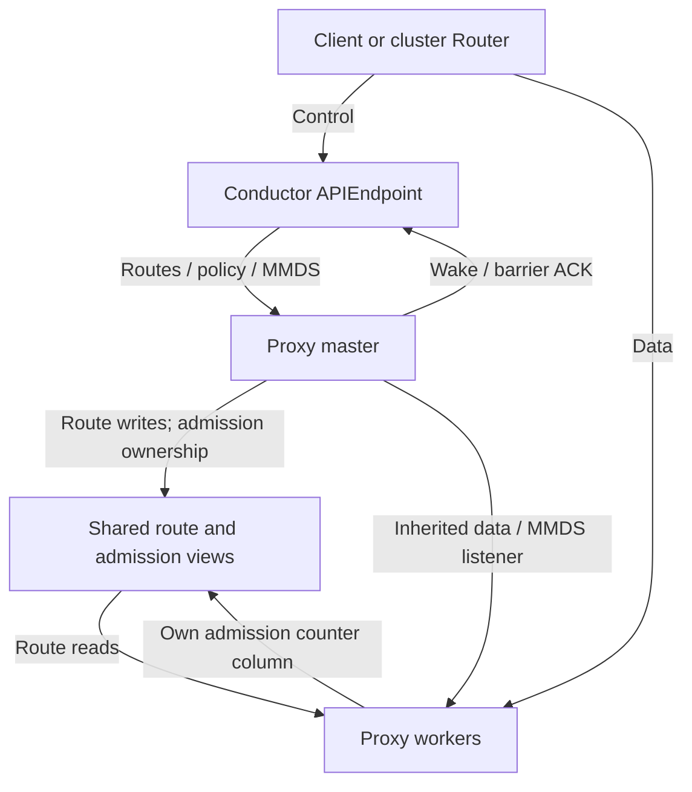

[English](node-proxy.md) | [简体中文](node-proxy_zh.md)

<a id="overview"></a>

# Access, credentials and proxy

Configure client access, tenant credentials, native exec and forwarding; then operate the node Proxy. The final sections specify route synchronization and admission internals. Sandbox state transitions remain in [Sandbox lifecycle](sandbox-lifecycle.md), cluster ingress in [cluster](cluster.md), and custom applications in [extensions](extensions.md).

**Read by task:** [SDK access](#sdk-configuration) · [Credentials](#credential-model) · [Exec sessions](#exec-session-api) · [Configure](#proxy-configuration) · [Deploy](#deployment) · [MMDS](#mmds) · [Traffic admission](#admission) · [Route protocol](#route-synchronization)

<a id="proxy-role"></a>

## Overview

The data-plane proxy is the L7 forwarding layer for sandbox traffic. It routes requests from external e2b SDKs/CLIs, port forwarding, or the cluster router by `(sid, target)` to guest envd/CI UDS endpoints, user ports at a sandbox floating IP, or the native exec `ctl.sock`. Ordinary HTTP retains the legacy port target; CONNECT can explicitly select a logical service with `E2b-Sandbox-Service`. The control-plane API, lifecycle, keys, and builds belong to `node-ctl conductor serve`; see [node.md](node.md). This document covers the data-plane forwarding layer.

```text
client / cluster-router
  │ Host: <port>-<sid>.<domain>
  │ or E2b-Sandbox-Id + E2b-Sandbox-Port
  │ CONNECT may add E2b-Sandbox-Service + X-Access-Token
  ▼
node proxy worker
  │ shared route view (read-only mmap)
  ├─ e2b legacy 49983/49999 ─► envd / ci UDS
  ├─ forward:port ───────────► floatingip:port
  └─ exec ──────────────────► <run_root>/sandboxes/<sid>/ctl.sock
```

<a id="design-principles"></a>

### Design principles

Sandbox metric collection/history is owned by the separate
[Telemetry component](observability.md#telemetry), not Proxy's traffic counters or MMDS.
Telemetry reuses the management namespace/packet path and MMDS FloatingIP
lookup rules, but directly accepts guest OTLP on its own listeners. Do not
forward OTLP through the application data proxy; Conductor's metrics query uses
the live telemetry registration's separate API UDS, not Proxy StatsSocket.

- **Separate forwarding and control planes:** the proxy decides routes, applies authentication policy, and forwards bytes. The conductor owns sandbox lifecycle authority.
- **One subscribing master, multiple forwarding workers:** only the proxy master registers a config-socket plugin. Workers neither connect to the conductor nor hold independent routesync subscriptions.
- **Separate route views:** fixed-length data-plane fields enter shared memory, which workers mmap read-only. Variable-length `mmds_routes` and `mmds_route_secret_values` remain in the master's bounded heap. Workers query an exact path through inherited local socketpair RPC. Secret-value plaintext never enters mmap.
- **Inherited listener FDs:** configuration selects a TCP address or a named activated listener for data and MMDS independently. The master gives each worker its own descriptor for the same listening socket. Service-owned copies preserve listeners across InplaceRestart.
- **Configurable forwarding network namespace:** with `proxy_netns` pointing to the connector management namespace, workers run there; their `floatingip:port` access and the MMDS listener also use that namespace.
- **No upstream connection pool:** ordinary HTTP dials and closes a backend for each request. Each CONNECT binds one request to one TCP/UDS connection. Connections are never reused across sandboxes or ports.
- **Authentication policy precedes lifecycle effects:** ordinary HTTP and non-exec CONNECT follow `LookupRoute → authorize(RouteBinding) → TryBeginParking → ActivateRoute → fresh Route → dial`. Lookup never wakes, resumes, parks, or dials; Activate revalidates the binding before and after lifecycle effects. Invalid ordinary credentials cannot wake a sandbox or consume traffic parking/admission when the node's effective policy is `enforce`. Node `log`/`off` modes admit ordinary requests according to [Data-plane authentication](#authorization).
- **Logical service selection belongs to CONNECT:** ordinary HTTP does not use `E2b-Sandbox-Service` to choose a backend and otherwise forwards it as an application header. The explicit exception is the exact value `exec`, which returns 405 before activation. For CONNECT, an explicit service is authoritative for backend selection.
- **Exec authenticates before activation:** `service=exec` always validates a KAT bound to `StableID`. After CONNECT 200, it must also authorize the complete first ExecRequest. Failure cannot trigger parking, Wake/resume, or a backend dial. The final node proxy gives the ctl tunnel helper only requests that pass both gates; it exposes neither arbitrary UDS endpoints nor other ctl capabilities to tenants.
- **Deterministic MMDS keys:** `MmdsSecret = HMAC-SHA256(manifest_key, "kuasar-mmds-v1:" + sid)`, with the hex manifest key decoded to bytes. PUT and GET therefore agree even when different workers serve them.

<a id="sdk-configuration"></a>

## SDK/CLI integration and protocol pins

- Production TLS uses `E2B_DOMAIN` and `E2B_API_KEY`; development can use HTTP/h2c `E2B_API_URL` and `E2B_SANDBOX_URL` for the separate control and data listeners. At cluster Router ingress, only the exact Host `api.<configured domain>` (after stripping the port) selects the control plane, not arbitrary `api.*` hosts. Direct access to the Conductor control listener, including a development `E2B_API_URL`, has no such Host requirement: its API mux routes by method and path, and does not forward sandbox data.
- API keys are `e2b_` plus 72 hex digits, 76 characters total. SDK syntax checking uses `/^e2b_[0-9a-f]+$/`; server separately checks MAC ([Credentials and ownership: encrypted APISecret/ManifestKey pairs](#credential-model)).
- Envd is built from `packages/envd` in the `e2b-dev/runtime` source tarball. `guest-runtime/native-deps/Makefile` pins `ENVD_TARBALL` to tag `2026.22` with its matching `ENVD_TARBALL_SHA256`; these are source inputs, not a prebuilt envd download. The recorded SDK compatibility baseline is JavaScript e2b 2.27.x and Python 2.25.x; this is not a claim about every later version.
- X-Access-Token carries envdAccessToken. Secure Sandbox behavior is enabled by default from SDK v2.0.0, which attaches it to data requests.
- Internal Proxy/observer frames, messages and compatibility versions are defined in the [route synchronization contract](#route-synchronization); they are separate from SDK compatibility.

<a id="data-protocols"></a>

## Data protocols: envd and native exec

envd uses port **49983**, HTTP/1.1 plus h2c and unversioned Connect-RPC process.Process/filesystem.Filesystem packages. Filesystem RPC handles metadata; contents use GET/POST /files with signed query. Other endpoints include /health, /init and /metrics. Per-operation user uses `Authorization: Basic base64("user:")`. Code-interpreter POSTs NDJSON to `https://49999-<sid>.<domain>/execute`, reaching guest FastAPI on 49999 and Jupyter on 8888. Envd exec is POST /process.Process/Start with X-Access-Token. Tenant traffic is forwarded, not reimplemented; Build supplies a minimal hand-written connect+JSON process.Start client for steps/startCmd/readyCmd, without generated protobuf/gRPC stubs ([Target-aware execution and publication](node-build.md#execution-and-publication)).

sandbox-ctl --connect maps guest envd/CI control ports to host `<rundir>/envd.sock` and `ci.sock`. Proxy reaches these UDS paths directly without floating-IP routing or a cross-sandbox path.

Native exec uses a separate ctl protocol. Clients obtain ExecAccessToken ([Control plane: sandbox lifecycle](sandbox-lifecycle.md#sandbox-api)), then establish service-addressed CONNECT:

```http
CONNECT sandbox:443 HTTP/1.1
E2b-Sandbox-Id: <NodeSandboxID>
E2b-Sandbox-Service: exec
X-Access-Token: kat1.<payload>.<signature>
```

Authority port 443 is a transport placeholder, not a guest port. Even an accompanying E2b-Sandbox-Port cannot select exec backend. service=exec requires CONNECT and always enforces KAT regardless of ordinary off/log/enforce policy. After CONNECT 200, final Proxy reads and authorizes the complete exec_request first frame. Only successful conditions permit paused activation, ctl.sock dial and exact raw-frame forwarding; see [node-proxy.md](node-proxy.md) [Forwarding paths](#transfers).

<a id="data-routing-overview"></a>

## Route selection and backend identity

Legacy data routing parses `(sid,port)` from `Host` (`<port>-<sid>.<domain>`) or `E2b-Sandbox-Id`/`E2b-Sandbox-Port`. For e2b, ports 49983/49999 authenticate with EnvdAccessToken and dial sandbox-ctl `--connect` host UDS endpoints for envd/CI. For bare, these numbers are ordinary legal ports: ForwardAccessToken authorizes `floatingip:port`. CONNECT may explicitly carry `E2b-Sandbox-Service: forward|e2b:envd|e2b:code-interpreter|exec`; this is the authoritative backend selector. Ordinary HTTP otherwise uses legacy routing, but explicitly naming `exec` returns 405. Native exec uses an explicitly minted ExecAccessToken, verifies KAT before any resume side effects and ultimately reaches `<RunRoot>/sandboxes/<NodeSandboxID>/ctl.sock`.

TrafficAccessToken is for external gateways/e2b data components; node's platform layer does not consume it. Authorized requests to paused sandboxes trigger automatic resume through the shared launch owner ([Lifecycle and state machine](sandbox-lifecycle.md#state-and-ownership)). Independent Proxy is the sole node data plane; see [node-proxy.md](node-proxy.md). In a cluster, Router maps the stable public SandboxID to current NodeSandboxID, injects `E2b-Sandbox-Id` and `X-Access-Token`, and forwards to node Proxy ([cluster.md](cluster.md#client-access)).

<a id="credential-model"></a>

## Credentials and ownership: encrypted APISecret/ManifestKey pairs

- **Separate tenant roots:** both APISecret and ManifestKey are 32 bytes represented as 64 lowercase hex digits. APISecret authenticates API requests and derives ServiceSecret. ManifestKey protects Manifest content through MANIFEST_KEY/manifest.key and seals image-pull tokens. A pair may specify APISecret; otherwise use the fixed domain-separated KDF:

  ```
  APISecret = HMAC-SHA256(decodeHex(ManifestKey), "kuasar-api-secret-v1")
  ```

  **Only APISecret signs/verifies API keys** through e2b-key-ctl gen-apikey:

  ```
  api_key = "e2b_" + hex( fp(12) ‖ ts(4) ‖ nonce(4) ‖ mac(16) )      # 76 characters
  fp  = SHA256(APISecret)[:12]                                       # Candidate prefilter, not unique identity
  mac = HMAC-SHA256(APISecret, fp‖ts‖nonce)[:16]                     # Unforgeable without APISecret
  ```

  SDK syntax uses /^e2b_[0-9a-f]+$/, while internal/apikey separately checks MAC. Neither root credential is sent to SDK clients.
- **Encrypted storage:** manifest_keys/sandboxes/builds each store the complete pair. api_secret_enc and manifest_key_enc use AES-256-GCM in internal/secretbox: keytag(4)‖nonce(12)‖ciphertext+tag; keytag selects a decryption key. Each root has a full 64-hex SHA-256 fingerprint. The API key's 24-hex prefix only prefilters candidates. encryption_key/NODE_CONFIG_ENCRYPTION_KEY takes colon-separated keys, first active, others retained for rotation; custom Runtime providers have the priority described in [Configuration](node.md#conductor-configuration).
- **Authentication:** prefilter by APISecret fingerprint prefix, decrypt candidate APISecret, recompute HMAC. Create/build/import requires its complete pair in manifest_keys (daemon-only writes, manual CLI or Registry lease), otherwise 403. Existing ID/list operations check the resource's own APISecret without allowlist lookup, so clearing allowlist does not revoke existing resources before their lifecycle ends. List verifies MAC per candidate after prefix filtering, preventing hash-collision tenant crossover.
- **Copied business credentials:** Create/Build/import copies the complete pair into its row. Later allowlist add/drop/expiry or provider changes affect new records, never rebind existing ones.
- **Convergent storage:** ManifestKey seals the Manifest key table; chunk encryption keys derive from SHA256(salt‖plaintext). Writers sharing a Store salt belong to one content-sharing domain, allowing identical plaintext to reuse objects. Isolation requires extra_salt or separate Store/salt domains. Content equality never shares tenant ManifestKeys/APISecrets/templates or expands their authorization boundaries.
- **No plaintext stored roots:** roots reside encrypted in SQLite and only in necessary trusted process memory/protected route projections/environment at runtime. Authenticated exact-run bootstrap delivers sandbox ManifestKey; runner replaces inherited same-name entries so final exec has one authoritative MANIFEST_KEY. Conductor can store/deliver it but managed host preparation does not call CustomerKey, construct key-bound readers or open/decrypt/parse tenant artifacts. Sandbox YAML contains no root credentials.

  Builder likewise gets authoritative environment only after authentication. run-builder installs MANIFEST_KEY as process-wide reader authority and removes inherited registry credential keys. Registry credentials remain in local BuildSpec and go only to the host flatten operation or guest import command that needs them, not phase sandbox-ctl descendant environments. APISecret stays with conductor API authentication/ServiceSecret derivation and protected trusted Router/Proxy projections, never guest workloads. Auto-resume decrypts ManifestKey only for authenticated task delivery. Node-link installs both roots atomically with encrypted storage and runtime-only plaintext.
- Each Sandbox durably stores ServiceSecret, deriving it by default as HMAC-SHA256(APISecret, `kuasar-service-secret-v1:`+StableID()), then never rebuilding it after storage. e2b EnvdAccessToken/TrafficAccessToken may be overridden, otherwise are random; bare keeps both empty. EnvdAccessToken serves e2b 49983/49999. TrafficAccessToken is for external gateways/e2b data components, not node platform authentication. Each opaque token is valid UTF-8 and at most 256 bytes, checked before persistence. Both profiles' ForwardAccessToken is strict kat1 signed by ServiceSecret, with stable SID and aud=forward. All four credentials persist encrypted and cannot be rebound by lifecycle Upsert.

  ExecAccessToken is not generated by default in create/get/list and never stored in the Sandbox row. Each exec-sessions call mints a UUIDv7 session_id token: `kat1.<base64url-no-padding(payload)>.<base64url-no-padding(signature)>`. Canonical fields are v,session_id,sid,aud, optional exp and optional conditions; sid is StableID, aud is exec, and there is no iat. HMAC-SHA256 uses decoded 32-byte ServiceSecret directly, without another exec key. Conditions are compact strings in API order, omitted when unrestricted, signed together with other fields without a separate digest. Token holders can decode them, so expressions must not contain confidential literals. Payload has no generation, node ID or route revision. Node mints; Router/Proxy verify protected routes. Strict validation covers three segments, canonical unpadded base64url, 32-byte signature, fixed JSON fields/order, UUIDv7, SID, audience and optional expiry. Session ID is internal to KAT, not a separate API field.

  MmdsSecret is HMAC-SHA256 using decoded ManifestKey and `kuasar-mmds-v1:` plus the node-local SandboxID (not StableID). This deterministic per-sandbox MMDS session-signing key is projected to trusted Proxy when enabled, authenticating envd ([MMDS](#mmds)).
- **Separate MMDS route-value storage:** MmdsSecret signs/verifies MMDSv2 tokens; MMDSRouteSecretValues contains sensitive response values. Each Sandbox/Build owner has one encrypted JSON blob containing actual name→opaque bytes only, without version, Content-Type, TTL or configured/wait state. AAD binds at least owner kind/ID, canonical route digest and revision. Updates use revision CAS; key rotation retains old secretbox decrypt keys. Create/Register transaction writes business row, routes-only metadata and initial blob together. Sandbox deletion cascades; Build terminal/cleanup removes its blob. Database contains ciphertext; plaintext exists only for bounded trusted conductor/Proxy heap lifetimes.

<a id="manifest-key-command"></a>

## `node-ctl manifest-key`

This thin client manages create/build credential-pair allowlisting (`manifest_keys`) through conductor's local **admin plane** ([Local control socket: run, task, admin, plugin and API planes](node.md#local-control-channels)). Daemon is the table's sole writer; CLI opens no DB and reads no config. It needs only `--socket`, or `NODE_CTL_SOCKET`, defaulting to `/run/sandbox/node-ctl.socket`.

ManifestKey comes from a positional argument or `MANIFEST_KEY`. APISecret can be supplied through `--api-secret`/`API_SECRET`; otherwise [Credentials and ownership: encrypted APISecret/ManifestKey pairs](#credential-model)'s KDF derives it. The pair is written atomically. Output includes only their full fingerprints, never root credentials. Registry also installs leased pairs over node-link ([Cluster integration (node-link)](cluster.md#node-attachment) and [cluster.md](cluster.md)), coexisting with manual entries.

```
node-ctl manifest-key add    [--api-secret S] [--label L] [--ttl 24h]
                             [--registry-auth <docker.json> |
                              --registry-username U --registry-password P |
                              --registry-token T]      [--socket S] <KEY>…
node-ctl manifest-key remove [--api-secret S] [--socket S] <KEY>…
node-ctl manifest-key check  [--api-secret S] [--socket S] <KEY>…
node-ctl manifest-key list   [--socket S]
```

- `--api-secret` explicitly pairs an APISecret with one `<KEY>` only; omission derives the default. `add/remove/check` always operate on the complete pair.
- `--ttl` sets expiry duration (`0`/omitted means never). Repeated add refreshes expiry only for an identical complete pair. Binding the same full APISecret fingerprint to different credential material conflicts. Expired pairs are treated as absent and lazily removed by the reaper; `list` shows `expires`.
- `--registry-auth`/`--registry-*` configure default tenant pull credentials encrypted in `registry_auth_enc`, selected by fromImage host during Build ([Target-aware execution and publication](node-build.md#execution-and-publication)).
- `add/remove/check` prints `STATUS api=<64-hex> manifest=<64-hex>`; `list` prints both full fingerprints per row.
- Authentication uses `SO_PEERCRED`: with `paths.admin_pidfile`, peer PID must be listed; otherwise socket mode 0600 is the boundary (same UID/root).

<a id="credential-tool"></a>

## `e2b-key-ctl`

See [Subcommands](node.md#command-catalog) for the command list. Full `seal-pull-token` syntax:

```
e2b-key-ctl seal-pull-token [<MANIFEST_KEY>] {--registry-username U --registry-password P |
                                              --registry-token T}
```

The opaque `kpt_` token contains image-pull credentials sealed with AES-GCM using a tenant ManifestKey-derived key. SDK `api_headers` sends it as `X-Kuasar-Pull-Token` with the Build request; conductor opens it using the tenant's stored key ([Target-aware execution and publication](node-build.md#execution-and-publication)). ManifestKey comes from the first positional argument or `MANIFEST_KEY`.

<a id="exec-session-api"></a>

## Exec session API

Exec session is explicit authorization, not a server session object or guest process. Its strict JSON object accepts int64 ttlSeconds and conditions objects containing expr:

```json
{
  "ttlSeconds": 3600,
  "conditions": [
    {"expr": "request.argv == ['/usr/bin/python3', '/workspace/task.py']"},
    {"expr": "request.cwd == '/workspace'"},
    {"expr": "request.user == '1000:1000' && !request.stdio.tty"}
  ]
}
```

Omitted conditions or [] means unrestricted, normalized to nil and omitted from token payload. Explicit null, non-arrays, unknown/duplicate fields, non-object elements, unknown/duplicate element fields or empty expr return 400. Conditions combine with AND; use `||` within one CEL expression for OR. The entire raw body, including trailing whitespace, is capped at 64 KiB. A second JSON value, negative/out-of-range TTL fails before lifecycle side effects; 64 KiB+1 returns 413. Omitted/zero ttlSeconds gives no expiry. Positive values calculate exp at actual mint time; Unix-second or time.Time overflow returns 400.

Before compiling caller-controlled CEL, standalone node performs side-effect-free credential preflight: an existing target checks resource-bound APISecret; a missing KMT-import target checks an allowlisted pair. After compilation, prepareStandaloneTarget authoritatively validates again against concurrent changes before possible import/resume. CEL exposes only typed request: argv list(string), env map(string,string), cwd/user strings and stdio tty/stdin/stdout/stderr booleans. It exposes no route, claims, metadata, clock, filesystem, network, secrets or I/O/side-effect functions. Before minting or paused→starting, node compiles, requires boolean type and applies source/AST/cost bounds. Unknown fields, non-booleans and excessive bounds fail. Existing eager exec-session activation remains; deferred activation is separate #240 work.

Compilation precedes target preparation and lifecycle mutation. The SID fence then waits for the previous attempt's terminal cleanup, mints using actual current time, and only afterward permits a new paused→starting transition. Fence waiting does not consume token TTL; compilation/signature failure starts no new launch.

Existing targets ignore migration token. Missing targets may synchronously import, validating the object, credential binding and profile; node then signs KAT with the row's ServiceSecret. MigrationToken is transient input, never stored in Sandbox business rows, logs or errors, and is discarded after use. Paused targets accept asynchronous resume without waiting for READY. Successful response sets Cache-Control: no-store and contains exactly:

```json
{"execAccessToken":"kat1.<payload>.<signature>"}
```

It returns no session ID, expiry, ServiceSecret or other route/credential fields. Authentication retains existing 401/403; missing/non-owned sandboxes return 404. Synchronous import, credential read/mint or asynchronous-resume admission failures expose sanitized 503, omitting fingerprints, ServiceSecret, NodeSandboxID, socket paths and KAT payload.

<a id="proxy-configuration"></a>

## Proxy command and configuration

Start the node data plane as one proxy master process:

```bash
node-ctl proxy serve --config /etc/node-ctl/proxy.yaml
```

`node-ctl` runs the built-in master or replaces itself with a statically customized master selected by `paths.proxy_executable`. The master always reexecutes its own current executable to start workers. The internal worker mode is not an operator interface.

Static customization interfaces, configuration hooks, runtime binding, private route sources and authorized forwarding are defined in [Extensions](extensions.md#proxy-bootstrap).

`--config` also accepts an ordered `base.yaml:override.yaml` list. The master
loads and merges it once; workers continue to use the frozen bootstrap
configuration. See the shared [configuration-file rules](node.md#configuration-files).

`proxy.yaml` fields:

| Field | Default | Meaning |
|---|---|---|
| `config_socket` | `/run/sandbox/node-ctl.socket` | Conductor config-socket; the master registers on its plugin plane and synchronizes routes |
| `paths.proxy_executable` | Empty | Absolute executable for a statically customized Proxy master; empty uses the built-in implementation. Static diagnostics check regular/executable status, absence of group/world writability, and same-file identity, without inferring ownership from the diagnostic command's EUID. Actual root dispatch requires root ownership; non-root dispatch accepts root or its own EUID. It selects node-ctl → master dispatch and the target opened when InplaceRestart is accepted; workers use their own master's image |
| `paths.run_root` | Required | Node RunRoot; workers construct `<run_root>/sandboxes/<NodeSandboxID>/ctl.sock` locally. This path is not transmitted in routesync `Policy` or shared route records |
| `data_listen` | Required | The node's sandbox data ingress: TCP `host:port`, or `fd=<name>` for an explicitly supplied named TCP listener |
| `shutdown_timeout` | `0` | Non-negative duration; zero disables InplaceRestart and makes automatic termination immediate. Explicit App.Shutdown still drains gracefully. A positive budget is shared by data/MMDS and, for full stop, all instances |
| `inplace_restart` | `false` | Register SIGUSR2 in the original master entry when true; direct `App.InplaceRestart` works with either value |
| `proxy_netns` | Empty | Forwarding namespace; empty uses the current namespace. Otherwise workers run there and the conductor-projected MMDS address is bound there; `data_listen` stays in the master's current namespace |
| `stats_socket` | `<dir(config_socket)>/proxy-stats.sock` | Traffic-stats UDS owned and registered with the conductor by the master. Must be absolute, cannot conflict with config/SHM paths, and has mode 0600 |
| `shm_path` | `<dir(config_socket)>/proxy-routes.shm` | Shared route-table mmap file |
| `route_capacity` | `65536` | Fixed route-slot capacity; exhaustion fails Upsert and terminates the current routesync session. A Create waiting for that route returns 503 |
| `workers` | `1` | Number of worker processes |
| `tls` | Empty | Data-plane TLS `{cert,key}`; empty means h2c |
| `auth` | `enforce` | Data-plane authentication fallback before routesync policy arrives |
| `park_timeout` | `30s` | Parking fallback before routesync policy arrives |
| `metrics_listen` | Empty | Master Prometheus text endpoint aggregating worker data-plane counters |
| `traffic.max_inflight.total` | `0` | Node-wide per-sandbox inflight limit across all applicable services; `0` means unlimited |
| `traffic.max_inflight.forward` | `0` | Per-sandbox `forward` inflight limit; `0` means unlimited |
| `traffic.max_inflight."e2b:envd"` | `0` | Per-e2b-sandbox envd inflight limit; `0` means unlimited |
| `traffic.max_inflight."e2b:code-interpreter"` | `0` | Per-e2b-sandbox code-interpreter inflight limit; `0` means unlimited |
| `traffic.max_inflight.exec` | `0` | Per-sandbox native exec inflight limit; `0` means unlimited |

`proxy.yaml` contains neither `mmds_listen` nor `services`. Their sole sources are conductor `mmds.listen` and `mmds.services`, delivered in `Hello{Policy}` through trusted plugin registration.

<a id="proxy-command"></a>

## `node-ctl proxy`

This is the independent data-plane master, deployed separately on the conductor's node. Its `proxy.yaml` has its own schema ([node-proxy.md](node-proxy.md) [Proxy command and configuration](#proxy-configuration)). Master internally reexecs and supervises workers using its current executable; workers neither enter the node-ctl CLI dispatcher nor reread configuration:

```
node-ctl proxy serve --config /etc/node-ctl/proxy.yaml
```

`proxy.yaml` configures process endpoints/bootstrap policy: `config_socket`, `data_listen`, `proxy_netns`, `stats_socket`, `shm_path`, `workers`, `tls`, `auth` and `park_timeout`. Only conductor configures MMDS listening and the service registry. Master registers once on the plugin plane, receives MMDS policy in the handshake, maintains the shared route view and passes the sole Data listener FD to workers. See [node-proxy.md](node-proxy.md) [Proxy command and configuration](#proxy-configuration) and [Forwarding paths](#transfers); conductor and Proxy must be deployed together.

<a id="conductor-access-configuration"></a>

## Conductor access configuration

These fields belong to Conductor configuration. Shared loading, path and environment rules are defined in [node operation](node.md#conductor-configuration).

| Field | Default | Meaning |
|---|---|---|
| `proxy.park_timeout` | `30s` | Request parking budget while waiting for route synchronization or paused-sandbox resume ([node-proxy.md](node-proxy.md) [routesync and shared route views](#route-synchronization)) |
| `proxy.auth` | `enforce` | Data authentication policy: `off`/`log`/`enforce`, checking `X-Access-Token` ([node-proxy.md](node-proxy.md) [Data-plane authentication](#authorization)) |
| `encryption_key` | Required in built-in mode | AES-256 keys for stored credential pairs: colon-separated 64-hex values, first active, others retained for old records. Priority: custom Runtime provider > `NODE_CONFIG_ENCRYPTION_KEY` > YAML; provider failure never falls back |
| `mmds.enabled` | `false` | envd authentication posture ([Route authority and broadcast](#route-publication), node-proxy [MMDS](#mmds)): false uses -isnotfc and the Proxy gate; true uses FC mode and MMDS re-key |
| `mmds.listen` | `127.0.0.1:19254` | MMDS listener, targeted by vswitch --mgmt-service translation |
| `mmds.routes.enabled` | `false` | Accept tenant static/secret/service exact routes; requires mmds.enabled |
| `mmds.routes.max_routes_per_sandbox` | `32` | Maximum routes for each Sandbox or Build |
| `mmds.routes.max_namespace_bytes` | `65536` | Maximum bytes in one Header/metadata MMDS JSON document |
| `mmds.routes.max_static_body_bytes` | `16384` | Maximum UTF-8 bytes in one static data value |
| `mmds.routes.max_secret_value_bytes` | `16384` | Maximum initial secret string/admin PUT opaque body |
| `mmds.routes.reserved_path_prefixes` | `[/latest/api/, /internal/]` | Exact-path prefixes reserved from tenant routes; built-in `/` is also reserved |
| `mmds.services` | Empty | Conductor-only local service registry, name.endpoint; V1 requires absolute unix:// endpoints, with no duplicate proxy.yaml registry |

<a id="deployment"></a>

## Deployment topology

Every sandbox-capable node runs both conductor and Proxy. The conductor API listener carries only the control plane; the Proxy's required `data_listen` is the node's only sandbox data ingress. The two advertised endpoints point to these separate listeners, with no cross-plane fallback.



Key points:

- A/A′ register as `proxy`; temporary B uses a private instance ID. IDs identify ownership and same-name replacement. The admitted registration's `Proxy` capability identifies its role; `StatsSocket` is a separate optional traffic-stats address.
- Only the master listens on `stats_socket`. The conductor's public traffic GET reads the master's aggregate cache through this UDS, without querying workers on demand. A missing `StatsSocket` does not remove the route-barrier participant.
- Workers do not register plugins or hold independent complete route tables. Route mmap remains master-write/worker-read-only; in admission mmap, each worker writes only its own absolute-counter column. The master restarts crashed workers, and replacements read the current route/admission view directly.
- Master exit takes its workers down. After systemd restarts the master, it registers again and rebuilds shared tables.
- Admitted registrations must satisfy `subscribe.kind=route_wake`, `proxy!=nil`, and `mmds=true` before the conductor projects MMDS policy, routes, and secret values. Connection admission, valid MMDS state and registration epochs remain enforced. Ordinary observers and node-link never receive these confidential values.

<a id="readiness"></a>

## Business readiness and service status

Each master reserves `GET /readyz` and `GET /status` on its own 0600 `stats_socket`.
Both return JSON with `Cache-Control: no-store`; other methods return 405.
`/readyz` returns 200 only after initial Bookmark, local initialization and every
configured worker's actual data and enabled-MMDS acceptance; otherwise it returns
503. Zero sandboxes is valid; disabled MMDS does not block readiness. Later
worker or route-state faults remove readiness until recovery. These reads never
call a Guest. Stats-stream readiness and an open TCP port are insufficient.

```sh
curl --fail --silent --show-error --max-time 2 \
  --unix-socket /run/sandbox/proxy-stats.sock http://localhost/readyz
curl --silent --show-error --max-time 2 \
  --unix-socket /run/sandbox/proxy-stats.sock http://localhost/status
```

Status exposes local `ready`, `instance_id`, `boot_id`, `pid`, `phase`,
`routes_synced`, `workers.{ready,expected}`, `data`, `mmds` and `reasons`.
Phases are `starting/prepared/serving/draining/stopped/failed`; an unconfirmed
peer is `unknown`. Reasons include `initial_sync_pending`, `worker_not_ready`,
`route_state_unavailable` and `draining`. `service_ready` requires at least one
known ready instance and no complete-service stop. `instances` includes actual
management and metrics addresses. `inplace_restart` holds the current or last
operation's ID, phase, pinned target identity, attempts, latest error, next
attempt, result and forced-close count. Transition/result logs retain history.
The shared data port is never used to confirm a particular candidate's readiness.

<a id="shutdown"></a>

## Bounded shutdown

Shutdown independently stops data and MMDS acceptance and waits for each
endpoint's accepted work. A worker exits after both have ended; dependencies
remain available while its work still uses them. This does not guarantee request
sequences such as data calling MMDS or consecutive data/MMDS requests.
Ordinary responses, streaming bodies, HTTP/1 WebSocket and CONNECT tunnels, and
the supported HTTP/2/h2c paths participate. Existing keep-alive/H2 connections
cannot begin new business after drain starts; established tunnels can finish.
Listener Serve returning, HTTP Shutdown finishing and hijacked tunnels ending
are separate events. No new transport protocol is implied.

For HTTP/1, draining half-closes the response direction and consumes pending
input until the peer closes its write direction or the shared deadline expires.
This preserves a completed response when another request was already pipelined.
A keep-alive client that reads the complete response but leaves its write
direction open can therefore consume the remaining drain budget. Closing that
connection at the deadline is reported as forced even when the response body
was delivered in full. That result describes connection cleanup and does not
mean that an already completed response failed.

`shutdown_timeout` defaults to zero. Automatic termination (SIGINT/SIGTERM in
Run, or RunContext cancellation) then cleans up immediately; explicit
`App.Shutdown(ctx)` still drains accepted work without a configured deadline.
InplaceRestart requires a positive timeout. With a positive value, one instance
shares the budget across data and MMDS. Each of the two restart drains gets one
budget; full Shutdown shares one deadline across A/A′ and B. Repeated calls never
extend it, and caller cancellation ends only the wait. Deadline expiry closes
remaining work and reaps processes;
`ErrForcedClose` and `completed_with_forced_close` distinguish this outcome.
An extension's optional `Shutdown(context.Context) error` joins its work after
the core cancels its Start context. See [extension lifecycle](extensions.md#proxy-lifecycle-named-listeners-and-inplacerestart).

<a id="inplace-restart"></a>

## InplaceRestart

Both built-in Proxy and xproxy use **A → ready B → drained A → original-PID exec
→ ready A′ → drained/reaped B → A′ alone**. Each takeover requires business
readiness from dedicated local control. Initial Bookmark suffices for route
initialization; there is no old-instance catch-up condition. At most two
instances may retain business. B and workers cannot start nested operations.

Deploy a compatible binary as a separate protected file and atomically replace
the configured executable path. An accepted operation opens and pins that
target's identity and digest plus the original declarative input. B, A′ and
retries use those inputs even if the deployment path or YAML later changes.
Each master reruns Configure from that original input and checks takeover
compatibility. For initial adoption from an older version, use ordinary service
startup first. Conductor must advertise `inplace_restart_v1`, and configured
extensions must provide Shutdown; these checks also apply to programmatic calls.

With a positive `shutdown_timeout` and `inplace_restart: true`, trigger the original master:

```sh
systemctl kill --kill-who=main --signal=SIGUSR2 kuasar-proxy.service
```

The default false leaves SIGUSR2 unregistered; it does not disable
`App.InplaceRestart(ctx)` when the timeout is positive. Enabling the signal with
a zero timeout is a configuration error. `App.Run()` retains SIGINT/SIGTERM handling. A custom
entry uses `RunContext()` and calls App actions itself; see the
[public lifecycle API](extensions.md#proxy-lifecycle-named-listeners-and-inplacerestart). Acceptance returns an
operation ID, not final completion; the original Go stack cannot survive exec.
Inspect status throughout the operation, including B's private socket while the
original master's management endpoint is temporarily unavailable.

Before A stops accepting, a failed B is drained/reaped and A keeps serving.
After that boundary the coordinator recovers automatically: it replaces failed
B, retries failed exec, retries A′ initialization, repairs A′ during B drain,
and retries B reclamation. Candidate preparation is bounded by 30 seconds;
retry delays are 1/2/4/8/10 seconds, capped at 10 with no fixed attempt limit.
Preparation, drain and backoff have separate clocks. Stop cancels future
attempts. Persistent faults remain visible; removing their cause resumes the
same operation. Runtime-fatal main-process faults require deployment supervision.
Recovery never replays user requests or restores connections lost in a crash.

A/A′ retain configured `shm_path` and `stats_socket`; B creates checked private
names in the same parent directories. Only owned resources are removed after
actual process exit. Address listeners and activated listeners both retain
service copies; they are not rebound during replacement. Closing an instance's
listener never performs a socket-wide shutdown on another holder.

For metrics, empty disables all instances; fixed `host:p` uses p for A/A′ and
p+1 for B; port 0 remains dynamically assigned. Port 65535 rejects the operation.
B binds and retains its metrics listener before A drains; a conflict fails that
preparation without scanning further ports. IPv6 follows the same rule. Counters
may reset per instance and scraping may have a short gap. Ordinary startup logs
a metrics bind failure and continues serving; restart requires the configured
metrics resources to be available before A drains.

Traffic statistics remain instance-local. The existing traffic response exposes
`inplaceRestart: true` from acceptance through operation cleanup, including when
B answers during the exec gap. Idle consumers must treat these observations as
incomplete and read normal single-instance statistics again after completion.
An unavailable read is still an error, never zero or evidence that restart ended.
There are no persistent statistics records, completion files or cross-instance
counter aggregation. Each generation keeps existing admission limits and
single-generation concurrency slack. Reserve capacity for two instances, two
quota sets, FD/memory peaks and the adjacent metrics port.

<a id="listener-ownership"></a>

## Named listeners and systemd deployment

`data_listen: "fd=proxy-data"` and conductor `mmds.listen: "fd=proxy-mmds"`
select names exactly; either may independently remain a TCP address. Names are
case-sensitive, nonempty, and contain no whitespace, colon or NUL. Invalid,
missing, duplicate, unused, non-listening or non-TCP inputs fail startup; two
names cannot alias one socket. Environment inputs never override configuration
or cause an address to fall back to an inherited listener.

`app/activation.Receive()` adapts `LISTEN_FDS` and `LISTEN_FDNAMES` beginning at
FD 3. Absent input yields an empty map; zero accepts an empty name set. An
absent LISTEN_PID is allowed; a supplied empty, invalid or mismatched PID fails
without taking or closing its FDs. Processing clears activation environment;
owned descriptors are close-on-exec until explicitly passed to successors.
The final master consumes activation across node-ctl → xproxy; worker bootstrap
and logging descriptors remain separate. For direct runtime file ownership,
see [Runtime.ListenerFiles](extensions.md#proxy-lifecycle-named-listeners-and-inplacerestart).

The following units are deployment templates. Create the connector management
namespace and forwarding/address configuration first, then choose the MMDS
address that matches it. For example, with `proxy_netns: sw0_mgmt` and connector
forwarding to `127.0.0.1:19254` in that namespace:

```ini
# kuasar-proxy-data.socket
[Socket]
ListenStream=0.0.0.0:3443
Accept=no
FileDescriptorName=proxy-data
Service=kuasar-proxy.service

[Install]
WantedBy=sockets.target
```

```ini
# kuasar-proxy-mmds.socket
[Socket]
ListenStream=127.0.0.1:19254
NetworkNamespacePath=/run/netns/sw0_mgmt
Accept=no
FileDescriptorName=proxy-mmds
Service=kuasar-proxy.service

[Install]
WantedBy=sockets.target
```

```ini
# kuasar-proxy.service
[Unit]
Requires=kuasar-proxy-data.socket kuasar-proxy-mmds.socket
After=kuasar-proxy-data.socket kuasar-proxy-mmds.socket

[Service]
Type=simple
RuntimeDirectory=kuasar-proxy
RuntimeDirectoryMode=0700
ExecStart=/opt/kuasar/bin/node-ctl proxy serve --config /etc/node-ctl/proxy.yaml
Sockets=kuasar-proxy-data.socket kuasar-proxy-mmds.socket
KillMode=control-group
SendSIGKILL=yes
TimeoutStopSec=45s
Restart=on-failure
```

Set `shutdown_timeout: 30s` and `inplace_restart: true` in proxy.yaml for this
signal example, plus `data_listen: fd=proxy-data`. Conductor owns
`mmds: {enabled: true, listen: fd=proxy-mmds}`. Omit the MMDS unit and its service
references when MMDS is disabled. Keep runtime directory permissions, binary
ownership, namespace access and control-socket admission consistent with the
service identity. Add ordering for the deployment's actual conductor and network
setup units. Put `NetworkNamespacePath` in the MMDS unit's `[Socket]` section,
create that namespace first, and verify its listener with
`ip netns exec sw0_mgmt ss -ltn`. Putting only the service in a namespace does
not move existing sockets. See
[systemd namespace semantics](https://github.com/systemd/systemd/blob/v255/man/systemd.exec.xml).

`KillMode=control-group` sends TERM to the main process, B and their workers.
Each worker uses its configured drain budget, keeps dependencies until its
accepted business ends, and reports its stop over the existing control connection.
The first drain deadline wins when a master command and worker signal overlap.
Zero still means immediate automatic cleanup. Signaling one worker does not stop
other instances; its live master retains normal worker supervision. A custom
`RunContext` entry must translate its chosen termination signals to cancellation.
Set `TimeoutStopSec` above `shutdown_timeout` with reaping margin. Systemd waits
for the service's processes and forcibly reclaims any remaining ones at its
deadline, including when the main process exits first. `KillMode=mixed` can kill
B immediately after main exit; increasing `TimeoutStopSec` alone does not give B
its drain time in that mode.

TERM/INT may terminate the main process before Go installs its handlers after
exec. B detects its control connection closing, starts its own bounded drain,
and never starts another instance. This also works without systemd while B can
run; an external supervisor must handle a crashed or hung B. The B shutdown log
reports `completed`, `completed_with_forced_close`, or `failed`. The dead main
process cannot report a completed InplaceRestart operation. After its workers
finish, B removes its own paths and, if its parent has exited, the original
main instance paths whose file identities still match.

Set `stats_socket: /run/kuasar-proxy/stats.sock` and
`shm_path: /run/kuasar-proxy/routes.shm` for this example. The dedicated
`RuntimeDirectory` also removes files after an external forced kill prevents
application cleanup. Never assign a shared conductor directory to this unit;
explicit paths elsewhere need equivalent deployment-owned fatal-exit cleanup.
Ordinary `systemctl restart kuasar-proxy.service` retains active
socket units; queued connections still depend on backlog and client timeouts.
For complete shutdown, stop both socket units and the service together so
incoming traffic cannot activate it again. Install or alter production units
only through the deployment process.

<a id="transfers"></a>

## Forwarding paths

Ordinary HTTP parses `(sid, port)` from `Host: <port>-<sid>.<domain>` or `E2b-Sandbox-Id` / `E2b-Sandbox-Port`. It does not select a backend from `E2b-Sandbox-Service`; that header is forwarded unchanged as an application header, except that the exact value `exec` returns 405 before activation. CONNECT parses `(sid, service?, port?)`. The second cluster hop must use the current NodeSandboxID as `sid`.

Without an explicit service, the node applies the legacy mapping from its trusted local profile:

```text
profile=e2b  and port ∈ {49983,49999} → envd / ci UDS
otherwise                              → floatingip:port
unknown or not running before timeout   → 404
```

Thus bare ports 49983/49999 forward to `floatingip:port` just like any other valid port. They have no envd/CI logical meaning and do not return 501.

An explicit CONNECT `E2b-Sandbox-Service` replaces legacy port inference:

| Service | Supported profile | Backend | Port semantics |
|---|---|---|---|
| `forward` | e2b / bare | `floatingip:port` | Required from `E2b-Sandbox-Port`, legacy Host, or CONNECT authority |
| `e2b:envd` | e2b | envd UDS | May be present but does not select the backend |
| `e2b:code-interpreter` | e2b | CI UDS | May be present but does not select the backend |
| `exec` | e2b / bare | `<run_root>/sandboxes/<NodeSandboxID>/ctl.sock` | May be present but does not select the backend |

Explicit `e2b:envd` or `e2b:code-interpreter` on bare returns 501. An unknown or empty service returns 400. Service and port may coexist; the node never uses 49983/49999 to override an explicit service.

Ordinary HTTP:

1. The worker reads the shared table and obtains a `RouteBinding` without a backend.
2. It selects EnvdAccessToken or ForwardAccessToken for the target and applies the node's effective authentication policy to `X-Access-Token`. Eligible `/files` requests can also verify a signature with EnvdAccessToken; [Data-plane authentication](#authorization) describes mode-specific enforcement.
3. After admission by that policy, `TryBeginParking` checks sandbox total and target-service limits together. Success publishes the shared count and enters parking. Exhaustion returns 429 without Wake, Activate, or dial.
4. `ActivateRoute` revalidates the binding, including admission generation/effective policy, before Wake/waiting and again after lifecycle work. It constructs the final backend from the latest running route and fails closed if the binding changes.
5. It dials envd UDS or `floatingip:port` from that running route. With `proxy_netns`, the floating-IP dial occurs in that namespace.
6. It writes one HTTP request and streams the response, or relays a negotiated HTTP/1.1 WebSocket upgrade. Response completion or final relay completion closes the flow and releases its quota exactly once.

Ordinary HTTP permits the same backend during `running → pausing` and observes the selected route's state, RunID, backend address and authorization identity for its current target until the exchange ends. A withdrawn route cancels its transport without waiting for TCP retransmission timeouts. Before any guest HTTP bytes are written, the same admitted request may activate its original binding again and dial the latest endpoint; it retains its one admission/traffic flow and the client's context/deadline. Once forwarding starts, cancellation closes the backend and uses the existing upstream-error handling; it never replays HTTP bytes. Policy updates, including limited/unlimited transitions and changes to other services' credentials, do not evict an already accepted transport; any later reactivation still checks the original full binding. This is local transport availability behavior, not a packet-isolation condition; connector generation remains independent. CONNECT keeps its existing stream and half-close behavior.

CONNECT:

- Sandbox ID comes from `E2b-Sandbox-Id` or the legacy authority label.
- Legacy/`forward` may obtain the actual port from CONNECT authority. For portless logical services, authority is only a transport placeholder and does not produce `E2b-Sandbox-Port`.
- After ordinary forward/envd/CI targets pass the effective authentication policy, the client and backend connections are spliced bidirectionally.
- `service=exec` accepts CONNECT only. Ordinary HTTP carrying this service returns 405 without triggering resume.

Node exec has three ordered stages:

1. Before CONNECT 200, side-effect-free local `LookupExec` supplies the route identity; the worker then strictly verifies the `X-Access-Token` KAT using that `StableID + ServiceSecret`. Only after successful HMAC verification does it compile CEL programs or retrieve them from the bounded cache. Lookup may wait for initial route synchronization/propagation without Wake; this is not traffic parking or admission. This stage neither activates nor dials `ctl.sock`. Token/identity/expiry/condition failures end with HTTP 400/401/404/501; a route lookup error returns 503.
2. After returning and flushing CONNECT 200, it reads the complete first ctl frame within a fixed 10-second first-request timeout. Strict parsing covers top-level `exec_request`, `ExecSpec`, and `StdioSpec`, preserving the client's original four-byte little-endian length plus JSON bytes. It rechecks expiry, constructs the normalized request view, and ANDs all conditions. False, error, unknown, cost exhaustion, and cancellation all fail closed.
3. Only successful request admission permits `TryBeginParking(exec) → ActivateExec → exact identity recheck → ctl.sock dial → AttachBackend`. It then writes the first Raw frame unchanged exactly once and starts bidirectional relay. Once that frame reaches the backend, it never retries, reroutes, or replays it.

The CEL view normalizes nil argv/env to `[]`/`{}`, and empty cwd or `/` to `/`; user retains its requested value. In TTY mode, stdin/stdout/stderr flags retain the ctl wire's ignored semantics. The view exposes normalized effective semantics and does not reject valid requests merely because those flags coexist. Failed condition or structural gates change neither parking nor activity and start no guest child, so they cannot resume a paused sandbox.

Workers obtain required `paths.run_root` from the master's frozen EffectiveConfig rather than rereading `proxy.yaml`. It must agree with the same node conductor's `paths.run_root`. routesync `Policy` and shared views project routes, credentials, and authentication policy, never the `ctl.sock` path.

The shared sandboxer tunnel helper understands no KAT, CEL, route, or lifecycle. It fixes callback ordering, strict first-frame reading, one-time Raw forwarding, and half-close relay. H1 continues from Hijack's buffered reader; H2 reads the request body and promptly flushes responses. Both preserve half-close and wait for both relay directions. After CONNECT 200, a fully recognized request denial or backend failure returns the same sanitized ctl frame, `{"type":"error","msg":"exec request rejected"}`. Unrecoverable framing closes the tunnel directly. `max_inflight.exec` is checked only after the first frame and CEL pass. Since HTTP 200 is already committed, exhaustion uses that generic ctl error and closes, records `data_requests_total{result="max_inflight_reached"}`, and neither fabricates HTTP 429 / `X-Kuasar-Proxy-Error` nor activates or dials `ctl.sock`.

KAT validation occurs at CONNECT admission and expiry is rechecked during first-frame authorization. Expiry after backend relay begins does not forcibly close an established tunnel. One unexpired KAT can open multiple independent CONNECTs. Each tunnel carries exactly one ctl exec session and never reuses a backend connection. New CONNECTs use the current NodeSandboxID after a route change; established tunnels do not migrate.

The worker performs the complete token, request, and backend gates in its own process, constructing `sandboxes/<NodeSandboxID>/ctl.sock` under frozen EffectiveConfig `paths.run_root`. Neither this path nor CEL programs enter routesync `Policy` or SHM records. The conductor does not parse, select, or forward ordinary HTTP, CONNECT, or exec bytes. Data requests sent to APIEndpoint receive only the API handler's natural response. The cluster router's canonical chained CONNECT is a relay; traffic accounting occurs only at the node worker establishing the final sandbox backend.

<a id="http11-websocket-forwarding"></a>

### HTTP/1.1 WebSocket forwarding

Standard ingress and privately authenticated `ForwardAuthorized` use the same
HTTP exchange. The latter applies `Rewrite` to a clone before final transport
normalization; rejection writes no guest request bytes. An HTTP/1.1 GET carrying
`Connection: Upgrade` and `Upgrade: websocket` keeps the upgrade handshake.
Connection tokens may be mixed-case, comma-separated, or split across header
values. Unrelated hop-by-hop headers, including fields nominated by Connection,
are removed. Endpoint handshake headers, cookies, Origin and application
authorization remain unless nominated as hop-by-hop fields. The endpoints
validate the key, version, origin and subprotocol.

A regular upstream response, including handshake rejection, is streamed normally.
Only a matching HTTP/1.1 WebSocket 101 transfers the response to a bidirectional
relay. An unexpected or mismatched 101 returns 502 before hijack; a writer that
cannot hijack, including through `Unwrap`, returns 500 `upgrade unsupported`.
After hijack, failures close the transport without writing another HTTP error.
Both readers' prefetched bytes survive. A clean EOF half-closes the peer and
drains its tail; request cancellation closes both sides and joins the relay.

One upgraded connection retains the original tracked backend, admission lease
and connected count until relay completion. Frames do not create new ingress or
request-result counts. The cluster router uses this same HTTP exchange over its
existing node CONNECT tunnel, retaining its buffered reader and identity rewrite;
there is no second WebSocket implementation or replay of the inner request.
No new configuration, extension API, frame processing, or HTTP/2 extended CONNECT
is introduced.

<a id="authorization"></a>

## Data-plane authentication

All data-plane requests use `X-Access-Token`, with the expected value selected by target:

- e2b legacy ports 49983/49999 and explicit `e2b:envd` / `e2b:code-interpreter` use the create response's `envdAccessToken`.
- Every bare legacy port, other e2b legacy ports, and explicit `forward` use `forwardAccessToken`.
- `trafficAccessToken` is for verification by external gateways and e2b data-plane components; the node proxy does not consume it.
- `exec` accepts only a `kat1` ExecAccessToken directly HMAC-signed with ServiceSecret, bound to `StableID`, with `aud=exec`. Envd/Forward/Traffic tokens cannot replace it.

EnvdAccessToken is opaque. ForwardAccessToken is a deterministic `kat1` signed by ServiceSecret, bound to `StableID` with `aud=forward`, not an opaque envd token. For ordinary requests, the node compares the supplied token with the target's expected token from the trusted route, subject to the modes below and the legacy signed-file exception. Exec independently validates its KAT format, signature, SID, audience, and optional expiry, then authorizes the first ExecRequest.

`auth` / policy `auth_mode`:

| Mode | Behavior |
|---|---|
| `enforce` | A mismatch returns 401 |
| `log` | Log mismatches but allow forwarding |
| `off` | Skip validation |

This table applies only to ordinary data traffic. Exec always enforces authentication, regardless of `auth_mode`. The node uses its own effective policy; router `enforce` does not change it. In node `log`/`off`, invalid ordinary credentials can pass into parking, activation, and backend dial.

For e2b legacy 49983 `GET/POST /files` without `X-Access-Token`, the node can verify envd's signature query with EnvdAccessToken. In `enforce`, the proxy verifies before forwarding, and envd independently verifies the same original request. A nonempty wrong `X-Access-Token` never falls back to a signature. These checks follow the ordinary node policy: `log` can forward a mismatch and `off` skips verification. Explicit logical services and bare port 49983 do not inherit the legacy signed-file exception.

<a id="request-credentials"></a>

### Create credential overrides

Credential overrides likewise have two entries:

```http
X-Kuasar-Sandbox-Credentials: {"service_secret":"<64 lowercase hex>","envd_access_token":"...","traffic_access_token":"..."}
```

```json
{"metadata":{"kuasar-sandbox.credentials":"{...}"}}
```

A complete Header credentials object overrides metadata wholesale. Only service_secret/envd_access_token/traffic_access_token are allowed; unknown/duplicate/null/nonstring/trailing values fail. Bare rejects Envd/Traffic override with 400. Each opaque token must be valid UTF-8 and at most 256 bytes. Absent ServiceSecret derives from APISecret and StableID(); Forward token is always generated from final ServiceSecret and cannot be caller-supplied. Credentials are removed from ordinary metadata immediately after validation.

<a id="mmds"></a>

## MMDS

With `mmds.enabled=true`, envd in FC mode obtains the current identity's access-token hash through Firecracker MMDS v2. `mmds.routes.enabled=true` additionally exposes explicitly declared static/secret/service exact routes. Only Proxy workers serve HTTP; the master supplies the bounded route view. With `proxy_netns`, the master binds the conductor-projected `mmds.listen` in that namespace and passes the same listener FD to all workers. Workers read no proxy/MMDS YAML.

```text
guest envd
  │ 169.254.169.254:80
  ▼
connector mgmt-extract
  │ conductor mmds.listen
  ▼
proxy worker ─┬─► shared route view(token identity + RunID)
              └─► master socketpair RPC(routes + values + service socket)
```

The two-stage protocol mints a token and then uses it to read metadata or operate on a declared hold route:

1. `PUT /latest/api/token` requires exactly one `X-metadata-token-ttl-seconds`, in `1..21600`. It finds the enriched starting/running route's FloatingIP using the request source IP. Before initial starting has a FloatingIP, only this minting path may wait for `park_timeout`. The returned HMAC token binds SID, source IP, current `RunID`, `aud=mmds`, and expiry.
2. `GET /` revalidates signature, source, expiry, audience, and current `RunID`, then returns `{instanceID, envID, address, accessTokenHash}` (`address` is currently empty). Pause/resume changes the incarnation, invalidating previous tokens.
3. `GET <declared-path>` performs the same authentication and then exact lookup. Undeclared routes and trusted secret projections with a missing value return 404. If only secret values are unavailable, only secret reads return 503; an unavailable route declaration still fails closed. Static/secret Content-Type defaults to `text/plain` only at response time, without rewriting configuration.

The deterministic per-sandbox `mmds_secret` lets different PUT/GET workers validate each other's session tokens. Request paths are neither cleaned nor redirected. Reads and the token endpoint reject queries. Only a PUT on a declared hold route accepts a query: one optional `if-match` decimal operand. Fragments, percent escapes in the path, characters requiring percent encoding, empty/dot segments, backslashes, wildcards, and trailing slashes except root are rejected. GET with nonzero/unknown Content-Length, any Transfer-Encoding, or an unknown body returns 400; the handler does not probe by reading even one body byte. Built-in root matches only `/`. Every guest response includes `Cache-Control: no-store` and `X-Content-Type-Options: nosniff`.

Four custom route types exist:

- `hold-traffic` exposes the sandbox’s shared count as decimal text. GET reads it; PUT (also lowercase `put`) sets it. Omit query parameters for an unconditional write. Build Register rejects this sandbox-only type.
- `static` directly returns declared UTF-8 `data`.
- `secret` retrieves current opaque bytes by the route's `secret` name. PUT replaces the whole value. DELETE commits removal before publishing an asynchronous route update; guest GET returns 404 after the Proxy projection applies it. There is no deletion barrier, cancellation of an already-resolved response, value wait or TTL. Content-Type always comes from the route.
- `service` resolves a local Unix socket from the master's sole registry. The worker/handler creates a new `GET <exact-path> HTTP/1.1` with `Host: mmds-service` and only the additional headers `E2b-Sandbox-Id: <sid>` and `E2b-Sandbox-Service: <service>`. It sends no port and forwards no guest Host, query, body, token, Authorization, Cookie, or other guest headers. V1 relays only a valid status, bounded body, and valid Content-Type (default `text/plain`), without following redirects. Timeout maps to 504; oversized/invalid responses to 502; missing services or unreachable sockets to 503.

The security boundary distinguishes portable route declarations from secret values: control-plane persistence is SQLite ciphertext, with bounded trusted conductor/Proxy-master heap use at runtime. The platform does not automatically project values into ordinary metadata, shared mmap, logs, metrics, migration tokens, templates or Build artifacts, or send them to observers/node-link. Once a guest actively GETs a value, it can copy it into application memory or files. Later Pause/snapshot or image export may retain those guest copies. Host DELETE cannot erase already-consumed copies. Callers should limit application residency and protect any memory, disk or image artifacts containing them as sensitive data.

Sandbox-local MMDS is a local object/route mechanism, not a cluster Secret API, generic CONNECT configuration surface or placement/admission feature. Standalone CONNECT parses secrets-only import only when the target is absent and actually imported; an existing target skips it. The complete migration boundary is in [Publication, templates and migration](sandbox-lifecycle.md#publication-and-migration). Request-scoped Build Register MMDS remains encrypted under Build ownership on the selected node ([Request-scoped Builder input](node-build.md#request-scoped-builder-input)). Incidental ordinary metadata propagation is not a cluster-wide MMDS support or E2E acceptance claim.

<a id="request-mmds"></a>

### MMDS request schema and precedence

MMDS uses this shared Create/Build Register schema. Headers contain JSON directly; metadata values contain JSON strings:

```json
{
  "secrets": {
    "key1": "data1",
    "key2": "data2"
  },
  "routes": [
    {
      "path": "/path/to/secret",
      "type": "secret",
      "secret": "key1",
      "content_type": "application/json"
    },
    {
      "path": "/path/to/relay",
      "type": "service",
      "service": "external-mmds"
    },
    {
      "path": "/path/to/data",
      "data": "value",
      "content_type": "application/json"
    }
  ]
}
```

Omitted type means static. Static requires path, permits data/content_type and forbids secret/service. Secret requires path/secret, permits content_type and forbids data/service. Service requires path/service and forbids data/secret/content_type. Static/secret response Content-Type defaults to text/plain only at response time; service uses the validated local service response type. Initial values must be JSON strings and each name must be referenced by a secret route; a route may initially lack a value.

Header and metadata are independently strictly parsed as partial documents, then merged by top-level key:

```text
effective.secrets = Header.secrets if present, else metadata.secrets
effective.routes  = Header.routes  if present, else metadata.routes
```

A key is neither concatenated nor recursively/path-merged. Explicit empty routes/secrets counts as present and clears lower input. Both documents reject unknown/duplicate fields, trailing values, malformed JSON and oversized input.

Validation immediately separates portable routes from confidential values. An exact absolute path must be usable byte-for-byte as an HTTP request target. Query/fragment/percent escapes, characters requiring percent encoding, empty/dot segments, backslash, trailing slash, wildcard, duplicate and reserved-prefix collisions are forbidden. Persistence uses stable minimal JSON: remove explicit static type; preserve absent type/content_type; add no runtime defaults or external version:

```text
input:     {"routes":[{"path":"/data","type":"static","data":"x"}]}
metadata:  {"routes":[{"path":"/data","data":"x"}]}
```

Metadata kuasar-sandbox.mmds never contains secrets. Build-specific scope and terminal cleanup are in [Request-scoped Builder input](node-build.md#request-scoped-builder-input).

<a id="request-traffic"></a>

## Request traffic policy

Build traffic is request-scoped to the Build runtime and its synthetic route; it is not inherited by Sandboxes created from the output artifact. Canonical TemplateID Create never queries retained Build metadata, a Template catalog, or artifact metadata for traffic defaults. Traffic leaf priority is:

```text
cluster group explicit metadata (when present)
  < create / reserve body metadata
  < X-Kuasar-Sandbox-Traffic
```

JSON is shaped as `{"max_inflight":{"total":32,"exec":2,"forward":0}}`. Leaves may be absent; explicit zero clears lower-priority patches or destination Proxy defaults. An absent metadata key remains absent; destination master fills from local traffic.max_inflight without storing defaults in Sandbox rows, MigrationToken or Registry. Migration retains absence or exact explicit patches and uses destination defaults for remaining leaves. Unknown/duplicate/null/negative/noninteger/uint32-overflow values return 400. Bare rejects explicit envd/CI service limits, though node defaults may include them; bare consumes only total/forward/exec. This limits inflight concurrency, not QPS/global capacity. See [node-proxy.md](node-proxy.md) [Per-sandbox traffic admission and stats](#admission) for algorithm and error bounds.

<a id="admission"></a>

## Per-sandbox traffic admission and stats

<a id="configuration-and-merging"></a>

### Configuration and merging

`traffic.max_inflight` specifies each sandbox's admitted logical inflight concurrency across the whole node Proxy. It is not QPS, bandwidth, worker capacity, or global Proxy capacity. A configured `M` is neither independently applied to each worker nor statically split into `ceil(M/N)`:

```yaml
traffic:
  max_inflight:
    total: 128
    forward: 96
    "e2b:envd": 16
    "e2b:code-interpreter": 8
    exec: 8
```

`0` makes that dimension unlimited. Total and target service are checked independently in one critical section; service limits need not sum to less than total. `forward` is not split by port. Reaching one sandbox's limit consumes or rejects no other sandbox's quota, preventing global failure amplification.

A sandbox stores only its explicit patch in metadata key `kuasar-sandbox.traffic`. Create/build may also provide the same JSON shape in exactly one `X-Kuasar-Sandbox-Traffic` header. Merge precedence is:

```text
cluster group explicit metadata (when present)
  < create metadata
  < X-Kuasar-Sandbox-Traffic
  < target Proxy resolution only for absent leaves
```

The first three layers merge by `max_inflight` leaf and marshal canonically. An absent leaf inherits lower-priority explicit patches and finally current destination `proxy.yaml`; explicit `0` clears lower-priority or node-default limits. Empty or duplicate headers, `null`, unknown fields, negative/non-integer values, and uint32 overflow are rejected. Bare sandboxes also reject explicit `e2b:envd` or `e2b:code-interpreter`. Node defaults may contain every service; bare consumes only `total/forward/exec`.

Build registration traffic applies only to the Build runtime and its synthetic route. It does not become a default for later Sandboxes created from the output artifact. Canonical TemplateID Create does not load retained Build rows, a Template catalog, or artifact metadata to recover traffic policy. Standalone Create starts with its explicit request patch; cluster Create may additionally carry explicit group defaults.

Destination-node defaults are not written into sandbox metadata/structs/SQLite, Registry records, or MigrationToken. MigrationToken retains existing Metadata: absent traffic remains absent after migration and resolves against destination Proxy defaults; explicit patches migrate unchanged and override those defaults. V1 cannot modify metadata at runtime. Lowering a limit does not evict existing connections and affects only later acquire attempts.

<a id="shared-admission-arena-and-error-bound-proof"></a>

### Shared admission arena and error-bound proof

Route mmap is separate from the mutable admission arena. For a valid route whose effective limits are all zero, the master publishes a zero binding. Workers take the existing `BeginParking` path without scanning the arena or IPC. Limited routes receive `{slot,generation,effective limits}` in route SHM. Arena v2 stores only a master-written active generation per slot and generation-tagged `counters[worker][forward/envd/CI/exec]`. Each live worker alone writes its rows. Its process-local per-slot mutex serializes row initialization, acquire and release; master never acquires that mutex or clears a live row. There is no shared guard, identity hash, draining state, or duplicate mutable limit policy. Local locks are indexed by slot, not merely by SandboxID.

Acquire runs under the process-local per-slot mutex (shared by all services for that slot):

```text
verify active generation and effective limits
→ initialize own row for a new generation: tag=0, reset four cells, publish new tag
→ read each row's tag, four cells, then tag again; include only unchanged matching tags
→ check total and target service together
→ recheck active generation, increment own target-service cell, recheck again
→ on revocation undo increment under the same local slot mutex and reject
→ unlock the slot mutex and return the admission lease
→ enter local parking under the distinct per-Sandbox traffic-entry mutex
```

All services of one sandbox in one worker share this lock, so each worker can have at most one acquire critical section in progress. First consider a monotone execution with no releases. Take the successful atomic increment that first brings the published count to `M` as the boundary publication. At that boundary, each other worker can have at most one acquire already started but not yet published: at most `N-1` altogether. The boundary worker can begin its next check only after unlocking. Any check starting after the boundary reads each column at a value no smaller than at the boundary. Even though these reads are not an atomic snapshot, their sum is at least `M`, so the check must reject. The increment is published before unlocking and returning the grant. Thus only those other `N-1` acquires already in progress at the boundary may still succeed, bounding the peak by `M + N - 1`.

Concurrent releases do not enlarge this bound. Fix any observation time `T`. Remove from the execution history every complete acquire→release interval of flows released before `T`. Removing positive-count intervals leaves the column values seen by remaining acquires unchanged or lower. Consequently every acquire that succeeded originally and remains active at `T` would still pass in the reduced history; same-worker serial order is also preserved. The reduced history has no release through `T`, and its published count equals the original execution's actual active count at `T`. The monotone-execution `M + N - 1` bound therefore applies. This argument requires no atomic snapshot across column reads and applies separately to total and target service checked within the same critical section. For the current generation, stable positive limit `M` and `N` workers, the contract is:

```text
actual admitted inflight <= M + N - 1
```

The parking→connected transition does not change shared counts. Activation/dial/HTTP-forward failure, context cancellation, an ordinary response, and final Close of complete CONNECT/exec relay all release through the same flow/lease exactly once. Half-close does not release it.

Delete or identity replacement revokes the old active generation without waiting for a live worker, including one stopped inside acquire. The master's allocation transaction retains one spare slot: revoke the old binding and allocate the new binding before publishing the route; commit retires the old slot, while rollback retires the unpublished slot and reactivates the old generation without clearing outstanding counts. On first use of a new generation, each worker initializes only its own row: store tag=0, reset all four counters, then publish the new tag. Scans read tag/counters/tag and include only unchanged tags matching the current generation. A late release either precedes that worker's initialization or sees the new tag and does nothing; it cannot decrement the new identity. Acquire rechecks generation before and after publishing its increment and undoes a revoked increment under the same local slot mutex. Complete RouteBinding/ExecIdentity equality still fences activation credentials and policy; arena Valid checks generation liveness only. Ordinary starting/running/pausing/paused updates and unchanged full-sync replay preserve generation and counts.

This bound does not combine old and new identities into one quota or promise to evict existing flows when a limit decreases. Worker placement is not a static M/N quota: one worker may use all M, but multiple workers cannot each independently use M. No watchdog, lock timeout, kill-on-contention policy, per-flow master RPC or global limiter is introduced.

A worker stats-stream fault first terminates the worker. Only after supervisor `cmd.Wait` proves the old process exited and the kernel closed its connections may the master clear that index, without any shared lock. Until then, stale-high counts can only conservatively reject, never undercount. Replacements reuse the index with a new epoch. Master exit terminates every child and connection; a new master rebuilds the arena without inheriting old counts. A full routesync on a surviving master instead preserves counts for replayed, unchanged bindings and retires absent bindings at Bookmark; it does not reset active flows' counts.

For `route_capacity=65536,workers=2`, counter payload occupies `65536 × 2 × 4 × 8 = 4194304` bytes. Including generation tags, headers and one transaction spare entry, arena v2 mmap is `5767320` bytes. Each worker separately holds 65537 local mutexes, or `524296` bytes when `sync.Mutex` is eight bytes. These mutexes are not shared mappings. Master and worker mapping validate size, layout version, stride, worker count/index, and eight-byte atomic alignment. Current support is limited to the project's Linux `amd64`/`arm64` scope. Only the admission arena changes from v1 to v2, not user configuration or routesync; master and workers must share the same executable/bootstrap source set.

Tests retain 1/2/4/8-worker threshold interleavings, service/total checks, skew, release waves, rollback and real child-process crash cleanup. SIGSTOP tests stop a real child inside acquire and require master route changes and a surviving worker to progress without first waking or killing it.

Worker shutdown retains both mappings until process exit, including when asynchronous extension code or hijacked handlers outlive `Run`. Only `cmd.Wait` permits clearing the exact worker epoch and starting its replacement; see [worker lifetime](#worker-lifetime).

If already-persisted traffic metadata is invalid, conductor keeps the actual Sandbox lifecycle and credentials and projects only `traffic_policy_invalid`. Master publishes no effective policy or enabled admission binding. This never fabricates `dead`/Delete, removes Registry ownership, disables MMDS, or interrupts full synchronization for other routes. Existing request and migration input validation remains strict.

Ordinary HTTP/non-exec CONNECT first follows the existing credential policy, then returns HTTP 503 with `route_error` before parking/acquire/Wake/Activate/dial. Privately authenticated `ForwardAuthorized` uses the same gate. Native exec retains KAT → CONNECT 200 → strict first frame/expiry/CEL → generic ctl rejection, without backend side effects. Traffic stats and extension `TrafficSource.Get` return unavailable rather than reporting zero limits; route lookups, `RouteSource.Get` and `WorkerHost.GetRoute` retain true facts. An invalid batch member makes the entire stats batch unavailable.

Exhaustion for ordinary HTTP/non-exec CONNECT returns 429, `X-Kuasar-Proxy-Error: max_inflight_reached`, and a fixed body. It sets no `Retry-After`, performs no Wake/Activate/dial, emits no per-rejection log, and increments low-cardinality `data_requests_total{result="max_inflight_reached"}`. See [Forwarding paths](#transfers) for exec's behavior after CONNECT 200.

<a id="traffic-stats-and-the-unified-worker-stream"></a>

### Traffic stats and the unified worker stream

The public API is `GET /sandboxes/{sid}/stats/traffic`. It counts logical ingress admitted by the final node proxy's authentication policy, not physical client TCP connections:

```text
ingress = parking + connected

parking: after authentication-policy and ExecRequest admission; ActivateRoute/ActivateExec and final backend dial are incomplete
connected:  final node proxy → sandbox backend is established and has not reached final Close
```

Conditional Pause retains the running RunID and trusted Worker-set baselines
across its temporary gate. Each Worker samples counts and last-zero BOOTTIME
under the traffic mutex; an explicit never-active sample uses those baselines.
The Master never substitutes its asynchronous counters for this final check.
Public UTC thresholds use a historical UTC/BOOTTIME interval; realtime timerfd
cancellation invalidates proof across clock steps, including steps between
periodic samples. Missing clock support fails public time proof closed. Internal
idle scheduling retains the original BOOTTIME anchor. Route protocol version 11
requires coordinated upgrades and rejects mixed peers. A timerfd clock-set cancellation cannot reveal an intermediate UTC excursion,
so public time proof remains unavailable for that Master observation lifetime;
waiting for wall time to catch up does not repair it. A new Proxy Master process
starts a new conservative observation lifetime and baseline; reconnecting or
rebuilding a Worker/RunID in the same Master does not clear this invalidation. The internal automatic condition continues
using BOOTTIME.

For enabled `idleTimeout` policies, Master sends absolute `activity` frames on the
existing control stream, bound to SID, RunID, trusted Worker generation and a
registration-local consecutive sequence. Initial running/sync, Worker recovery
and activity changes are covered; a one-second refresh permits recovery without
another business edge. The Conductor invalidates observations on source replacement,
disconnection, unknown state or multi-Proxy/hot-restart overlap. No timers survive
Conductor restart. The policy is heap-only route data, not part of SHM activation
identity. Automatic Pause logs receipt lag, idle wait, handshake/capture duration,
result and retry count for diagnosis; it creates no node-link Pause command.

The `hold` traffic service counts unfinished work that outlives its request. Both
profiles expose it in `services.hold`: `parking` is zero and `connected` is the
reported count. Native `inflight.connected` includes it once. It does not use
a connection slot, select a CONNECT target, or change physical connection metrics.

Use authenticated `GET /sandboxes/{id}/traffic/hold` to read the value, including
while paused. Send `PUT` with `{"value":1,"ifMatch":0}` to replace it conditionally;
omit `ifMatch` for an unconditional assignment. A successful write returns
`200 {"value":1}`. A failed comparison returns 409 with the actual value. Only
running sandboxes accept writes; lifecycle conflicts return 409 without a value
and never wake the guest.

To let a workload report for itself, explicitly declare
`{"routes":[{"path":"/work/hold","type":"hold-traffic"}]}` in the existing MMDS
namespace on direct node Create. After obtaining a guest metadata token:

```sh
curl -fsS -X PUT -H "X-metadata-token: $TOKEN" -d '1' \
  'http://169.254.169.254/work/hold?if-match=0'
```

The MMDS GET/PUT bodies are decimal text; this path is available only to the
sandbox that declared it. Report the total and confirm the write **before**
closing the last business connection. Publish the work result before releasing
the last hold. A positive-to-zero change starts a new idle interval; writing the
same value does not. A stale positive value has no TTL: the workload owner must
reconcile it. Unconditional Pause still works. Same-row Pause/Resume and Reset
retain the value; a new local row (including Import) starts at zero. To continue
work across nodes, keep an admitted connection until the destination confirms
the new count.

**Rolling upgrades:** routesync remains v11. A new Proxy requests
`hold_traffic` when it registers and a supporting Conductor confirms
`hold_traffic_v1` in Hello. Without confirmation, the Proxy forwards traffic,
reports physical services and uses the original connection-based idle policy.
A missing hold on a route in a *confirmed* session means activity is unknown.
The v0.1.14 release uses v11. If you deployed an intermediate main build that
requires v12, replace that Conductor and its Proxies together.

A new Conductor accepts a new positive count or a Create that declares a guest
hold path only when at least one traffic Proxy is registered and all such peers
are ready and support hold. Otherwise it returns 503; ordinary Create, Wake,
and connection-based idle still work. Legacy proxies receive their familiar
MMDS routes; only the hold path is omitted. A legacy Proxy joining later cannot
erase a confirmed count. The owner can still read it and, while the sandbox is
running, clear it through the node API. If a legacy statistics source would
report an active hold as idle, the node returns 503. Before downgrading the
**Conductor** itself to a build without hold, finish or hand off outstanding
work, or disable idle auto-pause for the affected sandboxes. The old authority
cannot enforce a count saved by its replacement. A v0.1.14 Conductor also
rejects an entire sandbox MMDS declaration if any path has type
`hold-traffic`. Clearing the count leaves that declaration in place. If a
sandbox needs its other custom MMDS paths during rollback, keep it on a
hold-aware Conductor or recreate it with a v0.1.14-compatible declaration
before the downgrade. Import restores a paused row and its existing paths;
on a new Conductor a legacy Proxy receives only the compatible paths.

The physical services are `forward`, `e2b:envd`, `e2b:code-interpreter`, and `exec`. e2b uses all four; bare uses forward/exec. Both profiles also report hold when negotiated. Each ordinary HTTP request and each CONNECT/exec tunnel counts as one logical ingress. Successful dial atomically performs `parking--/connected++` under the same worker-local entry lock. Activation/dial failure only ends parking. `CloseWrite` propagates half-close without ending connected; only the tracked backend's final `Close`, guarded by `sync.Once`, ends connected. Token or ExecRequest rejection does not enter parking/connected or refresh sandbox activity/`idleSince`.

Example idle response for a bare sandbox (inapplicable e2b limits are zero):

```json
{
  "state": "running",
  "maxInflight": {
    "total": 128,
    "forward": 96,
    "e2b:envd": 0,
    "e2b:code-interpreter": 0,
    "exec": 8
  },
  "inflight": {
    "parking": 0,
    "connected": 0
  },
  "idleSince": "2026-08-12T14:03:21.123456789Z",
  "services": {
    "hold": {
      "parking": 0,
      "connected": 0,
      "idleSince": "2026-08-12T14:00:00Z"
    },
    "forward": {
      "parking": 0,
      "connected": 0,
      "idleSince": "2026-08-12T14:03:21.123456789Z"
    },
    "exec": {
      "parking": 0,
      "connected": 0,
      "idleSince": "2026-08-12T14:00:00Z"
    }
  },
  "platform": {
    "rxPackets": 57,
    "rxBytes": 5108,
    "txPackets": 39,
    "txBytes": 8042
  },
  "transit": {
    "rxPackets": 2,
    "rxBytes": 196,
    "txPackets": 3,
    "txBytes": 294
  },
  "egress": {}
}
```

The Proxy master injects `maxInflight` from the current applied route's effective policy, not the conductor Sandbox row. An all-zero object explicitly means unlimited. Unavailable worker stats can still make this API return 503, without affecting master route/admission authority or the Create barrier.

Top-level `idleSince` appears only for state=running with all inflight counts zero. Starting/pausing/paused omits it even with zero connections. A service's `idleSince` likewise appears only when both of its counts are zero. The API returns no `idle`, `idleForSeconds`, last-open/close, cumulative connection counts, rates, latency, port breakdown, or worker identity, and sets `Cache-Control: no-store`. Unsynchronized Proxy routes, RunID/profile/state mismatches, or an untrusted worker set return 503. State participates in the conductor→master query identity, preventing a stale top-level `idleSince` after Pause commits while the asynchronous route view still says running.

The response is flat: `state`, `maxInflight`, `inflight`, `idleSince`, `services`, `platform`, `transit`, and `egress`. Conductor owns this native API and composes the existing Proxy observation with the current Sandbox-to-switch/port binding. `platform` maps connector Mgmt RX/TX packets/bytes; `transit` maps Transit RX/TX. Both use the sandbox viewpoint. Each configured current port supplies all four unsigned integer counters, including valid zero. A sandbox without an attached port has empty `platform`/`transit` objects only when its FloatingIP, inner IP and port MAC are also absent, meaning no applicable current observation. An attached port requires all three identity fields; a partial binding returns 503 before querying either source. `egress: {}` always means no publishable egress statistics; it does not mean observed zero traffic. There are no per-service packet counters, source groups or network API alias.

`connected` replaces the former native `inflight.egress` and `services[*].egress`, preserving the established-backend-until-final-Close meaning. Top-level `idleSince` covers admitted Proxy ingress and declared hold activity; management monitoring packets do not refresh it and it makes no claim about sandbox computation or network idleness. Packets are packet counts, not application request counts; bytes are observed frame bytes, not throughput. Management uses the existing port/management ingress frame length; transit uses the frame before encapsulation or after removal of outer GENEVE headers, retaining Ethernet. Different observation points are not added into a traffic total. The cumulative counters belong to the current attachment and can reset on reuse; the API creates no network history.

Conductor batches at most 64 current ports per switch through connector's Go `Stats(ports)` API, with no per-sandbox CLI processes or second lifecycle authority. It reuses its allocation/detach fence; connector reuses the pin-directory shared lock, current pinned-map ID and reset-confirmation flag. The existing Proxy stats socket also accepts a bounded batch. Configured-source read errors, unconfirmed reset, control contention, incomplete results or changed bindings return 503 for the whole read, never zero or an older complete-looking response. The same domain reads serve the public API, trusted local batch and conductor extension. Stats remains available independently of telemetry and does not participate in Create/Resume readiness.

Traffic collection requires the matching connector control binary, TC programs and current counter-map ABI. Recreate older PERCPU_ARRAY/64-byte counter maps before enabling collection; the current map is a locked ARRAY/80-byte value. A failed reset affects stats availability only. See [connector operations](https://github.com/kuasar-sandbox/connector/blob/main/docs/vswitch-operations.md) for switch lifecycle and deployment.

Each worker reports through one Unix socketpair:

```text
worker hot path
  update sharded local absolute state + revision
  mark SID/counter dirty + nonblocking notify
        │
        ▼ async single sender
[4-byte LE length][JSON hello/ready/update/remove/goodbye]
        │ absolute Prometheus counters + absolute per-SID traffic
        ▼
master: workerID/epoch/sequence/contribution → per-SID aggregate cache
        ├─ counter absolute delta → existing metrics.M
        └─ stats UDS batchGet → conductor public GET
```

The hot path never writes the socket. One sender may coalesce arbitrary intermediate changes and clears dirty only if revision has not changed again after a successful write. Coalesced notifications and backpressure therefore cannot lose final absolute state. Frames have a 1 MiB limit plus bounds on SID/counter counts and identifier lengths. Within an epoch, backward/skipped sequence numbers, sequence reuse with different content, counter regression/omission, and malformed frames are protocol errors.

Master queries read a continuously maintained aggregate cache, without GET-time fan-out to workers. It compares `idleSince` using Linux boottime and emits only UTC wall time. The effective timestamp is the maximum of worker idle time, the trust start of the current master/worker set, and the first observation of current RunID as running. A disconnected worker stats stream immediately starts a 503 window and terminates that worker. Only after `Wait` confirms exit and kernel closure of backend FDs does the master remove all of its contributions. A replacement sends hello+ready with a new epoch. Stats remains unavailable until ready, and the worker starts serving data listeners only after stats readiness.

Workers send absolute state to their master over socketpairs; the conductor queries one live admitted Proxy. During InplaceRestart, `inplaceRestart` marks its instance-local statistics as incomplete service traffic. Failed reads remain unavailable and do not count as zero. Route SHM remains master-write/worker-read-only, without a stats area or worker writes. Mutable worker admission columns exist only in the separate arena, never in route records that can move during backshift.

<a id="route-synchronization"></a>

## routesync and shared route views

routesync remains framed JSON over h2c; the proxy master dials the conductor:

```text
master → conductor : register{subscribe: route_wake, proxy{stats_socket?}, mmds}
master → conductor : wake{sid} / route_barrier_ack{barrier_id}
conductor → master : hello{policy, proxy_capabilities}
conductor → master : upsert* → bookmark → upsert/delete/route_barrier...
```

The master projects the downstream route stream into shared memory:

- `BeginSync` starts a new synchronization generation.
- `Upsert` inserts or updates the `sid` slot. An identical replay only refreshes its synchronization generation, without advancing the lifecycle revision.
- `Delete` reclaims live slots through backshift deletion and records credential-free `(sid, revision)` in a separate bounded terminal-state cache.
- `Bookmark` removes old records absent from this generation and marks initial sync complete.
- `Policy` writes the shared header. Each worker request reads current `auth_mode` and `park_timeout_ms`.

Pause uses routesync v11 `pause_barrier{barrier_id,route}` and `pause_ack{barrier_id,pause_ack}`.
The conductor snapshots currently online ready registrations, ignoring those already disconnected.
There is no persistent Proxy inventory; zero participants is permitted. Each master applies the
`pausing` route before synchronously sampling every live worker, including draining workers,
over its private control channel. Workers check the gate while holding the same per-SID lock as
parking/backend accounting, including unlimited traffic. Every ACK carries per-service parking
and connected counts, plus an error if the sample is incomplete. Unlike Create, Pause requires
this worker handshake. With `ifIdle=true`, nonzero counts reject Pause with 409; handshake failure
returns 503. Disconnect, replacement or joining during the attempt fails its fixed participant set.

New authenticated traffic parks and requests Wake for both `pausing` and `paused`. The conductor
serializes Wake after Pause under the SID lock. Full sync includes the pending gate; disconnect
does not restore a stale running route. Existing flows remain counted until completion. The
`pausing → paused` update preserves activation revision, including capture-time endpoint removal;
`starting → paused` still signals failed resume even when updates coalesce. The idle guarantee
covers the participating online proxies only.

Every Create establishes a route-applied barrier on the same ordered stream:

```text
conductor: Upsert(initial starting) → route_barrier{id}
master:    traffic patch validate/merge → admission apply → route SHM Upsert
           → notify workers → route_barrier_ack{id}
```

`ApplyUpsert` treats admission and route changes as one rollback-capable transaction. Failure in validation, arena allocation, MMDS projection, or route SHM Upsert restores the previous admission/route view. The master's ACK only means that the `starting RouteBinding` and effective limits needed for parking have entered its serving view. It does not mean the sandbox is running, a backend is dialable, envd has completed `/init`, or any worker is healthy/ready. Zero serving workers, worker restarts, and stats-stream faults do not enter the Create condition. One upstream writer serializes Wake and BarrierAck frames. If an earlier Upsert fails to apply, the subscriber sends no ACK and terminates the session; the conductor rolls back the waiting Create and returns 503. Barrier IDs exist only in this in-memory coordination, not the route changelog, shared table, Sandbox schema, or log fields.

The barrier includes all valid Proxy participants, including A and B during replacement. After ACK, Create rechecks registration epochs and the participant set. Disconnect, same-ID replacement, and late or old-session ACKs cannot complete the barrier. All members must ACK before 201 can return. `Hello.proxy_capabilities` includes `inplace_restart_v1` when conductor supports these multi-instance semantics; its absence permits compatible single-instance service but rejects InplaceRestart before draining A.

With conductor `paths.plugin_pidfile` configured, the PID allowlist remains enforced. The original coordinator opens B's dedicated conductor connection and passes its descriptor over private control, including on reconnect. The connection retains the authorized coordinator PID. B still registers separately and receives its own route stream; other processes gain no new admission rule.

The MMDS extension is not stored in fixed records. For each active sandbox, the master replaces routes and values under one lock; `route_capacity` bounds the heap-entry count. `BeginSync` and routesync disconnection immediately clear the heap and mark it unavailable. A new master starts with an empty view; a full `Bookmark` is required before queries reopen. A worker-only restart does not clear the surviving master's heap; its replacement reconnects through inherited RPC and waits for the shared view to be synchronized before serving. Each `Hello{Policy}` atomically replaces the whole service registry. Running/starting Upsert updates the heap before publishing the SHM route; paused/Delete revokes the heap before updating SHM. Thus workers that sampled an old active row also fail closed, preventing a new lifecycle from being combined with old secrets. `RunID` enters fixed records to bind MMDSv2 tokens to an incarnation. MMDS route declarations and secret-value plaintext never enter fixed records, metrics, or logs.

Here `RouteEntry.SandboxID`, `sid`, and shared-table keys are node-local SandboxIDs. In cluster operation they are Registry-allocated NodeSandboxIDs; the cluster Router translates the public stable SandboxID before reaching the node. `RouteEntry.StableID` preserves sandbox identity across NodeSandboxID changes for KAT/credential binding and is not the shared-table lookup key. routesync V3 made the hard switch to `stable_id`; V4 replaced Snapshot-specific location with `artifact_location`, orthogonal to E/S kind; V5 split node registration into `api_endpoint` and `data_endpoint` and narrowed Proxy registration. Subscribers and node-link clients validate the version in the first Hello and terminate mismatched sessions before handling routes or commands.

The shared table is a fixed-capacity open-addressed hash table with a single master writer. Each record has a seqlock. Workers retry when a write is in progress or the version changes, never observing a partial route. Workers depend only on local shared-table reads:

```text
sid hash ─► record slot ─► RouteEntry (read-only Lookup)
                         ├─ running → policy admission, Activate recheck, then forward
                         ├─ starting → policy admission, park without Wake; end on rollback
                         └─ pausing/paused → wake pipe and park only after policy admission
```

Ordinary route Lookup never writes the wake pipe for missing, paused, or starting routes. Only after a request passes the returned `RouteBinding`'s authentication policy may Activate write a wake for a pausing/paused SID. A starting sandbox already has a conductor launch owner; Activate only waits for running/delete/paused updates and must not send another Wake. The latter two rollback updates immediately terminate the starting request. The master deduplicates requests and sends upstream routesync `Wake`. After each table write it wakes worker-local parking waiters through a notify pipe. Global revision/notification merely triggers rechecking; workers use that SID's live or terminal revision to determine whether Wake received a terminal response. Live route, terminal cache, and revision are read in one table-seqlock snapshot, preventing an old missing/paused route and new revision from forming a false terminal result. Identical paused Upserts do not advance per-SID revision, so subscription replay cannot impersonate Wake completion. A change only to pause reason, recovery obligation, pressure version or running interval updates SHM and global notification while retaining the activation revision; explicit resource-pause adoption must reach all readers without impersonating a failed launch. Live-hash deletion backshifts and immediately reclaims slots under the same table seqlock. The terminal cache holds at most 4096 entries and no credentials. Under extreme churn, collisions only evict older terminal correlations; affected waiters conservatively keep parking until a later state or timeout, without misrouting or treating an unrelated SID as the Wake result.

On the normal activation path, terminal revision still exposes rollback promptly even when asynchronous convergence coalesces intermediate starting and subsequent paused/Delete updates. Only extreme cache eviction degrades to a conservative timeout. While an authorized request remains undelivered and the same binding is still paused, activation may retry Wake at most once per second within its original park deadline. This lets an ordinary paused request re-evaluate node eligibility after critical relief. The master deduplicates queued Wakes and conductor retains one launch owner. Once starting is observed, or a lifecycle revision proves a coalesced starting→paused rollback, that request ends without another Wake. Ordinary Lookup itself never sends Wake.

The shared view is an asynchronously converging route cache. Default creation uses UUIDs; cluster NodeSandboxIDs use `<stableSandboxID>-g<SandboxGeneration>`. Normal operation does not reuse one node-local ID for distinct logical sandboxes. If an external system immediately assigns a just-deleted NodeSandboxID to a different logical sandbox, workers can briefly retain the previous instance's projected credentials and same-name run directory before Delete/new Upsert arrives. Nodes must not deliberately perform this immediate cross-sandbox ID reuse. Explicit migration targets for different logical sandboxes must use a fresh NodeSandboxID or first confirm route-view convergence.

On a dead or deleting Upsert, the Proxy removes the primary route, admission binding and MMDS data, and records a credential-free revision in the bounded terminal cache. Full sync revokes retained terminal routes first. When the table is full, new business routes wait for the snapshot bookmark so slots belonging to parents deleted during disconnection can be reclaimed. Routes present in both snapshots keep their active admission leases. A paused projection after Reset can allocate a primary slot again.

Protected `RouteEntry` states are `starting|running|pausing|paused|dead|deleting`. Entries explicitly carry `StableID`, `APISecret`, `APISecretFingerprint`, `ManifestKeyFingerprint`, `ServiceSecret`, `EnvdAccessToken`, `TrafficAccessToken`, and `ForwardAccessToken`. Raw ManifestKey never enters routes. Node forwarding selects only EnvdAccessToken or ForwardAccessToken for its target. TrafficAccessToken is projected in the protected view for external gateways and e2b data-plane components, but the node platform layer does not consume it. `StableID + ServiceSecret` verifies exec KATs; shared-table keys and local run directories still use NodeSandboxID exclusively. Existing `MmdsSecret` independently signs MMDS tokens and is not a route secret value; route secret values enter only the master's heap through the trusted projection described above.

On the routesync wire, `MaxInflightPatch` carries only explicit sandbox leaves. The master merges it with destination-node `proxy.yaml` defaults and writes fixed effective values plus `{admission slot,generation}` into route SHM. Pointers enter neither SHM nor route equality. Current internal boundaries are routesync version 11, route SHM schema 9, worker bootstrap/config/FD protocol version 3, and admission arena version 2. These are hard compatibility cuts: mismatched conductor/proxy/registry/router protocol versions or old SHM/bootstrap formats fail closed.

Resource-paused and explicitly paused routes both park after the existing authentication policy. The node decides eligibility from current durable intent: adoption removes resource auto-recovery and its critical exemption, but a real still-parked request or later Wake can use ordinary rules. Starting continues to wait for the new running endpoint. No delivered nonidempotent request is replayed, and previously killed native exec children are not preserved. Pressure facts also survive full route synchronization/Bookmark and extension projection; they do not enter NodeList or Cluster placement decisions.

The initial durable starting Upsert may lack a FloatingIP, UDS, or any other backend endpoint. Workers park by state and never attempt those empty fields. After the node persists network ownership and completes YAML/ready.sock preparation, it publishes enriched starting; only then can MMDS identify it by FloatingIP. Ordinary data traffic still waits for running.

<a id="route-publication"></a>

### Route authority and broadcast

Conductor serve is this node's route and lifecycle authority. Create/resume/pause/kill update routes immediately and broadcast routesync Upsert/Delete to plugin-plane subscribers: Proxy masters and read-only observers such as platform agents. Master projects routes into shared memory; workers read them, while observers maintain read-only state caches. Full broadcast sends individual upserts followed by a bookmark, keeping sender memory bounded at high density. See node-proxy.md [routesync and shared route views](#route-synchronization) for framed JSON over h2c, resynchronization and RouteEntry fields, including migration's artifact_location, MMDS's mmds_secret and presence-aware max_inflight patches; [Local control socket: run, task, admin, plugin and API planes](node.md#local-control-channels) covers plugin registration/authentication. Registry owns fleet-wide routes (cluster.md). Node-link reports local Sandbox events to Registry ([Router](cluster.md#router-boundary)), independently of local plugin broadcasts.

Server-side projection precedes broadcast. Trusted MMDS proxies receive mmds_routes and mmds_route_secret_values in the same Upsert for atomic replacement. Ordinary observers receive neither, and cluster/node-link never receives secret values. Conductor-owned mmds.services appears only in trusted proxies' Hello policy. Master atomically replaces that service registry; workers obtain resolved Unix-socket endpoints through local MMDS RPC instead of reading a second copy from proxy.yaml.

- **Auto-resume launch owner:** requests reaching paused Sandboxes send routesync Wake upstream. Connect, Proxy Wake, ExecSession and other launch entries for one SID share one attempt ([Lifecycle and state machine](sandbox-lifecycle.md#state-and-ownership)).
- **Starting projection:** broadcast immediately after durable insertion of `starting,run_id=""`, before any FloatingIP or usable endpoint exists. Publish enriched starting after network ownership is durably CAS-written and YAML/ready.sock are prepared, allowing Proxy MMDS to support envd /init. Starting permits neither ordinary data access nor Wake. Each Create follows its initial Upsert with an ordered route barrier. Master validates and merges node defaults with explicit patches, then transactionally publishes admission bindings and route SHM before ACK. The barrier does not wait for worker readiness, statistics or a healthy-worker count: successful master apply can ACK with no serving workers. Admission/route apply failure neither ACKs nor leaves half-published state. Only successful apply+ACK and a lease recheck permit 201 and launch. Thus the first valid request after 201 should see starting and park, without treating the normal propagation gap as missing. Launch success broadcasts running; failed Create broadcasts retained dead, while failed Resume broadcasts paused.
- **Envd authentication posture (`mmds.enabled`):** determines whether Create supplies an envd token and Proxy hosts MMDS. False means non-secure envd and one proxy gate, with `proxy.auth=enforce` required. True enables FC MMDS v2 inside Proxy and installs the identity-bound EnvdAccessToken through /init, making snapshot fan-out data access possible. A new identity gets a generated token by default unless explicitly supplied; identity-preserving restore or migration does not automatically rotate it. See node-proxy.md [MMDS](#mmds) for the posture comparison and two-stage MMDS protocol.

<a id="failure-boundaries"></a>

## Reliability

- **Worker crash:** a stats fault first terminates the old worker. The master waits for `cmd.Wait`, clears its admission column, and restarts the same index with a new epoch. Stale-high counts only conservatively reject while waiting. Other workers keep accepting on the same listener FD. Routes, sandbox state, and Create barriers do not change. The kernel closes existing connections on the crashed worker.
- **Master crash:** the plugin lease disconnects, Create and standalone Connect cannot pass their route barriers, and DataEndpoint becomes unavailable. systemd restart registers a new master, rebuilds shared tables, and starts workers. Already running sandboxes themselves are unaffected.
- **routesync disconnect:** the master reconnects with exponential backoff. Fixed data-plane routes retain their existing retention/Bookmark convergence semantics, but MMDS route/value/service authority clears immediately and returns 503. Old secrets and service routes are not served before a full-sync Bookmark. Disconnect also fails pending Create and standalone Connect barriers. A disconnect after ACK and a completed 201/200 response is an ordinary runtime availability failure.
- **Standalone Connect:** success waits for preceding route updates to be applied and acknowledged, so the first request can park on Starting instead of selecting the old running incarnation. It does not wait for VM readiness. Barrier failure returns 503 and caller cancellation ends the wait; neither cancels an already accepted resume. Cluster CmdConnect retains its separate acceptance/ownership protocol.
- **Park/wake:** Lookup sends no Wake. Only Activate admitted by the effective authentication policy may wake a pausing/paused SID and wait for shared-table updates. Starting only parks, never wakes; paused/Delete immediately ends that wait. Resume ownership and current-launch progression remain with the conductor.
- **Stats stream:** EOF, timeout, or protocol error on any worker stream stops that worker. Traffic GET returns 503 until confirmed exit; then contributions are removed and readiness waits for the replacement. Prometheus counters remain monotone throughout the master's lifetime and do not regress on worker epoch changes.
- **Failure codes:** unavailable Create/standalone Connect proxy stream, barrier timeout/disconnect, or route-apply failure = 503; invalid target = 400; non-CONNECT exec = 405; unknown/deleted SID = 404; rejected authentication = 401; recognized service unsupported by the profile = 501; unregistered/unreachable backend or proxy = 502; exec route lookup error before CONNECT acceptance = 503; ordinary admission exhaustion = 429 plus `max_inflight_reached`; exec activation/backend failure or exhaustion after CONNECT 200 = generic ctl error.

<a id="worker-lifetime"></a>

### Worker lifetime and transport cancellation

A Proxy worker is a dedicated one-shot subprocess. The built-in and custom App
entry points must exit that process after `Run` returns; they are not an API for
restarting workers inside an otherwise long-lived process.

Successful route SHM and admission arena mappings belong to the worker process.
`PreparedWorker.Close` closes inherited descriptors but does not unmap either
mapping. Existing handlers, extensions and traffic GC may still hold references
when a forced `Run` completion returns. Graceful draining waits for business and
extension completion first; process exit remains the final mapping ownership
boundary. The kernel reclaims mappings when the subprocess exits. Constructors still clean
up their own unsuccessful operations; low-level mapping tests can explicitly
unmap only after every reader has stopped. Worker lifecycle tests use child
processes instead of requiring production teardown to serve test-only reuse.

This does not change normal request cleanup. A finished request or complete tunnel
still closes its backend and releases its inflight contribution exactly once.
The supervisor must still wait for process exit before clearing that worker's
shared counters and stats contribution: unmapping a process does not zero shared
memory used by surviving processes. Master route apply and Create barriers do not
wait for worker health or handler shutdown.

Traffic limits decide whether a new flow is admitted, not how an admitted flow
is transported. Ordinary HTTP cancellation and HTTP/2 CONNECT stream cancellation
close the associated backend with or without an effective limit. HTTP/1 hijacked
CONNECT retains half-close semantics; its original HTTP request context is not a
universal tunnel-close signal. Native exec keeps its existing KAT / first-frame /
CEL / traffic-admission ordering.

<a id="performance"></a>

## Performance

- Ordinary data-plane lookup is a worker-local mmap hash lookup, with no conductor call or cross-process RPC. Only custom guest MMDS paths use local worker→master socketpair RPC.
- Unlimited traffic never accesses the admission arena. Limited flows scan fixed `N × 4` absolute cells without per-flow master RPC. Different sandboxes use different worker-local mutexes, avoiding a process-global lock; same-SID concurrency serializes only within that worker's entry and row.
- The master alone writes route SHM; workers only read it. Admission workers write their own columns, and the master is absent from the per-flow hot path.
- Neither ordinary HTTP nor CONNECT uses upstream connection pools, avoiding reuse across sandboxes/ports.
- `route_capacity` is a fixed protective capacity. Increase it and restart the proxy master when more capacity is needed.
- Worker metrics and traffic report absolute snapshots asynchronously over the unified stats socketpair. At `metrics_listen`, the master differences absolute counters and continues exposing existing `data_requests_total{result=...}` metrics. Backpressure coalesces intermediate snapshots without permanently losing counts or current traffic.
- MMDS source-IP reverse lookup uses one reconstructible fixed slot indexed by IPv4 modulo connector `MaxPorts`, then validates the candidate SID against the authoritative primary route table, including active state and exact IP. It is no longer a linear table scan. Missing, mismatched, or stale hints fail closed; a modulo collision displaces the previous source hint rather than authorizing it as the new source. This hint holds no credentials and is not an ordinary data-plane route authority. Token minting uses the source lookup; authenticated GET validates the token's source/IP/incarnation binding, and custom GET additionally uses master RPC. MMDS is not limited to envd initialization.

Here running proves only that the orchestrator readiness wire and mandatory e2b `/init` succeeded. It does not guarantee that the code interpreter, forwarded business port, or user application is listening/healthy. [#125](https://github.com/kuasar-sandbox/orchestrator/issues/125) separately tracks business-backend readiness; the proxy adds no generic dial retry in this phase.

<a id="related-contracts"></a>

## See Also

- [node.md](node.md) — conductor control plane, Proxy deployment, lifecycle, and key model.
- [cluster.md](cluster.md#client-access) — how cluster ingress forwards to this node's data plane.
- [Connector vSwitch](https://github.com/kuasar-sandbox/connector/blob/main/docs/vswitch.md) — mgmt-extract and MMDS VIP translation.
- [Deployment](https://github.com/kuasar-sandbox/kuasar-sandbox/blob/main/docs/deployment.md) — topology, ports, and failure domains.
