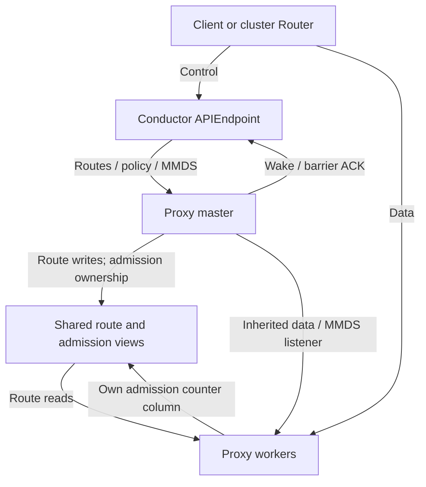

[English](node-proxy.md) | [简体中文](node-proxy_zh.md)

<a id="overview"></a>

# 访问、凭据与代理

本篇定义客户端访问、租户凭据、原生 exec 与转发，以及节点 Proxy 的运行方式。后半部分维护路由同步和准入的内部协议。Sandbox 状态变化见[生命周期](sandbox-lifecycle_zh.md)，集群入口见[集群](cluster_zh.md)，自定义应用见[扩展](extensions_zh.md)。

**阅读路径：** [SDK 访问](#sdk-configuration) · [凭据](#credential-model) · [Exec session](#exec-session-api) · [配置](#proxy-configuration) · [部署](#deployment) · [MMDS](#mmds) · [流量准入](#admission) · [路由协议](#route-synchronization)

<a id="proxy-role"></a>

## 概述

数据面 proxy 是沙箱流量的 L7 转发层:把外部 e2b SDK/CLI、端口转发或
cluster-router 进入本节点的请求按 `(sid, target)` 路由到 guest envd/CI UDS,
sandbox floatingip 用户端口或 native exec `ctl.sock`.普通 HTTP 的 target 仍是 legacy
port;CONNECT 可以用 `E2b-Sandbox-Service` 显式选择逻辑服务.控制面 API,生命周期,密钥,构建由
`node-ctl conductor serve` 承载,见 [node_zh.md](node_zh.md);本文只描述数据面转发层。

```text
client / cluster-router
  │ Host: <port>-<sid>.<domain>
  │ or E2b-Sandbox-Id + E2b-Sandbox-Port
  │ CONNECT may add E2b-Sandbox-Service + X-Access-Token
  ▼
node proxy worker
  │ shared route view (read-only mmap)
  ├─ e2b legacy 49983/49999 ─► envd / ci UDS
  ├─ forward:port ───────────► floatingip:port
  └─ exec ──────────────────► <run_root>/sandboxes/<sid>/ctl.sock
```

<a id="design-principles"></a>

### 设计原则

Sandbox metric 采集/历史由独立 [Telemetry 组件](observability_zh.md#telemetry) 负责，不是 Proxy
traffic counter 或 MMDS。Telemetry 复用 management namespace/packet path 和 MMDS
FloatingIP lookup 规则，但在自身 listener 直接接收 guest OTLP。不要把 OTLP 经应用
data proxy 转发；Conductor metrics query 使用 live telemetry registration 的独立
API UDS，不使用 Proxy StatsSocket。

- **转发层与控制面分离**:proxy 只做路由判定、鉴权和字节转发;沙箱生命周期权威在
  conductor。
- **单订阅 master,多 worker 数据面**:只有 proxy master 注册
  config-socket plugin;worker 不连接 conductor,不持独立 routesync 订阅。
- **分离路由视图**:固定长度的数据面字段写共享内存,worker mmap 只读;可变长的
  `mmds_routes` 与 `mmds_route_secret_values` 只放 master 有界 heap,worker 经继承的
  本机 socketpair RPC 按 exact path 查询。secret plaintext 不进入 mmap。
- **listener FD 继承**：data 与 MMDS 分别按配置选择 TCP 地址或命名激活 listener。
  每个 worker 持有同一监听 socket 的独立描述符；服务级副本跨 InplaceRestart 保留。
- **转发 netns 可配置**:`proxy_netns` 指向 connector 管理平面 netns 时,worker 进程
  在该 netns 内运行,proxy 到 `floatingip:port` 的访问和 MMDS listener 都位于其中.
- **无上游连接池**:普通 HTTP 为每条请求建立独立后端连接并关闭;CONNECT 是一条请求绑定一条
  TCP/UDS 连接。不同 sandbox/port 不复用上游连接。
- **鉴权先于生命周期副作用**:普通 HTTP 与 non-exec CONNECT 固定执行
  `LookupRoute → authorize(RouteBinding) → TryBeginParking → ActivateRoute → fresh Route → dial`。
  Lookup 不 Wake/Resume/park/dial;Activate 在生命周期副作用前后重验 binding。无效
  credential 在节点有效策略为 `enforce` 时不能唤醒或占用 traffic parking/admission；
  节点 `log`/`off` 对普通请求的放行语义见 [数据面鉴权](#authorization)。
- **逻辑服务只影响 CONNECT**:普通 HTTP 不解析 `E2b-Sandbox-Service`,应用层
  Header 保持不变；唯一显式例外是值精确为 `exec` 时在激活前返回 405。
  CONNECT 中显式 service 是 backend 选择的权威输入。
- **Exec 先鉴权后激活**:`service=exec` 始终验证绑定 `StableID` 的 KAT;
  CONNECT 200 后还必须授权完整首个 ExecRequest.失败请求不得触发 parking、Wake/resume
  或 backend dial.最终 node proxy 只将双重 gate 通过的请求交给 ctl tunnel helper,
  不向租户开放任意 UDS 或其它 ctl capability.
- **确定性 MMDS 密钥**:`MmdsSecret = HMAC-SHA256(manifest_key, "kuasar-mmds-v1:" + sid)`（先将十六进制 manifest key 解码为字节）,PUT 和 GET 即使落到
  不同 worker 也一致。

<a id="sdk-configuration"></a>

## SDK / CLI 对接与协议 pin

- 生产 TLS 使用 `E2B_DOMAIN` 与 `E2B_API_KEY`；开发环境可用 HTTP/h2c 的
  `E2B_API_URL` 与 `E2B_SANDBOX_URL` 分别访问控制和数据 listener。经集群 Router 时，
  只有去掉端口后精确等于 `api.<configured domain>` 的 Host 才进入控制面，不接受任意
  `api.*`。直接访问 Conductor 控制 listener（包括开发用 `E2B_API_URL`）没有此 Host
  限制：API mux 按 method/path 路由，不转发 Sandbox 数据。
- api_key 形态:`e2b_` + 72 hex(共 76 字符);e2b SDK 以 `/^e2b_[0-9a-f]+$/` 校验
  格式,服务端另验 MAC([密钥与归属模型(APISecret + ManifestKey 凭据对,加密存 sqlite)](#credential-model))。
- envd 从 `e2b-dev/runtime` 源码 tarball 的 `packages/envd` 构建。
  `guest-runtime/native-deps/Makefile` 将 `ENVD_TARBALL` 固定到 `2026.22` tag，
  并设置匹配的 `ENVD_TARBALL_SHA256`；这是源码输入，不是预编译 envd 下载。
  已记录的 SDK 兼容基线为 JavaScript `e2b` 2.27.x / Python 2.25.x，不代表所有后续版本。
- 数据面鉴权头 `X-Access-Token`(= `envdAccessToken`):secure 沙箱自 SDK v2.0.0
  默认开,SDK 每次数据面调用携带。
- 内部 Proxy/observer 的帧、消息与兼容版本统一由[路由同步协议](#route-synchronization)维护，不属于 SDK 兼容性定义。

<a id="data-protocols"></a>

## 数据面协议(envd 与 native exec)

envd 单端口 **49983**,HTTP/1.1 与 h2c 双栈,Connect-RPC(proto 包无版本):
`process.Process`、`filesystem.Filesystem`(仅元数据);文件内容走 HTTP
`GET/POST /files`(+ 签名 query);另有 `/health`、`/init`、`/metrics`。每操作用户
经 `Authorization: Basic base64("user:")`。**code-interpreter** =
`POST https://49999-<sid>.<domain>/execute`(NDJSON)→ guest FastAPI(:49999) →
Jupyter(:8888)。exec = `POST /process.Process/Start`(头 `X-Access-Token`)。
租户数据面本组件只透传不实现;**构建流水线自带一个最小 `process.Start` 客户端**
(connect+JSON 信封手写,无 protobuf/gRPC 依赖)驱动 steps/startCmd/readyCmd([按目标执行与发布](node-build_zh.md#execution-and-publication))。

guest 内 envd 的两个控制端口经 sandbox-ctl `--connect` 映射为 host UDS
(`<rundir>/envd.sock`、`ci.sock`),仅 proxy 可达——不走 floatingip,沙箱间无通路。

Native exec 不复用 envd HTTP/Connect-RPC.客户端先按 [控制面:沙箱生命周期](sandbox-lifecycle_zh.md#sandbox-api) 取得 ExecAccessToken,
再建立一条 service-addressed CONNECT:

```http
CONNECT sandbox:443 HTTP/1.1
E2b-Sandbox-Id: <NodeSandboxID>
E2b-Sandbox-Service: exec
X-Access-Token: kat1.<payload>.<signature>
```

authority 的 443 只是 transport 占位,不是 guest port;即使请求同时携带
`E2b-Sandbox-Port`,Node 也不用它选择 backend.`service=exec` 只接受 CONNECT,
且始终强制验证 KAT,不受普通 proxy `off|log|enforce` 模式影响.最终 proxy 在回复
CONNECT 200 后严格读取并授权完整 `exec_request` 首帧;条件通过后才可以恢复 paused
sandbox、连接 `ctl.sock` 并原样转发首帧;详见
[node-proxy_zh.md](node-proxy_zh.md) [转发路径](#transfers).

<a id="data-routing-overview"></a>

## 路由选择与后端身份

数据面按 `Host`(`<port>-<sid>.<domain>`)或 `E2b-Sandbox-Id`/`E2b-Sandbox-Port` 头解析
legacy `(sid, port)`.e2b profile 的 49983/49999 使用 EnvdAccessToken,拨 sandbox-ctl
`--connect` 暴露的 host UDS 直达 envd/CI;bare 的 49983/49999 与其它合法端口一样,
以 ForwardAccessToken 鉴权并拨 `floatingip:port`.CONNECT 可以显式携带
`E2b-Sandbox-Service: forward|e2b:envd|e2b:code-interpreter|exec`;service 是权威 backend
选择器；普通 HTTP 使用 legacy routing，但显式 `exec` 在激活前返回 405。Native exec 使用显式申请的 ExecAccessToken,在任何
恢复副作用之前完成 KAT 校验,最终进入
`<RunRoot>/sandboxes/<NodeSandboxID>/ctl.sock`.
TrafficAccessToken 仅供外部网关及 e2b
数据面组件使用,node 平台层不消费。对 paused
沙箱的请求触发自动 resume(与其它入口共用 launch owner,[生命周期与状态机](sandbox-lifecycle_zh.md#state-and-ownership)).独立 Proxy 是唯一节点数据面,
转发层设计见 [node-proxy_zh.md](node-proxy_zh.md)。集群下,数据面由 cluster-ctl router 经
把公开稳定 SandboxID 转换为当前 NodeSandboxID,再注入 `E2b-Sandbox-Id` +
`X-Access-Token` 转发进本节点 proxy(cluster.md)。

<a id="credential-model"></a>

## 密钥与归属模型(APISecret + ManifestKey 凭据对,加密存 sqlite)

- **根凭据分工**:APISecret 与 ManifestKey 是同一租户范围内用途分离的根凭据,都是
  32B / 64-lowercase-hex。APISecret 用于 API 请求认证和派生 Sandbox ServiceSecret;
  ManifestKey 是 manifest 内容键(`MANIFEST_KEY` env / `manifest.key`),也用于封装镜像
  拉取令牌。创建凭据对时可显式给出 APISecret;
  缺省值采用固定、域隔离的 KDF:

  ```
  APISecret = HMAC-SHA256(decodeHex(ManifestKey), "kuasar-api-secret-v1")
  ```

  **api_key 只由 APISecret 签发和验证**(`e2b-key-ctl gen-apikey`):

  ```
  api_key = "e2b_" + hex( fp(12) ‖ ts(4) ‖ nonce(4) ‖ mac(16) )      # 76 字符
  fp  = SHA256(APISecret)[:12]                                       # 候选预筛,不是唯一身份
  mac = HMAC-SHA256(APISecret, fp‖ts‖nonce)[:16]                     # 无 APISecret 不可伪造
  ```

  e2b SDK 以 `/^e2b_[0-9a-f]+$/` 校验 api_key 格式(故用 hex 编码);serve 另
  自校验 MAC(`internal/apikey`)。APISecret 与 ManifestKey 本身都不发给 SDK。
- **加密落盘**:`manifest_keys` / `sandboxes` / `builds` 三表均保存完整凭据对;
  `api_secret_enc`、`manifest_key_enc` 使用 AES-256-GCM(`internal/secretbox`:
  记录 = `keytag(4)‖nonce(12)‖ct+tag`,keytag 选解密钥)。两者各存完整 64-hex
  SHA-256 指纹;API key 内的 24-hex 短指纹只作候选预筛,不作唯一身份。
  加密密钥经 `encryption_key` / `NODE_CONFIG_ENCRYPTION_KEY`(`:` 分隔多键,[0]
  活动、其余备用解旧记录,支持轮换)。
- **鉴权解析**(短 hash 匹配 + 完整 MAC 校验):api_key → 按 APISecret 候选指纹
  命中行/白名单 → 解密 APISecret → 重算 HMAC 比对:
  - **create / build / import**:APISecret+ManifestKey 凭据对须在 `manifest_keys` 白名单
    (`node-ctl manifest-key`,[`node-ctl manifest-key`](#manifest-key-command);daemon 是该表唯一写者;集群下 registry 经
    node-link 租约写入,[集群接入(node-link)](cluster_zh.md#node-attachment)),否则 **403**。
  - **其他按 id / list 操作**:只对资源行自身的 APISecret 校验,不查白名单——即
    清空白名单,存量 sandbox/build 仍可正常操作直至生命周期结束。
  - list 的 hash 预筛非唯一,逐行再验 MAC,杜绝 hash 碰撞串租户。
- **业务记录复制**:create/build/import 插入时把完整 pair 复制进 sandbox/build 行。
  后续 allowlist add/drop/TTL 或 provider 凭据更新只影响新插入记录,不重绑既有业务记录。
- **与收敛加密的关系**:manifest_key 只封 manifest 的密钥表;chunk 加密密钥派生自
  `SHA256(salt‖明文)`.共享同一 store salt 的 writer 属于同一内容共享安全域,域内相同
  明文可以复用 physical object;需要隔离的租户或部署必须使用 `extra_salt` 或独立
  store/salt domain.租户之间不共享 manifest key、APISecret 或模板,内容相同也不自动
  扩大凭据和模板边界.
- **根凭据不落明文**:sqlite 内加密;运行期只在必要的进程内存、受保护路由投影和进程 env 中。
  sandbox ManifestKey只在exact-run bootstrap认证后投递,runner以它覆盖继承环境中的同名项,
  且最终exec env只有一个authoritative `MANIFEST_KEY`。conductor可持久化/投递该值，但 sandbox/build host preparation
  不调用 CustomerKey、不建立 key-bound reader、不打开/解密/解析租户制品。
  `<sid>.yaml`非密不含根凭据。
  builder task同样只在认证后取得 authoritative env；run-builder仅把`MANIFEST_KEY`安装为
  process-wide reader authority，并先清除继承的registry credential keys。registry凭据只保留在
  本地BuildSpec中，定向传给需要它的host flatten调用或guest import命令，不被phase
  `sandbox-ctl`及其后代环境继承；最终仍只有一个`MANIFEST_KEY`条目。
  APISecret 由 serve 用于 API 认证和 ServiceSecret 派生,并可投影给可信 router/proxy;
  不下发给 guest 或业务进程。auto-resume从资源行解密ManifestKey仅用于认证后投递给runner。
  集群下
  node-link 原子下发完整凭据对,
  两者同样仅入加密存储 + 运行期内存([集群接入(node-link)](cluster_zh.md#node-attachment))。
- 每个 Sandbox 持久化独立 ServiceSecret。未 override 时按
  `HMAC-SHA256(APISecret,"kuasar-service-secret-v1:"+StableID())` 派生;保存后不再重建。
  e2b 的 `envdAccessToken`/`trafficAccessToken` 可 override,否则分别随机生成;bare 两项恒空。
  EnvdAccessToken 用于 e2b 49983/49999,TrafficAccessToken 仅供外部网关及 e2b 数据面组件
  验证,不由 node 平台层消费。两个 e2b opaque token 均限制为有效 UTF-8、最多 256 bytes,
  在写业务行前校验。e2b/bare 的 `forwardAccessToken` 均为 ServiceSecret 签发、绑定
  StableID 且 `aud=forward` 的严格 `kat1`,用于其他 forward 目标。四项凭据均加密
  落盘并在 lifecycle upsert 中不可重绑。
  ExecAccessToken 不在 create/get/list 中缺省生成,也不写 Sandbox 业务行;它只由
  `POST /sandboxes/{id}/exec-sessions` 按次签发.每个 token 使用 UUIDv7 `session_id`,
  线格式为 `kat1.<base64url-no-padding(payload)>.<base64url-no-padding(signature)>`,
  payload 的 canonical field 顺序为 `v,session_id,sid,aud[,exp][,conditions]`,其中 `sid=StableID()`,
  `aud=exec`,不包含 `iat`.signature 以解码后的 32-byte ServiceSecret 直接执行
  HMAC-SHA256,不另派生 exec key.`conditions` 是按 API 顺序保存的紧凑字符串数组,
  unrestricted 时省略;它与其它 payload 字段一起受 HMAC 覆盖,不另加 digest.KAT holder
  可以解码 payload,所以 condition 不具保密性,表达式不得含需要保密的字面量.payload 不含 generation,node ID 或
  route revision.Node 是唯一签发方;Router/proxy 只使用受保护 route 验证.验证严格检查
  3 段线格式,canonical no-padding base64url,32-byte signature,固定 JSON 字段/顺序,
  UUIDv7,SID,audience 和可选 expiry.session ID 只在 KAT 内部使用,不在 API 响应中外显.
  `MmdsSecret =
  HMAC-SHA256(manifest_key, "kuasar-mmds-v1:"+sid)`(每沙箱确定性派生的 MMDS 会话签名
  密钥；此处 sid 是 node-local SandboxID，不是 StableID，manifest key 先从 hex 解码为字节；`mmds.enabled` 时随路由分发给 proxy 校验 envd 身份,见 node-proxy.md [MMDS](#mmds))。
- **MMDS route value 独立存储**:`MmdsSecret` 只签名/验证 MMDSv2 token;
  `MMDSRouteSecretValues` 才是 secret route 返回的敏感 value 集合。每个 sandbox/build
  owner 各有一份 encrypted JSON blob,只编码实际 name→opaque bytes,不保存 version、
  Content-Type、TTL 或 configured/wait 状态。AAD 至少绑定 owner kind、owner id、canonical
  routes digest 与 revision;更新使用 CAS/revision,轮换密钥沿用 secretbox 活动键 + retained
  decrypt keys。Create/Register 在一个 sqlite transaction 内写业务 row、routes-only metadata
  与 initial blob;Sandbox 删除走 FK cascade,Build 终态/清理删除 blob。数据库中只出现
  ciphertext,plaintext 只在受信 conductor/proxy heap 的有界生命周期内存在。

<a id="manifest-key-command"></a>

## `node-ctl manifest-key`

create/build 凭据对白名单(`manifest_keys` 表)管理,是 serve daemon **admin 平面**的瘦
客户端(经本机控制 socket,[本机控制 socket(run / task / admin / plugin / api 平面)](node_zh.md#local-control-channels))——daemon 是该表唯一写者,CLI 不开 DB、不读 config,
只需 `--socket`(或 `NODE_CTL_SOCKET` env,默认 `/run/sandbox/node-ctl.socket`)。
ManifestKey 取自位置参数或 `MANIFEST_KEY` env;APISecret 可用 `--api-secret` / `API_SECRET`
显式指定,缺省则按 [密钥与归属模型(APISecret + ManifestKey 凭据对,加密存 sqlite)](#credential-model) 固定 KDF 派生。两者原子成对入库;输出只含两者的完整指纹,
绝不回显根凭据。集群下该表另由 registry 经 node-link 以租约项写入([集群接入(node-link)](cluster_zh.md#node-attachment)、cluster.md),
与手动项共存。

```
node-ctl manifest-key add    [--api-secret S] [--label L] [--ttl 24h]
                             [--registry-auth <docker.json> |
                              --registry-username U --registry-password P |
                              --registry-token T]      [--socket S] <KEY>…
node-ctl manifest-key remove [--api-secret S] [--socket S] <KEY>…
node-ctl manifest-key check  [--api-secret S] [--socket S] <KEY>…
node-ctl manifest-key list   [--socket S]
```

- `--api-secret`:显式指定与该 ManifestKey 配对的 APISecret;只接受单个 `<KEY>`。
  缺省时派生默认值。`add/remove/check` 始终按完整凭据对操作。
- `--ttl`:失效时长(`0`/缺省 = 永不);只有完整 pair 完全相同时,重复 add 才刷新失效时间;
  相同 APISecret 完整指纹绑定不同凭据材料时报冲突。过期凭据对视同不在
  白名单,由 reaper 惰性清理;`list` 显示 `expires`。
- `--registry-auth`/`--registry-*`:租户默认镜像拉取凭据,加密存白名单行
  (`registry_auth_enc`),构建拉取时按 fromImage 的 host 匹配取用([按目标执行与发布](node-build_zh.md#execution-and-publication))。
- `add/remove/check` 输出 `STATUS api=<64-hex> manifest=<64-hex>`;`list` 逐行输出两项完整指纹。
- 鉴权:`SO_PEERCRED`——配置了 `paths.admin_pidfile` 则 peer pid 须在其中;未配则仅靠
  socket 0600 权限(同 uid / root)。

<a id="credential-tool"></a>

## `e2b-key-ctl`

总览见 [子命令总览](node_zh.md#command-catalog)。`seal-pull-token` 完整形式:

```
e2b-key-ctl seal-pull-token [<MANIFEST_KEY>] {--registry-username U --registry-password P |
                                              --registry-token T}
```

输出 `kpt_` 前缀的不透明令牌:以租户 manifest_key 派生密钥 AES-GCM 封装的镜像拉取
凭据,经 SDK `api_headers`(头 `X-Kuasar-Pull-Token`)随构建请求传入,serve 用
该租户的存量 key 解封([按目标执行与发布](node-build_zh.md#execution-and-publication))。manifest key 取自首个位置参数或 `MANIFEST_KEY` env。

<a id="exec-session-api"></a>

## Exec session API

Exec session 是显式授权动作,不是服务端 session 对象,也不启动 guest process.请求 body
是严格 JSON object,可含 int64 `ttlSeconds` 和 `conditions:[{"expr":"..."}]`.例如:

```json
{
  "ttlSeconds": 3600,
  "conditions": [
    {"expr": "request.argv == ['/usr/bin/python3', '/workspace/task.py']"},
    {"expr": "request.cwd == '/workspace'"},
    {"expr": "request.user == '1000:1000' && !request.stdio.tty"}
  ]
}
```

`conditions` 缺失或 `[]` 都表示 unrestricted,规范化为 `nil` 并从 token payload 省略;
显式 `null`、非数组、unknown/duplicate 字段、非 object 元素、元素中的 unknown/duplicate
字段和空 `expr` 均返回 400.多个表达式按 AND 组合;需要 OR 时在单条 CEL 中使用 `||`.
完整原始 body(含尾随空白)上限 64 KiB;第二个 JSON value、负数或越界 TTL 同样在生命周期
副作用之前拒绝.64 KiB + 1 返回 413.`ttlSeconds` 缺省或为 0 时 token 长期有效;为正数时
以实际签发时刻计算 `exp`,Unix 秒加法或 `time.Time` 表示溢出均返回 400.

standalone node 在编译 caller-controlled CEL 前先执行无副作用 credential preflight:既有目标验证
resource-bound APISecret,缺失且准备 KMT import 的目标验证 allowlisted credential pair;编译后
`prepareStandaloneTarget` 再次做权威校验以关闭并发变化,随后才可能 import/resume.
CEL 使用固定强类型 `request` view:`argv list(string)`,`env map(string,string)`,`cwd string`,
`user string` 和 `stdio.{tty,stdin,stdout,stderr} bool`;不暴露 route、claims、metadata、时间、
文件系统、网络、secret 或可产生 I/O/副作用的函数.签发节点在 token mint 和任何
paused→starting 变化之前编译、bool type-check 并执行静态 bounds;unknown field、非 bool、
超出 source/AST/cost bounds 均拒绝.这仍保留既有 eager exec-session activation 合同;
deferred activation 属于独立的 #240,本合同不实现它.

conditions 在目标准备和 lifecycle mutation 前完成编译.SID lifecycle fence 随后等待前一
attempt 的 terminal cleanup,再按实际签发时间生成 token,最后才允许新的 paused→starting;
因此 fence 等待不消耗 token TTL,编译或签名失败也不会产生新的 launch side effect.

目标已存在时不解析 migration token;目标缺失且提供该 token 时可以先同步 import 并完成对象,
credential binding 和 profile 校验.随后 node 以沙箱记录中的 ServiceSecret 签发 KAT;
MigrationToken 只作为本次同步 import 的瞬时输入,不写 Sandbox 业务行,日志或错误文本,
消费后立即丢弃.
paused 目标只接受异步 resume,响应不等待 READY.成功响应设置
`Cache-Control: no-store`,body 严格只有:

```json
{"execAccessToken":"kat1.<payload>.<signature>"}
```

响应不返回 session ID,过期时间,ServiceSecret 或其它 route/credential 字段.
鉴权失败沿用现有 401/403,沙箱不存在或不属于调用方返回 404;同步 import,
credential 读取/签发或异步 resume 任务接受失败统一对外返回脱敏 503,
错误文本不包含 fingerprint,ServiceSecret,NodeSandboxID,socket path 或 KAT payload.

<a id="proxy-configuration"></a>

## Proxy 命令与配置

节点数据面由一个 proxy master 进程启动:

```bash
node-ctl proxy serve --config /etc/node-ctl/proxy.yaml
```

`node-ctl` 运行内置 master，或按 `paths.proxy_executable` 原地 exec 静态定制 master；master
始终 reexec 自己当前的 executable 启动 worker。内部 worker 模式不作为运维接口。

静态定制接口、配置 Hook、运行期绑定、私有路由及授权转发见 [扩展指南](extensions_zh.md#proxy-bootstrap)。

`--config` 也支持有序 `base.yaml:override.yaml` 列表，由 master 加载合并一次；
worker 继续使用冻结后的 bootstrap 配置。共享规则见[配置文件加载](node_zh.md#configuration-files)。

`proxy.yaml` 字段:

| 字段 | 默认 | 说明 |
|---|---|---|
| `config_socket` | `/run/sandbox/node-ctl.socket` | conductor config-socket;master 在 plugin 平面注册并同步路由 |
| `paths.proxy_executable` | 空 | 静态定制 Proxy master 的绝对 executable;空使用内置实现.静态 config 诊断检查 regular/executable,非 group/world-writable 和 same-file,不按诊断 EUID 判断 owner;实际 root dispatch 只接受 root-owned,非 root dispatch 接受 root-owned 或本 EUID-owned.用于 node-ctl → master 分派及 InplaceRestart 受理时打开目标;worker 使用自己 master 的程序映像 |
| `paths.run_root` | (必填) | 节点 RunRoot;worker 本地构造 `<run_root>/sandboxes/<NodeSandboxID>/ctl.sock`,该路径不经 routesync `Policy` 或共享路由记录传递 |
| `data_listen` | (必填) | Sandbox 数据入口：TCP `host:port`，或显式交付的命名 TCP listener `fd=<name>` |
| `shutdown_timeout` | `0` | 非负时长；0 时 InplaceRestart 不可用、自动终止立即收尾，显式 App.Shutdown 仍优雅排空。正值由 data/MMDS 共用，完整停机跨全部实例共用 |
| `inplace_restart` | `false` | true 时原生主入口注册 SIGUSR2；两种取值都允许直接调用 App.InplaceRestart |
| `proxy_netns` | 空 | 转发平面 netns;空 = 当前 netns.非空时 worker 在该 netns 内运行,conductor 下发的 MMDS listen 也在该 netns 绑定;`data_listen` 仍在 master 当前 netns |
| `stats_socket` | `<dir(config_socket)>/proxy-stats.sock` | master 独占监听并注册给 conductor 的 traffic stats UDS;必须是绝对路径且不得与 config/SHM 路径冲突,权限 0600 |
| `shm_path` | `<dir(config_socket)>/proxy-routes.shm` | 共享路由表 mmap 文件 |
| `route_capacity` | `65536` | 固定路由槽位数;满时 Upsert 失败并终止当前 routesync session,等待该 route 的 Create 返回 503 |
| `workers` | `1` | worker 进程数 |
| `tls` | 空 | 数据面 TLS `{cert,key}`;空 = h2c |
| `auth` | `enforce` | routesync policy 到达前的数据面鉴权回退值 |
| `park_timeout` | `30s` | routesync policy 到达前的 park 回退值 |
| `metrics_listen` | 空 | master Prometheus 文本端点,聚合 worker 数据面计数 |
| `traffic.max_inflight.total` | `0` | 每个 Sandbox 全部适用 service 的 Proxy 级 inflight 上限;`0` = unlimited |
| `traffic.max_inflight.forward` | `0` | 每个 Sandbox 的 `forward` inflight 上限;`0` = unlimited |
| `traffic.max_inflight."e2b:envd"` | `0` | 每个 e2b Sandbox 的 envd inflight 上限;`0` = unlimited |
| `traffic.max_inflight."e2b:code-interpreter"` | `0` | 每个 e2b Sandbox 的 code-interpreter inflight 上限;`0` = unlimited |
| `traffic.max_inflight.exec` | `0` | 每个 Sandbox 的 native exec inflight 上限;`0` = unlimited |

`proxy.yaml` 不含 `mmds_listen` 或 `services`:两者唯一来源是 conductor
`mmds.listen` / `mmds.services`,经可信 plugin registration 的 `Hello{Policy}` 下发。

<a id="proxy-command"></a>

## `node-ctl proxy`

独立数据面 master;运维带外起,与 conductor 同节点.配置文件驱动
(`proxy.yaml`,自带 schema,见 [node-proxy_zh.md](node-proxy_zh.md) [Proxy 命令与配置](#proxy-configuration)),worker 由 master
从自己的当前 executable 内部 reexec 和监督；worker 不经过 node-ctl CLI，也不重新读取配置:

```
node-ctl proxy serve --config /etc/node-ctl/proxy.yaml
```

进程端点与 bootstrap 策略(`config_socket`/`data_listen`/`proxy_netns`/
`stats_socket`/`shm_path`/`workers`/`tls`/`auth`/`park_timeout`)在 `proxy.yaml`;
MMDS listen 与 service registry 只配置在 conductor。master 在 plugin 平面注册一次,
由握手取得 MMDS policy,维护共享路由视图并把唯一 Data listener fd 传给 worker.拓扑见
node-proxy.md [Proxy 命令与配置](#proxy-configuration),[转发路径](#transfers);conductor 与 Proxy 必须成对部署.

<a id="conductor-access-configuration"></a>

## Conductor 访问配置

以下字段属于 Conductor 配置；共享加载、路径与环境变量规则见[节点运行](node_zh.md#conductor-configuration)。

| 字段 | 默认 | 说明 |
|---|---|---|
| `proxy.park_timeout` | `30s` | 数据面请求挂起预算:等路由同步 / paused 沙箱 resume 的上限(node-proxy.md [routesync 与共享路由视图](#route-synchronization)) |
| `proxy.auth` | `enforce` | 数据面鉴权:`off`/`log`/`enforce`,校验 `X-Access-Token`(node-proxy.md [数据面鉴权](#authorization)) |
| `encryption_key` | 内置模式必填 | APISecret/ManifestKey 凭据对落盘加密的 AES-256 密钥:`:` 分隔多个 64-hex,首个为活动密钥,其余备用解旧记录(轮换);优先级为 custom Runtime provider > `NODE_CONFIG_ENCRYPTION_KEY` > YAML，provider 失败不回退 |
| `mmds.enabled` | `false` | envd 鉴权姿态开关([路由权威与广播](#route-publication),node-proxy.md [MMDS](#mmds)):false = `-isnotfc` + proxy 单闸门;true = FC 模式 + MMDS re-key |
| `mmds.listen` | `127.0.0.1:19254` | MMDS 监听地址(vswitch `--mgmt-service` 的转换目标) |
| `mmds.routes.enabled` | `false` | 是否接受租户声明的 static/secret/service exact route;要求 `mmds.enabled=true` |
| `mmds.routes.max_routes_per_sandbox` | `32` | 每个 Sandbox 或 Build 的 route 数量上限 |
| `mmds.routes.max_namespace_bytes` | `65536` | Header 或 metadata 中单份 MMDS JSON 的字节上限 |
| `mmds.routes.max_static_body_bytes` | `16384` | 单条 static `data` 的 UTF-8 字节上限 |
| `mmds.routes.max_secret_value_bytes` | `16384` | initial secret string 或 admin PUT opaque body 的字节上限 |
| `mmds.routes.reserved_path_prefixes` | `[/latest/api/, /internal/]` | 租户 route 禁止占用的 exact path 前缀;内置 `/` 也保留 |
| `mmds.services` | 空 | conductor-only 本机 service registry:`name.endpoint`;V1 只接受 `unix://` absolute path,不在 `proxy.yaml` 复制 |

<a id="deployment"></a>

## 部署拓扑

每个可承载 sandbox 的节点同时运行 conductor 与 Proxy.conductor 的 API listener 只承载
控制面;Proxy 的必填 `data_listen` 是该节点唯一 sandbox 数据入口.两个 advertised endpoint
分别指向这两个 listener,也不存在跨平面回退.



要点:

- A/A′ 使用 `proxy` 注册，临时 B 使用私有实例 ID。ID 表示注册归属与同名替换；
  经过准入的 registration `Proxy` 能力表示角色，`StatsSocket` 是独立可选的统计地址。
- `stats_socket` 只由 master 监听;conductor 的公开 traffic GET 经该 UDS 读 master
  聚合缓存,不会查询时扇出 worker.缺少 `StatsSocket` 不影响 route barrier participant.
- worker 不注册 plugin,不保存独立全量路由表;route mmap 仍是 master 单写/worker 只读,
  admission mmap 则由每个 worker 只写自己的 absolute-counter column。崩溃后由 master
  重启,replacement 直接读取当前 route/admission view。
- master 退出会带走其 worker;systemd 重启 master 后重新注册并重建共享表。
- 通过连接准入的 registration 同时满足
  `subscribe.kind=route_wake`、`proxy!=nil`、`mmds=true`,conductor 才投影 MMDS policy、
  routes 和 secret values；继续校验 MMDS 状态和注册代次。普通 observer 与 node-link
  均收不到这些 confidential values。

<a id="readiness"></a>

## 业务就绪与服务状态

每个 master 在自己的 0600 `stats_socket` 上保留 `GET /readyz` 与 `GET /status`。
两者返回 JSON 和 `Cache-Control: no-store`，其他方法返回 405。成功应用初始 Bookmark、
完成本地初始化、全部配置 worker 进入 data 与已启用 MMDS 的实际接纳循环后，
`/readyz` 返回 200，否则返回 503。零沙箱可就绪，MMDS disabled 不阻塞。
后续 worker 或必要路由状态失效会撤销 ready，恢复后重新计算。检查只读状态，
不访问 Guest；统计通道 ready 或 TCP 端口存在均不足以证明业务就绪。

```sh
curl --fail --silent --show-error --max-time 2 \
  --unix-socket /run/sandbox/proxy-stats.sock http://localhost/readyz
curl --silent --show-error --max-time 2 \
  --unix-socket /run/sandbox/proxy-stats.sock http://localhost/status
```

本地字段包括 `ready`、`instance_id`、`boot_id`、`pid`、`phase`、`routes_synced`、
`workers.{ready,expected}`、`data`、`mmds` 与 `reasons`。实例阶段为
`starting/prepared/serving/draining/stopped/failed`，无法确认的对端为 `unknown`。
原因码包括 `initial_sync_pending`、`worker_not_ready`、`route_state_unavailable`、
`draining`。`service_ready` 要求服务未进入完整停机，且至少一个已知实例 ready。
`instances` 列出实际管理与 metrics 地址；`inplace_restart` 包含当前或最近操作的 ID、
阶段、固定目标身份、尝试次数、最近错误、下次尝试、结果和强制关闭数量。
阶段与结果日志保留历史。共享 data 端口不用于确认某个候选实例就绪。

<a id="shutdown"></a>

## 有界停机

data 与 MMDS 独立停止接纳、等待各自已接纳的工作；worker 在两者都结束后退出。
仍被业务使用的依赖保留到业务结束。不保证 data 内调用 MMDS、连续 data 或 MMDS
请求等组合流程一定成功。
普通响应、流式正文、HTTP/1 WebSocket、CONNECT 隧道及已有 HTTP/2/h2c 路径均参与。
排空开始后已有 keep-alive/H2 连接不能开始新业务；已建立隧道可继续完成。
监听 Serve 返回、HTTP Shutdown 完成与 hijack 隧道结束分别等待，不增加新协议。

HTTP/1 排空会半关闭响应方向，并继续读取已到达的输入，直到对端关闭写方向或共同
期限到达，避免已有流水线请求导致完整响应被连接重置截断。合法的 keep-alive 客户端
即使已读完响应，也可能仍保持写方向打开，因此可能耗尽剩余排空预算。期限到达时
关闭该连接会报告强制收尾，即使响应正文已完整送达；该结果描述连接收尾，并不代表
已经完整送达的响应失败。

`shutdown_timeout` 默认 0。此时自动终止（Run 的 SIGINT/SIGTERM、RunContext 的
context 取消）立即收尾；显式 `App.Shutdown(ctx)` 仍优雅排空已接纳业务，不设置隐含
期限。InplaceRestart 要求正时长。正值下单实例 data/MMDS 共用预算，两轮重启排空
各有一次预算；完整 Shutdown 对 A/A′ 与 B 共用一个期限，重复调用不延长。
调用 context 取消只结束等待。超时关闭剩余工作并回收实际进程，
`ErrForcedClose` 与 `completed_with_forced_close` 区分强制结果。
核心在业务排空后取消扩展 Start 的 context，再调用可选
`Shutdown(context.Context) error` 等待其结束，见[扩展生命周期](extensions_zh.md#proxy-lifecycle-named-listeners-and-inplacerestart)。

<a id="inplace-restart"></a>

## InplaceRestart

内置 Proxy 与 xproxy 共用 **A → B 就绪 → A 排空 → 原主 PID exec → A′ 就绪
→ B 排空并回收 → A′ 单实例**。每次接管先通过专属本地控制确认业务就绪。
初始 Bookmark 即满足路由初始化条件，不要求追平旧实例。最多两套实例持有业务；
B 与 worker 不发起嵌套操作。

将兼容目标构建为独立、权限受保护的文件，再原子替换部署路径。操作受理时固定目标文件
身份、摘要及原始声明式输入；之后修改部署路径或 YAML，不改变本次 B、A′ 和重试使用的
输入。各 master 从相同原始输入执行 Configure 并校验接管兼容性。首次从旧版本采用此
能力时先按普通方式启动。Conductor 必须声明 `inplace_restart_v1`，已配置扩展必须提供
Shutdown；程序化调用执行相同预检。

配置正值 `shutdown_timeout` 和 `inplace_restart: true` 后，向原主进程发送：

```sh
systemctl kill --kill-who=main --signal=SIGUSR2 kuasar-proxy.service
```

默认 false 不注册 SIGUSR2；只要 timeout 为正，仍可直接调用 `App.InplaceRestart(ctx)`。
timeout 为 0 时启用信号属于配置错误。`App.Run()` 保留
SIGINT/SIGTERM 行为；自定义入口使用 `RunContext()` 自行调用动作，见
[公共生命周期 API](extensions_zh.md#proxy-lifecycle-named-listeners-and-inplacerestart)。方法返回受理结果与操作 ID，
最终完成通过状态观察；原 Go 调用栈不会跨 exec 保留。原 master 管理端点短暂不可用时，
可继续查询 B 的私有 stats socket。

A 停止接纳前，B 失败则排空并回收 B，A 继续服务。越过此边界后，协调器自动替换故障 B、
重试 exec、重试 A′ 初始化，在 B 排空期间恢复 A′，并重试 B 回收。候选准备单次 30s；
退避依次为 1/2/4/8/10 秒，10 秒封顶，不限制固定次数。准备、排空、退避分别计时。
停机取消后续尝试；持续故障保留可观察状态，解除原因后同一操作继续。
主进程致命故障由部署监督机制处理。恢复不重放业务，也不恢复崩溃时丢失的连接。

A/A′ 保持显式 `shm_path` 与 `stats_socket`；B 在相同父目录派生并检查私有路径。
实际进程结束后仅清理自有资源。地址来源和 FD 来源均保留服务级 listener 副本，
接管时不重新 bind；关闭本代 listener 不执行影响其他持有者的底层 socket shutdown。

metrics 为空则均关闭；固定 `host:p` 的 A/A′ 用 p、B 用 p+1；端口 0 各自动态分配；
65535 拒绝操作。B 必须实际 bind 并持有端口后才排空 A，冲突时本次准备失败，
不扫描其他端口；IPv6 同样处理。每代计数可重置，抓取可短暂空窗。
普通启动时 metrics 绑定失败仍告警并继续服务；重启则在排空 A 前确认所需资源可用。

业务统计保留实例本地读数。现有 traffic 返回中的 `inplaceRestart: true` 从受理持续到
操作清理结束，exec 间隙由 B 返回时也保持。idle 消费方须理解此时统计不完整，不能据此
证明整个服务空闲；操作完成后重新读取正常单实例统计。读取失败仍不可用，不填零，
也不据此推断重启结束。不增加持久统计记录、完成凭据或跨实例计数汇总。
各代保留既有额度和单代并发余量，部署预留双实例 CPU、内存、FD、两份额度和相邻 metrics
端口，不进行跨代额度转移。

<a id="listener-ownership"></a>

## 命名监听与 systemd 部署

`data_listen: "fd=proxy-data"` 与 conductor `mmds.listen: "fd=proxy-mmds"`
精确选择名称；两者可分别继续使用 TCP 地址，四种组合均支持。名称区分大小写、非空，
不含空白、冒号或 NUL。缺失、重复、未使用、错误类型、非 TCP 监听资源均导致启动失败，
两个名称不能引用同一 socket。环境不覆盖配置，也不将地址监听自动回退到继承 FD。

`app/activation.Receive()` 按 `LISTEN_FDS`、`LISTEN_FDNAMES` 从 FD 3 接收。
没有输入时返回空集合，零数量接受空名称集合。未提供 LISTEN_PID 时不校验；
提供的空值、非法值、不匹配 PID 均失败，且不接管或关闭其 FD。处理后清理 activation
环境，接管文件设置 close-on-exec，再按需显式传给后继。最终 master 消费
node-ctl → xproxy 链路中的 activation，worker bootstrap 和日志 FD 独立处理。
直接交付文件的所有权见 [Runtime.ListenerFiles](extensions_zh.md#proxy-lifecycle-named-listeners-and-inplacerestart)。

以下为部署模板。先建立 connector 管理 netns、地址与转发，再选择匹配的 MMDS 地址。
例如 `proxy_netns: sw0_mgmt` 且 connector 转发到该命名空间内的 `127.0.0.1:19254`：

```ini
# kuasar-proxy-data.socket
[Socket]
ListenStream=0.0.0.0:3443
Accept=no
FileDescriptorName=proxy-data
Service=kuasar-proxy.service

[Install]
WantedBy=sockets.target
```

```ini
# kuasar-proxy-mmds.socket
[Socket]
ListenStream=127.0.0.1:19254
NetworkNamespacePath=/run/netns/sw0_mgmt
Accept=no
FileDescriptorName=proxy-mmds
Service=kuasar-proxy.service

[Install]
WantedBy=sockets.target
```

```ini
# kuasar-proxy.service
[Unit]
Requires=kuasar-proxy-data.socket kuasar-proxy-mmds.socket
After=kuasar-proxy-data.socket kuasar-proxy-mmds.socket

[Service]
Type=simple
RuntimeDirectory=kuasar-proxy
RuntimeDirectoryMode=0700
ExecStart=/opt/kuasar/bin/node-ctl proxy serve --config /etc/node-ctl/proxy.yaml
Sockets=kuasar-proxy-data.socket kuasar-proxy-mmds.socket
KillMode=control-group
SendSIGKILL=yes
TimeoutStopSec=45s
Restart=on-failure
```

此信号示例在 proxy.yaml 设置 `shutdown_timeout: 30s`、`inplace_restart: true`、
`data_listen: fd=proxy-data`；conductor 配置
`mmds: {enabled: true, listen: fd=proxy-mmds}`。MMDS disabled 时移除对应 socket unit
及 service 中的引用。运行目录、程序所有权、netns 权限和控制连接准入须匹配服务身份。
依部署实际 conductor 与网络准备 unit 补充启动顺序。在 MMDS unit 的 `[Socket]` 中
设置 `NetworkNamespacePath`，先创建该 netns，再用
`ip netns exec sw0_mgmt ss -ltn` 检查实际监听位置。仅改变 service 的 netns 不会移动
已经存在的 socket，见
[systemd 命名空间语义](https://github.com/systemd/systemd/blob/v255/man/systemd.exec.xml)。

`KillMode=control-group` 向主进程、B 及各自的 worker 发送 TERM。
worker 直接收到 TERM/INT 时按配置预算排空，在已受理业务结束前保留依赖，
通过现有控制连接报告自身停机。与 master 排空命令竞争时保留首次期限，0 仍表示自动
立即收尾。单个 worker 的信号不停止其他实例；存活 master 保留原有 worker 监督机制。
定制 `RunContext` 入口需要将选定的终止信号转换为 context 取消。
`TimeoutStopSec` 应大于 `shutdown_timeout` 并留出进程回收余量。即使主进程先退出，
systemd 也会等待本服务的剩余进程，并在期限到达后强制回收。
`KillMode=mixed` 在主进程退出后可能立即杀死 B；在该模式下仅增大 `TimeoutStopSec`
不能为 B 保留排空时间。

exec 后 Go 尚未安装信号处理器时，TERM/INT 可能直接终止主进程。B 通过控制连接断开
开始自身的有界排空，不再启动后继。没有 systemd 时，只要 B 仍可运行，该行为同样成立；
B 自身崩溃或卡死则由外部监督者处理。B 的停机日志区分 `completed`、
`completed_with_forced_close` 和 `failed`，已退出的主进程不能继续报告重启动作完成。
worker 结束后，B 清理自己的路径；若父进程已经退出，再清理文件身份仍匹配的原主实例路径。

此示例同时设置 `stats_socket: /run/kuasar-proxy/stats.sock` 和
`shm_path: /run/kuasar-proxy/routes.shm`。专属 `RuntimeDirectory` 还能在外部强杀阻止
应用执行清理时回收文件。不要将 conductor 共用目录交给该 unit；其他显式路径需要部署方
提供等价的致命退出清理。普通
`systemctl restart kuasar-proxy.service` 保留已启动的 socket unit，排队连接仍受 backlog
与客户端超时限制。完整停服应同时停止两个 socket unit 和 service，避免新流量重新激活。
生产 unit 的安装与修改属于部署流程。

<a id="transfers"></a>

## 转发路径

普通 HTTP 按 `Host: <port>-<sid>.<domain>` 或 `E2b-Sandbox-Id` /
`E2b-Sandbox-Port` 解析 `(sid, port)`.它不解析 `E2b-Sandbox-Service`;该 Header 作为
应用层 Header 原样转发，不改变 backend；唯一例外是值精确为 `exec` 时在激活前返回 405。CONNECT 解析 `(sid, service?, port?)`.
cluster 第二跳的 `sid` 必须是当前 NodeSandboxID.

未显式携带 service 时,Node 从本地受信 profile 应用 legacy 映射:

```text
profile=e2b  and port ∈ {49983,49999} → envd / ci UDS
otherwise                              → floatingip:port
unknown or not running before timeout   → 404
```

因此 bare 的 49983/49999 与其它合法端口一样转发到 `floatingip:port`,不具有
envd/CI 逻辑含义,也不返回 501.

CONNECT 显式携带 `E2b-Sandbox-Service` 时,service 取代 legacy 端口推导:

| Service | 支持 profile | Backend | Port 语义 |
|---|---|---|---|
| `forward` | e2b / bare | `floatingip:port` | 必须由 `E2b-Sandbox-Port`,legacy Host 或 CONNECT authority 之一提供 |
| `e2b:envd` | e2b | envd UDS | 可携带,但不参与 backend 选择 |
| `e2b:code-interpreter` | e2b | CI UDS | 可携带,但不参与 backend 选择 |
| `exec` | e2b / bare | `<run_root>/sandboxes/<NodeSandboxID>/ctl.sock` | 可携带,但不参与 backend 选择 |

bare 显式请求 `e2b:envd` 或 `e2b:code-interpreter` 返回 501.unknown/空 service 返回 400.
service 与 port 并存不是冲突;Node 不会用 49983/49999 反向覆盖显式 service.

普通 HTTP:

1. worker 只读共享表,得到不含 backend 的 `RouteBinding`;
2. 按目标选择 EnvdAccessToken 或 ForwardAccessToken,按节点有效鉴权策略检查 `X-Access-Token`；符合条件的
   `/files` 请求也可使用 EnvdAccessToken 验证 signature，各模式的强制范围见 [数据面鉴权](#authorization)；
3. 按该策略获准后执行 `TryBeginParking`:同时检查 Sandbox total 与目标 service 上限,成功后
   发布共享计数并进入 parking;达到上限返回 429,不 Wake、不 Activate、不 dial;
4. 进入 `ActivateRoute`:在 Wake/等待前重验包含 admission generation/effective policy 的
   binding,完成生命周期动作后再
   重验一次,并从最新 running route 构造最终 backend;binding 改变时 fail closed;
5. 根据当前 running route 拨 envd UDS 或 `floatingip:port`。配置 `proxy_netns` 时,`floatingip:port` 在该
   netns 内拨号;
6. 写入一条 HTTP 请求，流式复制响应，或转发协商成功的 HTTP/1.1 WebSocket Upgrade；响应或完整 relay 结束后一次性关闭 flow 并释放额度。

普通 HTTP 允许在 `running → pausing` 时保留同一后端，并在交换结束前持续观察所选路由的状态、RunID、后端地址以及当前 target 的授权身份。路由撤销会取消该传输，无需等待 TCP 重传超时。在尚未向 guest 写入任何 HTTP 字节时，同一个已获准请求可以用原 binding 再次执行激活并拨最新端点；它保留原有的一次 admission/traffic flow 以及客户端 context/deadline。一旦开始转发，取消只关闭后端并沿用现有 upstream-error 处理，绝不重放 HTTP 字节。策略更新（包括 limited/unlimited 切换和其他服务凭据修改）不会驱逐已接受的传输；后续如需重新激活，仍校验原有完整 binding。这是本机传输可用性行为，不是报文隔离的前置条件；connector generation 的隔离机制保持独立。CONNECT 继续使用既有的 stream 和 half-close 语义。

CONNECT:

- sandbox id 来自 `E2b-Sandbox-Id` 或 legacy authority label;
- legacy/`forward` 可从 CONNECT authority 取实际 port;无端口逻辑服务的 authority
  只是 transport 占位,不会生成 `E2b-Sandbox-Port`;
- 普通 forward/envd/CI 目标通过有效鉴权策略后,把客户端连接与后端连接双向 splice;
- `service=exec` 只接受 CONNECT;普通 HTTP 携带该 service 返回 405,且不触发恢复.

node proxy 的 exec 路径分为三个有序阶段:

1. CONNECT 200 前，无副作用本地 `LookupExec` 提供 route identity；worker 随后以其中的
   `StableID + ServiceSecret` 严格验证 `X-Access-Token` KAT,并在 HMAC 验证成功后
   编译/读取有界缓存中的 CEL programs。Lookup 可以等待初始 route synchronization/propagation，
   但不 Wake、不进入 traffic parking/admission；该阶段不 activation、不拨
   `ctl.sock`;token/identity/expiry/conditions 失败以 HTTP 400/401/404/501 结束，route lookup 错误返回 503。
2. 返回并 flush CONNECT 200 后,在固定 10 秒 first-request timeout 内读取完整首个 ctl
   frame.解析严格覆盖顶层 `exec_request`、`ExecSpec` 和 `StdioSpec`,保留客户端原始
   4-byte little-endian length + JSON bytes,重新检查 expiry,构造规范化 request view 并
   以 AND 执行全部 conditions.false、error、unknown、cost exceeded 或 cancel 都 fail closed.
3. 只有 request admission 成功后才 `TryBeginParking(exec) → ActivateExec → exact identity recheck →
   ctl.sock dial → AttachBackend`,然后把首帧 Raw 原样写入一次并进入双向 relay.首帧一旦
   写入 backend 就不 retry、reroute 或 replay.

CEL view 将 nil argv/env 规范化为 `[]`/`{}`,空 cwd 与 `/` 规范化为 `/`,user 保留请求原值.
TTY 模式中 stdin/stdout/stderr flags 沿用 ctl wire 的 ignored 语义,view 暴露规范化后的有效
语义,不会因 flags 同时出现而拒绝合法请求.条件或结构 gate 失败不改变 parking/activity,
不启动 guest child;因此也不会使 paused sandbox 恢复.

worker 从 master 冻结的 EffectiveConfig 取得 `proxy.yaml` 中必填的 `paths.run_root`,不重新
读取文件.该值应与同节点 conductor 的 `paths.run_root` 一致.routesync `Policy` 和共享路由
视图只提供路由,凭据及鉴权策略,不投影 `ctl.sock` 路径.

共享的 sandboxer tunnel helper 不理解 KAT、CEL、route 或 lifecycle;它只冻结 callback 顺序、
严格首帧读取、Raw 单次转发和 half-close relay.H1 从 Hijack 返回的 buffered reader 继续读,
H2 从 request body 读并及时 flush response;两者都保留 half-close,等待双向 relay 结束.
CONNECT 200 后,已完整识别的 request denial 或 backend failure 返回统一脱敏 ctl frame
`{"type":"error","msg":"exec request rejected"}`;framing 无法恢复时直接关闭 tunnel.
`max_inflight.exec` 也只在首帧与 CEL 通过后检查;达到上限时 HTTP 200 已提交,因此使用同一
generic ctl error frame并关闭,记录 `data_requests_total{result="max_inflight_reached"}`,不伪造
HTTP 429 或 `X-Kuasar-Proxy-Error`,也不 Activate 或拨 `ctl.sock`。

KAT 在 CONNECT admission 时校验,并在首帧授权时重新检查 expiry;进入 backend relay 后
过期不强制断开已建立 tunnel,有效期内同一 KAT
可以建立多条独立 CONNECT.每条 tunnel 只承载一个 ctl exec session,不复用 backend 连接;
新 CONNECT 在 route 切换后自动进入当前 NodeSandboxID,已建立 tunnel 不迁移.

worker 在本进程执行上述完整 token + request + backend gate,用 frozen EffectiveConfig 的
`paths.run_root` 构造 `sandboxes/<NodeSandboxID>/ctl.sock` 路径.路径和 CEL programs 不经 routesync `Policy` 或 SHM
记录.conductor 不解析,不选择也不转发 ordinary HTTP,CONNECT 或 exec 字节;误发到
APIEndpoint 的数据请求只得到 API handler 的自然响应.cluster-router 的 canonical chained
CONNECT 只是中继,traffic 统计只发生在建立最终 sandbox backend 的 node worker.

<a id="http11-websocket-forwarding"></a>

### HTTP/1.1 WebSocket 转发

标准入口与私有鉴权后的 `ForwardAuthorized` 使用同一个 HTTP exchange。后者先在副本上执行
`Rewrite`，再做最终传输归一化；回调拒绝时不写任何 Guest 请求字节。携带
`Connection: Upgrade` 和 `Upgrade: websocket` 的 HTTP/1.1 GET 保留升级握手。
Connection token 支持大小写混合、逗号分隔和多个 Header value。清除无关的逐跳 Header，
包括 Connection 指定的字段；握手 Header、Cookie、Origin 和应用鉴权字段在未被指定为
逐跳字段时保留。Key、version、origin 和 subprotocol 由端点校验。

上游普通响应（包括握手拒绝）照常流式转发。只有匹配的 HTTP/1.1 WebSocket 101 才进入
双向 relay。非预期或不匹配的 101 在 Hijack 前返回 502；ResponseWriter 无法直接或通过
`Unwrap` 支持 Hijack 时，返回 500 `upgrade unsupported`。Hijack 后失败只关闭传输，
不再写 HTTP 错误。两侧 reader 已预读的字节均保留；正常 EOF 对另一侧执行半关闭并排空
尾部数据，请求取消则关闭两侧并等待 relay 结束。

一条升级连接持续持有原 tracked backend、admission lease 和 connected 计数，直到 relay
结束。Frame 不产生新的 ingress 或请求结果计数。Cluster-router 在现有到节点的 CONNECT
隧道上使用同一个 HTTP exchange，保留 buffered reader 和 identity rewrite；不增加第二套
WebSocket 实现，也不重放内部请求。本功能不增加配置、扩展 API、Frame 处理或 HTTP/2
extended CONNECT。

<a id="authorization"></a>

## 数据面鉴权

数据面请求头统一为 `X-Access-Token`,但期望值按转发目标选择:

- e2b legacy 49983/49999 以及显式 `e2b:envd`/`e2b:code-interpreter` 使用 create
  响应中的 `envdAccessToken`;
- bare 的任意 legacy 端口,e2b 的其它 legacy 端口和显式 `forward` 使用
  `forwardAccessToken`;
- `trafficAccessToken` 只供外部网关及 e2b 数据面组件验证,node proxy 不消费;
- `exec` 只接受以 ServiceSecret 直接 HMAC 签名,绑定 `StableID` 且
  `aud=exec` 的 `kat1` ExecAccessToken.Envd/Forward/Traffic token 不能代替它.

EnvdAccessToken 是 opaque token；ForwardAccessToken 则是 ServiceSecret 签发、绑定
`StableID` 且 `aud=forward` 的确定性 `kat1`，不是 opaque envd token。普通请求把传入 token
与受信 route 中该目标的 expected token 比较，遵循下表模式和 legacy 签名文件例外。
Exec 独立严格验证 KAT 格式、签名、SID、audience 和可选 expiry，再授权首个 ExecRequest。

`auth` / policy `auth_mode`:

| 模式 | 行为 |
|---|---|
| `enforce` | 不匹配返回 401 |
| `log` | 记录但放行 |
| `off` | 不校验 |

上表只适用普通数据面。Exec 始终 enforce，不受 `auth_mode` 影响。节点独立使用自身有效
策略，Router 的 `enforce` 不会改变该策略。在节点 `log`/`off` 模式下，无效普通凭据也可能
进入 parking、激活和后端拨号。

e2b legacy 49983 上的 `GET/POST /files` 在未携带 `X-Access-Token` 时，可用
EnvdAccessToken 验证 envd signature query；`enforce` 下 proxy 先验签再转发，envd 收到原始请求
后再次验证同一 signature。如果请求携带非空但错误的 `X-Access-Token`，不回退 signature。
这些检查仍遵循节点普通数据面策略：`log` 可放行不匹配请求，`off` 跳过验证。显式逻辑 service
与 bare 49983 不继承 legacy 签名文件例外。

<a id="request-credentials"></a>

### Create 凭据覆盖

凭据 override 同样支持两种等价入口:

```http
X-Kuasar-Sandbox-Credentials: {"service_secret":"<64 lowercase hex>","envd_access_token":"...","traffic_access_token":"..."}
```

```json
{"metadata":{"kuasar-sandbox.credentials":"{...}"}}
```

Header 中存在完整 credentials object 时覆盖 metadata object,不做字段级合并。对象只允许
`service_secret`、`envd_access_token`、`traffic_access_token`;unknown、duplicate、null、
非字符串及 trailing value 均拒绝。bare 显式指定 Envd/Traffic token 返回 400。
Envd/Traffic override 必须是有效 UTF-8 且各不超过 256 bytes。
ServiceSecret 缺省从 APISecret 与 `StableID()` 派生;Forward token 始终由最终
ServiceSecret 自动签发,不能由请求指定。credentials 在验证后立即从普通 metadata 分离。

<a id="mmds"></a>

## MMDS

`mmds.enabled=true` 时,envd 在 FC 模式下通过 Firecracker MMDS v2 获取当前身份的
access-token hash;`mmds.routes.enabled=true` 还开放显式声明的 static/secret/service
exact route.HTTP 只由 Proxy worker 承载,master 提供有界 route view.配置
`proxy_netns` 时,master 在该 netns 绑定 conductor 下发的 `mmds.listen`,并把同一个
listener fd 传给所有 worker;worker 不读取任何 proxy/MMDS YAML.

```text
guest envd
  │ 169.254.169.254:80
  ▼
connector mgmt-extract
  │ conductor mmds.listen
  ▼
proxy worker ─┬─► shared route view(token identity + RunID)
              └─► master socketpair RPC(routes + values + service socket)
```

两段式协议先签发 token，再用于 root 或声明路径的 GET：

1. `PUT /latest/api/token`:要求恰好一个 `X-metadata-token-ttl-seconds`,值为
   `1..21600`;按请求源 IP 查 enriched starting/running route 的 floatingip。初始
   starting 尚无 FloatingIP时仅此 token mint 路径可按 `park_timeout` 等待。返回的
   HMAC token 绑定 sid、来源 IP、当前 `RunID`、`aud=mmds` 和 expiry。
2. `GET /`:重新校验签名、来源、expiry、audience 与当前 `RunID`,返回
   `{instanceID, envID, address, accessTokenHash}`（当前 `address` 为空字符串）。pause/resume 改变 incarnation,旧 token 立即失效。
3. `GET <declared-path>`:完成相同认证后 exact lookup;未声明或声明但未配置的 secret
   都返回 404。仅 secret 值不可用时，只有依赖它的读取返回 503；路由声明本身不可信时仍拒绝访问。static/secret 缺省 Content-Type 在响应时才取
   `text/plain`,不写回配置。

MMDS session token 使用每沙箱确定性 `mmds_secret`,因此 PUT 和 GET 落到不同 worker
仍能互相验证。GET 和 token 端点不接受 query；只有已声明的 hold 写入接受一个可选的十进制参数 `if-match`。请求 path 不清理、不重定向：fragment、路径中的 percent escape、需
percent-encode 的字符、空/dot segment、backslash、wildcard 和非 root trailing slash 均拒绝。GET 的非零/未知
Content-Length、任意 Transfer-Encoding 或未知 body 直接 400,handler 不读取一个 byte
来探测 body。内置 root 只精确匹配 `/`;所有 guest 响应统一带
`Cache-Control: no-store` 与 `X-Content-Type-Options: nosniff`。

四类自定义 route：

- `hold-traffic`：GET 读取沙箱的共享计数，PUT（也接受小写 `put`）写入，正文与结果均为十进制文本。不带条件表示无条件赋值。Build Register 不接受这种沙箱专属类型。
- `static`:直接返回声明的 UTF-8 `data`。
- `secret`:按 route 的 `secret` 名查当前 opaque bytes;PUT 完整替换。DELETE 先持久删除再异步发布 route,
  Proxy 投影应用后 guest GET 才返回 404;没有 deletion barrier,不取消已解析的响应,不等待 value、无 TTL。
  Content-Type 始终来自 route。
- `service`:master 从唯一 registry 解析本机 Unix socket,worker/handler
  构造全新 `GET <exact-path> HTTP/1.1`,`Host: mmds-service`,仅增加
  `E2b-Sandbox-Id: <sid>` 与 `E2b-Sandbox-Service: <service>`。不发送 port,不透传 guest
  Host/query/body/token/Authorization/Cookie 或任何 guest header。V1 只透传合法 status、
  有界 body 和合法 Content-Type(缺省 `text/plain`),不跟随 redirect;超时/过大/非法响应
  映射 504/502,service 缺失或 socket 不可达为 503。

安全边界:routes 是 portable declaration,secret values 的控制面存储为 SQLite ciphertext,运行期在受信 conductor/Proxy master 的有界 heap。
平台不把 values 自动投影到普通 metadata、共享 mmap、日志、metrics、migration token、template 或 Build 制品,
也不发给 observer/node-link。但 guest 主动 GET 后可以把 value 复制到应用内存或文件;
后续 Pause/snapshot 或 image export 可能保留这些 guest 副本。宿主 DELETE 不会擦除 guest 已消费的副本。
调用方应缩短应用驻留时间,并把包含这些副本的内存、磁盘或 image 制品按敏感数据保护。

Sandbox-local MMDS 是本机对象/route 机制,不是 cluster Secret API、通用 CONNECT 配置面或 placement/admission 功能。
Standalone CONNECT 的 secrets-only import 只在目标不存在且实际 import 时解析,目标已存在则跳过;
完整迁移边界见 [Publish、template 与 migration](sandbox-lifecycle_zh.md#publication-and-migration)。
Build Register 的请求级 MMDS 仍在选定节点按 Build ownership 加密保存,见 [请求级 Builder 输入](node-build_zh.md#request-scoped-builder-input)。
普通 metadata 的偶然传递不构成 cluster-wide MMDS 支持或对应 E2E 验收承诺。

<a id="request-mmds"></a>

### MMDS 请求 schema 与优先级

MMDS 在 Sandbox Create 与 Build Register 共用以下外部 schema。Header 直接携 JSON;
metadata 的 value 仍是一个 JSON string:

```json
{
  "secrets": {
    "key1": "data1",
    "key2": "data2"
  },
  "routes": [
    {
      "path": "/path/to/secret",
      "type": "secret",
      "secret": "key1",
      "content_type": "application/json"
    },
    {
      "path": "/path/to/relay",
      "type": "service",
      "service": "external-mmds"
    },
    {
      "path": "/path/to/data",
      "data": "value",
      "content_type": "application/json"
    }
  ]
}
```

`type` 缺省表示 static。static 必须有 `path`,可有 `data`/`content_type`,禁止
`secret`/`service`;secret 必须有 `path`/`secret`,可有 `content_type`,禁止
`data`/`service`;service 必须有 `path`/`service`,禁止 `data`/`secret`/`content_type`。
static/secret 未声明 Content-Type 时只在响应阶段取 `text/plain`;service 使用本机服务的
受校验响应 Content-Type。Create/Register initial value 必须是 JSON string,每个 name
至少由一条 secret route 引用;secret route 可以暂时没有 value。

Header 与 metadata 分别严格解析为 partial document,再按顶层 key 合并:

```text
effective.secrets = Header.secrets if present, else metadata.secrets
effective.routes  = Header.routes  if present, else metadata.routes
```

同 key 不拼接、不递归或按 path 深合并。显式 `"routes":[]` 与 `"secrets":{}` 也算
present,会清空低层值。两份 JSON 均拒绝 unknown field、duplicate key、trailing value、
malformed JSON 和超限输入。

校验后立即分离 portable routes 与 confidential values。exact absolute path 必须能按原字节
作为 HTTP request target 使用,禁止 query、fragment、percent escape、需 percent-encode 的字符、
空/dot segment、backslash、trailing slash、wildcard、duplicate
或 reserved path/prefix collision。持久化使用稳定最小 JSON:显式 `type:"static"` 被删除,
输入缺省的 `type`/`content_type` 保持缺省,不写运行时默认值,不增加外部 version。例如:

```text
input:     {"routes":[{"path":"/data","type":"static","data":"x"}]}
metadata:  {"routes":[{"path":"/data","data":"x"}]}
```

`metadata["kuasar-sandbox.mmds"]` 绝不包含 `secrets`。Build 专属作用域与终态清理见 [请求级 Builder 输入](node-build_zh.md#request-scoped-builder-input)。

<a id="request-traffic"></a>

## 请求流量策略

Build traffic 仅作用于本次 Build runtime 及其 synthetic route，不会被输出制品后续创建的
Sandbox 继承。canonical TemplateID Create 不查询保留的 Build metadata、Template catalog
或制品 metadata 来取得 traffic 默认值。`traffic` 的固定 leaf priority 是:

```text
cluster group explicit metadata (when present)
  < create / reserve body metadata
  < X-Kuasar-Sandbox-Traffic
```

其 JSON 形状为 `{"max_inflight":{"total":32,"exec":2,"forward":0}}`。每个
leaf 可独立省略;显式 `0` 保留并清除低优先级 patch 或目标节点 Proxy 默认限制。整个
metadata key 省略时保持省略,最终由目标 Proxy master 合并该节点
`traffic.max_inflight`;目标节点默认值不写入 Sandbox row、MigrationToken 或 Registry。
MigrationToken 已携 Metadata,所以 absent 在目标端继续 absent,显式 patch 原样迁移并改用
目标节点默认值补齐其它 leaf。unknown、duplicate、`null`、负数、非整数和 `uint32`
overflow 均返回 400。bare Sandbox 显式声明 `e2b:envd` 或
`e2b:code-interpreter` 拒绝;节点默认可以包含这些 service,bare 只消费
`total`、`forward`、`exec`。该限制是 inflight concurrency,不是 QPS 或 Proxy global capacity;
完整算法与误差边界见 [node-proxy_zh.md](node-proxy_zh.md) [per-Sandbox traffic admission 与 stats](#admission)。

<a id="admission"></a>

## per-Sandbox traffic admission 与 stats

<a id="configuration-and-merging"></a>

### 配置与合并

`traffic.max_inflight` 是每个 Sandbox 在整个 node Proxy 上可接纳的 logical inflight 规格,
不是 QPS、带宽、worker capacity 或 Proxy global capacity。配置值 `M` 不会按 worker 各自
应用,也不会静态切成 `ceil(M/N)`:

```yaml
traffic:
  max_inflight:
    total: 128
    forward: 96
    "e2b:envd": 16
    "e2b:code-interpreter": 8
    exec: 8
```

`0` 表示该维度 unlimited。`total` 与目标 service 在同一次临界区中独立检查,不要求 service
之和小于 `total`;`forward` 也不按 port 拆分。一个 Sandbox 达限不占用或拒绝其它 Sandbox
的额度,因此不会形成 global failure amplification。

Sandbox 只在 metadata key `kuasar-sandbox.traffic` 保存显式 patch;create/build 也可用恰好
一次的 `X-Kuasar-Sandbox-Traffic` 传入同形 JSON。合并优先级为:

```text
cluster group explicit metadata (when present)
  < create metadata
  < X-Kuasar-Sandbox-Traffic
  < target Proxy resolution only for absent leaves
```

前三层按 `max_inflight` 叶子合并并 canonical marshal。叶子 absent 继承低优先级显式 patch,
最终继承当前目标节点 `proxy.yaml`;explicit `0` 则清除低优先级或节点默认限制。空 Header、重复
Header、`null`、unknown、负数、非整数和 uint32 overflow 均拒绝。bare Sandbox 显式声明
`e2b:envd` 或 `e2b:code-interpreter` 也拒绝;节点默认可包含全部 service,bare 只消费
`total/forward/exec`。

Build 注册的 traffic 仅约束 Build runtime 及其 synthetic route，不成为输出制品后续创建
Sandbox 的默认配置。canonical TemplateID Create 不查询保留的 Build row、Template catalog
或制品 metadata 来恢复 traffic policy。单节点 Create 使用请求显式 patch；集群 Create
还可以携带 group 显式默认值。

目标节点默认值不写入 Sandbox metadata/struct/SQLite、Registry record 或 MigrationToken。
MigrationToken 沿用已有 Metadata:absent traffic 在迁移后仍 absent,由目标 Proxy 使用自己的
默认值;显式 patch 原样迁移并覆盖目标默认。V1 不支持运行时修改 metadata,降低 limit 也不
驱逐已有连接,只影响后续 acquire。

<a id="shared-admission-arena-and-error-bound-proof"></a>

### 共享 admission arena 与误差证明

route mmap 与 mutable admission arena 分离。master 为策略合法且 effective limit 全为 0 的
route 发布零 binding，worker 直接执行既有 `BeginParking`，不扫描 arena、不 IPC。limited
route 的 `{slot,generation,effective limits}` 位于 route SHM。arena v2 仅保存 master 写入的
每 slot active generation，以及携带 generation tag 的 `counters[worker][forward/envd/CI/exec]`。
存活 worker 独占写入自己的 row；进程内 per-slot mutex 串行化初始化、acquire 和 release。
master 不获取该锁、不清理存活 row；不存在 shared guard、identity hash、draining state 或第二份可变 limit policy。本地锁按 slot 而非仅按 SandboxID 组织。

acquire 在进程内 per-slot mutex（该 slot 所有 service 共用）内执行:

```text
verify active generation and effective limits
→ initialize own row for a new generation: tag=0, reset four cells, publish new tag
→ read each row's tag, four cells, then tag again; include only unchanged matching tags
→ check total and target service together
→ recheck active generation, increment own target-service cell, recheck again
→ on revocation undo increment under the same local slot mutex and reject
→ unlock the slot mutex and return the admission lease
→ enter local parking under the distinct per-Sandbox traffic-entry mutex
```

同一 worker、同一 Sandbox 的所有 service 共用该锁,所以每个 worker 同时最多有一个 acquire
临界区。先考虑没有 release 的单调执行。把使已发布值首次到达 `M` 的成功原子增量作为边界
发布:边界时其它每个 worker 最多各有一个已经开始但尚未发布的 acquire,共至多 `N-1` 个;
边界 worker 在解锁后才能开始下一次检查。边界之后才开始的检查逐列读取的都是不小于边界
时刻的值,即使不是原子 snapshot,其和也至少为 `M`,必须拒绝。增量在解锁和返回 grant 前已经
发布,所以只有边界时正在进行的其它 `N-1` 个 acquire 还可能成功,峰值至多为 `M + N - 1`。

concurrent release 不扩大该上界。固定任意观察时刻 `T`,从执行历史中删除所有在 `T` 前已经
release 的 flow 的 acquire→release 完整区间。删除这种正计数区间只会让其余 acquire 的逐列
读取值保持不变或降低,所以原执行中成功且在 `T` 仍 active 的每个 acquire 在缩减历史中仍会
通过;同 worker 的串行关系也不变。缩减历史到 `T` 为止没有 release,其已发布计数恰好等于原
执行在 `T` 的 actual active 数,因此适用上一段单调执行的 `M + N - 1` 上界。该论证不要求
逐列读取构成原子 snapshot,并分别适用于同一次临界区内检查的 `total` 和目标 service。所以
对当前 generation、稳定的正上限 `M` 与 worker 数 `N`,合同是:

```text
actual admitted inflight <= M + N - 1
```

parking→connected 不改 shared count。activation、dial、HTTP forward、context cancel、ordinary
response 及完整 CONNECT/exec relay 的最终 Close 都由同一个 flow/lease exactly once 释放;
half-close 不释放。

Delete 或 identity replacement 撤销旧 active generation,不等待存活 worker,即使其停在 acquire 临界区。
master 的分配事务保留一个 spare slot:先撤销旧 binding、分配新 binding,再发布 route;
成功后回收旧 slot,失败则回收尚未发布的新 slot、恢复旧 generation,绝不清空旧连接计数。
各 worker 首次使用新 generation 时只初始化自己的 row:先置 tag=0,清四个计数,最后发布新 tag。
扫描在四计数前后读 tag,仅计入两次 tag 一致且匹配当前 generation 的 row。
旧 release 或者在本 worker 初始化前完成,或者见新 tag 后不操作,不会减少新 identity 计数。
acquire 在发布增量前后重验 generation;撤销则在同一本地 slot 锁内撤回增量。
既有完整 RouteBinding/ExecIdentity 相等检查继续保护 activation 的凭据与策略;arena Valid 只表示 generation 存活。
正常 starting/running/pausing/paused 更新与未改变 binding 的 full-sync 重放保留 generation/计数。
本上界不把新旧身份合为一个 quota,也不承诺降低 limit 时驱逐已有 flow。
worker 落点不是静态 M/N quota:单个 worker 可用全部 M,但多个 worker 不能各自独立用 M。
不引入 watchdog、锁超时、争锁即杀进程、每 flow master RPC 或全局 limiter。

worker stats stream fault 会先终止 worker。只有 supervisor 的 `cmd.Wait` 证明旧进程已退出、
kernel 已关闭其连接后，master 才清理该 index，无需 shared lock；此前 stale-high 只能
保守拒绝,不能漏计。replacement 复用 index 但使用新 epoch。master 退出会终止全部 child 和
连接;新 master 重建 arena，不继承旧计数。
仍存活 master 的完整 routesync 则保留重放且未改变 binding 的计数，只在 Bookmark 淘汰
本轮未出现的 binding；它不会清零仍活跃 flow 的计数。

在 `route_capacity=65536,workers=2` 配置下,counter 主体为
`65536 × 2 × 4 × 8 = 4194304` bytes；连同 generation tags、headers 和一个 transaction spare
entry，arena v2 mmap 为 `5767320` bytes。每个 worker 另持有 65537 个进程内 mutex，
`sync.Mutex` 为 8 bytes 时占 `524296` bytes，不属于共享映射。size、stride、worker count/index 和 8-byte atomic alignment
及 layout version 均在 master/worker 映射时检查;当前仅支持项目 Linux `amd64`/`arm64` 范围。
仅 admission arena 从 v1 升到 v2,不是用户配置或 routesync 版本变更;master/worker 必须使用同一 executable/bootstrap source set。
保留 1/2/4/8-worker 阈值交错、service/total、偏斜、release 波次、rollback 和真实子进程退出清理测试。
SIGSTOP 测试把真实 child 停在 acquire 内,要求 master 路由更新与 surviving worker 无需先唤醒或杀死它即可前进。

worker 关闭后仍保留两种映射直到进程退出，包括异步扩展代码或 hijacked handler 超出
`Run` 生命周期的情况。只有 `cmd.Wait` 后才清理对应 epoch 并启动 replacement；见
[worker 生命周期](#worker-lifetime)。

已持久化的 traffic metadata 损坏时，conductor 保留真实 Sandbox lifecycle 和 credentials，
仅投影 `traffic_policy_invalid`。master 不发布 effective policy 或可用 admission binding。
它不伪造 `dead`/Delete、不移除 Registry ownership、不禁用 MMDS，也不影响其它 route 的
完整同步。请求持久化前和 migration 输入仍严格校验。

普通 HTTP/non-exec CONNECT 先执行既有 credential policy，再在 parking/acquire/Wake/
Activate/dial 前返回 HTTP 503 与 `route_error`。私有鉴权后的 `ForwardAuthorized` 共用
该路径。native exec 保持 KAT → CONNECT 200 → strict first frame/expiry/CEL → generic ctl
拒绝，无 backend 副作用。traffic stats 与扩展 `TrafficSource.Get` 返回 unavailable，不能报告
零限制；route lookup、`RouteSource.Get` 和 `WorkerHost.GetRoute` 仍保留真实事实。stats batch
中任何无效成员使整批 unavailable，不返回部分成功结果。

普通 HTTP 与 non-exec CONNECT 达限返回 429、
`X-Kuasar-Proxy-Error: max_inflight_reached` 和固定 body,不设置 `Retry-After`、不 Wake/Activate/dial、
不逐次打印日志,并增加低基数 `data_requests_total{result="max_inflight_reached"}`。exec 的
CONNECT 200 后差异见 [转发路径](#transfers)。

<a id="traffic-stats-and-the-unified-worker-stream"></a>

### Traffic stats 与统一 worker stream

公开接口为 `GET /sandboxes/{sid}/stats/traffic`。统计的是最终 node proxy 按有效鉴权策略接纳的
逻辑 ingress,不是客户端物理 TCP 数:

```text
ingress = parking + connected

parking: 有效鉴权策略和 ExecRequest admission 通过后,ActivateRoute/ActivateExec 与最终 backend dial 尚未完成
connected:  最终 node proxy → sandbox backend 已建立且尚未最终 Close
```

条件 Pause 保留当前 running RunID 与可信 Worker 集合的基线，临时 gate 不重置基线。
Worker 在流量锁内同步采样计数、最后归零 BOOTTIME，并显式区分从未有流量与缺样本。
Master 异步统计不能替代终检。公开 UTC 条件使用历史 UTC/BOOTTIME 可信区间；
realtime timerfd 在时钟设置时使区间失效，包括两次采样之间的跳变。时钟能力缺失时
公开时间证明返回不可用；内部 idle 调度保留原 BOOTTIME 锚。路由协议版本 11
需要协调升级，混合版本拒绝连接。timerfd 的时钟设置取消无法提供中间 UTC 跳变的高水位，
因此本轮 Master 观察生命周期内公开时间证明保持不可用；等待墙钟追平不能修复历史。
新的 Proxy Master 进程从新的观察生命周期与保守基线开始；同一 Master 的
重连或 Worker/RunID 重建不清除该失效标志。内部自动条件继续使用 BOOTTIME。

启用 `idleTimeout` 时，Master 沿现有控制流发送绝对 `activity` 帧，绑定 SID、RunID、
可信 Worker 代次和注册会话内连续序号。覆盖首次 running/同步、Worker 恢复和活动变化；
每秒刷新一次，使恢复不依赖新的业务边沿。来源替换、断链、unknown、多 Proxy/热重启
重叠时取消候选。Conductor 重启不继承 timer。策略仅留在路由堆内存，不参与 SHM 激活
标识。自动暂停日志记录通知延迟、idle 等待、握手/capture 耗时、结果和重试次数，
不新增 node-link Pause 命令。

`hold` 服务记录业务请求结束后仍在执行的工作数。两种 profile 都返回
`services.hold`：`parking` 恒为零，`connected` 是业务登记的数量。
原生统计的 `inflight.connected` 只合计一次 hold；它不占用连接配额，不是 CONNECT
目标，也不改变物理连接指标。

使用已有鉴权访问 `GET /sandboxes/{id}/traffic/hold` 可读取当前值，沙箱已暂停时也可读。
`PUT` 正文 `{"value":1,"ifMatch":0}` 表示仅在当前值为零时替换；省略
`ifMatch` 则直接赋值。写入成功返回 `200 {"value":1}`，条件不符返回 409
和比较时的实际值。只有 running 沙箱接受写入；生命周期冲突返回 409，不带数值，也不唤醒沙箱。

让 guest 自行登记时，在直接向节点 Create 的 MMDS 配置中显式声明
`{"routes":[{"path":"/work/hold","type":"hold-traffic"}]}`。取得 metadata token 后：

```sh
curl -fsS -X PUT -H "X-metadata-token: $TOKEN" -d '1' \
  'http://169.254.169.254/work/hold?if-match=0'
```

MMDS 读写使用十进制文本，只有声明了该路径的沙箱可以访问。应用应在最后一条业务连接
结束前确认登记总数成功，并在结果可交付后再释放最后一项。正数归零会开始新的空闲区间；
重复写入同值不会重置计时。hold 没有 TTL，残留计数由业务核对。无条件 Pause 仍可执行。
同一本地记录的 Pause/Resume 和 Reset 保留计数；新记录（含独立 Import）从零开始。
跨节点接续工作时，应保持一条已接纳的连接，直到目的节点确认重新登记。

**滚动升级：** routesync 仍使用 v11。新 Proxy 注册时声明 `hold_traffic`，支持它的
Conductor 在 Hello 中确认 `hold_traffic_v1`。没有确认时，Proxy 继续转发，按真实连接
返回原有服务统计、判定空闲。已经确认支持 hold 的会话里，单条路由缺少 hold 表示活动未知。
v0.1.14 发布版使用 v11。如果已经部署了强制使用 v12 的 main 中间构建，应同时替换该节点的 Conductor 和 Proxy。

新 Conductor 只在至少注册了一个流量 Proxy，且所有流量 Proxy 均已就绪并支持 hold 时，
接受新的正数写入或声明 guest hold 路径的 Create；否则返回 503。普通 Create、Wake 和按连接自动暂停
仍可用。给旧 Proxy 的 MMDS 声明仅去掉 hold 路径，保留其他路由。旧 Proxy 后来加入不会清除
已登记的计数；所属调用方仍可通过节点 API 读取，并在沙箱运行时归零。旧统计源无法反映已有正数时，
节点返回 503。若要把 **Conductor 本身**降级为不识别 hold 的版本，应先完成或交接已登记的工作，
或者先关闭相应沙箱的空闲自动暂停；旧 Conductor 不会执行新版本保存的计数。

物理 service 包括 `forward`、`e2b:envd`、`e2b:code-interpreter`、`exec`。e2b 返回四项,
bare 使用 forward/exec。协商支持时，两种 profile 均另含 hold。普通 HTTP 和每条 CONNECT/exec 各是一条逻辑 ingress。dial
成功时在同一 worker-local entry lock 中原子执行 `parking--/connected++`;activation 或 dial
失败只结束 parking。`CloseWrite` 只传播 half-close,不结束 connected;只有 tracked backend
的最终 `Close` 以 `sync.Once` 结束 connected。token 或 ExecRequest admission 失败不进入
parking/connected,也不刷新 sandbox activity/`idleSince`。

bare Sandbox 空闲响应示例（不适用的 e2b 上限为零）：

```json
{
  "state": "running",
  "maxInflight": {
    "total": 128,
    "forward": 96,
    "e2b:envd": 0,
    "e2b:code-interpreter": 0,
    "exec": 8
  },
  "inflight": {
    "parking": 0,
    "connected": 0
  },
  "idleSince": "2026-08-12T14:03:21.123456789Z",
  "services": {
    "hold": {
      "parking": 0,
      "connected": 0,
      "idleSince": "2026-08-12T14:00:00Z"
    },
    "forward": {
      "parking": 0,
      "connected": 0,
      "idleSince": "2026-08-12T14:03:21.123456789Z"
    },
    "exec": {
      "parking": 0,
      "connected": 0,
      "idleSince": "2026-08-12T14:00:00Z"
    }
  },
  "platform": {
    "rxPackets": 57,
    "rxBytes": 5108,
    "txPackets": 39,
    "txBytes": 8042
  },
  "transit": {
    "rxPackets": 2,
    "rxBytes": 196,
    "txPackets": 3,
    "txBytes": 294
  },
  "egress": {}
}
```

`maxInflight` 由 Proxy master 从当前 applied route 的 effective policy 注入,不从 conductor
Sandbox row 推导;全零对象明确表示 unlimited。worker stats unavailable 时该 API 仍可返回 503,
但不影响 master route/admission authority 或 Create barrier。

顶层 `idleSince` 仅在 state=running 且所有 inflight 为零时返回;starting/pausing/paused 即使零连接
也不返回顶层时间。service 的 `idleSince` 也只在该 service 两项为零时出现。接口不返回
`idle`、`idleForSeconds`、last-open/close、累计连接数、速率、延迟、端口明细或 worker
身份;`Cache-Control: no-store`.Proxy route 未完成同步,
RunID/profile/state 不匹配或 worker 集不可信时返回 503。state 参与 conductor→master
查询身份,避免 Pause 已提交但异步 route view 仍为 running 时返回旧的顶层 `idleSince`。

响应为平铺结构: `state`、`maxInflight`、`inflight`、`idleSince`、`services`、`platform`、`transit` 和 `egress`. Conductor 拥有该原生 API,按照当前 Sandbox 到 switch/port 的绑定组织既有 Proxy 观测与网络计数. `platform` 映射 connector 的 Mgmt RX/TX 包数和字节数,`transit` 映射 Transit RX/TX;两者都采用沙箱视角. 已配置且当前有效的端口返回全部四项无符号整数,包括合法的 0. 没有 attached port 的沙箱仅在 FloatingIP、inner IP 和 port MAC 也都为空时返回空 `platform`/`transit` 对象,表示没有适用的当前观测. 已附着端口要求上述三个身份字段完整;不完整绑定在读取任一来源前返回 503. `egress: {}` 始终表示尚无可发布的 egress 统计,不是观测到零流量. 不发布 per-service 包计数、来源分组或 network API 别名.

`connected` 替代原生 `inflight.egress` 和 `services[*].egress`,保持后端连接已建立至最终 Close 的原有含义. 顶层 `idleSince` 覆盖 Proxy 已接纳的 ingress 和业务登记的 hold;management 监控包不会刷新它,它不对沙箱计算或整个网络空闲作出结论. packets 是包数而非应用请求数;bytes 是观测帧字节而非吞吐速率. management 使用既有端口/management ingress 帧长度;transit 使用封装前或去除外层 GENEVE 头后的帧长度,保留以太网头. 不把不同观测点相加成总流量. 累计计数属于当前 attachment,端口复用后可以重置;API 不建立网络历史.

Conductor 每个 switch 最多批量读取 64 个当前端口,调用 connector Go `Stats(ports)`,不逐沙箱启动 CLI,不维护第二套生命周期权威. 它复用原有 allocation/detach fence;connector 复用 pin 目录共享锁、当前 pinned-map ID 和清零确认标记. 既有 Proxy stats socket 也支持有界批量. 已配置来源读取失败、清零未确认、控制锁占用、结果不完整或绑定变化时,整个读取返回 503,不会用 0 或旧样本伪装完整响应. 公开 API、可信本机 batch 与 conductor extension 共用相同领域读取. Stats 独立于 telemetry,不参与 Create/Resume readiness.

流量采集需要相互匹配的 connector control binary、TC program 和当前 counter-map ABI. 开启采集前需重建旧 PERCPU_ARRAY/64-byte counter map;当前为带锁的 ARRAY/80-byte value. 清零失败仅影响 stats 可用性. switch 生命周期与部署见 [connector 操作说明](https://github.com/kuasar-sandbox/connector/blob/main/docs/vswitch-operations_zh.md).

每个 worker 使用一条 Unix socketpair 上报:

```text
worker hot path
  update sharded local absolute state + revision
  mark SID/counter dirty + nonblocking notify
        │
        ▼ async single sender
[4-byte LE length][JSON hello/ready/update/remove/goodbye]
        │ absolute Prometheus counters + absolute per-SID traffic
        ▼
master: workerID/epoch/sequence/contribution → per-SID aggregate cache
        ├─ counter absolute delta → existing metrics.M
        └─ stats UDS batchGet → conductor public GET
```

热路径不写 socket。sender 可合并任意中间变化,写成功后只在 revision 未再次变化时清 dirty;
因此 notify 合并和背压不会丢最终绝对状态。frame 有 1 MiB、每帧 SID/counter 数和标识长度
上限;同 epoch 的 sequence 回退/跳号/异内容重用、counter 回退/遗漏或 malformed frame 都是
协议错误。

master 查询只读持续维护的聚合 cache,不在 GET 时扇出 worker。它用 Linux boottime 比较
`idleSince`,对外只输出 UTC wall time;有效值取 worker idle、当前 master/worker 集合可信起点
和当前 RunID 首次被观察为 running 的时间的最大值。worker stats stream 断开后立即进入 503 窗口并终止
worker;只有 `Wait` 确认进程退出、内核已关闭其 backend FD 后才删除该 worker 的全部贡献。
replacement 以新 epoch 发 hello+ready,在 ready 前不开放 stats,并且 worker 也是在 stats ready
后才开始 Serve 数据 listener。

worker 经 socketpair 把绝对状态交给各自 master；conductor 查询一个已准入的当前 Proxy。InplaceRestart 期间通过 `inplaceRestart` 标记实例本地统计不代表完整服务；读取失败仍不可用，不能计为零。
route SHM 仍是 master 单写,worker 只读,没有 stats 区或 worker 写入;worker 的 mutable admission
column 只存在于独立 arena,不进入会因 backshift 移动的 route record。

<a id="route-synchronization"></a>

## routesync 与共享路由视图

资源暂停与显式暂停都在既有认证策略通过后 park。节点依据当前 durable intent 判定资格：
接管取消资源后台恢复及 critical 豁免，但真实仍驻留的请求或后续 Wake 可以按普通规则重验。
Starting 等待新的 running endpoint。不重放已投递的非幂等请求，也不保留已经清理的 native
exec 子进程。压力事实随完整 route sync/Bookmark 和 extension 投影收敛，不进入 NodeList 或
Cluster 选址决策。

routesync 仍是帧化 JSON over h2c,由 proxy master 拨 conductor:

```text
master → conductor : register{subscribe: route_wake, proxy{stats_socket?}, mmds}
master → conductor : wake{sid} / route_barrier_ack{barrier_id}
conductor → master : hello{policy, proxy_capabilities}
conductor → master : upsert* → bookmark → upsert/delete/route_barrier...
```

master 把下行路由流投影到共享内存:

- `BeginSync` 开启新同步世代;
- `Upsert` 写入或更新 `sid` 槽位;完全相同的重放只刷新同步世代,不推进生命周期
  revision;
- `Delete` 用 backshift 删除回收 live 槽位,并在独立的有界终态 cache 中记录无凭据的
  `(sid, revision)`;
- `Bookmark` 清理本世代未出现的旧记录,并标记首轮同步完成;
- `Policy` 写入共享头部,worker 每请求读取当前 `auth_mode` / `park_timeout_ms`。

Pause 使用 routesync v11 的 `pause_barrier{barrier_id,route}` 和
`pause_ack{barrier_id,pause_ack}`. Conductor 固定本次开始时在线且 ready 的 Proxy 集合,
忽略此前已断链的 Proxy, 不持久化清单; 空参与集允许继续. 各 master 先应用 `pausing`
路由, 再通过私有控制通道同步采样所有 worker, 包括正在 drain 的 worker. Worker 在
parking/backend 计数共用的 per-SID 锁内复核门禁, unlimited 流量同样参与统计.
每个 ACK 携带各服务的 parking/connected 计数; 采样不完整同时返回 error. Pause 需要
worker 握手, Create 的原有 master-only 屏障不变. `ifIdle=true` 时非零计数返回 409,
握手失败返回 503. 握手中断链、替换或新增参与者均使本次固定集合失败.

新请求鉴权后对 `pausing` 和 `paused` 使用相同 park/Wake 流程; conductor 以 SID 锁将
Wake 排在 Pause 之后. 全量同步包含尚未提交的门禁, 断链也不恢复旧 running 路由.
已有流量继续计数直到结束. `pausing → paused` 及捕获后的端点清空不推进 activation
revision; `starting → paused` 即使被合并仍表示恢复失败. idle 保证仅覆盖本次在线参与者.

每个 Create 都使用同一有序 stream 建立 route-applied barrier:

```text
conductor: Upsert(initial starting) → route_barrier{id}
master:    traffic patch validate/merge → admission apply → route SHM Upsert
           → notify workers → route_barrier_ack{id}
```

`ApplyUpsert` 把 admission 与 route 作为一个可回滚事务处理:任一校验、arena allocation、MMDS
projection 或 route SHM Upsert 失败都会恢复旧 admission/route view。master 的 ACK 只表示 parking
所需的 `starting RouteBinding` 及其 effective limit 已进入 master-owned serving view,不表示 sandbox
已 running、backend 可拨、envd 已完成 `/init` 或任何 worker healthy/ready。serving worker 数为 0、worker
重启或 stats stream fault 都不进入 Create 条件。Wake 与 BarrierAck 由一个上行 writer 串行
写帧。任一先行 Upsert 写表失败时,subscriber 不发送 ACK并终止 session;conductor 将等待中的
Create 回滚并返回 503。barrier id 只存在于本次内存协调,不进入 route changelog、共享表、
Sandbox schema 或日志字段。

屏障覆盖全部有效 Proxy 参与者，包括重启期间的 A 与 B。Create 在 ACK 后再次核验
注册代次和参与集合；断连、同 ID 替换、迟到或旧 session ACK 都不能完成屏障。
全部参与者 ACK 后才能返回 201。Conductor 在 `Hello.proxy_capabilities` 中用
`inplace_restart_v1` 声明这些多实例配套能力；缺失时兼容的单实例仍可运行，
InplaceRestart 在排空 A 前拒绝。

配置 conductor `paths.plugin_pidfile` 时仍严格执行 PID 白名单。原主进程连接固定的 conductor socket，通过私有控制连接把 B 专用连接交给它，重连也走此路径；SO_PEERCRED 保持已获授权的原主 PID。B 独立注册并接收路由，不增加其他进程的准入规则。

MMDS 扩展不写固定表。master 对每个 active sandbox 在一个锁内替换 routes + values;
heap entry 总数受 `route_capacity` 限制。`BeginSync` 与 routesync 断开
都会立即清空 heap 并标记 unavailable；新 master 也从空视图开始，只有完整 `Bookmark` 后才
重新开放查询。仅重启 worker 不会清空仍存活 master 的 heap；replacement 通过继承 RPC 接回
当前 master，并在共享视图同步后才开始服务。service
registry 由每次 `Hello{Policy}` 原子整表替换。running/starting Upsert 先更新 heap 再公开
SHM route;paused/Delete 先撤销 heap 再更新 SHM,让已采样旧 active row 的 worker 也 fail closed,
避免把新生命周期与旧 secret
组合。`RunID` 进入固定表用于 MMDSv2 token 的 incarnation 绑定;routes/value plaintext
绝不进入固定记录、metrics 或日志。

本文中 `RouteEntry.SandboxID`、`sid` 和共享表 key 均是 node-local SandboxID.集群路径下,它们是
Registry 分配的 NodeSandboxID;cluster Router 已在进入 node 之前把公开稳定 SandboxID 转换为该值.
`RouteEntry.StableID` 是跨 NodeSandboxID 变化保持的 sandbox identity，用于 KAT/credential
binding，不参与共享表 lookup。routesync V3 将 identity 一次性切换为 `stable_id`；V4 将
Snapshot-specific location 改为与 E/S kind 正交的 `artifact_location`;V5 将节点注册拆成
`api_endpoint` 与 `data_endpoint` 并收缩 Proxy registration;subscriber
和 node-link client 在首个 Hello 校验版本，不匹配时在处理 route/command 前终止 session。

共享表是固定容量开放寻址 hash 表。master 单写;每条记录带 seqlock,worker 读取时若遇到
写中状态或版本变化会重试,不会看到半条路由。worker 只依赖共享表本地读取:

```text
sid hash ─► record slot ─► RouteEntry (Lookup 只读)
                         ├─ running → auth 后 Activate 重验并转发
                         ├─ starting → auth 后 park,不发 Wake;回滚即结束
                         └─ pausing/paused → auth 后才发 wake pipe 并 park
```

普通 route Lookup 对 missing/paused/starting 都不写 wake pipe;只有请求已按返回的
`RouteBinding` 完成鉴权后,Activate 才可对 pausing/paused sid 写 wake pipe。starting 已由 conductor
launch owner 推进,Activate 只等待 running/delete/paused 更新,不得再发 Wake;后两种回滚更新
立即结束 starting 请求。master 去重后通过 routesync
上行 `Wake`。master 每次写共享表后通过 notify pipe 唤醒 worker 本地 park waiters。
全局 revision/notify 只负责唤醒检查;worker 以该 SID 的 live 或终态 revision 判断 Wake
是否已收到终态回应。live 路由、终态 cache 和 revision 在同一次 table seqlock snapshot
中读取,waiter 不会把旧 missing/paused 路由与新 revision 混合为假终态。重复的相同 paused
Upsert 不推进 per-SID revision,因此订阅重放不能伪装成 Wake 的完成响应。只有暂停原因、恢复义务、压力版本或运行起点变化时，SHM 和全局通知仍更新，但保留 activation revision；显式接管必须传到全部 reader，不能伪装为启动失败。live hash 的删除
会在同一 table seqlock 下 backshift 并立即回收槽位;终态 cache 固定最多 4096 条且不含任何
凭据。极端 churn 下 cache 碰撞只会淘汰较旧的终态相关性,对应 waiter 保守地继续 park 到
后续状态或 timeout,不会错误路由或把无关 SID 当作 Wake 结果。
正常 activation 路径中,即使异步共享表收敛把中间 starting 与随后 paused/Delete 合并,
终态 revision 仍会让 waiter 及时观察 rollback;只有前述极端 cache 淘汰才退化为保守 timeout。
授权请求尚未投递且同一 binding 仍为 paused 时，可在原 park deadline 内至多每秒重试一次 Wake，
使普通暂停请求在 critical 缓解后重新判断资格。master 合并待发送 Wake，conductor 保持唯一
launch owner。观察到 starting，或该 SID 生命周期 revision 证明合并了 starting→paused
回滚后，该请求结束，不再 Wake。

共享视图是异步收敛的路由缓存。默认创建使用 UUID,集群 NodeSandboxID 使用
`<stableSandboxID>-g<SandboxGeneration>`,正常流程不会让不同逻辑沙箱复用同一个
node-local ID。若外部系统显式把刚删除的 NodeSandboxID 立即分配给另一个逻辑沙箱,
在 Delete/新 Upsert 尚未到达 Proxy 的极短窗口内,worker 仍可能持有旧实例的
凭据投影和同名运行目录.节点不得主动执行这种跨逻辑沙箱的即时 ID 复用;
为不同逻辑沙箱显式指定迁移 target 时应使用新的 NodeSandboxID,或先确认路由视图已经收敛。

收到 dead 或 deleting Upsert 时，Proxy 释放主路由槽、准入绑定和 MMDS 数据，并在有界终态缓存中登记不含凭据的修订。全量同步先撤销保留对象的终态路由。主表已满时，新业务路由等到快照 Bookmark 后再入表，此时可以回收断连期间已删除父对象的槽位。两次快照中持续存在的路由保留已占用的请求额度。Reset 后的 paused 投影可重新取得主路由槽。

受保护 `RouteEntry` 的 state 为 `starting|running|pausing|paused|dead|deleting`,并显式携带
`StableID`、`APISecret`、`APISecretFingerprint`、
`ManifestKeyFingerprint`、`ServiceSecret`、`EnvdAccessToken`、`TrafficAccessToken` 和
`ForwardAccessToken`。
ManifestKey 原文不进入路由。节点 proxy 转发时只按目标选择 EnvdAccessToken 或
ForwardAccessToken;TrafficAccessToken 仅随受保护视图投影给外部网关及 e2b 数据面组件,
不由 node 平台层消费.`StableID + ServiceSecret` 用于验证 exec KAT,
其中共享表 key 和本地运行目录仍只使用 NodeSandboxID.既有 `MmdsSecret` 独立服务于
MMDS token 签名,不等于 route secret values;后者仅经上述可信投影进入 master heap。
`MaxInflightPatch` 只在 routesync wire 上携带 Sandbox 显式叶子;master 将目标节点
`proxy.yaml` 默认值与该 patch 合并后,把 fixed effective value 及
`{admission slot,generation}` 写入 route SHM,不会把 pointer 写入 SHM 或用于 route equality。
当前内部兼容边界为 routesync version 11、route SHM schema 9、worker bootstrap/config/FD
protocol version 3，以及 admission arena version 2。这些都是内部 hard cut；协议版本不匹配的
conductor/proxy/registry/router 或旧 SHM/bootstrap 不兼容且 fail closed。

初始 durable starting upsert 可以没有 FloatingIP、UDS 或其它 backend endpoint;worker 按
state park,绝不尝试使用这些空字段。node 持久化 network ownership 并完成 YAML/ready.sock
后会发布 enriched starting,此时 MMDS 才能按 FloatingIP 反查身份。ordinary data plane 仍
须等 running。

<a id="route-publication"></a>

### 路由权威与广播

serve 是**本节点**路由与生命周期的权威:create/resume/pause/kill 实时更新路由,经
**routesync** 广播 Upsert/Delete 给所有 plugin 平面订阅者(Proxy master 与路由
观察者如平台 agent)。proxy master 把路由投影到共享内存,worker 只读;观察者持只读缓存
感知状态。广播逐条 upsert + 末尾 bookmark(高密度下发端内存有界)。线格式(帧化 JSON over h2c)、容错重同步、
`RouteEntry` 字段(含驱动迁移的 `artifact_location`、MMDS 使用的 `mmds_secret` 与
presence-aware `max_inflight` patch)见 node-proxy.md [routesync 与共享路由视图](#route-synchronization);
plugin 平面的注册与鉴权见 [本机控制 socket(run / task / admin / plugin / api 平面)](node_zh.md#local-control-channels)。机群级路由权威是 registry(cluster.md);serve 经 node-link
把本节点沙箱事件上报 registry([router](cluster_zh.md#router-boundary)),与本节点 plugin 平面的路由广播是两条正交通道。

广播前执行服务端投影:受信 MMDS proxy 的 Upsert 额外携 `mmds_routes` 与
`mmds_route_secret_values`,二者在同一 event 中原子替换;普通 observer 不收到这些字段,
cluster/node-link 也绝不收到 value。conductor-owned `mmds.services` 仅放在受信 proxy 的
Hello policy,不广播给 route observer.Proxy master 原子替换 registry,worker 经本机 MMDS RPC 取得已解析 Unix socket endpoint,
不读取 `proxy.yaml` 中的第二份配置。

- **auto-resume launch owner**:数据面打到 paused 沙箱时,Proxy 经 routesync `Wake` 上行;同一 sid 的
  Connect,Proxy Wake,ExecSession 与其它 launch 入口共用唯一 attempt([生命周期与状态机](sandbox-lifecycle_zh.md#state-and-ownership))。
- **starting 投影**:初始 `starting,run_id=""` durable insert 后即广播,此时没有 FloatingIP
  或可用 endpoint;network ownership 已 CAS 持久化且 YAML/ready.sock 已准备后再广播 enriched
  starting,供 Proxy MMDS 完成 envd `/init`.starting 不开放普通数据面,也不触发
  Wake.每次 Create 在初始 Upsert 后发送 ordered route barrier;Proxy master 先校验并将
  目标节点默认与显式 patch 合并、事务化发布 admission binding 和 route SHM,全部成功后才
  ACK。barrier 不等待 worker readiness、worker stats 或健康 worker 数;即使没有 serving worker,
  master apply 成功仍可 ACK。任一 admission/route apply 失败不 ACK,也不会留下只发布一半的
  route/admission 状态。master apply+ACK且 lease
  复核成功后才返回 201并启动 launch,因此 201 后的首个合法请求应直接看到 starting并
  parking,不再把正常 route propagation gap 当作 missing。launch 成功广播 running;create
  失败广播保留的 dead 管理 Upsert,resume 失败广播 paused。
- **envd 鉴权姿态(`mmds.enabled`)**:该开关决定 create 是否给 envd 下发 token、proxy
  是否寄宿 MMDS 服务——`false` = envd 非 secure、proxy 单闸门(配置强制
  `proxy.auth=enforce`);`true` = proxy 组件内起 FC MMDS v2、经 `/init` 安装该身份绑定的
  EnvdAccessToken，使快照扇出沙箱数据面可用。新身份未显式提供 token 时默认生成；
  保留身份的恢复或迁移不自动轮换它。姿态对比与 MMDS 两段式协议见 node-proxy.md [MMDS](#mmds).

<a id="failure-boundaries"></a>

## 可靠性

- **worker 崩溃**:stats fault先触发旧 worker 终止;master 等 `cmd.Wait` 后才清其 admission
  column并以新 epoch重启同 index。等待期间 stale-high 只会保守拒绝;其他 worker 继续
  accept 同一 listener fd,route/Sandbox state和Create barrier均不改变。崩溃 worker 上的已有
  连接由 kernel 关闭。
- **master 崩溃**:plugin 租约断开,Create 和 standalone Connect 无法通过路由 barrier,DataEndpoint 也不可用;
  systemd 重启 master 后重新注册,重建共享表并启动 worker.已运行沙箱本身不受影响.
- **routesync 断开**:master 指数退避重连;固定数据面共享表沿用原有保留/Bookmark
  收敛语义,但 MMDS routes/value/service authority 立即清空并返回 503,完整同步 Bookmark
  前不服务旧 secret 或执行旧 service route。断连同时使尚未返回的 Create 和 standalone Connect barrier 失败;
  已 ACK并完成 201/200 响应后的断连按正常运行期 availability failure 处理。
- **standalone Connect**:成功响应等待先行路由更新已应用并获 ACK,使首个请求能在 starting
  上 parking,而不会选中旧 running 实例。它不等待 VM ready。barrier 失败返回 503,调用方
  取消会结束等待;两者都不取消已受理的 resume。cluster CmdConnect 保持独立的受理及归属协议。
- **park / wake**:Lookup 不发送 Wake;通过有效鉴权策略的 Activate 才能对 pausing/paused sid 发 Wake 并等待
  共享表更新。starting 只 park、不 Wake,变为 paused/Delete 时立即结束;resume ownership 和
  当前 launch 的状态推进仍由 conductor 执行。
- **stats stream**:任一 worker stream EOF、超时或协议错误都会停止该 worker;确认退出前
  traffic GET 返回 503,确认后删除其贡献并等待 replacement ready。Prometheus counter 在
  master 生命周期内保持单调,worker epoch 更换不会回退。
- **失败码**:Create/standalone Connect 无可用 proxy route stream,barrier 超时/断连或 route apply
  失败 = 503;非法 target = 400;exec 的非 CONNECT method = 405;未知/已删除 sid = 404;
  鉴权失败 = 401;已识别但 profile 不支持的 service = 501;
  后端/proxy 未注册或不可达 = 502;CONNECT 接受前的 exec route lookup 错误 = 503;ordinary admission 达限 =
  429 + `max_inflight_reached`;CONNECT 200 后的 exec activation/backend 失败或达限 = generic ctl error。

<a id="worker-lifetime"></a>

### Worker 生命周期与传输取消

Proxy worker 是专用、单次运行的子进程。内置入口及定制 App 在 `Run` 返回后必须退出该进程；它们不是供常驻进程在内部反复重启 worker 的 API。

成功建立的 route SHM 和 admission arena 映射由 worker 进程拥有。`PreparedWorker.Close`
关闭继承描述符，但不卸载两份映射。优雅停机先等待业务与扩展结束；强制完成时仍可能有
handler、扩展和 traffic GC 持有引用。进程退出是最终所有权边界，内核统一回收映射。
构造函数仍清理自己未成功返回的操作；底层测试仅在全部读者退出后显式卸载。
worker 生命周期测试使用真实子进程。

这不改变正常请求的清理。请求或完整隧道结束时仍关闭 backend，并恰好释放一次 inflight 贡献。supervisor 仍必须等待进程退出，才清理该 worker 的共享计数和统计贡献：卸载一个进程的映射不会清零其他进程仍使用的共享内存。master route apply 和 Create barrier 不等待 worker 健康或 handler 退出。

流量限制只决定是否接纳新 flow，不决定已接纳 flow 的转发行为。普通 HTTP 请求取消和 HTTP/2 CONNECT stream 取消，无论是否配置有效限制，都关闭对应 backend。HTTP/1 hijacked CONNECT 保持半关闭语义，原 HTTP request context 不是通用的隧道关闭信号。native exec 保持既有 KAT、首帧、CEL、traffic admission 顺序。

<a id="performance"></a>

## 性能

- 普通数据面 route lookup 是 worker 本地 mmap hash 查找,不进 conductor,不跨进程 RPC;
  只有 guest 自定义 MMDS path 走同机 worker→master socketpair。
- unlimited traffic fast path 不访问 admission arena;limited flow 只扫描固定 `N × 4` absolute
  cells,不做 per-flow master RPC。不同 Sandbox 使用不同 worker-local mutex,不争用一把进程级
  global lock;同 SID并发只在本 worker entry和本 worker row上串行。
- master 单写 route共享表;worker 只读。admission worker只写自己的 column,master不在
  per-flow热路径中。
- 普通 HTTP 和 CONNECT 都不使用上游连接池,避免跨 sandbox/port 连接复用。
- `route_capacity` 是固定容量保护阈值;容量不足时应调大配置并重启 proxy master。
- worker 数据面 metrics 与 traffic 经统一 stats socketpair 异步上报绝对快照;
  `metrics_listen` 由 master 对 counter 绝对值求差后继续输出既有
  `data_requests_total{result=...}`。背压只合并中间 snapshot,不会永久丢失计数或当前 traffic。
- MMDS 来源 IP 反查使用按 IPv4 对 connector `MaxPorts` 取模定位的可重建固定槽位，再对主路由表
  中的候选 SID、active state 和精确 IP 进行权威验证，已不是线性扫描。提示缺失、不匹配或过时
  均 fail closed；取模冲突会替换旧来源的提示，不会将旧来源授权为新来源。提示不含凭据，
  也不是普通数据面的路由权威。token 签发使用来源反查，已认证 GET 校验 token 的来源 IP 与
  incarnation 绑定，自定义 GET 还会查询 master RPC。MMDS 不仅用于 envd 初始化。

这里的 running 只证明 orchestrator readiness wire 与 mandatory e2b `/init` 已成功,不保证
code interpreter、forward 业务端口或用户应用 health 已监听;业务 backend readiness 仍由
[#125](https://github.com/kuasar-sandbox/orchestrator/issues/125) 独立跟踪,proxy 不在本阶段
增加通用 dial retry。

<a id="related-contracts"></a>

## See Also

- [node_zh.md](node_zh.md) — conductor 控制面,Proxy 部署,生命周期与密钥模型.
- [cluster_zh.md](cluster_zh.md#client-access) — 集群入口如何转发到本节点数据面。
- [Connector vSwitch](https://github.com/kuasar-sandbox/connector/blob/main/docs/vswitch_zh.md) — mgmt-extract / MMDS VIP 转换。
- [部署文档](https://github.com/kuasar-sandbox/kuasar-sandbox/blob/main/docs/deployment_zh.md) — 部署拓扑、端口与故障域。
