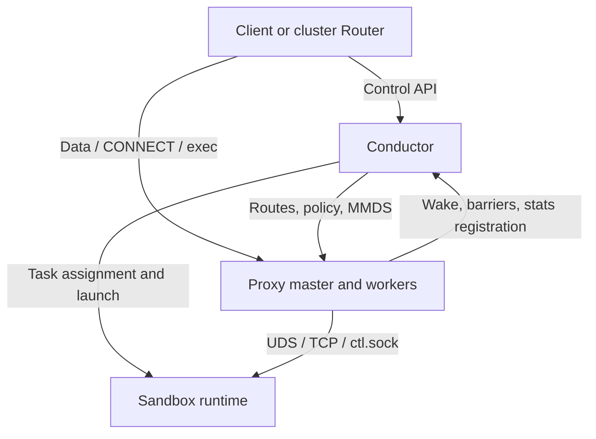

[English](node.md) | [简体中文](node_zh.md)

<a id="overview"></a>

# Node operation

Run and recover a compute node: service roles, shared configuration, systemd pools, trusted local channels and runtime dependencies. Start with the [project Quick Start](https://github.com/kuasar-sandbox/kuasar-sandbox/blob/main/docs/quickstart.md) for a complete platform deployment. [Sandbox lifecycle](sandbox-lifecycle.md), [Build](node-build.md), [access](node-proxy.md), [resources](node-resource.md), [observability](observability.md), [cluster](cluster.md) and [extensions](extensions.md) own their precise capability contracts.

`node-ctl` runs one resident conductor per compute node and exposes its microVM sandboxes through an **e2b-compatible API**. The supported operations can be used by unmodified Python/JavaScript `e2b`, `@e2b/code-interpreter` SDKs and the e2b CLI, subject to the [SDK compatibility boundaries and pinned versions](node-proxy.md#sdk-configuration). `node-ctl conductor serve` provides the **API** (control-plane REST for sandbox lifecycle, template builds and authentication), **host orchestration** (systemd template units for `sandbox-ctl`/builder tasks and `connector-ctl vswitch` networking), an optional **resource controller** (node arbitration through `resource_listen`; see [node-resource.md](node-resource.md)), and the **node-link client** that joins cluster-ctl orchestration ([Cluster integration (node-link)](cluster.md#node-attachment)). The separately deployed `node-ctl proxy serve` owns guest data-plane forwarding; conductor does not serve it.

A node can run **standalone**, serving e2b SDK/CLI clients on one machine, or **join a cluster** managed by Registry, Router and Placer ([cluster.md](cluster.md)). Both modes share the same e2b control plane and lifecycle primitives. **Create, pause, kill and template execution remain node-local**; cluster commands reuse these primitives ([Cluster integration (node-link)](cluster.md#node-attachment)).

`sandbox-ctl` runs the sandbox microVM with Cloud Hypervisor. An e2b-profile guest runs upstream envd from the single `sandbox-runtime.bundle` ([Guest profiles: envd and the toolchain](#guest-runtime)); the independent Proxy forwards its single-port protocol (49983/Connect-RPC) through a host UDS. A tenant's root credentials are **APISecret + ManifestKey**: APISecret signs/verifies API keys and derives each Sandbox's ServiceSecret; ManifestKey protects Manifest content and image-pull tokens. If omitted, APISecret is derived from ManifestKey by a fixed KDF. The pair is stored encrypted, never as plaintext root credentials in the database ([Credentials and ownership: encrypted APISecret/ManifestKey pairs](node-proxy.md#credential-model)).

The outputs are **`node-ctl`** (daemon, launchers, resource controller and administration CLI, [Command-line interface](#commands)) and **`e2b-key-ctl`** (credential derivation without DB/config/orchestration state, [`e2b-key-ctl`](node-proxy.md#credential-tool)).

**Read by task:** [Start the service](#conductor-command) · [Configure](#conductor-configuration) · [Pools and units](#systemd-pools) · [Local channels](#local-control-channels) · [Recover](#recovery)

<a id="service-roles"></a>

## Overview

<a id="the-service-problem"></a>

### The service problem

The runtime/accelerator/builder/vswitch stack exposes individual CLI primitives: start a microVM, flatten an image, attach a port. Clients need a northbound service that composes them: an existing e2b SDK/CLI and API key should let them create, execute in, pause, resume and kill sandboxes and build custom templates, without managing microVMs, Manifests or the eBPF switch.

node-ctl supplies that layer using **e2b protocol compatibility**. The SDK ecosystem, including code interpreters and agent integrations, can use the supported contract without client modifications. Endpoints, tokens and state machines have reference implementations, and real SDK/CLI E2E tests check compatibility. At scale, node-link connects many nodes to cluster-ctl for session-affine routing and on-demand placement ([Cluster integration (node-link)](cluster.md#node-attachment) and [cluster.md](cluster.md)); one node can also serve independently.

<a id="design-principles"></a>

### Design principles

1. **Compose at explicit boundaries.** Lifecycle and networking use subprocess CLIs such as `sandbox-ctl` and `connector-ctl vswitch`; units use systemd D-Bus and envd forwarding uses UDS. The code also imports sibling repositories' public packages for typed artifact preparation, configuration, assembly and publication ([Contract boundaries](#ownership-boundaries)), so this is not a CLI-only dependency graph. The binaries support pure-Go `CGO_ENABLED=0` builds.
2. **Keep resource arbitration separable.** `sandbox-ctl`'s `pkg/resource` client negotiates sandbox admission and quota with the node resource controller. `node-ctl conductor serve` embeds it through `resource_listen`, with inline configuration ([node-resource.md](node-resource.md)). It remains separate from API, host and Proxy logic. Conductor manages the Build admission pool itself ([Target-aware execution and publication](node-build.md#execution-and-publication)).
3. **Delegate process supervision to systemd.** Runner/builder template instances use RunID and may start early to wait for config-socket assignment. Runner `ctl/vmm` subgroups separate the supervisor from sandbox resources; the entire builder unit is accounted. StopUnit and its completion checks reclaim the unit; conductor does not replace systemd as a process supervisor.
4. **Keep root credentials encrypted at rest.** Tenant APISecret/ManifestKey pairs use AES-256-GCM in SQLite. Authenticated task bootstrap supplies authoritative ManifestKey environment values to single-tenant runner/builder processes. Conductor's managed sandbox/build preparation does not open or parse tenant artifacts with that key, and ManifestKey does not enter the guest ([Local control socket: run, task, admin, plugin and API planes](#local-control-channels)–[Credentials and ownership: encrypted APISecret/ManifestKey pairs](node-proxy.md#credential-model)). Pairs received over node-link are also stored encrypted ([Cluster integration (node-link)](cluster.md#node-attachment)).
5. **Separate local and cluster routing authority.** Conductor owns local routes and lifecycle; independent Proxy is the sole sandbox data ingress ([Data-plane boundaries](#runtime-endpoints)). Registry owns cluster routes. Node-link reports node events and accepts cluster commands ([Cluster integration (node-link)](cluster.md#node-attachment)) without creating competing cluster authority.
6. **Reconcile after restart.** SQLite and systemd unit inventory preserve enough state to adopt or clean up execution after a conductor restart ([Reliability](#recovery)). In cluster mode, node-link reconnects and reports the node's sandboxes so Registry converges.

<a id="two-sandbox-profiles"></a>

### Two sandbox profiles

| Profile | Meaning | Data plane | Exposed services |
|---|---|---|---|
| **e2b** | Upstream envd in the guest for agent exec, file access and code execution | envd fs/process/pty/runCode plus platform native exec | envd/CI, floating-IP user ports and native exec |
| **bare** | Run a customer image as a networked microVM without envd | Platform native exec; no envd API | Floating-IP networking and native exec |

`bare` reuses `sandbox-runtime.bundle` and exposes the base sandbox through the northbound API. Build registration defaults to **e2b**, but explicitly accepts **bare** ([Build API](node-build.md#build-api)); the output profile is immutable. The templateID prefix encodes profile ([Template IDs and artifact authority](node-build.md#artifact-identity)), which selects guest launch behavior and data services within the shared runtime Bundle.

<a id="boundaries-and-dependencies"></a>

### Boundaries and dependencies

- Northbound clients use e2b SDK/CLI directly. In a cluster, cluster-ctl Router forwards traffic and node-link carries control commands. Platform administration can also use the e2b API.
- Standalone and cluster modes keep create/pause/kill/template execution on the node. Joining adds node-link ([Cluster integration (node-link)](cluster.md#node-attachment)) without replacing the e2b contract.
- The data plane forwards upstream guest envd protocols rather than implementing envd ([Data protocols: envd and native exec](node-proxy.md#data-protocols)).
- The independent Telemetry component implements envd/OTLP collection and E2B `/sandboxes/{SandboxID}/metrics` history; Conductor only authenticates, checks ownership and forwards to a live registered query UDS. See [Telemetry](observability.md#telemetry). Native `/stats/resource`, `/stats/traffic` and `/stats/usage` remain independent; see [Instantaneous resource and traffic stats](observability.md#native-stats-api) and [Native usage](observability.md#native-usage).
- The server does not parse Dockerfiles. It pulls/flattens existing images and executes the supported structured Build steps supplied by clients inside phase microVMs ([Target-aware execution and publication](node-build.md#execution-and-publication)).
- Routing, storage and units are node-local. Cross-node snapshots/templates use canonical portable refs in Manifest Store or uniformly mounted named locations ([Artifact capture, templates and migration](sandbox-lifecycle.md#capture-and-pause)); cluster-ctl orchestrates through node-link ([Cluster integration (node-link)](cluster.md#node-attachment)).
- Dependencies include the standard library, pure-Go `modernc.org/sqlite`, `golang.org/x/net/http2` for config-socket/node-link h2c, `golang.org/x/sys` for pidfile locks/SO_PEERCRED/mmap, `coreos/go-systemd`, `google/uuid` v7 and `gopkg.in/yaml.v3`. The module also includes CEL/protobuf, AWS SDK and sibling public packages; see [go.mod](../go.mod). The hand-written envd client and node-link use JSON rather than a gRPC wire protocol.

<a id="architecture-and-data-paths"></a>

### Architecture and data paths

Alongside the application data path below, `node-ctl telemetry serve` subscribes
to the same full Plugin Plane RouteEntry stream. It scrapes envd over UDS and
directly accepts FloatingIP-identified guest OTLP in the management namespace.
Its Collector pipelines use standard exporter configuration; the local TSDB opens
only when explicitly enabled. Query backends and HTTP handlers are selected independently,
and query-only requires no Collector graph. Conductor forwards authenticated metrics queries over the
independent registered API UDS; no telemetry work enters lifecycle barriers.
The complete topology, failure and identity contracts are in [Telemetry](observability.md#telemetry).



<a id="node-directories-and-identities"></a>

### Node directories and identities

`paths.run_root`/`paths.base_root` are node-level **RunRoot/BaseRoot**; an object's actual directories are **RunDir/BaseDir**. RunRoot holds pid/lock files, Unix sockets, readiness, Sandbox YAML, runtime config, bounded CH snapshot staging state and small temporary JSON. BaseRoot holds writable diffs, local checkpoints, Build images and Sandbox/Snapshot artifacts, and other large data:

```text
<RunRoot>/
├── node-level files
├── runners/<RunID>.pid
├── sandboxes/<SandboxID>/
└── builds/<BuildID>/
    ├── builder.pid
    ├── a/
    ├── b/
    └── c/

<BaseRoot>/
├── node-level persistent files
├── sandboxes/<SandboxID>/checkpoint/
└── builds/<BuildID>/
    ├── checkpoint/
    ├── a/
    ├── b/
    └── c/
```

An ordinary Sandbox row stores exact `RunDir=<RunRoot>/sandboxes/<SandboxID>` and `BaseDir=<BaseRoot>/sandboxes/<SandboxID>`. SandboxID is always logical identity. sandboxer's PathID selects only the leaf beneath invocation-level roots; for ordinary sandboxes they are equal. Build phases retain globally unique logical SandboxIDs but use fixed PathID `a`, `b` or `c`. Resources, logs, memfd and artifact identity still use logical SandboxID. RunID identifies runner execution; its pidfile lives only under `runners/`.

BuildID is restricted to `[A-Za-z0-9_-]{1,48}` and used verbatim as `builds/<BuildID>`. BuildRunDir/BuildBaseDir derive uniquely from the roots and BuildID; they are not stored in Build rows, hashed or sanitized, and have no legacy-path fallback/migration. Registered/waiting Builds create no directories; execution claims precede creation. All Build images and Sandbox/Snapshot artifacts use `BuildBaseDir/checkpoint`; ordinary local captures use `BaseDir/checkpoint`. Validation requires custom RunRoot to fit sandboxer's longest socket under the maximum SandboxID and the longest phase socket under a 48-byte BuildID, within Linux's 107-byte pathname limit. The identity-length contract does not vary with the chosen root.

<a id="commands"></a>

## Command-line interface

<a id="command-catalog"></a>

### Subcommands

**`node-ctl`:**

| Subcommand | Purpose |
|---|---|
| `conductor serve` | Control plane, local control socket, reaper and Build pool; `cluster` enables node-link ([Cluster integration (node-link)](cluster.md#node-attachment)), and `resource_listen` embeds the resource controller ([node-resource.md](node-resource.md)) |
| `proxy serve` | Independent data-plane master/workers ([`node-ctl proxy`](node-proxy.md#proxy-command) and [node-proxy.md](node-proxy.md)) |
| `run-sandbox` / `run-builder` | Launchers inside systemd units, not interactive commands ([`node-ctl run-sandbox` / `run-builder`](#task-launcher-commands) and [Local control socket: run, task, admin, plugin and API planes](#local-control-channels)) |
| `resource` | `status`/`list`/`drain`/`pressure`: inspect reservations, resource/worker pools, pressure/recovery and drain admission ([node-resource.md](node-resource.md) [Command-line interface](node-resource.md#resource-command)) |
| `builder status` / `builder cancel <build-id>` / `builder delete <transient-template-id> [--cancel]` | Inspect durable usage, transient IDs, operation intent and claims; cancel execution or delete one Build record ([Cancel and delete a Build record](node-build.md#cancel-and-delete-a-build-record)) |
| `config` | Normalize/validate configuration or print a commented template |
| `manifest-key` | `add`/`remove`/`check`/`list`: manage credential-pair allowlisting for create/build/import ([Credentials and ownership: encrypted APISecret/ManifestKey pairs](node-proxy.md#credential-model)); Registry also writes leased entries ([Cluster integration (node-link)](cluster.md#node-attachment)) |
| `export-sandbox` / `import-sandbox` | Promote paused sandboxes to templates or migrate them ([Artifact capture, templates and migration](sandbox-lifecycle.md#capture-and-pause)) |
| `version` | Print version |

**`e2b-key-ctl`**, which derives credentials without DB/config/daemon access:

| Subcommand | Purpose |
|---|---|
| `gen-key` | Generate a random 32-byte root credential (64 hex digits) |
| `derive-api-secret [<MANIFEST_KEY>]` | Derive default APISecret with the fixed KDF ([Credentials and ownership: encrypted APISecret/ManifestKey pairs](node-proxy.md#credential-model)) |
| `gen-apikey [<API_SECRET>]` | Sign an e2b API key with APISecret (`e2b_` plus hex, [Credentials and ownership: encrypted APISecret/ManifestKey pairs](node-proxy.md#credential-model)) |
| `fingerprint [<API_SECRET>]` | Print APISecret's full 64-hex SHA-256 fingerprint |
| `seal-pull-token [<MANIFEST_KEY>] …` | Seal an opaque image-pull token (`kpt_`, [Target-aware execution and publication](node-build.md#execution-and-publication)) |
| `version` | Print version |

A typical standalone-node setup is:

```bash
# 1) Generate a content root, derive APISecret, register the pair and issue the SDK API key
MK=$(e2b-key-ctl gen-key)
API_SECRET=$(e2b-key-ctl derive-api-secret "$MK")
node-ctl manifest-key add --api-secret "$API_SECRET" --label tenant-a "$MK"
export E2B_API_KEY=$(e2b-key-ctl gen-apikey "$API_SECRET")

# 2) Point e2b SDK/CLI at this node
export E2B_DOMAIN=sandboxes.example.com        # Production (TLS, DNS / TLS)
# dev: E2B_API_URL=http://host:3000  E2B_SANDBOX_URL=http://host:3443
```

In cluster mode, Registry distributes leased keys through node-link ([Cluster integration (node-link)](cluster.md#node-attachment) and [cluster.md](cluster.md)); manual `manifest-key add` is unnecessary.

<a id="conductor-command"></a>

## `node-ctl conductor serve`

```
node-ctl conductor serve [--config /etc/node-ctl/conductor.yaml]
```

| Flag | Default | Meaning |
|---|---|---|
| `--config` | `/etc/node-ctl/conductor.yaml` | Conductor configuration ([Configuration](#conductor-configuration)) |

Startup opens SQLite with file mode 0600, restores and validates persisted pool/unit identities, generates/installs systemd templates ([Process management through systemd template units](#systemd-pools)), reconciles restart state ([Reliability](#recovery)), starts the 5-second TTL reaper and optional embedded resource controller, binds and confirms the local control socket ([Local control socket: run, task, admin, plugin and API planes](#local-control-channels)), starts runner/builder pools and Build admission ([Target-aware execution and publication](node-build.md#execution-and-publication)), optionally dials `cluster.node_link.endpoint` ([Cluster integration (node-link)](cluster.md#node-attachment)), then listens on `api.listen`. That listener serves only the wrapped control API; sandbox data Host requests and CONNECT do not reach backends. With no TLS certificates it serves plaintext h2c; development SDK control uses `E2B_API_URL`.

The supplied systemd service is [deploy/node-ctl.service](../deploy/node-ctl.service).

<a id="task-launcher-commands"></a>

## `node-ctl run-sandbox` / `run-builder`

These are systemd ExecStart launchers. Their common entry uses `--run-id` as the unit instance name and `--pidfile=<RunRoot>/runners/<RunID>.pid`. An exclusive `fcntl(F_SETLK)` lock prevents duplicate execution; the launcher writes its PID, opens one authenticated long-lived run session on `--config-socket`, then calls WaitAssignment to obtain its business ID ([Local control socket: run, task, admin, plugin and API planes](#local-control-channels)). They then diverge:

- **run-sandbox:** remains the unit parent. It immediately connects `<RunRoot>/sandboxes/<SandboxID>/ready.sock` with `FD_CLOEXEC` still set and requests bootstrap using SID plus exact RunID; the runtime-owned `<RunDir>/<SandboxID>.pid` is locked later by `sandbox-ctl`, not by the parent. Cold-image bootstrap returns final LaunchSpec in one RPC. E/S bootstrap returns task-local ArtifactPrepareSpec and authoritative `MANIFEST_KEY`; the runner overrides inherited environment, opens E/S according to kind and durable LaunchMode, submits the completion and waits for final LaunchSpec. It retains PreparedSource, carrier bindings and sorted ref-locations locally, explicitly closes readers/fetchers, then starts `sandbox-ctl run` as its direct child with the trusted VMM cgroup FD and readiness FD. The parent closes its readiness copy after `Start`, waits exactly once for that child, and reports one bounded `{sid, run_id, stage, exit_code|signal|error}` execution result over the config socket before exiting. The long-lived session FD stays parent-owned and is never inherited by the child. Any prepare/start failure closes readiness and conductor observes EOF; a post-start child exit is reported through the durable result path.
- **run-builder:** complete task preparation, resident execution, deadlines, shared run-session registration and Build result handoff are in [Task handoff](node-build.md#task-handoff).

```
node-ctl run-sandbox --pidfile=<f> --config-socket=<uds> --run-id=<rid>
node-ctl run-builder --pidfile=<f> --config-socket=<uds> --run-id=<rid>
```

Missing flags fall back to `TASK_PIDFILE`, `TASK_CONFIG_SOCKET` and `TASK_RUN_ID`, used for systemd `%i` wiring.

<a id="configuration-command"></a>

## `node-ctl config`

Configuration generation and diagnosis are **role-specific** (`conductor`/`proxy`/`telemetry`, separate files and schemas):

```
node-ctl config <conductor|proxy|telemetry> --template            # Print the role-specific commented template
node-ctl config <conductor|proxy|telemetry> --config <file>       # Load, default, validate and normalize
node-ctl config <conductor|proxy|telemetry> --config <file> --resolve   # Also resolve auto/derived effective values
                              -o <file>             # Write a file (default stdout)
```

The first argument selects schema: conductor uses `conductor.yaml` ([Configuration](#conductor-configuration)), proxy uses `proxy.yaml` ([node-proxy.md](node-proxy.md) [Proxy command and configuration](node-proxy.md#proxy-configuration)), telemetry uses `telemetry.yaml` ([Telemetry](observability.md#telemetry)). Conductor `--resolve` additionally expands `resource_listen` auto memory/CPU and deeply validates watermarks; for other roles it is equivalent to `--config`. Templates correspond to `deploy/{conductor,proxy,telemetry}.example.yaml`.

The command performs strict declarative decoding, defaulting and diagnosis. It never executes `conductor_executable`/`proxy_executable`/`telemetry_executable` or accesses custom App runtime materials. With a custom executable, the first output line explicitly marks bootstrap-only validation; that App validates final configuration before startup side effects.

<a id="conductor-configuration"></a>

## Configuration

Conductor uses `conductor.yaml`. The fully commented [deploy/conductor.example.yaml](../deploy/conductor.example.yaml) matches the shape of `node-ctl config conductor --template`. The authoritative type is `config.Conductor` in public package `github.com/kuasar-sandbox/orchestrator/config`; internal code reuses that schema. It provides strict `LoadConductor`/`DecodeConductor`, `LoadProxy`/`DecodeProxy`, final validators that do not reapply defaults after hooks, and genuinely deep `Clone` operations. Decode/Load perform bounded strict decoding, declarative defaulting and enum/duration/range/format validation of supplied values. They do not inspect environment, component files or executable-dependent startup requirements. Identical input produces identical results regardless of `NODE_CONFIG_ENCRYPTION_KEY`. Unknown YAML fields and multiple documents fail. Config JSON/YAML contains only serializable declarations, never loggers, providers or runtime handles.

Groups are `api`, `proxy`, `paths`, `units`, `sandbox` (instance defaults under `resources`/`network`/`boot`), `builder`, `checkpoint`, `mmds`, `cluster` (node-link, [Cluster integration (node-link)](cluster.md#node-attachment)) and `resource_listen` (embedded controller with all tuning inline; [node-resource.md](node-resource.md)). `encryption_key` and `manifest_config` are top-level values. Built-in node-ctl explicitly performs final declarative validation, then runtime resolution reads the environment/YAML encryption key. Custom conductor validates after Configure; Runtime providers may supply key/TLS/object-store material. A provider overrides environment/YAML and never falls back after failure. Helper executable paths (`sandbox-ctl`, `connector-ctl`, `flatten-ctl`) are outside public Config. Resolution starts at the original node-ctl's exact adjacent release directory, retaining PATH fallback when a helper is absent.


The following table owns shared node-service fields. Capability-specific configuration is defined with its behavior: [instance lifecycle](sandbox-lifecycle.md#node-defaults), [access and credentials](node-proxy.md#conductor-access-configuration), [resources](node-resource.md#conductor-resource-configuration), [Build](node-build.md#build-configuration), [observability](observability.md#node-observation-configuration), and [cluster attachment](cluster.md#node-attachment-configuration). A shared YAML file does not create a second definition of those fields.

| Field | Default | Meaning |
|---|---|---|
| `api.domain` | Required | Service domain, e.g. `sandboxes.example.com`; control plane is `api.<domain>` |
| `api.listen` | `:443` | Northbound listener; development can use plaintext h2c on `:3000` |
| `api.tls.cert/key` | Empty | Wildcard certificate for `*.<domain>` and `api.<domain>` ([DNS / TLS](#dns-and-tls)); empty means plaintext. A non-nil custom Runtime TLS provider is authoritative; core still fixes TLS version/ALPN/client-auth policy |
| `manifest_config` | `/opt/sandbox/manifest.yaml` | Shared remote Manifest Store configuration; leave `manifest.key` empty because each task receives its tenant key through environment |
| `paths.conductor_executable` | Empty | Absolute custom conductor executable; empty selects built-in. Config diagnosis checks regular/executable, not group/world-writable and not the same file as node-ctl, without applying diagnostic EUID ownership policy. Runtime root node-ctl accepts only root-owned executables; non-root accepts root or its own EUID. Dispatch executes the same opened/validated FD and never falls back |
| `paths.run_root` | `/run/sandbox` | Small node files plus `runners/`, `sandboxes/`, `builds/`, usually tmpfs; must leave the 107-byte Linux socket pathname budget for the longest phase path at maximum BuildID ([Node directories and identities](#node-directories-and-identities)) |
| `paths.base_root` | `/var/lib/sandbox` | Persistent node files and large Sandbox/Build data ([Node directories and identities](#node-directories-and-identities)) |
| `paths.db_path` | `<base_root>/node-ctl.db` | SQLite path ([Reliability](#recovery)) |
| `paths.config_socket` | `/run/sandbox/node-ctl.socket` | Local run assignment/result and task/admin/plugin/API planes ([Local control socket: run, task, admin, plugin and API planes](#local-control-channels)); connects manifest-key/export/import CLI, Proxy and platform agents |
| `paths.admin_pidfile` | Empty | Multiline PID allowlist for admin, allowing `#` comments; otherwise socket mode 0600 alone |
| `paths.plugin_pidfile` | Empty | Multiline PID allowlist for Proxy/agent plugin registration; otherwise socket mode 0600 alone |
| `units.dir` | `/etc/systemd/system` | Template-unit installation directory |
| `units.runner_pools` / `units.builder_pools` | Absent | Independent pools with name, resource_pool, unit, size, capacity and priority; see below |
| `units.runner` / `units.builder` | `sandbox-runner@.service` / `sandbox-builder@.service` | Template-unit names |
| `units.runner_pool_size` / `units.builder_pool_size` | `0` / `0` | Idle prestarted RunID unit counts; zero still starts on-demand units through WaitAssignment. Finite execution admission resources permit a nonzero Builder pool; idle units hold no Build claim |
| `units.pool_wait_timeout` | `5s` | Positive budget from StartUnit through entry into WaitAssignment; timeout cleans that RunID and replenishes the pool |
| `units.install` | `true` | False delegates unit installation to operations |
| `sandbox.boot.kernel` | — | vmlinux path |
| `sandbox.boot.runtime` | — | Single guest runtime Bundle: offset-zero EROFS plus digest-marker ZIP, containing envd and flatten-ctl ([Guest profiles: envd and the toolchain](#guest-runtime)) |
| `sandbox.boot.overlay_diff_template` | — | Preformatted empty ext4, sparsely copied to img cold-start writable upper. An unformatted diff is rejected; deployment supplies a sparse file formatted with `mkfs.ext4 -O ^has_journal`. Restore obtains the layer graph from artifacts |

For new `sandbox.boot.overlay_diff_template` and `builder.diff_template` files,
use `mkfs.ext4 -O ^has_journal` to avoid filesystem journal capacity and metadata
writes on disposable work disks. This does not disable journald or application
logs and is not a crash-recovery guarantee. Existing journaled templates and
user-supplied images remain compatible; sync/quiesce, snapshot/restore and mount
behavior are unchanged. Apply this only when creating a new empty template,
never by reformatting an existing data disk.

The primary use case is [NUMA deployment with multiple pools](#numa-deployment-with-multiple-pools): distinct templates carry per-node CPU/memory placement. [Resource pools](node-resource.md#resource-pools) add capacity-aware placement and pressure recovery. The repeated-template example below illustrates configuration semantics, not distinct NUMA bindings.

Each `units.runner_pools` / `units.builder_pools` entry accepts `name`,
`resource_pool`, `unit`, `size`, `capacity` and `priority`. Each entry creates an
independent pool; templates may be shared within the same resource pool.
`size >= 0` is the idle prewarm target; zero starts on demand. Optional capacity
limits all instances and effective start reservations. Higher priority wins,
with random ties. `dir`, `install` and `pool_wait_timeout` are shared.

```yaml
units:
  dir: /etc/systemd/system
  install: true
  pool_wait_timeout: 5s
  runner_pools:
    - {unit: sandbox-runner@.service, size: 8}
    - {unit: sandbox-runner@.service, size: 4}
    - {unit: sandbox-runner-special@.service, size: 0}
  builder_pools:
    - {unit: sandbox-builder@.service, size: 2}
    - {unit: sandbox-builder@.service, size: 0}
```

When a list is absent, that kind uses its legacy `runner` / `runner_pool_size` or
`builder` / `builder_pool_size` as one pool, retaining the template and size-zero
defaults. Runner and Builder can independently use old or new input. Explicit
empty lists, invalid entries and explicit old/new fields for the same kind
(including an explicit old size of zero) are rejected; inserted defaults are not
mixed input. Compatibility covers reading old configurations in the new binary.

<a id="conductor-bootstrap"></a>

### Statically customized conductor

The complete custom Conductor construction, protected configuration, runtime binding and provider contracts are maintained in [Extensions](extensions.md#conductor-bootstrap). Authorization, persisted records and lifecycle invariants remain core-owned and cannot be bypassed by configuration hooks.

<a id="configuration-assembly"></a>

### Configuration assembly and validation

The complete Proxy configuration/binding lifecycle, Master/Worker hooks, public route sources and authorized-forwarding SDK are maintained in [Extensions](extensions.md#proxy-bootstrap). Core process, shared-memory and cancellation invariants remain in [node-proxy.md](node-proxy.md).

Build configuration and its legacy-schema boundary are defined in [Build configuration](node-build.md#build-configuration).

There is no node-global remote-memory prefetch switch. Each Sandbox's kuasar-sandbox.restore namespace selects it ([Sandbox configuration propagation](sandbox-lifecycle.md#request-configuration)).

Configuration consistency requires proxy.auth=enforce when mmds.enabled=false, since nonsecure envd relies on Proxy's data gate. mmds.routes.enabled requires mmds.enabled; service endpoints must be absolute Unix socket URIs. Only proxy.yaml configures proxy_netns and worker count. Cluster endpoint requires node_id plus separate api_endpoint/data_endpoint. With resource_listen.enabled, startup resolves one canonical controller identity and writes it into every dynamic Sandbox YAML; there is no second sandbox.resources.control_socket source. Startup headroom has identical static/dynamic semantics, independent of controller enablement.

<a id="network-attachment-identities"></a>

## Network attachment identities

For node-owned vSwitch attachments, conductor reads the switch `generation_bits` capability once and assigns a process-local monotonically advancing attachment sequence modulo that width. The generation is passed through both CLI Attach and TAPFD PREPARE. `generation_bits=0` is legacy behavior. The sequence is deliberately not durable Sandbox identity and may restart after conductor restart; failed Attach attempts may consume a generation.

<a id="systemd-pools"></a>

## Process management through systemd template units

At startup, conductor generates each configured template and the fixed sandbox-runner.slice/sandbox-builder.slice under units.dir; identical generated content for the same template is written once, while conflicting content under one name is rejected before writing; it calls D-Bus Reload only when content changes. With units.install=false, operations manages them; conductor neither writes files nor reads or validates operator resource properties. Generated ExecStart uses the exact original node-ctl path retained by runtime resolution/bootstrap, including custom conductor mode ([Configuration](#conductor-configuration)).

**Runner unit** (`%i` is RunID):

```ini
# sandbox-runner@.service (Generated; paths rendered from config)
[Service]
Type=exec
WorkingDirectory=/run/sandbox
ExecStart=<node-ctl> run-sandbox --pidfile=/run/sandbox/runners/%i.pid \
          --config-socket=/run/sandbox/node-ctl.socket --run-id=%i
ExecStopPost=/bin/rm -f /run/sandbox/runners/%i.pid
# One resident parent per RunID; no automatic retry after a stateful crash
Restart=no
# Default SIGTERM, then SIGKILL after TimeoutStopSec; includes CH (Cgroup separation and FD capability)
KillMode=control-group
TimeoutStopSec=20
Slice=sandbox-runner.slice
# Delegate CPU/memory controllers (Cgroup separation and FD capability)
Delegate=yes
```

The complete Builder unit lifecycle and resource ownership rules are in [Builder unit and process lifecycle](node-build.md#builder-unit-and-process-lifecycle).

Both ExecStart programs lock the RunID pidfile, open the authenticated run session, then wait for business-ID assignment over config-socket. Runner connects readiness immediately after obtaining SID and requests exact-run bootstrap; the runtime `<RunDir>/<SandboxID>.pid` is owned by `sandbox-ctl`. Artifact tasks prepare E/S locally and complete the second stage before obtaining final LaunchSpec. The runner parent then starts `sandbox-ctl run` as a direct child in the same unit cgroup, closes its readiness copy after Start, waits once, and reports the bounded execution result. Type=exec requires no sd_notify. Builder process/child-VM and result behavior is defined in [Task handoff](node-build.md#task-handoff).

Runner and Builder placement first selects a resource pool with sufficient
declared Capacity, operation permission and worker supply, preferring the lowest
runtime utilization with random ties. Within that resource pool, higher worker-pool
priority wins and equal priorities select randomly. Registration, rejected Build
admission and already bound executions do not select again. Resume can select a
different pool after old execution cleanup. Artifact preparation can replace its
worker before VM launch when authoritative Capacity becomes available. All actual
phases of one Build stay with one Builder; global registration/execution ledgers,
FIFO claims and release fences remain separate. The [resource-pool contract](node-resource.md#resource-pools)
owns capacity, selection, managed drop-ins and recovery. Systemd/Linux enforces
CPU/NUMA placement; Conductor does not add pool-specific slices or outer Builder
CPU/memory limits.

Before StartUnit can run, conductor records RunID → creating pool for exact
WaitAssignment routing, even when pools share a template. A separate RunID →
actual unit association survives assignment until lifecycle cleanup. Logical pool,
resource pool, actual unit and execution Capacity are persisted for restart.
Durable
binding still precedes publishing assignment. Builder retries first consult the
durable Build binding. Neither RunID format nor the pidfile/config-socket,
Delegate, ctl/vmm and trusted-FD contracts change.

Conductor maintains target idle counts for each pool. Assignment consumes a unit already waiting in WaitAssignment and schedules asynchronous replenishment. With no idle unit, it creates a RunID and uses the same StartUnit/WaitAssignment path. A fixed control loop serializes Start/Stop requests received over a channel; there is no newly spawned start goroutine for every replenishment. pool_wait_timeout covers the full StartUnit-to-WaitAssignment interval. Start failure, wait timeout or canceled waiting connection triggers StopUnit plus ResetFailedUnit, then a new UUIDv7 RunID to refill the pool.

Runner assignment budget begins at pool Assign and covers queuing, on-demand StartUnit and WaitAssignment. After selecting an idle runner, the pool calls the commit callback to bind RunID; only success publishes task ID and returns success. This is assignment's linearization point: later caller cancellation cannot reverse it. Pool loop alone answers pending cancellation/shutdown, exactly once per request.


- **Kill:** under the SID fence, exact-CAS full ownership into deleting, cancel active launch, withdraw runtime cache and publish deleting management Upsert. Asynchronous finalization stops the unit and all CH descendants, resets failed state, releases TAPFD or detaches vswitch, removes directories and hard-deletes row before final route Delete. Business-route withdrawal does not await cleanup. The old launch claim remains until its attempt finishes local cleanup, preventing late CAS resurrection or an early same-SID successor. Guest restart policy cannot block host unit termination.
- **Readiness:** before assigning a runner, conductor binds `<RunDir>/ready.sock` with directory 0700/socket 0600. Runner immediately connects. Conductor waits for artifact completion, readiness EOF, cancellation and absolute deadline together, so a task exiting during root reads fails immediately. The one-shot stream must be `control_ready\nready\nEOF`. Bare is ready then; e2b next sends mandatory POST /init as the first envd request, without /health as a startup gate. Health is for external checks after initialization. Artifact and cold launches follow the accepted attempt owner through preparation, child Start, readiness and /init. An explicitly supplied positive absolute deadline spans these phases without reset; ordinary launches add no overall deadline. /init starts immediately, retries only connection/transport errors at 1ms/2ms/4ms/capped-5ms backoff, under the shared launch context, without a separate 50ms request limit. Only 204 succeeds; other statuses expose the status code without potentially sensitive response body. Protocol errors, early EOF, cancellation or total timeout fail launch: fresh starting becomes dead; resume returns paused. After durable acceptance but before runner assignment, failure uses the empty-RunID fence. Only /init success commits starting→running with the exact RunID and publishes running route.
- **Liveness authority:** ListUnitsByPatterns over distinct configured runner templates obtains the authoritative active RunID set for reconciliation with stored sandboxes.run_id ([Reliability](#recovery)).
- Host Restart=no and guest envd restart=always under sandbox-init are separate layers.

<a id="cgroup-separation-and-fd-capability"></a>

### Cgroup separation and FD capability

The runner unit root is an empty delegation boundary:

```text
sandbox-runner@<run-id>.service/
├── ctl/   node-ctl parent and its direct sandbox-ctl child
└── vmm/   cloud-hypervisor
```

Before assignment, run-sandbox accepts only membership in its matching RunID unit root or ctl subgroup. From the root it creates ctl, moves its whole process with cgroup.procs and rereads /proc/self/cgroup to confirm identity. Existing ctl supports externally installed units. Both paths verify an empty unit root and cpu/memory delegation, enable controllers there, idempotently create vmm and open its directory FD with CLOEXEC. This requires Delegate=yes, not systemd v254's DelegateSubgroup. After LaunchSpec, the launcher passes only the trusted VMM/readiness descriptors through the child's ExtraFiles and derives their actual child FD numbers. Parent copies remain CLOEXEC; the RunID lock and Run session never enter ExtraFiles. LaunchSpec carries no host cgroup path or FD.

sandbox-ctl restores CLOEXEC immediately, configures limits and creates CH atomically in vmm with clone3(CLONE_INTO_CGROUP). memory.high therefore constrains VMM while sandbox-ctl can service UFFD/vsock/signals/reaping under guest pressure. Sandboxer owns high, balloon target/current and grow/shrink ordering; node controller only handles reservation requests. Linux 5.7+ and seccomp permission for clone3 are required. Unsupported hosts fail closed, with no post-start migration/shared-cgroup fallback.

KillMode=control-group covers ctl/vmm recursively. systemd reclaims the delegated subtree after StopUnit; conductor need not move processes or remove cgroups itself. Delegation/hierarchy/controller/FD failures precede CH startup.

<a id="numa-deployment-with-multiple-pools"></a>

### NUMA deployment with multiple pools

The primary deployment use case for multiple pools is to keep a Sandbox's host
execution within a NUMA node while distributing new executions across nodes.
Conductor selects a pool and its systemd template; the operator configures CPU
placement and memory allocation on that template. This is host-side placement,
not guest vNUMA topology. Resource pools schedule configured capacity and runtime
utilization; systemd/Linux applies the placement policy.

NUMA placement is enforced by systemd/Linux. The example below installs placement
policies manually. To account and schedule each NUMA budget independently, use
the [resource-pool configuration](node-resource.md#pool-configuration), including
`resource_pool` associations and external `unit_dropins`. Validate effective CPU
and memory-node masks, page placement and cross-pool recovery on the actual host.

The example below leaves all logical pools in the shared `default` resource pool:
it distributes unit placement but does not create independent NUMA budgets. Use
the resource-pool example for independent capacity and pressure accounting.

For a host with online, memory-bearing NUMA nodes 0 and 1, use distinct template
names for distinct placement policies. The following replaces the `units` block
in an otherwise complete Conductor configuration; omit the legacy single-pool
fields. The sizes are illustrative idle-worker targets, not recommended capacity:

```yaml
units:
  dir: /etc/systemd/system
  install: true
  pool_wait_timeout: 5s
  runner_pools:
    - {unit: sandbox-runner-numa0@.service, size: 4}
    - {unit: sandbox-runner-numa1@.service, size: 4}
  builder_pools:
    - {unit: sandbox-builder-numa0@.service, size: 1}
    - {unit: sandbox-builder-numa1@.service, size: 1}
```

**Inspect the actual host topology first.** Node IDs and logical CPU numbering
are machine-specific, including SMT siblings; never infer a CPU range from the
node number. Confirm cgroup v2 and the `cpuset` controller are available, and that
the ancestor slices allow both target nodes/CPU sets:

```sh
lscpu -e=CPU,NODE,SOCKET,CORE
numactl --hardware
cat /sys/fs/cgroup/cgroup.controllers
cat /sys/devices/system/node/node{0,1}/cpulist
```

**Install operator-owned placement drop-ins before starting Conductor or any
prewarmed worker.** On the example two-node host, run this as root. Each selected
node must have online CPUs and memory. The example uses that node's entire CPU
list; adjust `cpus` to the deployment's intended subset when reserving host CPUs:

```sh
set -eu
unit_dir=/etc/systemd/system
for node in 0 1; do
  cpus=$(cat "/sys/devices/system/node/node${node}/cpulist")
  test -n "$cpus"
  for kind in runner builder; do
    dropin="$unit_dir/sandbox-${kind}-numa${node}@.service.d"
    install -d -m 0755 "$dropin"
    cat > "$dropin/20-numa.conf" <<EOF
[Service]
CPUAffinity=
CPUAffinity=$cpus
AllowedCPUs=
AllowedCPUs=$cpus
NUMAPolicy=bind
NUMAMask=
NUMAMask=$node
AllowedMemoryNodes=
AllowedMemoryNodes=$node
EOF
  done
done
systemctl daemon-reload
```

`CPUAffinity` sets the initial execution mask; `AllowedCPUs` bounds the entire
unit subtree through cgroup v2. `NUMAPolicy=bind` with `NUMAMask` sets allocation
policy before the worker creates threads/children; `AllowedMemoryNodes` bounds
the unit's permitted memory nodes. These are placement settings, **not**
`CPUQuota`, `MemoryMax`, `MemoryHigh`, a per-pool reservation, or exclusive CPU
ownership. Keep runtime Sandbox resource enforcement with `sandbox-ctl`.

With `install: true`, Conductor generates each named base template and the two
existing fixed slices; the separately managed `.service.d/20-numa.conf` files
supply placement. Do not put custom properties into generated base files, which
Conductor rewrites. With
`install: false`, operators instead install four independent real template files
based on this version's generated runner/Builder templates ([Process management through systemd template units](#systemd-pools) and Build [Builder unit and process lifecycle](node-build.md#builder-unit-and-process-lifecycle)),
plus `sandbox-runner.slice` and `sandbox-builder.slice`, then reload systemd.
Preserve the deployment's executable paths, `%i` **RunID**, pidfile/config socket,
`Delegate=yes`, `ctl/vmm`, cleanup, and existing slice contracts. Do not use unit
aliases to represent different placements. Conductor does not install or reload
anything in that mode.

Runner and Builder assignments use priority with random ties within the selected
resource pool. A prewarmed process is
already placed before assignment. Runner children and Builder child
processes remain under the selected unit; the Builder's A/B/C phases that actually
run use that same Builder, not fresh pool selections. In-guest work runs through
those phase VMMs. Do not bind only the Conductor daemon: systemd starts the units,
so placement belongs on their templates. See [Builder unit and process lifecycle](node-build.md#builder-unit-and-process-lifecycle).

The deployment retains these boundaries:

- Two entries sharing one template must share its resource pool and placement
  policy; duplication does not bind them to different nodes. `size` is an idle
  target. Resource-pool capacity and runtime usage govern placement; Builder
  business FIFO/claims remain separate.
- A bound execution stays with its actual unit, including Conductor restart.
  Pause/resume requiring a new runner selects again and may use the other node;
  the feature supplies no sticky NUMA placement, live migration or host-node
  identity in portable artifacts. Keep templates needed by active/pending-cleanup
  executions configured. Changing/reloading drop-ins does not re-exec existing
  prewarmed or assigned workers with the new process policy; plan an explicit
  lifecycle-safe worker turnover rather than assuming hot migration.
- Strict single-node binding can cause local reclaim or allocation failure/OOM
  despite free memory elsewhere. A running execution is not moved in response to
  an individual allocation failure. Cross-pool pressure recovery uses the explicit
  Pause/Resume lifecycle in the resource-pool contract. A
  deliberate `NUMAPolicy=preferred` fallback configuration must also remove or
  widen single-node `AllowedMemoryNodes`; cpuset restrictions take precedence.
  That trades strict memory locality for fallback; resource-pool accounting
  still follows the execution's selected pool.

Setting semantics: [systemd.exec(5)](https://manpages.debian.org/trixie/systemd/systemd.exec.5.en.html),
[systemd.resource-control(5)](https://manpages.debian.org/trixie/systemd/systemd.resource-control.5.en.html),
[Linux NUMA memory policy](https://docs.kernel.org/admin-guide/mm/numa_memory_policy.html),
and [cgroup v2 cpuset](https://docs.kernel.org/admin-guide/cgroup-v2.html#cpuset).

<a id="local-control-channels"></a>

## Local control socket: run, task, admin, plugin and API planes

Conductor serves h2c/HTTP1.1 on paths.config_socket, default `/run/sandbox/node-ctl.socket`, mode **0600**. One socket multiplexes five independently authenticated planes. SO_PEERCRED injects peer PID into request context; same UID/root can connect, with additional plane checks. SDKs do not use /internal/*, which is separate from API paths.

**Run plane** uses the existing socket for `PUT /internal/run/session` and `POST /internal/run/assignment`, `/internal/run/sandbox-result`, `/internal/run/build-result` and `/internal/run/build-phase`. SO_PEERCRED must match the parent PID in the locked `runners/<RunID>.pid`. Session admission additionally requires a real pool or durable task owner, not merely a well-formed RunID. The first response identifies `kind+RunID` and is flushed before assignment. The parent continuously consumes this response stream; reconnect registers the same run without repeating assignment or child execution. A replaced connection cannot remove its successor generation. Idle retirement and assignment handoff share the pool's serialization boundary; durable binding precedes the response, so a lost response can replay the same starting assignment.

A closed Run session is a liveness notification, not evidence of process death. Conductor checks the exact actual unit and preserves healthy execution; a stale old-run check cannot cancel a same-SID successor or a reconnected starting attempt. Shutdown marks session closes as non-death, cancels streams, then drains HTTP handlers. Resource-controller lease and StateSync responsibilities are unchanged. See [configsock/server.go](../internal/configsock/server.go).

`POST /internal/run/sandbox-result` carries the exact SandboxID/RunID and a bounded prepare/start/run result. A short store transaction accepts it before ACK; identical retries are idempotent, while stale/conflicting reports are rejected. ACK means durable acceptance, not completed cleanup, and reporting never waits for a SID lifecycle lock spanning StopUnit or hooks. Both starting-to-running CAS paths reject an accepted result. The parent reports from an independent finite budget, never performs node database/network cleanup and never invents a prepare result after a start/run report failure.

Results, session disconnects and the existing low-frequency Reaper all coalesce into one process-local pending entry per exact RunID. At most four run-end workers execute; pending runs do not create waiting goroutines or timers. Failed passes rotate behind other work with bounded backoff. Shutdown drains an already-running synchronous removal rather than pretending context cancellation interrupts RemoveAll; durable pending ownership remains recoverable. Starting notifications reach only the original rollback attempt; running results fence the exact unit, detach and durably clear networking under the allocation fence, release that fence before slow directory removal, then commit dead and withdraw live routes/observations. Paused checkpoints and existing deleting finalizers retain their ownership rules. The Reaper also finds accepted results whose in-memory notification was lost, even while their parent session remains live, and missing-session owners whose unit exits after the initial disconnect check. It does not periodically run full startup reconciliation.

**① Task plane:** launchers obtain work specifications. Artifact-backed Sandbox and Build use exact-run two-stage endpoints; cold/image retains one-RPC bootstrap:

- POST /internal/task/sandbox/bootstrap takes sandbox_id/run_id/version. It first obtains non-secret exact-run pidfile identity and authenticates SO_PEERCRED+pidfile before the secret-bearing provider. Cold-image returns final LaunchSpec; artifact returns ArtifactPrepareSpec plus environment. The task submits sandbox_id/run_id/summary to POST /internal/task/sandbox/prepare and waits for LaunchSpec `{exec,args,workdir}`. Identical-digest replay waits for/returns the same result without duplicate host effects; conflicting replay returns 409. A disconnected HTTP request cancels only its wait. Exec is sandbox-ctl with run, sandbox-id/path-id, config, shared manifest config and invocation roots `<RunRoot>/sandboxes`/`<BaseRoot>/sandboxes`, plus selected --from E or --restore S and --connect mappings. PathID/roots fix ch.sock/ctl.sock/staging to stored RunDir/BaseDir; pause/snapshot/exec use that same locator. Child Start injects the local cgroup/readiness FDs, which LaunchSpec cannot override.
- Complete Build bootstrap/prepare versions, payloads and recovery rules are in [Build task handoff](node-build.md#task-handoff); the identity and shared-plane rules below apply to both Sandbox and Build.
- Sandbox/Build authentication first resolves business ID plus exact RunID to non-secret task identity, then verifies peer PID against the parent's locked `<RunRoot>/runners/<RunID>.pid` for Sandbox or `<BuildRunDir>/builder.pid` for Build. Only then may providers decrypt ManifestKey/registry credentials. Stale runs or unauthorized peers cannot reach them.
- Root-credential-free bulk config uses files: Sandbox YAML (0600) or phase YAML (0600) in phase RunDir (0700). Tenant root/pull credentials use authenticated spec/environment instead. This does not make arbitrary caller-supplied workload files/env nonsensitive; their declarations retain normal config/artifact semantics.

**② Admin plane:** /internal/admin/manifest-keys uses GET for list and POST `{op:add|remove|check,manifest_key,api_secret?,label,ttl_seconds,registry_auth}` for pair allowlisting ([Credentials and ownership: encrypted APISecret/ManifestKey pairs](node-proxy.md#credential-model)). Responses contain fingerprints only. Optional admin_pidfile checks peer PID; otherwise socket 0600 applies. manifest-key CLI uses this plane. Cluster key_put writes/refreshes atomic leased pairs through node-link; expiry without renewal evicts entries, while key_drop is best-effort ([Cluster integration (node-link)](cluster.md#node-attachment)).

The same plane supports Sandbox-local MMDS secret values:

```http
PUT    /internal/admin/sandboxes/{id}/mmds/secrets/{name}
DELETE /internal/admin/sandboxes/{id}/mmds/secrets/{name}
```

Name must be referenced by a current secret route. PUT replaces opaque bytes within max_secret_value_bytes; DELETE is idempotent. Success is 204 without plaintext. There is no TTL/expiry input or Content-Type-derived value metadata; response content type belongs to the route. Only successful store CAS publishes Upsert. Logs record SID/name/outcome, never body. Authentication remains socket 0600, SO_PEERCRED and optional admin pidfile.

**③ Plugin plane:** PUT /internal/plugin/{id}/register registers Proxy master or an observer and holds the h2c connection as both lease and routesync stream ([node-proxy.md](node-proxy.md) [routesync and shared route views](node-proxy.md#route-synchronization)). First body frame is register{caps}; route_wake subscriptions can later send wake/route_barrier_ack. Response is hello(policy) → initial upserts → bookmark → live upsert/delete/barrier. Wake/ACK share a serialized upstream writer.

Capabilities are independent: subscribe route/route_wake, proxy marker with optional stats_socket, and mmds. Barriers cover the current admitted registrations with route_wake subscription and proxy marker, independently of their IDs and stats_socket. Disconnect unregisters; a new same-ID registration unregisters/disconnects its predecessor. Optional plugin_pidfile checks peer PID, otherwise socket 0600 applies. During InplaceRestart, the original coordinator opens B's conductor connection and passes it to B, preserving this PID admission. Proxy and agents subscribe locally, independently of cross-network node-link mTLS.

Confidential MMDS projection requires an admitted registration with route_wake, non-nil proxy and mmds=true. The registration ID identifies ownership and same-ID replacement; it does not grant a role. Ordinary observers and cluster/node-link do not receive route values. Master fails closed before the initial Bookmark and clears mutable route/value/service views on disconnect rather than indefinitely serving stale secrets.

**④ API plane:** remaining paths use the same wrapped e2b control http.Handler as api.listen, including export/import, over local plaintext h2c with API-key authentication. Export/import CLI uses it ([Artifact capture, templates and migration](sandbox-lifecycle.md#capture-and-pause)).

Host root/daemon UID are trusted; tenant code runs inside guests and cannot reach host UDS.

<a id="runtime-endpoints"></a>

## Data-plane boundaries

The data-plane **forwarding layer**—L7 reverse proxy routing `(sid, port)` to guest envd/floating IP, per-request authentication, CONNECT tunnels, MMDS and the routesync wire format—is specified in [node-proxy.md](node-proxy.md). Conductor serves only control APIs, lifecycle and local route authority. It creates no proxy, listens on no data port and receives or forwards no Sandbox data. The independent `node-ctl proxy serve` process's mandatory `data_listen` is the node's sole data ingress.

<a id="endpoint-resolution"></a>

### APIEndpoint and DataEndpoint

Standalone and cluster deployments must separate the endpoints:

| Endpoint | Owner | Purpose |
|---|---|---|
| `APIEndpoint` | Conductor `api.listen` | Sandbox/Build control HTTP |
| `DataEndpoint` | Proxy `data_listen` | Ordinary HTTP, CONNECT and native exec CONNECT |

Cluster registration explicitly carries both; they are not derived from bind addresses. Router sends control/build requests only to APIEndpoint and data/exec only to DataEndpoint. A missing endpoint fails closed without cross-plane fallback. Proxy workers perform the KAT + ExecRequest gate and sandboxer ctl tunnel for native exec. They construct `<RunRoot>/sandboxes/<NodeSandboxID>/ctl.sock` locally from mandatory `paths.run_root` in the master's frozen EffectiveConfig. That path is absent from routesync Policy and shared route views.

Router→node currently uses plaintext HTTP/CONNECT. The two registered endpoints must therefore address distinct internal plaintext listeners, never TLS-enabled node listeners. Supplied deployment examples use conductor `:3000` and Proxy `:3443`, terminating external TLS at Router or a load balancer. Node-link retains its independent mTLS.

Proxy master can register an optional stats_socket. Each worker pushes Prometheus counters and per-Sandbox absolute traffic values through its own socketpair. Conductor's traffic API queries one current admitted Proxy registration's stats endpoint. During InplaceRestart, `inplaceRestart: true` tells consumers that these values may omit another instance's work; idle consumers must account for this incomplete window. There is no cross-instance aggregation. Route-barrier participation is independent of this socket. Each logical ingress is counted once, at the final node worker.

<a id="guest-runtime"></a>

## Guest profiles: envd and the toolchain

- Guest-runtime builds one sandbox-runtime.bundle: sandboxer's sandbox-init in a virtio-pmem/DAX runtime, with pinned envd and flatten-ctl under /opt/sandbox-runtime/bin/. Raw EROFS starts at offset zero, followed by zero padding and a ZIP containing only an empty .kuasar.digest.<hex> marker. Runtime identity covers EROFS+padding and is computed once during construction; launch/restore reads it directly from EOF. Total length is aligned to 2 MiB for virtio-pmem, otherwise Cloud Hypervisor reports PmemSizeNotAligned. EROFS describes its own extent, so guest mounts ignore trailing padding/ZIP.
- **Boot chain:** sandbox-init automatically bind-mounts /opt/sandbox-runtime into the same guest path. Envd is launch.exec: `/opt/sandbox-runtime/bin/envd -isnotfc -port 49983`, omitting -isnotfc when MMDS is enabled (node-proxy.md [MMDS](node-proxy.md#mmds)), with restart=always and root user `0:0`. Envd needs CAP_SETUID/SETGID to execute workload commands as the image's Config.User; a non-root envd can fail with EPERM. Workloads themselves retain their target user.
- **Cgroup delegation:** ordinary e2b Create, builder steps and final snapshot templates set launch.cgroup_control=true without adding an envd cgroup-root argument. Real /sys/fs/cgroup/app is the namespace/freezer root and has no direct processes. Long-lived envd, plugins and native exec managed by sandbox-init reside in real /app/init and see /init through their scoped cgroup namespace. Envd uses default /sys/fs/cgroup to create user, ptys and socats at namespace root, corresponding to real /app/user, /app/ptys and /app/socats. Bare defaults to false and can enable kuasar-sandbox.launch.cgroup_control explicitly.
- Envd is a native-deps build product alongside vmlinux/mkfs.erofs. `make -C guest-runtime/native-deps envd` downloads the e2b-dev/infra release tarball (default tag 2026.22, override ENVD_TARBALL), then builds packages/envd. `make -C guest-runtime sandbox-runtime` injects it with the build toolchain.
- **Userland requirements for base/customer images:** bash, coreutils/util-linux, a precreated default user (normally user with /home/user), cgroup v2 and writable /run. Envd runs each guest command as the default user wrapped by `ionice -c 2 -n 4 nice -n N "$@"`. Missing users/utilities cause invalid default user or ionice: not found; plain Alpine lacks both prerequisites.
- **Guest /etc/hosts is required:** flattened Docker images omit Docker's runtime-injected hosts file. Calls such as socket.getfqdn(hostname), including Python http.server.server_bind between bind and listen, can fall through to DNS and stall hostname resolution; approximately 20 seconds has been observed, rather than a fixed timeout guarantee. This can look like broken host→floating-IP application forwarding. Cold-launch SANDBOX_CONFIG injects /etc/hosts with `127.0.1.1 <hostname>` and /etc/resolv.conf from sandbox.network.dns through ephemeral_files, and sets the hostname through network.hostname. These node-derived files never enter portable C0 and are not reinjected on memory restore.
- After runtime readiness, host directly calls mandatory POST /init over UDS to set envVars, default user/workdir user:/home/user and timestamp; accessToken appears only with MMDS (node-proxy.md [MMDS](node-proxy.md#mmds)). The short transport backoff described above covers an envd socket not yet dialable. Startup does not probe /health.

<a id="dns-and-tls"></a>

## DNS / TLS

Production uses operator-provided wildcard DNS/TLS for *.<domain> and api.<domain>, including on-premises/offline deployments. Conductor api.listen serves control; independent Proxy data_listen serves data. They must be different listeners. Standalone can terminate TLS on both; using port 443 for both requires distinct addresses or an external hostname-routing load balancer. Development E2B_API_URL/E2B_SANDBOX_URL point separately at plaintext HTTP/h2c. In clusters, Router owns the public wildcard certificate and currently forwards plaintext to node APIEndpoint/DataEndpoint; node-link separately uses cluster.node_link.tls mTLS ([Cluster integration (node-link)](cluster.md#node-attachment)).

<a id="recovery"></a>

## Reliability

<a id="sqlite-state"></a>

### SQLite state

One SQLite file at paths.db_path uses WAL, mode 0600 and a pure-Go driver. Core tables:

```
sandboxes      id(node-local SandboxID,1..57 bytes DNS-label subset) PK,
               profile, cluster_group, cluster_route_key, stable_id,
               template_id, state(starting|running|pausing|paused|deleting|dead), max_checkpoints, deadline_unix, dead_unix,
               run_id, run_dir, base_dir, envd_uds, ci_uds, floatingip, vswitch_port,
               inner_ip, port_mac, api_secret_hash, api_secret_enc,
               manifest_key_hash, manifest_key_enc,
               resume_source_kind, resume_source_ref, resume_sandbox_ref, auto_pause_memory, launch_mode,
               service_secret_enc, envd_access_token_enc, traffic_access_token_enc,
               forward_access_token_enc, metadata_json, env_json,
               created_unix, sandbox_result_run_id, sandbox_result_json,
               instance_id, auto_reset, dead_run_id, dead_token, reset_id,
               reset_state, reset_automatic, reset_error, auto_reset_error
sandbox_mmds_route_secret_values
               sandbox_id PK/FK sandboxes(id) ON DELETE CASCADE,
               routes_digest, revision, ciphertext, updated_unix
run_pool_ownership          run_id PK, ownership JSON
resource_pool_pressure      name PK, record JSON
resource_recovery_placement sandbox_id PK, placement JSON
manifest_keys  api_secret_hash PK, api_secret_enc, manifest_key_hash,
               manifest_key_enc, label, created_unix, expires_unix, registry_auth_enc
```

`run_pool_ownership` persists kind, logical/resource pool, actual unit, task and declared
Capacity from before StartUnit through confirmed exit, including idle workers.
`resource_pool_pressure` retains each pool's pressure record;
`resource_recovery_placement` retains source/destination pool, Capacity and saved
Budget. [Pool recovery](node-resource.md#pool-compatibility-and-recovery) owns their
restart and admission semantics.


Build schema, admission and record authority are in [Persistence, recovery and retention](node-build.md#recovery). Resume_source_kind/ref is paused E/S's typed root and resume_sandbox_ref is Snapshot's exact associated E; auto_pause_memory selects only TTL CaptureKind, and launch_mode records accepted image/cold/memory in starting. This lifecycle schema replaces the old single-string model without dual reading/writing or a migration shim; incompatible development databases must be rebuilt.

The additive `sandbox_result_run_id`/`sandbox_result_json` columns retain the original execution identity and bounded result through dead history and database reopen. Successful Reset and beginning a new run clear the previous result. Unknown results remain absent. Dead-history retention removes it with its existing Sandbox row; no second result table or task history is introduced.

Root/service credentials in *_enc use AES-256-GCM; both *_hash values are full SHA-256. The first 24 hash characters only index candidate preselection ([Credentials and ownership: encrypted APISecret/ManifestKey pairs](node-proxy.md#credential-model)).

Each MMDS owner has at most one secretbox ciphertext row; [Credentials and ownership: encrypted APISecret/ManifestKey pairs](node-proxy.md#credential-model) owns AAD/transaction/CAS/cleanup. Build schema markers, additive migration and terminal timestamp initialization are in [Persistence, recovery and retention](node-build.md#recovery).

<a id="restart-reconciliation"></a>

### Restart reconciliation

Before any cleanup (including early Build cancellation/deletion), conductor can
locate units by enumerating distinct configured templates with ListUnitsByPatterns.
Each actual unit is reconciled once. Restart restores durable RunID, logical-pool,
resource-pool and actual-unit identity before installing placement drop-ins, and
reconstructs worker slots and declared-capacity claims before opening admission.
Legacy shared-template units without recoverable logical identity remain
unattributed only with unlimited worker capacity; ambiguous finite limits fail
startup. See [pool compatibility and recovery](node-resource.md#pool-compatibility-and-recovery).
A missing index entry is not
proof of process absence; enumeration errors preserve durable ownership and never
cause a guess using the default template. Keep every template with execution or
pending-cleanup ownership, together with its logical/resource-pool identity, in
configuration. The persisted actual unit is checked before deciding that an
execution exited; a removed or reassigned live identity fails startup. Hot
configuration migration, deletion and draining are outside this contract.

Before opening APIs, config-socket routesync or node-link, conductor reconciles the
configured runner unit set:

- **Deleting:** already accepted explicit deletion with unfinished cleanup. Cancel the SID's launch owner and fence its exact unit. Under allocation fence, detach a nonempty exact network tuple and exact-clear all four fields; an empty tuple skips Detach. Remove canonical RunDir, BaseDir, then exact hard-delete. Any failure blocks startup and retains unfinished ownership. Directory retries never reacquire a durably cleared network owner. Deleting remains in full management routes but rejects Wake/Resume/Exec and all activation.
- **Starting:** never adopt directly as running. Fresh Create first stops/resets exact runner, detaches and removes RunDir while retaining formed current disks and BaseDir, then exact-run CASes to dead and records automatic responsibility. A valid ResumeSource identifies accepted Resume: release old ownership while retaining starting, source and durable launch_mode; remove only RunDir, retain BaseDir/checkpoint, clear runtime owner and enqueue recovery using the original cold/memory choice. Any stop/reset/detach/directory failure blocks startup without clearing unfinished fields or exposing APIs.
- **Accepted execution result:** takes precedence over apparent unit liveness. Finalize a running owner instead of adopting it; an accepted failed starting result returns a fresh Create to dead, or a resume to paused while preserving its checkpoint.
- **Running with active/activating unit and no accepted end:** adopt, restore in-memory route, preserve TTL, resend the snapshot to Proxy and report through node-link in clusters.
- **Running without live unit:** persist the exact-run end fact (dead_run_id) without inventing an execution result, fence unit, detach and remove RunDir, then atomically commit dead and any automatic Reset operation. Retain BaseDir, original ResumeSource and user checkpoints. Systemd query errors never prove absence; an accepted end fact cannot be adopted back into running.
- **Dead:** recover pending automatic operations, including a crash after dead commit but before work starts. Failed operations stay failed; expired dead objects enter deleting without late automatic preparation. Already committed paused never rolls back.
- **Runner units without running rows:** old-pool idle/orphan run IDs are stopped/reset; the new pool replenishes configured idle capacity.
- **Paused:** retry complete stop/reset/inactive fencing, detach, exact CAS, selective checkpoint cleanup and RunDir removal even if RunID/port already cleared. Preserve source and BaseDir/checkpoint. Resume/Wake/Exec use the same admission gate and cannot enter starting before old cleanup completes. Run_root is tmpfs: host reboot makes lost running instances dead, while paused E/S and sbx/snp templates survive and can Connect/Wake from persistent BaseDir/checkpoint.

The same startup gate reconstructs Builder ownership under [Build recovery](node-build.md#recovery) before allowing bootstrap/results. Builds remain subject to the shared reaper and failure-domain rules below.

The same conductor reaper runs retention every five seconds, at most 128 rows per type.
Sandbox dead_ttl starts at the first durable dead commit for that terminal instance. Reads, failed
Reset, cleanup retries and conductor downtime do not extend it. An exact parent instance/dead token/
state-version CAS transfers expired dead into the same persistent deleting finalizer as explicit
Delete. Reset committing first invalidates the old TTL candidate; Delete committing first prevents
Reset publication. Source users must finish or be fenced before removing current disks, dependencies,
user checkpoints, Reset partial output and versions. Cleanup failure retains deleting and retries;
only then are the parent row and management location removed. Paused gains no TTL.
Build terminal_ttl keeps its existing finished_unix and owner-free exact-delete rules. No automatic
VACUUM or remote artifact GC is introduced.

These local finalizers implement #132/#133's cleanup contract. Export retains its publish/finalize race and routes move deletion through the same durable acceptance and finalizer (#348); #205's Build resources, two admission levels and cgroup authority remain. Current source still has post-registration Build projection, so routesync v11 retains v6 Build full-sync/live-delete convergence without changing #46's immutable registered-node binding. If #46 later removes that projection, node TTL itself needs no recreated lifecycle event. This adds neither remote-artifact GC, per-step cleanup stages nor another path authority.

RouteSource.Range and later full snapshots therefore never mispublish abandoned starting as running. A crash after initial network ownership but before runner assignment deterministically releases the port and converges to dead/paused as appropriate.

<a id="failure-domains"></a>

### Failure domains

| Failure | Impact | Recovery |
|---|---|---|
| Conductor crash/restart | Control interrupted; microVM units and established running data streams survive. | Systemd restarts and reconciliation adopts units. Proxy retains fixed routes for running traffic; paused Wake has no responder and can time out. Cluster node-link reconnects/reports. MMDS confidential authority still clears on routesync loss as below. |
| Proxy worker crash | Its connections close; absolute shared admission counts remain conservatively high. Other workers accept or conservatively reject. | Stats-stream fault first terminates worker. Only after cmd.Wait proves process exit does master clear its index and launch a new epoch there. Route/Sandbox state and Create are unchanged. |
| Proxy master crash | Data unavailable, plugin lease lost and new Create fails closed. | Systemd restarts master, registers, rebuilds shared tables and starts workers. |
| Runner unit/Cloud Hypervisor crash | That Sandbox dies; Restart=no avoids stateful retries. | Reconciliation marks dead; client creates again or resumes a separately preserved paused artifact. |
| Routesync disconnect | Fixed route view stops updating; MMDS routes/values/services immediately unavailable. | Master clears confidential heap, reconnects/registers with exponential backoff and reopens MMDS only after full-sync bookmark (node-proxy.md [routesync and shared route views](node-proxy.md#route-synchronization)). Fixed routes retain existing retention/convergence behavior. |
| Cluster node-link disconnect | Registry temporarily loses fresh node view. | Node reconnects/registers/reports with exponential backoff ([Cluster integration (node-link)](cluster.md#node-attachment)/cluster.md); local Sandboxes continue. |
| SQLite corruption | Control unavailable. | File-level backup/rebuild; operators can still discover Sandbox units through ListUnits. |

<a id="ownership-boundaries"></a>

## Contract boundaries

| Object | Mechanism | Contract |
|---|---|---|
| Sandbox-ctl runtime | Run-sandbox remains the unit parent and starts its direct child with `run --ready-fd=<fd> --cgroup-path=fd=<vmm-fd> --config <sid>.yaml --manifest-config … --run-root … --base-root … [--from E\|--restore S] [--connect]`. Run-builder directly spawns A/B/C; E-based C uses --from E --replace-boot. Platform relay uses exec --env/--stdin-from/--stdout-to; memory finalization uses snapshot/publish. Top-level E calls sandboxer assembly/publication packages without a sandbox-ctl process. Conductor Capture calls snapshot or export. | Managed launch/Build preparation never calls sandbox-ctl info. Readiness is control_ready→ready→EOF. Node-ctl injects the local VMM cgroup FD. Non-root-credential config files plus key environment; runtime owns resource admission. E2b semantic commands use envd ([Target-aware execution and publication](node-build.md#execution-and-publication)). |
| Resource controller (node-resource.md) | Embedded in serve with resource_listen and inline tuning; dynamic Sandboxes dial the same canonical SocketIdentity through pkg/resource protocol. | Resource_listen is the sole endpoint source. Per-runner vmm/ is the Sandbox resource cgroup, with FD injected by run-sandbox. Disabled controller means static cgroup. |
| Registry (cluster-ctl) | Node-link: serve dials Registry, registers as route authority, sends registration/heartbeat/Sandbox routes/Build full-sync-upsert-delete and accepts create/connect/delete/key_put/key_drop/build_register ([Cluster integration (node-link)](cluster.md#node-attachment), cluster.md). | MTLS; cluster kill uses node-link delete. Registry has no Build projection TTL. Empty node_link.endpoint means standalone. |
| Connector-ctl vswitch | Without tapfd_socket, CLI attach <switch> --inner-ip [--transit-*] / detach --port; with it, resident TAPFD/1 PREPARE/OPEN/RELEASE. Render network.tapfd.socket/request in Sandbox config. | Prestart the kernel-data-plane switch with start/serve. Public port differs from internal slot. One Build reuses one slot. |
| Flatten-ctl builder | Guest runtime supplies export --output - for import/export and mountpoint, driven by sandbox-ctl exec. Host uses info --json --manifest-config only to verify registry referrer hits. | Sandboxer typed openers read all three image-carrier configs and publish outputs. Tenant FLATTEN_* enters guest only through exec env; stdio relays tarstream artifacts. |
| Sandboxer pkg/artifact + pkg/sandbox | Direct Manifest ingest/single-root Bundle publication of image/E logical sources; local IMG→top-level E has no intermediate file. | Sandboxer owns typed roles, customer keys, write admission, root-last, sparse rules and named-location atomic/reuse validation. Finalization never invokes manifest-ctl store. |
| Manifest-ctl (accelerator) | Independent Manifest Store CLI, outside Builder final publication. | Calling-process environment supplies MANIFEST_KEY. |
| Mkfs.erofs (deps) | Host tool for guest-runtime `make sandbox-runtime`. | Deterministic runtime packaging; the Guest exports EROFS images through the Go library linked into static flatten-ctl ([Guest profiles: envd and the toolchain](#guest-runtime)/[Target-aware execution and publication](node-build.md#execution-and-publication)). |
| Guest envd | UDS mapped by sandbox-ctl --connect. Build uses a minimal Connect+JSON process.Start client for steps/startCmd/readyCmd ([Target-aware execution and publication](node-build.md#execution-and-publication)). | Unmodified upstream; protocol pins in [Data protocols: envd and native exec](node-proxy.md#data-protocols)/[SDK/CLI integration and protocol pins](node-proxy.md#sdk-configuration). |
| Systemd | D-Bus StartUnit/StopUnit/ResetFailed/ListUnitsByPatterns/Reload. | Process management and unit installation ([Process management through systemd template units](#systemd-pools)). |
| Node-ctl proxy serve | Bidirectional framed-JSON h2c routesync UDS plus separate data listener. | Independently operated on the same node. Master registers once; workers inherit data-listener FDs and shared routes. Frozen EffectiveConfig includes paths.run_root; workers never reread proxy.yaml (node-proxy.md [Proxy command and configuration](node-proxy.md#proxy-configuration)/[Deployment topology](node-proxy.md#deployment)/[routesync and shared route views](node-proxy.md#route-synchronization)). |

Public Config/App/extension contracts live in config and app/conductor, app/proxy and app/telemetry; advanced Collector bindings are isolated in app/telemetry/otel. CGO_ENABLED=0 remains supported; internal core retains internal/* dependency boundaries.

<a id="related-contracts"></a>

## See also

- [Node Proxy](node-proxy.md): independent forwarding, routing/routesync, authentication, MMDS and CONNECT; [Data-plane boundaries](#runtime-endpoints)'s sole data ingress, reached through Router in clusters.
- [Node resources](node-resource.md): resource protocol, Sandbox policy and controller organization, embedded in serve at the sole resource_listen endpoint.
- [Cluster](cluster.md): [node-link wire](cluster.md#node-link) and [node attachment](cluster.md#node-attachment), Registry and Reserve; [Router](cluster.md#client-access) data ingress and [Placer](cluster.md#groups-and-placement) placement/key distribution.
- [Sandbox lifecycle](https://github.com/kuasar-sandbox/sandboxer/blob/main/docs/runtime.md): SANDBOX_CONFIG modes, run/snapshot/restore/connect and cgroups.
- [vSwitch operations](https://github.com/kuasar-sandbox/connector/blob/main/docs/vswitch-operations.md): attach/detach/open-port; [vSwitch design](https://github.com/kuasar-sandbox/connector/blob/main/docs/vswitch.md) owns floating IP and mgmt-service/MMDS VIP translation.
- [Flatten](https://github.com/kuasar-sandbox/guest-runtime/blob/main/docs/flatten-cli.md): export, idempotent OCI Referrers and FLATTEN_REGISTRY_*.
- [Manifest](https://github.com/kuasar-sandbox/accelerator/blob/main/docs/transfer.md): content keys, convergent encryption and deduplication domains ([Credentials and ownership: encrypted APISecret/ManifestKey pairs](node-proxy.md#credential-model)'s storage side).
- [Deployment](https://github.com/kuasar-sandbox/kuasar-sandbox/blob/main/docs/deployment.md): topology and unit installation.
- [Demo](https://github.com/kuasar-sandbox/kuasar-sandbox/blob/main/test/demo/DEMO.md): complete e2b CLI/SDK workflow.
