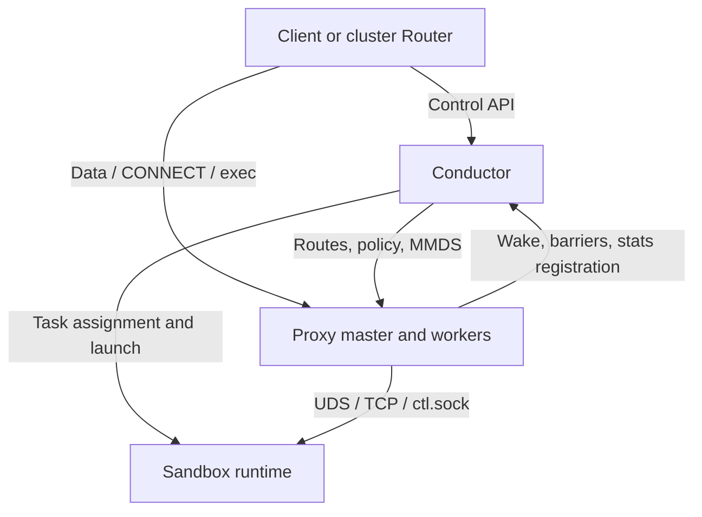

[English](node.md) | [简体中文](node_zh.md)

<a id="overview"></a>

# 节点运行

本篇维护计算节点的服务角色、共享配置、systemd 池、可信本地通道与运行依赖。完整平台部署从[项目快速开始](https://github.com/kuasar-sandbox/kuasar-sandbox/blob/main/docs/quickstart_zh.md)进入。[Sandbox 生命周期](sandbox-lifecycle_zh.md)、[Build](node-build_zh.md)、[访问](node-proxy_zh.md)、[资源](node-resource_zh.md)、[观测](observability_zh.md)、[集群](cluster_zh.md)及[扩展](extensions_zh.md)分别维护能力的精确定义。

`node-ctl conductor serve` 是计算节点上的单实例控制 daemon,对外提供一套 **e2b 兼容 API**,把节点上的
microVM 沙箱以 e2b 协议暴露给客户端——在本文协议与已验证版本支持的操作范围内，未改造的 e2b SDK（python/js `e2b`、
`@e2b/code-interpreter`）与 e2b CLI 可直接指向本机运行。`node-ctl conductor serve` 一身兼数职:
**api**(控制面 REST:沙箱生命周期、模板构建、鉴权)、**主机**(经 systemd 模板单元
拉起/停止任务与 `sandbox-ctl`，在构建 guest 中执行 `flatten-ctl`，调 `connector-ctl vswitch` 编排网络)、可选的**资源控制器**(节点级资源仲裁,经
`resource_listen` 内置,node-resource.md)、以及 **node-link 客户端**(接入集群,把本节点
交由 cluster-ctl 编排,[集群接入(node-link)](cluster_zh.md#node-attachment))。独立 `node-ctl proxy serve` 承载数据面，不嵌入 conductor。

node-ctl 既可**独立运行**(直供 e2b SDK / CLI,单机即可用),也可经 node-link **接入集群**
由 registry / router / placer 编排(cluster.md);两态共用同一套 e2b 控制面与生命周期原语——
**控制面 create / pause / kill / 模板构建始终在本节点**,集群只下发高层命令复用这些原语([集群接入(node-link)](cluster_zh.md#node-attachment))。

沙箱本体由 `sandbox-ctl` 运行(microVM,cloud-hypervisor);e2b profile 的 guest 内
跑原版 envd(由单一 `sandbox-runtime.bundle` 内置,[guest profile:envd 与工具链](#guest-runtime)),独立 Proxy 经 UDS
反代其单端口协议(49983/Connect-RPC)。同一租户范围内的根凭据是
**APISecret + ManifestKey**:APISecret 用于签发/验证 api_key 并派生每个 Sandbox 的
ServiceSecret,ManifestKey 保护 manifest 内容和镜像拉取令牌;APISecret 缺省时由
ManifestKey 通过固定 KDF 派生。两者成对加密存储,永不落明文盘([密钥与归属模型(APISecret + ManifestKey 凭据对,加密存 sqlite)](node-proxy_zh.md#credential-model))。

产物两个二进制:**`node-ctl`**(daemon + 启动器 + 资源控制器 + 管理 CLI,[命令行接口](#commands))与
**`e2b-key-ctl`**(纯派生凭据工具,无 DB/config/编排状态,[`e2b-key-ctl`](node-proxy_zh.md#credential-tool))。

**阅读路径：** [启动服务](#conductor-command) · [配置](#conductor-configuration) · [Pool 与 unit](#systemd-pools) · [本地通道](#local-control-channels) · [恢复](#recovery)

<a id="service-roles"></a>

## 概述

<a id="the-service-problem"></a>

### 业务问题

平台的沙箱栈(runtime/accelerator/builder/vswitch)各自提供 CLI 原语:起一台 microVM、
展平一个镜像、attach 一个端口。缺一个北向面把它们组合成"客户可用的服务":客户拿着
现成的 e2b SDK/CLI 与一个 api key,要能 create/exec/pause/resume/kill 沙箱、构建自定义
模板,而不感知 microVM、manifest、eBPF 交换机的存在。

node-ctl 补这一层,并刻意选择 **e2b 协议兼容**而非自定义 API:e2b 的 SDK 生态
(代码解释器、agent 框架集成)直接可用,客户端零改造;协议契约清晰(端点、token、
状态机皆有参照实现),兼容性可用真实 SDK/CLI 端到端验收。大规模部署时,多个 node-ctl
节点经 node-link 聚合到 cluster-ctl 控制面,做机群级会话亲和路由与按需调度([集群接入(node-link)](cluster_zh.md#node-attachment)、cluster.md);
单节点亦可独立承载。

<a id="design-principles"></a>

### 设计原则

1. **依赖面薄,经 CLI 组合**:驱动 `sandbox-ctl`(run/snapshot)、`connector-ctl vswitch`
   (attach/detach)、`flatten-ctl`(export)通过子进程 CLI；typed artifact/config 与 Builder assembly/publication 还复用兄弟仓公开包，
   不 import 兄弟仓 internal 包；
   经 systemd D-Bus 管单元;经 UDS 反代 envd。叶子组件,纯 Go,`CGO_ENABLED=0`。
2. **资源仲裁内置且可分离**:沙箱准入/配额由 `sandbox-ctl`(`pkg/resource` 的 client)
   与节点级**资源控制器**对话完成;控制器由 `node-ctl conductor serve` 经 `resource_listen` 内置
   (node-resource.md),调参随 serve 配置内联。它仍是与 conductor API/主机及独立 Proxy
   逻辑解耦的可分离子系统。构建任务的资源池由 serve 自管([按目标执行与发布](node-build_zh.md#execution-and-publication))。
3. **进程管理交给 systemd**:runner/builder 模板单元以 run-id 为实例名,可预启动等待
   config-socket 下发 assignment;runner 单元下以 `ctl/vmm` 隔离监督进程与沙箱资源,
   builder 仍按完整单元核算;`StopUnit` 即完整回收,serve 不自己当进程监督者。
4. **密钥不落明文盘**:租户 APISecret+ManifestKey 凭据对在库内 AES-256-GCM 加密;
   ManifestKey 只经认证后的 task bootstrap 注入单租户 runner/builder 进程的 authoritative
   env,sandbox launch的conductor路径不用它打开或解析snapshot,也不进入guest([本机控制 socket(run / task / admin / plugin / api 平面)](#local-control-channels)、[密钥与归属模型(APISecret + ManifestKey 凭据对,加密存 sqlite)](node-proxy_zh.md#credential-model))。集群下经node-link
   下行的凭据对同样仅加密落盘([集群接入(node-link)](cluster_zh.md#node-attachment))。
5. **本节点路由权威,独立数据面,集群可接入**:conductor 是**本节点**路由与生命周期的
   权威;独立 Proxy 是唯一 sandbox data ingress([数据面边界](#runtime-endpoints)).接入集群时,机群级
   路由权威是 registry——serve 经 node-link 上报沙箱事件、受理集群命令([集群接入(node-link)](cluster_zh.md#node-attachment)),不与
   集群争路由权威。
6. **重启可对账**:状态在 sqlite + systemd 单元集,serve 重启后以单元集为
   存活权威对账收养/清理([可靠性](#recovery));集群下另经 node-link 重连重报本节点沙箱集让 registry 收敛。

<a id="two-sandbox-profiles"></a>

### 两类沙箱(profile)

| profile | 是什么 | 数据面 | 对外服务 |
|---|---|---|---|
| **e2b** | guest 内跑原版 envd,agent 经其 exec / 读写文件 / 跑代码 | envd fs/process/pty/runCode + 平台 native exec | envd/CI + floatingip 用户端口 + native exec |
| **bare** | 把客户镜像当网络化 microVM 跑起来,无 envd | 平台 native exec;不提供 envd API | floatingip 网络 + native exec |

`bare` 直接复用基础沙箱运行时(`sandbox-runtime.bundle`),把基础沙箱接上北向 API;
Build register 缺省为 **e2b**，也明确支持 **bare**；输出 profile 在注册后不可变。
profile 编码在 templateID 前缀里（[模板 ID 与工件权威](node-build_zh.md#artifact-identity)），运行期据此选择共享 runtime Bundle 内的 guest 启动行为与数据服务。

<a id="boundaries-and-dependencies"></a>

### 边界与依赖

- 北向客户:e2b SDK / CLI 直连;集群下经 cluster-ctl router 转发(数据面)+ node-link
  下发命令(控制),平台管理面亦可经 e2b API 对接。
- 既可**独立运行**也可**接入集群**:控制面(create/pause/kill/模板构建)始终在本节点;
  接入集群仅多一条 node-link([集群接入(node-link)](cluster_zh.md#node-attachment)),不改 e2b 契约。
- 不实现 envd 协议:数据面只透传到 guest 内原版 envd([数据面协议(envd 与 native exec)](node-proxy_zh.md#data-protocols))。
- 独立 Telemetry 实现 envd/OTLP 采集与 E2B `/sandboxes/{SandboxID}/metrics` 历史；
  Conductor 只鉴权、检查 ownership 并转发到 live query UDS，完整契约见
  [Telemetry](observability_zh.md#telemetry)。`/stats/resource`、`/stats/traffic` 和 `/stats/usage` 均保持独立; 参见 [即时 resource / traffic stats](observability_zh.md#native-stats-api) 和[原生 usage](observability_zh.md#native-usage).
- 服务端不解析 Dockerfile；客户端展开的结构化 steps 会在构建 guest 内执行，支持镜像拉取、
  展平与最多三阶段流水线（[按目标执行与发布](node-build_zh.md#execution-and-publication)）。
- 节点本地:路由、存储、单元管理都是节点本地的;跨机快照/模板使用 canonical
  portable ref(数据位于 manifest store 或统一挂载的 named location,[Artifact lifecycle、转模板与迁移](sandbox-lifecycle_zh.md#capture-and-pause)),编排走
  cluster-ctl 的 node-link([集群接入(node-link)](cluster_zh.md#node-attachment))。
- 依赖:stdlib + `modernc.org/sqlite`(纯 Go)+ `golang.org/x/net/http2`(h2c,
  config-socket 与 node-link 共用)+ `golang.org/x/sys`(pidfile 锁 / SO_PEERCRED /
  mmap)+ `coreos/go-systemd`(D-Bus)+ `google/uuid`(v7)+ `gopkg.in/yaml.v3`。
  还使用公开 sibling packages、CEL/protobuf 与 S3 AWS SDK。envd/node-link 的本文 wire 使用
  Connect+JSON 或 framed JSON，不使用 gRPC transport；不能据此声称整个 go.mod 没有 protobuf。

<a id="architecture-and-data-paths"></a>

### 架构与数据通路

除下图应用数据通路外，`node-ctl telemetry serve` 还订阅同一 Plugin Plane 的完整
RouteEntry stream，经 UDS 采集 envd，并在 management namespace 直接接收以 FloatingIP
识别 guest 的 OTLP。Collector pipeline 按标准组件配置写入 exporter; 本地 TSDB 仅在
显式启用时打开。查询 backend 和 HTTP handler 独立选择, query-only 无需 Collector graph。
Conductor 仅把鉴权后的 metrics query 转发到独立注册的 API UDS, 不把
telemetry 加入生命周期 barrier。完整拓扑、故障与身份契约见 [Telemetry](observability_zh.md#telemetry)。



<a id="node-directories-and-identities"></a>

### 节点目录与身份

配置中的 `paths.run_root`/`paths.base_root` 分别是节点级 **RunRoot/BaseRoot**；对象的
实际目录称为 **RunDir/BaseDir**。RunRoot 只放 pid/lock、Unix socket、readiness、Sandbox
YAML、runtime config、CH 小型 snap-stage state 与小型临时 JSON。BaseRoot 放 writable diff、
本机 Sandbox checkpoint、Build image、Build Sandbox/Snapshot artifact 与其他大体积数据：

```text
<RunRoot>/
├── node-level files
├── runners/<RunID>.pid
├── sandboxes/<SandboxID>/
└── builds/<BuildID>/
    ├── builder.pid
    ├── a/
    ├── b/
    └── c/

<BaseRoot>/
├── node-level persistent files
├── sandboxes/<SandboxID>/checkpoint/
└── builds/<BuildID>/
    ├── checkpoint/
    ├── a/
    ├── b/
    └── c/
```

普通 Sandbox row 保存精确 `RunDir=<RunRoot>/sandboxes/<SandboxID>` 与
`BaseDir=<BaseRoot>/sandboxes/<SandboxID>`。`SandboxID` 始终是逻辑身份；sandboxer 的
`PathID` 只决定调用级 root 下的目录 leaf，普通 Sandbox 两者相同。Build phase 保留全局唯一
逻辑 SandboxID，PathID 固定为 `a`、`b`、`c`；资源、日志、memfd 与 artifact identity
仍使用逻辑 SandboxID。`RunID` 是 runner execution identity，pidfile 只位于 `runners/`。

`BuildID` 统一限制为 `[A-Za-z0-9_-]{1,48}`，原样作为 `builds/<BuildID>` leaf。
`BuildRunDir`/`BuildBaseDir` 由两个 root 与 BuildID 唯一派生，不写入 Build row，不 hash、
不 sanitize，也没有旧路径 fallback/migration。registered/waiting 不建目录，execution claim
后才创建；所有 Build image 与 Sandbox/Snapshot artifact 位于
`BuildBaseDir/checkpoint`。本机普通 Sandbox capture 位于 `BaseDir/checkpoint`。配置校验要求
自定义 RunRoot 在最大 SandboxID 下容纳 sandboxer 的最长 socket，并在 48-byte BuildID 下容纳
最长 phase socket（Linux pathname 上限 107 bytes）；不会按 root 动态改变身份长度合同。

<a id="commands"></a>

## 命令行接口

<a id="command-catalog"></a>

### 子命令总览

**`node-ctl`**:

| 子命令 | 用途 |
|---|---|
| `conductor serve` | 启动 conductor:控制面 + 本机控制 socket + reaper + 构建池;配 `cluster` 则起 node-link 客户端([集群接入(node-link)](cluster_zh.md#node-attachment)),配 `resource_listen` 则内置资源控制器(node-resource.md) |
| `proxy serve` | 启动独立数据面 master/worker(见 [`node-ctl proxy`](node-proxy_zh.md#proxy-command) 与 node-proxy.md) |
| `telemetry serve` | 启动独立 metrics 采集与查询服务（[Telemetry](observability_zh.md#telemetry)） |
| `run-sandbox` / `run-builder` | systemd 单元内启动器,非给人用([`node-ctl run-sandbox` / `run-builder`](#task-launcher-commands)、[本机控制 socket(run / task / admin / plugin / api 平面)](#local-control-channels)) |
| `resource` | `status`/`list`/`drain`/`pressure`:巡检 reservation、资源/worker 池及压力恢复，并控制 admission 排空(node-resource.md [命令行接口](node-resource_zh.md#resource-command)) |
| `builder status` / `builder cancel <build-id>` / `builder delete <transient-template-id> [--cancel]` | 查看持久用量、transient ID、操作意图与 claim; 取消执行或删除一条 Build 记录 ([取消与删除 Build 记录](node-build_zh.md#cancel-and-delete-a-build-record)) |
| `config` | 配置规范化/校验,或输出带注释骨架 |
| `manifest-key` | `add`/`remove`/`check`/`list`:create/build/import 凭据对白名单管理([密钥与归属模型(APISecret + ManifestKey 凭据对,加密存 sqlite)](node-proxy_zh.md#credential-model);集群下另由 registry 租约写入,[集群接入(node-link)](cluster_zh.md#node-attachment)) |
| `export-sandbox` / `import-sandbox` | 暂停沙箱转模板 / 跨机迁移([Artifact lifecycle、转模板与迁移](sandbox-lifecycle_zh.md#capture-and-pause)) |
| `version` | 版本 |

**`e2b-key-ctl`**(纯派生,不触 DB/config/daemon):

| 子命令 | 用途 |
|---|---|
| `gen-key` | 生成随机 32B 根凭据(64-hex) |
| `derive-api-secret [<MANIFEST_KEY>]` | 用固定 KDF 派生缺省 APISecret([密钥与归属模型(APISecret + ManifestKey 凭据对,加密存 sqlite)](node-proxy_zh.md#credential-model)) |
| `gen-apikey [<API_SECRET>]` | 用 APISecret 签发 e2b api key(`e2b_` + hex,[密钥与归属模型(APISecret + ManifestKey 凭据对,加密存 sqlite)](node-proxy_zh.md#credential-model)) |
| `fingerprint [<API_SECRET>]` | 打印 APISecret 的完整 64-hex SHA-256 指纹 |
| `seal-pull-token [<MANIFEST_KEY>] …` | 封装不透明镜像拉取令牌(`kpt_`,[按目标执行与发布](node-build_zh.md#execution-and-publication)) |
| `version` | 版本 |

接住一个新节点(独立模式)的典型顺序:

```bash
# 1) 生成内容根密钥,派生缺省 APISecret,登记凭据对,签发 SDK 用的 api key
MK=$(e2b-key-ctl gen-key)
API_SECRET=$(e2b-key-ctl derive-api-secret "$MK")
node-ctl manifest-key add --api-secret "$API_SECRET" --label tenant-a "$MK"
export E2B_API_KEY=$(e2b-key-ctl gen-apikey "$API_SECRET")

# 2) e2b SDK/CLI 直接指向本机
export E2B_DOMAIN=sandboxes.example.com        # 生产(TLS, DNS / TLS)
# dev: E2B_API_URL=http://host:3000  E2B_SANDBOX_URL=http://host:3443
```

集群模式下密钥由 registry 经 node-link 租约下发([集群接入(node-link)](cluster_zh.md#node-attachment)、cluster.md),无须手动
`manifest-key add`。

<a id="conductor-command"></a>

## `node-ctl conductor serve`

```
node-ctl conductor serve [--config /etc/node-ctl/conductor.yaml]
```

| 参数 | 默认 | 说明 |
|---|---|---|
| `--config` | `/etc/node-ctl/conductor.yaml` | conductor 配置文件([配置](#conductor-configuration)) |

启动序列:打开 sqlite(文件 chmod 0600)→ 恢复并验证持久 pool/unit 身份 → 生成并安装 systemd 模板单元([进程管理(systemd 模板单元,启动时自动生成安装)](#systemd-pools))→
Sandbox 重启对账([可靠性](#recovery))→(配 `resource_listen` 则起内置资源控制器,
node-resource.md)→ 起本机控制 socket并确认监听成功([本机控制 socket(run / task / admin / plugin / api 平面)](#local-control-channels))→ 在 bootstrap/result recovery gate 保护下完成 Build 对账 → 起 reaper(TTL,5s 周期)、runner/builder 预启动池与
构建准入循环([按目标执行与发布](node-build_zh.md#execution-and-publication))→(配 `cluster.node_link.endpoint` 则拨 registry 起 node-link 客户端,[集群接入(node-link)](cluster_zh.md#node-attachment))→
监听 `api.listen`.该 listener 只服务 wrapped control API;sandbox data Host 或 CONNECT
不会转发到 backend.TLS 证书缺省时以明文 h2c 服务(dev:SDK 控制面走 `E2B_API_URL`).

随仓 systemd 单元模板:`deploy/node-ctl.service`。

<a id="task-launcher-commands"></a>

## `node-ctl run-sandbox` / `run-builder`

systemd 单元的 ExecStart,非给人用。共用的进入骨架:`--run-id` 是 systemd 实例名,
`--pidfile` 指向 `<RunRoot>/runners/<RunID>.pid`,以 `fcntl(F_SETLK)` 排他锁防重入并写本
PID → 在 `--config-socket` 上打开一个经认证的长生命周期 run session → WaitAssignment 取得业务 id([本机控制 socket(run / task / admin / plugin / api 平面)](#local-control-channels))。之后两者分道:

- **run-sandbox**:保持为单元父进程。取得 sid 后立即连接固定的
  `<RunRoot>/sandboxes/<SandboxID>/ready.sock`(此时 readiness fd 保持 `FD_CLOEXEC`)并以 sid + exact run-id 取 bootstrap；runtime 拥有的
  `<RunRoot>/sandboxes/<SandboxID>/<SandboxID>.pid` 由后续 `sandbox-ctl` 锁定,父进程不持有。cold image bootstrap
  直接带最终 LaunchSpec,只需一次 RPC。E/S artifact bootstrap 带 task-local
  `ArtifactPrepareSpec` 与 authoritative `MANIFEST_KEY`;runner 覆盖继承环境,在本进程按
  source kind 与 durable LaunchMode 打开 E/S,提交同一 completion并等待最终 LaunchSpec。
  它保留 task-local `PreparedSource`、carrier binding 和 sorted ref-location,
  显式关闭 reader/fetcher后才启动直接子进程 `sandbox-ctl run`,并传入受信 VMM cgroup fd 与 readiness fd。
  父进程在 `Start` 成功后关闭自己的 readiness 副本,对该子进程只 `Wait` 一次,然后通过 config socket
  上报一个有界 `{sid, run_id, stage, exit_code|signal|error}` 执行结果再退出。长生命周期 session fd
  只归父进程所有,不会继承给子进程。任一 prepare/start 失败都会关闭 readiness 连接,serve 立即读到 EOF；
  子进程启动后的退出则经 durable result 路径上报。
- **run-builder**:完整任务准备、驻留执行、deadline、共享 run-session 注册与 Build 结果交接见 [任务交接](node-build_zh.md#task-handoff).

```
node-ctl run-sandbox --pidfile=<f> --config-socket=<uds> --run-id=<rid>
node-ctl run-builder --pidfile=<f> --config-socket=<uds> --run-id=<rid>
```

flags 缺省回落 `TASK_PIDFILE` / `TASK_CONFIG_SOCKET` / `TASK_RUN_ID`
env(systemd `%i` 接线用)。

<a id="configuration-command"></a>

## `node-ctl config`

配置诊断 + 生成工具,**按角色**(`conductor` / `proxy` / `telemetry`,各自独立文件与 schema):

```
node-ctl config <conductor|proxy|telemetry> --template            # 输出该角色带注释骨架
node-ctl config <conductor|proxy|telemetry> --config <file>       # 加载(补默认 + 校验)后重排输出
node-ctl config <conductor|proxy|telemetry> --config <file> --resolve   # 再展开 auto/派生(实际生效形态)
                              -o <file>             # 写文件(默认 stdout)
```

角色作首参以消歧 schema:`conductor` 对应 `conductor.yaml`([配置](#conductor-configuration)),`proxy` 对应 `proxy.yaml`
(node-proxy.md [Proxy 命令与配置](node-proxy_zh.md#proxy-configuration))，`telemetry` 对应 `telemetry.yaml`（[Telemetry](observability_zh.md#telemetry)）。
`--resolve` 对 `conductor` 额外展开 `resource_listen` 的 `auto` 内存/CPU
(并深校验水位),其余角色与 `--config` 等价。骨架与 `deploy/{conductor,proxy,telemetry}.example.yaml` 对应。
该命令只做严格 declarative decode、默认化与诊断，绝不执行 `conductor_executable` /
`proxy_executable` / `telemetry_executable`，也不接触 custom App 的运行时材料。custom 路径非空时，输出首行明确
标记这里只完成 bootstrap 校验；最终配置仍由对应 App 在启动副作用前校验。

<a id="conductor-configuration"></a>

## 配置

serve daemon 的配置文件是 `conductor.yaml`。完整带注释样例见 `deploy/conductor.example.yaml`
(`node-ctl config conductor --template` 输出同形骨架),权威结构是公共包
`github.com/kuasar-sandbox/orchestrator/config` 中的 `config.Conductor`；内部代码复用同一 schema，
不维护第二份配置事实来源。该包提供严格的 `LoadConductor` / `DecodeConductor`、
`LoadProxy` / `DecodeProxy`、hook 后不重套默认值的 `ValidateConductorFinal` /
`ValidateProxyFinal`，以及真正深拷贝的 `Clone`。Decode/Load 只执行 bounded strict decode、
declarative defaults 和已提供值的枚举/duration/range/格式校验；它们不读取环境、检查 component
文件或根据 executable 决定启动必填项。同一输入的结果不随 `NODE_CONFIG_ENCRYPTION_KEY` 改变。
未知 YAML 字段和多文档输入会失败，Config 的 JSON/YAML 只包含可序列化 declarative 数据，
不含 logger、provider 或运行时句柄。
`ResourceAllocatable.Memory` 以 `*string` 公开 presence：`nil` 表示继承 internal resolver
中的 `256MiB` 默认值，非 nil（包括显式 `256MiB`）表示 operator/custom `Configure`
的明确策略，必须满足 capacity 上界。`SetMemory` / `InheritMemory` 只是便利方法；直接赋
pointer 具有同一语义，`Clone` 与 component bootstrap JSON 都保留该 presence。
配置按关注点分组:`api`、`proxy`、`paths`、`units`、`sandbox`(实例级默认,子组
`resources`/`network`/`boot`)、`builder`、`checkpoint`、`mmds`、`cluster`(node-link,[集群接入(node-link)](cluster_zh.md#node-attachment))、
`resource_listen`(内置资源控制器,调参全部内联,node-resource.md),外加顶层单值
`encryption_key`、`manifest_config`。内置模式由 node-ctl 显式执行 final declarative validation，
再在 runtime resolution 读取 `NODE_CONFIG_ENCRYPTION_KEY` / YAML key；custom conductor 则在
`Configure` 后 final validate，并可由 Runtime provider 满足 key/TLS/object-store 材料。provider
优先于 environment/YAML 且失败不回退。运行 helper(sandbox-ctl/connector-ctl vswitch/flatten-ctl)
不进入公共 Config；它们先以最初的精确 node-ctl 相邻发行目录为解析基准，缺失时保留
现有 PATH fallback。


下表维护节点服务的共享字段。能力专属配置与行为同处维护：[实例生命周期](sandbox-lifecycle_zh.md#node-defaults)、[访问与凭据](node-proxy_zh.md#conductor-access-configuration)、[资源](node-resource_zh.md#conductor-resource-configuration)、[Build](node-build_zh.md#build-configuration)、[观测](observability_zh.md#node-observation-configuration)和[集群接入](cluster_zh.md#node-attachment-configuration)。同处一个 YAML 文件不意味着再维护一套字段定义。

| 字段 | 默认 | 说明 |
|---|---|---|
| `api.domain` | (必填) | 服务域,如 `sandboxes.example.com`;控制面 = `api.<domain>` |
| `api.listen` | `:443` | 北向监听;dev 用 `:3000` 走明文 h2c |
| `api.tls.cert/key` | 空 | 通配证书(`*.<domain>` 与 `api.<domain>`,[DNS / TLS](#dns-and-tls));空 = 明文。custom Runtime TLS provider 非 nil 时为权威材料源，core 仍固定 TLS version/ALPN/client-auth 策略 |
| `manifest_config` | `/opt/sandbox/manifest.yaml` | 共享远程 manifest store 配置(`manifest.key` 留空,租户 key 经 env 按任务下发) |
| `paths.conductor_executable` | 空 | 静态定制 conductor 的绝对 executable；空使用内置实现。`node-ctl config` 只诊断 regular/executable、非 group/world-writable、非 node-ctl same-file 元数据，不按诊断 EUID 判断 owner；实际 dispatch 中 root node-ctl 只接受 root-owned，非 root node-ctl 接受 root-owned 或本 EUID-owned。它执行已打开并校验的同一 FD，失败绝不回退 |
| `paths.run_root` | `/run/sandbox` | 节点 RunRoot:node-level 小文件、`runners/`、`sandboxes/`、`builds/`；通常为 tmpfs；必须为最大 BuildID 的最长 phase UDS 留出 107-byte Linux pathname 预算([节点目录与身份](#node-directories-and-identities)) |
| `paths.base_root` | `/var/lib/sandbox` | 节点 BaseRoot:node-level 持久文件与 `sandboxes/`、`builds/` 大体积数据([节点目录与身份](#node-directories-and-identities)) |
| `paths.db_path` | `<base_root>/node-ctl.db` | sqlite 路径([可靠性](#recovery)) |
| `paths.config_socket` | `/run/sandbox/node-ctl.socket` | 本机控制 socket(run assignment/result + task/admin/plugin/api,[本机控制 socket(run / task / admin / plugin / api 平面)](#local-control-channels));manifest-key/export/import CLI,Proxy 与平台 agent 的连接点 |
| `paths.admin_pidfile` | 空 | admin 平面的多行 PID 白名单(`#` 注释);未配则仅靠 socket 0600 |
| `paths.plugin_pidfile` | 空 | plugin 平面(proxy/agent 注册)的多行 PID 白名单;未配则仅靠 socket 0600 |
| `units.dir` | `/etc/systemd/system` | 模板单元安装目录 |
| `units.runner_pools` / `units.builder_pools` | 缺省 | 独立 pool 列表，支持 name/resource_pool/unit/size/capacity/priority，见下文 |
| `units.runner` / `units.builder` | `sandbox-runner@.service` / `sandbox-builder@.service` | 模板单元名 |
| `units.runner_pool_size` / `units.builder_pool_size` | `0` / `0` | 空闲预启动 run-id 单元数;0 = 不保留 idle,有任务时仍按需经 WaitAssignment 流程启动. 有限 execution CPU/memory 准入资源允许非零 Builder pool,idle 单元不持有 Build claim.  |
| `units.pool_wait_timeout` | `5s` | 从调用 `StartUnit` 到单元进入 WaitAssignment 的正数时限;超时清理该 run-id 并补池 |
| `units.install` | `true` | `false` = 单元由运维带外管理,serve 不生成安装 |
| `sandbox.boot.kernel` | – | vmlinux 路径 |
| `sandbox.boot.runtime` | – | 单一 guest runtime bundle;offset-zero EROFS + digest marker ZIP,内置 envd、flatten-ctl([guest profile:envd 与工具链](#guest-runtime)) |
| `sandbox.boot.overlay_diff_template` | – | 预格式化空 ext4,img 冷启时稀疏复制为可写 upper(裸空 diff 非合法 fs 会被拒);部署方使用 `mkfs.ext4 -O ^has_journal` 格式化稀疏文件提供;restore 不需要(overlay 链来自快照) |

新建 `sandbox.boot.overlay_diff_template` 和 `builder.diff_template` 时，使用
`mkfs.ext4 -O ^has_journal`，避免可丢弃工作盘的文件系统 journal 占用及元数据
日志写入。这不影响 journald 或应用日志，也不提供崩溃恢复保证。已有带 journal
的模板和用户自带镜像继续兼容；sync/quiesce、快照/恢复及挂载行为保持不变。
此约定仅适用于新建空模板，不要重新格式化已有数据盘。

多池的主要应用场景是 [使用多池进行 NUMA 部署](#numa-deployment-with-multiple-pools)：不同 unit 模板承载不同节点的 CPU/内存放置策略，[资源池](node-resource_zh.md#resource-pools) 提供容量感知调度和压力恢复。以下重复模板示例仅说明配置语义，不代表不同 NUMA 绑定。

`units.runner_pools` / `units.builder_pools` 每项支持 name/resource_pool/unit/size/capacity/priority。
每项创建独立 pool，同一资源池内允许共享模板。
`size >= 0` 是 idle 预热目标，0 按需启动；可选 capacity 限制全部实例及有效启动预留。
同资源池内 priority 越高越优先，同级随机。
`dir`、`install`、`pool_wait_timeout` 由所有 pool 共享。

```yaml
units:
  dir: /etc/systemd/system
  install: true
  pool_wait_timeout: 5s
  runner_pools:
    - {unit: sandbox-runner@.service, size: 8}
    - {unit: sandbox-runner@.service, size: 4}
    - {unit: sandbox-runner-special@.service, size: 0}
  builder_pools:
    - {unit: sandbox-builder@.service, size: 2}
    - {unit: sandbox-builder@.service, size: 0}
```

对应列表缺省时，沿用旧 `runner` / `runner_pool_size` 或 `builder` / `builder_pool_size`
形成一个 pool，保留原模板及 size=0 默认值。runner 与 builder 可分别使用新旧输入。
显式空列表、非法项、同类显式新旧混用（包括显式旧 size=0）均拒绝；程序补入的默认值
不算混用。兼容范围仅为新版读取旧配置。

<a id="conductor-bootstrap"></a>

### 静态定制 conductor

定制 Conductor 的构造、受保护配置、运行期绑定与 provider 契约统一见 [扩展指南](extensions_zh.md#conductor-bootstrap)。节点核心始终拥有授权、持久记录与生命周期不变量，不能由配置 Hook 绕过。

<a id="configuration-assembly"></a>

### 配置装配与校验

定制 Proxy 的配置/绑定生命周期、Master/Worker hook、公共路由与授权转发 SDK 统一见 [扩展指南](extensions_zh.md#proxy-bootstrap)。Proxy 核心进程、共享内存与取消不变量见 [Proxy 规范](node-proxy_zh.md)。

Builder 配置与 legacy schema 边界见 [Build 配置](node-build_zh.md#build-configuration)。

远程内存 Prefetch 没有节点统一开关。是否请求 Prefetch 由每个 sandbox 的
`kuasar-sandbox.restore` 命名空间决定([沙箱配置传递链](sandbox-lifecycle_zh.md#request-configuration))。

配置自洽校验:`mmds.enabled=false` 时 `proxy.auth` 必须为 `enforce`(envd 非 secure,
Proxy 是唯一数据面闸门);`mmds.routes.enabled=true` 还要求 `mmds.enabled=true`,service endpoint
必须是 absolute Unix socket URI.`proxy_netns` 和 worker 数只配置在 `proxy.yaml`.
配 `cluster.node_link.endpoint` 时 `cluster.node_id`,`cluster.api_endpoint` 和
`cluster.data_endpoint` 都必填;配
`resource_listen.enabled=true` 时 node-ctl 在启动阶段解析一次 canonical controller
identity并自动写入每个 dynamic sandbox YAML;没有第二个
`sandbox.resources.control_socket` 配置源。startup 对 static/dynamic 使用同一 headroom
语义,不依赖 controller 是否启用。

<a id="network-attachment-identities"></a>

## 网络 attachment 身份

节点拥有的 vSwitch attachment 首次分配时由 conductor 读取一次 switch `generation_bits`,随后使用进程内单调 attachment sequence 按该 bit 宽度取模,并通过 CLI Attach 与 TAPFD PREPARE 传给 connector。`generation_bits=0` 保持 legacy 行为。该 sequence 不是持久 Sandbox 身份,conductor 重启后允许重新开始;失败 Attach 也可以消耗一个 generation。

<a id="systemd-pools"></a>

## 进程管理(systemd 模板单元,启动时自动生成安装)

serve 启动时生成并安装各配置模板及固定的两个 slice(`sandbox-runner.slice`、
`sandbox-builder.slice`)到 `units.dir`；同名同内容只写一次，同名不同内容在写入前拒绝。
内容变更才 `daemon-reload`(D-Bus `Reload`);
`units.install: false` 则交由运维带外管理,程序不生成文件,也不读取或校验运维资源属性. ExecStart 里的 `node-ctl` 路径
使用 runtime resolution/bootstrap 保留的原始 node-ctl 精确路径，custom conductor 模式也如此([配置](#conductor-configuration))。

runner 与 builder 先按声明 Capacity、操作权限和 worker 供给过滤资源池，再选择运行
使用率最低的池，同使用率随机；在所选资源池内按逻辑 worker pool 的 priority 优先，
同级随机。注册、被拒绝的 Build 准入及已绑定执行不重新取池；Resume 在旧执行清理后
可选择另一池。制品准备获得权威 Capacity 后，可在 VM 启动前更换准备 worker。
一个 Build 实际执行的全部阶段仍由同一 builder 执行；全局 registration/execution
ledger、FIFO/claim 及释放屏障独立保留。[资源池契约](node-resource_zh.md#resource-pools)
定义容量、选池、托管 drop-in 与恢复规则。CPU/NUMA 放置由 systemd/Linux 执行；
Conductor 不新增池级 slice 或 Builder 外层 CPU/内存限额。

允许 StartUnit 前先登记 RunID → 创建它的 pool，让共享模板的 WaitAssignment 也精确路由。
另保留 RunID → 实际 unit 到生命周期清理，assignment 完成不删除执行归属。
逻辑池、资源池、实际 unit 与执行 Capacity 均持久化，用于重启恢复。
仍先持久绑定 RunID 再发布 assignment，builder 重试先查持久 Build 绑定。
RunID 格式、pidfile/config socket、Delegate、ctl/vmm 及可信 FD 合同不变。

**runner 单元**(`%i` = run-id):

```ini
# sandbox-runner@.service (生成内容,路径按配置渲染)
[Service]
Type=exec
WorkingDirectory=/run/sandbox
ExecStart=<node-ctl> run-sandbox --pidfile=/run/sandbox/runners/%i.pid \
          --config-socket=/run/sandbox/node-ctl.socket --run-id=%i
ExecStopPost=/bin/rm -f /run/sandbox/runners/%i.pid
# 每个 RunID 一个常驻父进程；有状态崩溃不自动重试
Restart=no
# 默认先 SIGTERM，TimeoutStopSec 后 SIGKILL；递归包含 CH（cgroup(ctl/vmm 隔离与 FD capability)）
KillMode=control-group
TimeoutStopSec=20
Slice=sandbox-runner.slice
# 委派 cpu/memory controller（cgroup(ctl/vmm 隔离与 FD capability)）
Delegate=yes
```

完整 Builder unit 生命周期与资源责任边界见 [Builder unit 与进程生命周期](node-build_zh.md#builder-unit-and-process-lifecycle).

两单元的 ExecStart 都先锁 run-id pidfile,打开经认证的 run session,再经 config-socket WaitAssignment 等待
业务 id。runner 取得 sid 后立即连接 readiness,以 exact run-id 取 bootstrap；runtime
`<RunDir>/<SandboxID>.pid` 由 `sandbox-ctl` 拥有。artifact task 在进程内完成 E/S prepare 和第二阶段后才取最终 LaunchSpec。
runner 父进程随后在同一单元 cgroup 内启动直接子进程 `sandbox-ctl run`,Start 后关闭自己的 readiness 副本,
只 Wait 一次并上报有界执行结果；`Type=exec` 故无需 sd_notify。Builder 的进程/子 VM 与结果回传见 [任务交接](node-build_zh.md#task-handoff)。

serve 分别维护 runner/builder 的目标 idle 数量。分配会消费一个已进入 WaitAssignment
的单元并立即登记异步补池;无 idle 时也生成 run-id、按同一路径启动单元并等待其
WaitAssignment,不存在另一套直接启动模型。Start/Stop 请求只由一个固定控制循环串行
执行,状态循环通过 channel 投递请求,不为每次补池派生启动协程。`pool_wait_timeout` 覆盖
`StartUnit` 调用到 WaitAssignment 的完整区间;启动失败、等待超时或等待连接取消都会
`StopUnit` + `ResetFailedUnit`,再生成新的 UUIDv7 run-id 补足目标数量。沙箱 launch 的
runner assignment budget 从调用 pool Assign 起覆盖排队、按需 StartUnit 和
WaitAssignment;匹配 idle runner 后,pool 先调用 commit callback 绑定 run-id,commit 成功
才把 task ID 发给 runner 并向 Assign 调用方返回成功。commit 是 assignment 线性化点:
其后发生的 caller cancel 不得把成功翻转为 canceled;pending cancel 与 pool shutdown 由
pool loop 唯一回复,每个请求恰有一次结果。


- **kill**:在 SID lifecycle fence 内把完整 owner exact-CAS 为 `deleting`→取消 active launch→
  撤销 runtime cache 并发布 deleting 管理 Upsert→异步 `StopUnit`（默认先 SIGTERM，超时后 SIGKILL，递归包含 CH）→`ResetFailedUnit`→
  tapfd `RELEASE` 或 `connector-ctl vswitch detach`→删运行目录→hard-delete row 并发布最终 route Delete。业务路由撤销不等待
  这些 finalizer 步骤.launch claim 仍保留到旧
  attempt 完成其局部资源清理,因此迟到 CAS 不能复活该行,同 SID 也不能提前启动后继 attempt。
  `kill` 在进程层生效,不受 guest 内 restart 策略阻挡。
- **就绪**:serve 在分配 runner 前先绑定 `<RunDir>/ready.sock`(目录 0700、
  socket 0600),分配后 runner立即连接;serve同时等待 snapshot completion、readiness EOF、
  attempt cancel与绝对 deadline,因此task在根读取期间退出会立即失败。随后从node-ctl的
  one-shot连接严格读取
  `control_ready\nready\nEOF`;bare 到此启动成功。e2b 随后把 `POST /init` 作为首个 envd
  请求,不以 `/health` 作为启动门槛;health 仅在初始化完成后用于外部存活检查。cold 与 restore
  launch 共用已接纳 attempt 的 owner context，覆盖 task 根读取、completion RPC、host
  resource/network 准备、final wait、子进程 Start、runtime wire 与 mandatory `/init`；
  普通启动不加 60 秒整体期限。显式正数 bootstrap deadline 贯穿上述阶段，最终 spec
  生成后不重置。首个 `/init`立即发出;仅连接/传输
  错误按 1ms,2ms,4ms,5ms 上限退避重试,共享 launch context，不另加每次请求 50ms 期限。只有 204 表示成功;
  非 204 只返回状态码,不记录可能回显 access token/用户 env 的响应体;协议错误、提前
  EOF、取消或总预算超时都返回
  launch 失败:create 将已持久化的 starting 行按 run-id fence 标 dead,resume 则回退
  paused;durable acceptance 后即使尚未分配 runner,失败也按空 run-id fence 收敛到该终态。
  只有 `/init` 成功后才以同一 run-id 把
  starting CAS 为 running 并发布 running route.
- **存活权威**:按去重后的各配置 runner 模板调用 `ListUnitsByPatterns`，取得权威存活 run-id 集,再与库内 `sandboxes.run_id` 对账([可靠性](#recovery))。
- 宿主 `Restart=no` 与 guest 内 envd `restart=always`(sandbox-init 管)是两层,
  互不相干。

<a id="cgroup-separation-and-fd-capability"></a>

### cgroup(ctl/vmm 隔离与 FD capability)

runner unit 的 cgroup 根只作为委托边界,不放进程:

```text
sandbox-runner@<run-id>.service/
├── ctl/   node-ctl 父进程及其直接 sandbox-ctl 子进程
└── vmm/   cloud-hypervisor
```

`node-ctl run-sandbox` 在等待 assignment 前只接受当前进程位于对应 run-id 的 runner
unit 根或其 `ctl/`。前者创建 `ctl/` 并通过 `cgroup.procs` 将自身完整迁入,随后重读
`/proc/self/cgroup` 验证身份;后者用于运维带外安装的已预置单元。两条路径统一验证 unit
根无进程及 cpu/memory 委派,再于 unit 根启用 controller,幂等创建 `vmm/` 并以 CLOEXEC
打开目录 FD。该方式只依赖 `Delegate=yes`,不要求 systemd v254 才提供的
`DelegateSubgroup=`。取得 LaunchSpec 后,启动器只把可信 VMM/readiness 描述符放入子进程
ExtraFiles，按实际子进程 FD 编号追加参数。父进程副本保持 CLOEXEC；RunID 锁与 Run session
不进入 ExtraFiles。LaunchSpec 自身不携带任何主机 cgroup 路径或 FD。

sandbox-ctl 接收 FD 后立即恢复 CLOEXEC,写入资源上限,并以
`clone3(CLONE_INTO_CGROUP)` 把 CH 原子创建到 `vmm/`。因此 `memory.high` 只限制
VMM,sandbox-ctl 在 guest 压力下仍可处理 UFFD、vsock、信号和进程回收。具体 high
值、balloon target/current 和 grow/shrink 顺序全部由 sandboxer 本地控制;node
controller 只处理它发起的 reservation 请求。
节点要求 Linux 5.7+ 且 seccomp 允许 `clone3`;不满足时 sandbox 启动 fail closed,
不回退到启动后迁移或共享 cgroup。

`KillMode=control-group` 递归覆盖 `ctl/` 与 `vmm/`;StopUnit 后 systemd 回收整个委托
子树,无需 serve 单独搬迁进程或 rmdir。任何委托、层次、controller 或 FD 校验失败均在
CH 启动前 fail closed。

<a id="numa-deployment-with-multiple-pools"></a>

### 使用多池进行 NUMA 部署

多池的主要部署场景是：让单个 Sandbox 的宿主侧执行保持在一个 NUMA 节点内，
同时把新的执行分散到多个节点。Conductor 选择 pool 及其 systemd 模板；运维在模板上
配置 CPU 放置与内存分配策略。这是宿主侧部署能力，不是 guest vNUMA 拓扑，
资源池配置则提供按池容量和运行使用率的调度。

NUMA 放置由 systemd/Linux 执行。以下示例手工管理放置策略；需要独立 NUMA 容量和
使用率调度时，采用[资源池配置](node-resource_zh.md#resource-pools)，关联 resource_pool 和外部
unit_dropins。部署应在真实主机检查有效 CPU/内存节点集合、页分布及跨池恢复。

以下示例将所有逻辑池留在共享 `default` 资源池中，只分配 unit 的放置策略，
不建立独立 NUMA 预算；独立容量与压力记账应采用资源池配置示例。

对具有在线且带内存的 NUMA 节点 0、1 的主机，用不同模板名称表达不同放置策略。
以下内容替换完整 Conductor 配置中的 `units` 块；不要同时保留旧单池字段。
示例 size 只是空闲预热目标，不是推荐容量：

```yaml
units:
  dir: /etc/systemd/system
  install: true
  pool_wait_timeout: 5s
  runner_pools:
    - {unit: sandbox-runner-numa0@.service, size: 4}
    - {unit: sandbox-runner-numa1@.service, size: 4}
  builder_pools:
    - {unit: sandbox-builder-numa0@.service, size: 1}
    - {unit: sandbox-builder-numa1@.service, size: 1}
```

**先读取实际主机拓扑。** NUMA 节点号和逻辑 CPU 编号（含 SMT 线程）由机器决定，
不能根据节点号推算 CPU 范围。确认 cgroup v2、`cpuset` controller 可用，
且祖先 slice 允许两个目标节点及 CPU 集合：

```sh
lscpu -e=CPU,NODE,SOCKET,CORE
numactl --hardware
cat /sys/fs/cgroup/cgroup.controllers
cat /sys/devices/system/node/node{0,1}/cpulist
```

**在启动 Conductor 和任何预热 worker 之前，安装运维管理的放置策略 drop-in。**
在示例双节点主机上以 root 执行下列命令；所选节点必须有在线 CPU 和内存。
示例使用节点完整 CPU 列表；需要为宿主服务保留 CPU 时，应将 `cpus` 改成部署选定的子集：

```sh
set -eu
unit_dir=/etc/systemd/system
for node in 0 1; do
  cpus=$(cat "/sys/devices/system/node/node${node}/cpulist")
  test -n "$cpus"
  for kind in runner builder; do
    dropin="$unit_dir/sandbox-${kind}-numa${node}@.service.d"
    install -d -m 0755 "$dropin"
    cat > "$dropin/20-numa.conf" <<EOF
[Service]
CPUAffinity=
CPUAffinity=$cpus
AllowedCPUs=
AllowedCPUs=$cpus
NUMAPolicy=bind
NUMAMask=
NUMAMask=$node
AllowedMemoryNodes=
AllowedMemoryNodes=$node
EOF
  done
done
systemctl daemon-reload
```

`CPUAffinity` 设置初始 CPU 亲和性；`AllowedCPUs` 通过 cgroup v2 约束整个 unit 子树。
`NUMAPolicy=bind` 配合 `NUMAMask` 在 worker 创建线程/子进程前设置分配策略；
`AllowedMemoryNodes` 约束 unit 允许使用的内存节点。这些是放置策略，**不是**
`CPUQuota`、`MemoryMax`、`MemoryHigh`、每池 reservation 或 CPU 独占配置。
Sandbox 的运行时资源执行仍由 `sandbox-ctl` 管理。

`install: true` 时，Conductor 生成各个命名基础模板及现有的两个固定 slice，
独立管理的 `.service.d/20-numa.conf` 提供放置策略。不要把自定义属性写进会被
Conductor 重写的基础文件。
采用 `install: false` 时，运维应基于本版本生成的 runner/Builder 模板（[进程管理(systemd 模板单元,启动时自动生成安装)](#systemd-pools) 和 Build [Builder unit 与进程生命周期](node-build_zh.md#builder-unit-and-process-lifecycle)），
安装四个独立的实际模板文件，以及 `sandbox-runner.slice`、`sandbox-builder.slice`，
然后自行 reload systemd。保留当前部署的二进制路径、`%i` **RunID**、pidfile/config socket、
`Delegate=yes`、`ctl/vmm`、清理行为及既有 slice 合同。不要用 unit alias 表达不同绑定。
该模式下 Conductor 不执行任何模板安装或 reload。

runner 和 Builder 在选定资源池内按优先级分配，同级随机。
预热进程在分配业务前已处于对应放置策略下。Runner 父进程及其直接子进程、Builder 的各阶段子进程
留在选定 unit 下；一个 Build 实际执行的 A/B/C 阶段仍由同一个 Builder 驱动，
不按阶段重新取池；guest 内的工作通过这些阶段 VMM 执行。
不要只给 Conductor daemon 绑核：unit 由 systemd 启动，放置策略必须配置到任务模板上。
参见 [Builder unit 与进程生命周期](node-build_zh.md#builder-unit-and-process-lifecycle)。

部署仍遵循以下边界：

- 两个 pool 共用模板时必须共用资源池和放置策略，重复项不会自动绑定到不同节点。
  `size` 是 idle 目标；资源池容量和运行使用率决定选池，Builder 业务 FIFO/claim 独立保留。
- 已绑定执行保留实际 unit，Conductor 重启也不改变它。Pause/resume 需要新 runner 时
  重新取池，可能使用另一 NUMA 节点；本特性不提供 NUMA 粘性、在线迁移，也不把宿主
  节点身份写进可移植制品。活动或待清理执行仍依赖的模板必须保留在配置中。
  修改/reload drop-in 不会让已有预热或已分配 worker 重新 exec 并取得新的进程策略；
  应按生命周期安全安排 worker 更替，不要当成热迁移。
- 严格单节点绑定可能在其他节点仍有空闲内存时触发本地回收或分配失败/OOM；
  单次分配失败不会迁移正在运行的执行；跨池压力恢复通过资源池契约中的完整
  Pause/Resume 生命周期完成。如有意用 `NUMAPolicy=preferred` 允许内存回退，
  必须同时去掉或扩大单节点 `AllowedMemoryNodes`，因为 cpuset 限制优先。
  这是以严格内存本地性换取回退；资源账本仍归属执行所选的池。

设置语义参考：[systemd.exec(5)](https://manpages.debian.org/trixie/systemd/systemd.exec.5.en.html)、
[systemd.resource-control(5)](https://manpages.debian.org/trixie/systemd/systemd.resource-control.5.en.html)、
[Linux NUMA memory policy](https://docs.kernel.org/admin-guide/mm/numa_memory_policy.html)、
[cgroup v2 cpuset](https://docs.kernel.org/admin-guide/cgroup-v2.html#cpuset)。

<a id="local-control-channels"></a>

## 本机控制 socket(run / task / admin / plugin / api 平面)

serve 在 UDS `paths.config_socket`(默认 `/run/sandbox/node-ctl.socket`,**0600**)
跑一个 h2c HTTP 服务(兼容 HTTP/1.1):单 socket 复用五个平面、各自鉴权。连接建立时
经 **`SO_PEERCRED`** 取 peer pid 注入请求上下文;socket 0600 ⇒ 仅同 uid / root 可连,
各平面在此之上再细分。`/internal/*` 前缀 e2b SDK 永不使用,与 api 路径不冲突。

**Run 平面**在既有 socket 提供 `PUT /internal/run/session` 以及
`POST /internal/run/assignment`、`/internal/run/sandbox-result`、`/internal/run/build-result`
和 `/internal/run/build-phase`。SO_PEERCRED 必须匹配父进程持锁的 `runners/<RunID>.pid`；
session 准入还必须存在真实 pool 或 durable task owner，不能只校验 RunID 格式。
首响应标识 kind+RunID 并在 assignment 前 flush。父进程持续消费此响应流；同一 Run 重连只重新注册，
不重复 assignment 或子进程执行。旧连接关闭不能移除替代它的新 generation。
Idle 退役和 assignment handoff 共用 pool 串行边界；先 durable bind 再返回响应，丢响应可以重放同一 starting assignment。

Session 断连只是存活通知，不等于进程死亡。Conductor 核对精确的实际 unit 并保留健康执行；
旧 Run 的检查不能取消同 SID 的后继运行或已重连的 starting attempt。Shutdown 先将 session 关闭标为
非死亡、取消流，再 drain HTTP handlers。资源控制器 lease 与 StateSync 责任不变。
见 [configsock/server.go](../internal/configsock/server.go)。

`POST /internal/run/sandbox-result` 携精确 SandboxID/RunID 和有界 prepare/start/run 结果。
短 store 事务先持久接受再 ACK；相同重试幂等，stale/冲突报告拒绝。ACK 表示接受，
不表示完成清理；report 不等待跨 StopUnit 或 Hook 的 SID 长生命周期锁。
两条 starting→running CAS 都拒绝已接受结束结果。父进程使用独立有限预算上报，
不直接操作节点数据库或网络，不在 start/run 上报失败后伪造 prepare 结果。

结果、session 断连与既有低频 Reaper 共用每 exact RunID 一个进程内 pending 项。
最多四个 run-end worker 执行；等待中的 Run 不各自创建 goroutine 或 timer。
失败尝试按有界退避轮转到其它工作之后。Shutdown 必须等待已开始的同步删除完成，
不能假称 context 能中断 RemoveAll；durable pending ownership 保留供恢复。
Starting 只通知原 rollback attempt；running 结果先 fence exact unit，再在 allocation fence 内
物理 detach 并 durable clear 网络，在慢目录删除前释放端口 fence，最后 commit dead 并撤销在线 route/observation。
Paused 保留 checkpoint，deleting 继续使用既有 finalizer。Reaper 还补偿内存唤醒丢失的 accepted result，
即使父 session 仍在线；缺 session 的运行在首次检查仍健康、后来 unit 退出时也能收敛。
不周期执行完整启动 reconciliation。

**① task 平面** — 启动器取工作规约。sandbox 与 artifact-backed builder 都使用 exact-run
两阶段端点，cold/image 路径保持单次 bootstrap fast path:

- `POST /internal/task/sandbox/bootstrap`(run-sandbox;req `{sandbox_id,run_id,version}`)
  先取得不含秘密的 exact-run pidfile identity,完成 `SO_PEERCRED` + pidfile认证后才调用
  secret-bearing provider。cold image返回 `Final LaunchSpec`;artifact launch返回
  `ArtifactPrepareSpec` + env。task完成 E/S prepare 后向
  `POST /internal/task/sandbox/prepare` 提交 `{sandbox_id,run_id,summary}`并等待最终
  **LaunchSpec** `{exec,args,workdir}`。相同 digest replay等待/返回同一final result且不重复
  host side effect;冲突 replay返回409并fail closed;单次HTTP断开只取消该wait。
  `exec=sandbox-ctl`,`args=[run --sandbox-id <sid> --path-id <sid>
  --config <RunDir>/<sid>.yaml --manifest-config <shared>
  --run-root <RunRoot>/sandboxes --base-root <BaseRoot>/sandboxes
  (--from <E>|--restore <S>) (--connect <uds:ip:port>)…]`。`--path-id` 与两个调用级 root
  把 sandbox-ctl 的 socket/staging 目录(`ch.sock`/`ctl.sock`/…)钉到持久化的 RunDir/BaseDir；
  pause/snapshot/exec 客户端用同一 PathID 才能拨到 `ctl.sock`。node-ctl 在启动直接子进程
  时注入本机 cgroup/readiness FD,不允许 LaunchSpec 覆盖。
- Build bootstrap/prepare 的完整版本、payload 与恢复约束见 [Build 任务交接](node-build_zh.md#task-handoff)；下述身份和消息平面规则同时约束 Sandbox 与 Build。
- **鉴权**:sandbox/build端点先以业务 id + exact run-id 查不含秘密的 task identity，再校验
  peer pid ⟷ 对应父进程已锁定的 pidfile；认证通过后才调用可解密 `MANIFEST_KEY`/registry credential
  的 provider。Sandbox 使用 `<RunRoot>/runners/<RunID>.pid`，builder 使用 `BuildRunDir/builder.pid`；stale run 或未授权 peer
  均不能触达 secret-bearing provider。
- 设计意图:**根凭据不进入配置文件**(`<sid>.yaml` 为 0600;构建 phase YAML 为 0600,
  由 run-builder 写进 0700 的 phase RunDir)、**根凭据与 pull credential 走 spec env**，加密存储并仅在受信运行期使用；
  调用方 workload env/files 本身仍可含敏感内容，不能把它们笼统视为非敏感配置。

**② admin 平面** — `/internal/admin/manifest-keys`(`GET` = list,`POST
{op: add|remove|check, manifest_key, api_secret?, label, ttl_seconds, registry_auth}`):
APISecret+ManifestKey 凭据对白名单管理([密钥与归属模型(APISecret + ManifestKey 凭据对,加密存 sqlite)](node-proxy_zh.md#credential-model));响应和 list 只返回两者的完整指纹。
鉴权:配 `paths.admin_pidfile` 则 peer pid 须在其中;未配则仅靠 socket
0600。`node-ctl manifest-key` 即此平面客户端;集群下 node-link 心跳维系收到的原子
凭据对 `key_put` 写入 / 重发续租;未续租条目按 TTL 淘汰,`key_drop` 只作为
best-effort 清理命令([集群接入(node-link)](cluster_zh.md#node-attachment))。

同一 admin 平面还提供 sandbox-local MMDS route value 更新:

```http
PUT    /internal/admin/sandboxes/{id}/mmds/secrets/{name}
DELETE /internal/admin/sandboxes/{id}/mmds/secrets/{name}
```

`name` 必须被该 sandbox 当前的一条 secret route 引用。PUT body 是受
`mmds.routes.max_secret_value_bytes` 限制的 opaque bytes,完整替换当前 value;DELETE
幂等。成功均回 204,不返回 plaintext。API 不定义 TTL/expiration 参数或 header,不从请求
Content-Type 派生 value metadata;响应 Content-Type 始终属于 route。store CAS 成功后才
发布 Upsert 使 Proxy 收敛,失败时不发布伪状态.日志只记录 sid/name/outcome,
绝不记录 body。鉴权仍是本 socket 的 0600 + SO_PEERCRED + 可选 admin pidfile。

**③ plugin 平面** — `PUT /internal/plugin/{id}/register`:一个订阅者(Proxy
master,或路由观察者如平台 agent)注册其能力并**持挂该 h2c 连接**——连接本身即它的
租约 + 路由流(routesync,线格式见 node-proxy.md [routesync 与共享路由视图](node-proxy_zh.md#route-synchronization)).请求体首帧是 `register{caps}`,之后(route_wake)是
`wake` 或 `route_barrier_ack` 上行;响应体下行
`hello(policy) → upsert* → bookmark → upsert/delete/route_barrier`。Wake 与 barrier ACK
经同一个上行 writer 串行发送。能力相互
**独立,不强制组合**:`subscribe`(`route` | `route_wake`),`proxy{stats_socket?}`
(可信 Proxy registration marker 及可选 traffic stats endpoint),`mmds`.route barrier participant
覆盖当前通过准入且具有 `route_wake` subscription 与 `proxy` marker 的注册，不依赖 id 或 stats socket。**断连即反注册**;同
id 二次注册自动反注册(并断链)前者。鉴权:配 `paths.plugin_pidfile` 则 peer pid 须在
其中,未配则仅靠 socket 0600(同 admin)。InplaceRestart 期间由原主协调进程打开 B 的 conductor 连接并传给 B，保持此 PID 准入。Proxy master,平台 agent 均经此订阅.
此平面是**节点本地** UDS,与接入集群的 node-link([集群接入(node-link)](cluster_zh.md#node-attachment),跨网 mTLS)正交。

MMDS confidential 投影要求注册通过连接准入，且同时满足
`subscribe.kind=route_wake`、`proxy!=nil`、`mmds=true` 的 registration 才收到 conductor
MMDS service registry、`mmds_routes` 与 `mmds_route_secret_values`;普通 route observer
两者均不收,node-link/cluster stream 也不收。id 只标识注册归属和同名替换，不授予角色。
Proxy master 在初始 Bookmark 前 fail closed,断流即清空可变 route/value/service
视图,不会无限期服务断连前的 secret。

**④ api 平面** — 其余路径回落到 e2b 控制面 handler(与 TLS `api.listen` **同一个**
`http.Handler`,含 export/import 扩展),明文 h2c、`X-API-KEY` 鉴权。
`export-sandbox`/`import-sandbox` CLI 即此平面客户端([Artifact lifecycle、转模板与迁移](sandbox-lifecycle_zh.md#capture-and-pause))。

**信任模型**:host root / daemon uid 可信;租户代码在 guest 内,够不到 host UDS。

<a id="runtime-endpoints"></a>

## 数据面边界

数据面**转发层**——L7 反代:按 `(sid, port)` 路由到 guest envd / floatingip,逐请求
鉴权,CONNECT 隧道,MMDS,以及 routesync 线格式——自成一文,见 [node-proxy_zh.md](node-proxy_zh.md)。
conductor 只服务控制 API,生命周期和本节点路由权威;它不构造 proxy,不监听数据口,
不接收或转发 sandbox data.独立 `node-ctl proxy serve` 的必填 `data_listen` 是唯一节点数据入口.

<a id="endpoint-resolution"></a>

### APIEndpoint 与 DataEndpoint

独立部署和集群部署都必须把两个 endpoint 分开:

| Endpoint | Owner | 用途 |
|---|---|---|
| `APIEndpoint` | conductor `api.listen` | Sandbox/Build control HTTP |
| `DataEndpoint` | Proxy `data_listen` | ordinary HTTP,CONNECT 与 native exec CONNECT |

集群节点注册显式携带两者,不从 bind address 推导.cluster Router 的 control/build 转发只拨
`APIEndpoint`,data/exec 只拨 `DataEndpoint`;任一缺失都 fail closed,不跨平面回退.native exec
由 Proxy worker 执行 KAT + ExecRequest gate 和 sandboxer ctl tunnel,并使用 master 冻结的
EffectiveConfig 中必填的 `paths.run_root` 本地构造
`<RunRoot>/sandboxes/<NodeSandboxID>/ctl.sock`.该路径不通过 routesync `Policy` 或共享路由视图传递.

当前 Router→node 跳使用明文 HTTP/CONNECT,因此集群注册的两个 endpoint 必须指向不同的
明文内部 listener,不能指向启用 TLS 的 node listener.随附部署样例使用 conductor `:3000`
和 Proxy `:3443`,对外 TLS 在 cluster Router 或负载均衡器终止.这不改变 node-link 自身的
mTLS.

Proxy master 注册可选 `stats_socket`,每个 worker 经独立 socketpair 推送 Prometheus counter
与 per-sandbox traffic 绝对值;conductor traffic API 只查询当前 trusted Proxy registration 的
stats endpoint。InplaceRestart 期间返回 `inplaceRestart: true`，提醒 idle 消费方此时统计可能缺少另一实例的在途业务，不构造跨实例汇总。route barrier participation 不依赖 stats socket.每条 logical ingress 只在最终
node worker 统计一次.

<a id="guest-runtime"></a>

## guest profile:envd 与工具链

- 单一 **`sandbox-runtime.bundle`** 由 `guest-runtime` 构建:把 `sandboxer` 产出的
  `sandbox-init` 打成 virtio-pmem/DAX runtime,并在 `/opt/sandbox-runtime/bin/`
  内置固定版本 `envd`、`flatten-ctl`。runtime bundle 保持 raw EROFS
  从 offset 0 开始,随后是 zero padding 和只含空 `.kuasar.digest.<hex>` marker 的
  ZIP;该runtime carrier的identity覆盖EROFS+padding,构建时一次生成,启动/恢复从 EOF
  直接读取。成品总长
  **补齐到 2 MiB 对齐**(virtio-pmem 后端要求,否则 cloud-hypervisor 报
  `PmemSizeNotAligned`;EROFS superblock 自描述范围,尾部 padding/ZIP 对 guest mount
  不可见)。
- **启动链**:`/opt/sandbox-runtime` 被 sandbox-init 自动 bind-mount 进
  guest 同名路径,envd 直接作 `launch.exec`:
  `/opt/sandbox-runtime/bin/envd -isnotfc -port 49983`(`mmds.enabled` 时去
  `-isnotfc`,node-proxy.md [MMDS](node-proxy_zh.md#mmds)),`restart=always`,**以 root(`user: "0:0"`)运行**——envd 需要
  `CAP_SETUID/SETGID` 才能按镜像配置的用户跑工作负载命令(镜像设了 `Config.User` 时
  非 root 的 envd 会 exec EPERM);工作负载本身仍以目标用户执行。
- **cgroup 委托**:普通 e2b 创建、builder steps 和最终 snapshot template 均固定生成
  `launch.cgroup_control: true`;不向 envd 增加 cgroup root 参数。真实
  `/sys/fs/cgroup/app` 是 namespace/freezer root 且保持无直属进程,sandbox-init 长期管理的
  envd、plugin 与 native exec 位于真实 `/app/init`;它们在 scoped cgroup namespace 中看到
  `/init`,而 envd 仍按默认 `/sys/fs/cgroup` 在 namespace root 下创建 `user`、`ptys`、
  `socats`(真实路径分别为 `/app/user`、`/app/ptys`、`/app/socats`)。bare profile 默认
  `false`,可经 `kuasar-sandbox.launch.cgroup_control` 显式启用。
- envd 是 **guest-runtime/native-deps** 的原生构建产物(与 vmlinux/mkfs.erofs
  并列):`make -C guest-runtime/native-deps envd` 使用 e2b-dev/runtime 源码 tarball（`ENVD_TARBALL`，默认 tag
  `2026.22`，并固定 `ENVD_TARBALL_SHA256`；覆盖源码时一并更新匹配的校验和），需要构建产物时在 `packages/envd` 内构建；已有可执行产物直接复用。`make -C guest-runtime sandbox-runtime` 负责把它和构建工具链一起注入 runtime。
- **userland 门槛**(对 base/客户镜像的约束):须有 `bash`、`coreutils`/`util-linux`、
  预建默认用户(默认 `user`,含 `/home/user`)、cgroup v2、可写 `/run`。envd 跑每条
  guest 命令以默认用户、并包一层 `ionice -c 2 -n 4 nice -n N "$@"`——缺用户或缺
  util-linux/coreutils 会报 `invalid default user` / `ionice: not found`(裸 alpine
  两者皆缺)。
- **guest 须有 `/etc/hosts`**:展平的 docker 镜像不带它(docker 仅在容器运行时注入),
  而 guest 内 `socket.getfqdn(hostname)` 类调用(许多服务器在 bind 后、listen 前调它,
  如 Python `http.server.server_bind`)查无本地条目即落到 DNS,解析主机名曾观察到阻塞约 20s（不是固定 timeout 保证），
  表象是"host→floatingip 应用端口转发失败"。serve 在 cold launch 的 SANDBOX_CONFIG
  中通过 `ephemeral_files:` 注入 `/etc/hosts`(`127.0.1.1 <hostname>` 条目)与
  `/etc/resolv.conf`(`sandbox.network.dns`),并经 `network.hostname` sethostname。
  这些 node-derived 文件不进入 portable C0;memory restore 不重新注入它们。
- host 在 runtime readiness wire 完成后直接调 mandatory **`POST /init`**(经 UDS):置
  `envVars`、默认用户 `user`/workdir `/home/user`,时间戳;仅 `mmds.enabled` 时携带
  `accessToken`(node-proxy.md [MMDS](node-proxy_zh.md#mmds)).envd socket 尚未可拨由上述短退避传输重试吸收,
  无启动期 `/health` 探测.

<a id="dns-and-tls"></a>

## DNS / TLS

生产:`*.<domain>` + `api.<domain>` 通配 DNS + TLS(operator 提供,on-prem/离线
友好).控制面由 conductor `api.listen` 承载,数据面由独立 Proxy `data_listen` 承载;
二者必须是不同 listener.独立模式可让两者直接终止 TLS;若都使用端口 443,必须绑定不同
地址或由外部负载均衡器按域名转发.dev:`E2B_API_URL`/`E2B_SANDBOX_URL` 分别指向
明文 http(h2c) listener.集群下 cluster-ctl router 持对外通配证书,Router→node 的
`APIEndpoint`/`DataEndpoint` 跳当前为明文,node-link 则用独立的
`cluster.node_link.tls` mTLS([集群接入(node-link)](cluster_zh.md#node-attachment)).

<a id="recovery"></a>

## 可靠性

<a id="sqlite-state"></a>

### 状态存储(sqlite)

单文件 sqlite(`paths.db_path`,WAL,文件 0600),纯 Go 驱动。核心表:

```
sandboxes      id(node-local SandboxID,1..57 bytes DNS-label subset) PK,
               profile, cluster_group, cluster_route_key, stable_id,
               template_id, state(starting|running|pausing|paused|deleting|dead), max_checkpoints, deadline_unix, dead_unix,
               run_id, run_dir, base_dir, envd_uds, ci_uds, floatingip, vswitch_port,
               inner_ip, port_mac, api_secret_hash, api_secret_enc,
               manifest_key_hash, manifest_key_enc,
               resume_source_kind, resume_source_ref, resume_sandbox_ref, auto_pause_memory, launch_mode,
               service_secret_enc, envd_access_token_enc, traffic_access_token_enc,
               forward_access_token_enc, metadata_json, env_json,
               created_unix, sandbox_result_run_id, sandbox_result_json,
               instance_id, auto_reset, dead_run_id, dead_token, reset_id,
               reset_state, reset_automatic, reset_error, auto_reset_error
sandbox_mmds_route_secret_values
               sandbox_id PK/FK sandboxes(id) ON DELETE CASCADE,
               routes_digest, revision, ciphertext, updated_unix
run_pool_ownership          run_id PK, ownership JSON
resource_pool_pressure      name PK, record JSON
resource_recovery_placement sandbox_id PK, placement JSON
manifest_keys  api_secret_hash PK, api_secret_enc, manifest_key_hash,
               manifest_key_enc, label, created_unix, expires_unix, registry_auth_enc
```

`run_pool_ownership` 从 StartUnit 前到确认退出持久化种类、逻辑池/资源池、实际 unit、
task 与声明 Capacity，也覆盖 idle worker。`resource_pool_pressure` 保存逐池压力记录；
`resource_recovery_placement` 保存源/目的池、Capacity 与已保存 Budget。
重启与准入语义见[池恢复](node-resource_zh.md#pool-compatibility-and-recovery)。


Build schema、准入与记录权威见 [持久化、恢复与保留](node-build_zh.md#recovery)。
`resume_source_kind/ref` 是 paused E/S 的 typed root，`resume_sandbox_ref` 保存 Snapshot 的精确关联 E；`auto_pause_memory` 只决定 TTL CaptureKind;
`launch_mode` 是 starting 中已接受的实际 image/cold/memory 模式。生命周期
schema 直接替换旧单字符串 lifecycle 模型,不保留双读/双写或迁移 shim;已有开发数据库须重建。

新增 `sandbox_result_run_id`/`sandbox_result_json` 两列，以 additive migration 保存原执行身份和有界结果；dead history 和数据库重开保留它，Reset 成功与新运行开始时清空；未知结果保持缺省。结果随既有 Sandbox row 的 dead-history retention 删除，不另建结果表或任务历史。

`*_enc` 根凭据及 Sandbox service credential 均
AES-256-GCM、两项 `*_hash` 均为
完整 SHA-256。`substr(api_secret_hash,1,24)` 仅建候选预筛索引([密钥与归属模型(APISecret + ManifestKey 凭据对,加密存 sqlite)](node-proxy_zh.md#credential-model))。
MMDS value 表每 owner 最多一行 secretbox ciphertext;AAD/事务/CAS/cleanup 见 [密钥与归属模型(APISecret + ManifestKey 凭据对,加密存 sqlite)](node-proxy_zh.md#credential-model)。Build schema marker、additive migration 与终态时间补入见 [持久化、恢复与保留](node-build_zh.md#recovery)。

<a id="restart-reconciliation"></a>

### 重启对账

任何实际清理前（包括 Build 前置取消/删除）都能按去重后的配置模板枚举并定位实际 unit，
每个 unit 只对账一次。重启先恢复持久 RunID、逻辑池、资源池和实际 unit 身份，
再安装放置 drop-in；开放准入前重建 worker 槽位与声明容量账本。无法确定历史逻辑池的
旧共享模板实例仅在 worker 容量无限时显示为 unattributed；启用有歧义的有限容量会
拒绝启动。详见[池兼容与恢复](node-resource_zh.md#pool-compatibility-and-recovery)。
索引缺失不证明进程不存在；枚举错误保留持久归属，不能拼默认模板猜测。
仍有执行或待清理归属的模板及其逻辑池/资源池身份必须保留配置。判定执行退出前会检查
持久记录中的实际 unit；移除或重新分配存活身份会拒绝启动。不提供热配置迁移、删除或 drain。

conductor 在开放 API、config-socket routesync 和 node-link 前按配置 runner unit 集合对账:

已接受的 execution result 优先于表面 unit 存活：running owner 进入结果收尾而不被重新接管；
已接受失败结果的 starting，fresh Create 回到 dead，resume 回到 paused 并保留 checkpoint。

- 库内 `deleting` 是已经接纳、尚未完成的显式删除.Reconcile 先取消同 SID 的 launch owner,
  fence exact unit;network tuple 非空时在 allocation fence 内 detach exact port 并 full-owner
  exact-clear 四个 network 字段,tuple 已空则直接跳过 Detach;随后依次删除 canonical
  RunDir/BaseDir,再 exact hard-delete.任一步失败则启动 fail closed,尚未完成的 owner 保留供重试;
  已 durable clear 的 network owner 不会因目录重试重新取得.`deleting` 保留在完整管理投影中，
  拒绝 Wake、Resume、Exec 或任何 activation;
- 库内 starting 不直接收养为 running。fresh Create 先 Stop/Reset exact runner、detach network、
  只清理 RunDir、保留已形成的当前磁盘与 BaseDir，再以 exact run-id CAS 到 dead 并登记自动处理责任。带合法 `ResumeSource` 的 starting
  是已接受 resume:同样先释放旧 ownership,但保持 `state=starting`、source 和 durable
  `launch_mode`,只删除 RunDir、保留 BaseDir/checkpoint，清空 runtime owner 后排入恢复队列，
  用原 cold/memory 决定重新启动。任一
  Stop/Reset/detach/目录 cleanup 失败时 Reconcile 使节点启动失败并保留 ownership,不得先清字段
  或开放 API;
- 单元 active/activating、库内 running 且无已接受结束事实 ⇒ **收养**(重挂内存路由、TTL 继续生效,
  随快照重新推给 Proxy worker;集群下经 node-link 重报);
- 库内 running 但确认无活单元 ⇒ 先持久保存精确结束事实 dead_run_id，不虚构执行结果；
  fence unit、detach network、删除 RunDir，再原子提交 dead 和自动 Reset 责任；保留 BaseDir、
  原 ResumeSource 与用户 checkpoint。systemd 查询错误不等于不存在，已接受结束事实不能再被接管;
- dead ⇒ 接续 pending 自动操作，包含 dead 提交后尚未启动准备的窗口；failed 不自动重试，
  到期 dead 进入 deleting 而不补做自动准备；已提交 paused 不倒退;
- 无 running 行对应的 runner 单元属于上一个 pool 的 idle/orphan run-id ⇒
  `StopUnit` + `ResetFailedUnit`,随后由新 pool 按配置补足;
- paused 行无论 RunID/port 是否已清空都重试完整 cleanup：Stop/Reset + inactive fence、Detach、
  exact CAS、checkpoint 选择性清理和 RunDir RemoveAll；source 与当前 checkpoint 依赖保留。Resume/Wake/Exec 使用相同
  admission gate，旧 ownership 未完成时不得进入 `starting`。`run_root` 为 tmpfs ⇒ 整机重启后失联 running
  判 dead;paused E/S 与 sbx/snp template 保留,可被 Connect/Wake 重新拉起(本机制品位于
  持久 `BaseDir/checkpoint`)。

同一次 startup gate 也按 [Build 恢复契约](node-build_zh.md#recovery) 重建 Builder ownership，完成前不得处理 bootstrap/result。Build 仍受下述共享 reaper 与故障域规则约束。

同一个 conductor reaper 每 5 秒处理终态保留，每类最多 128 条。sandbox.dead_ttl 从本轮
首次持久提交 dead 起算；查询、Reset 失败、收尾重试及 conductor 停机均不续期。精确父实例、
dead token 和状态版本 CAS 将到期 dead 转入与显式 Delete 相同的持久 deleting finalizer。
Reset 先提交则旧 TTL 候选失效，Delete 先提交则 Reset 无法发布 paused。来源使用者完成或被
隔离后才删除当前磁盘、依赖、用户 checkpoint、Reset 部分产物和版本。失败保留 deleting 并
重试，全部清理完成后才移除父记录和管理定位；paused 不增加 TTL。Build terminal_ttl 继续
沿用 finished_unix 与 owner-free exact-delete 合同，不增加自动 VACUUM 或远端 artifact GC。

以上 node-local finalizer 是 #132/#133 的 cleanup 合同实现边界。Export 保持
publish/finalize 两阶段竞争，move 复用相同的持久删除接纳与 finalizer（#348）；#205 的 Build resources、两级准入和 cgroup
权威不变；当前 main 仍有 post-registration Build projection，故 routesync v11 沿用 v6 引入的 Build full sync +
live delete 收敛它，但不改变 #46 的 immutable registered-node binding；若 #46 删除该 projection，
节点 TTL 本身不要求重建 lifecycle event。这里不执行任何远端 artifact GC，也不增加逐步骤
cleanup stage 或第二份路径权威。

因此 RouteSource.Range 与后续全量同步不会看到遗留 starting 被误发布为 running;初始 starting
已经持久化 network 但尚未分配 runner 的 crash 也能确定性释放端口并收敛到 dead/paused。

<a id="failure-domains"></a>

### 故障域

| 故障 | 影响 | 自愈 |
|---|---|---|
| conductor 崩溃/重启 | 控制面中断;沙箱(microVM/单元)与 running 数据流不受影响 | systemd 重启 → 重启对账收养;Proxy master 仍可用共享路由视图服务 running 流量(Wake 无人应答,paused 唤醒挂起至超时);集群下 node-link 重连重报；MMDS confidential authority 仍按 routesync loss 清空 |
| Proxy worker 崩溃 | 该 worker 上的连接断;其共享 admission 绝对计数 stale-high,其余 worker 可继续接新连接或保守拒绝 | stats stream fault 先终止该 worker;仅 `cmd.Wait` 确认旧进程退出后 master 才清空该 index,再以同一 index、新 epoch 启动 replacement;不改 route/Sandbox state,不影响 Create |
| Proxy master 崩溃 | 数据面中断,plugin 租约断开,Create fail closed | systemd 重启 master → 重新注册,重建共享表,启动 worker |
| runner 单元/CH 崩溃 | 该沙箱死(`Restart=no`,有状态不重试) | 对账标 dead;客户重新 create(或从 paused 快照 resume) |
| routesync 断流 | Proxy 数据面视图停更;MMDS route/value/service 立即不可用 | Proxy master 清空 confidential heap 并指数退避重连重注册,完整同步 bookmark 后才重开 MMDS；fixed routes 保持原 retention/convergence 行为（node-proxy.md [routesync 与共享路由视图](node-proxy_zh.md#route-synchronization)） |
| node-link 断流(集群) | registry 暂失本节点视图 | 节点指数退避重连重注册重报沙箱集([集群接入(node-link)](cluster_zh.md#node-attachment)、cluster.md);本节点沙箱不受影响 |
| sqlite 损坏 | 控制面不可用 | 文件级备份/重建;沙箱单元仍可被 ListUnits 发现并由运维处置 |

<a id="ownership-boundaries"></a>

## 契约边界

| 对象 | 方式 | 说明 |
|---|---|---|
| `sandbox-ctl`(runtime) | run-sandbox 保持为单元父进程，以直接子进程启动 `run --ready-fd=<fd> --cgroup-path=fd=<vmm-fd> --config <sid>.yaml --manifest-config … --run-root … --base-root … [--from E\|--restore S] [--connect]`;run-builder 以直接子进程启动 A/B/C，source E 的 C 使用 `run --from E --replace-boot`，经 `exec --env/--stdin-from/--stdout-to` 做平台接力，memory 收尾 `snapshot`/`publish`;顶层 E 则直接调用 sandboxer package assembly/publication API，不启动 sandbox-ctl;serve 的 Capture 调用 `snapshot` 或 `export` | managed launch/build prepare 不启动 `sandbox-ctl info`;readiness wire 固定为 `control_ready`→`ready`→EOF;runner 的 VMM cgroup FD 仅由 node-ctl 本地注入;非密配置文件 + 密钥 env;资源准入在其内部;e2b 语义命令不走它(走 envd,[按目标执行与发布](node-build_zh.md#execution-and-publication)) |
| 资源控制器(node-resource.md) | serve 内置(`resource_listen`,调参内联);dynamic sandbox 自动使用同一 canonical `SocketIdentity` 拨号(`pkg/resource` 协议) | `resource_listen` 是唯一 endpoint 来源;每个 runner 的 `vmm/` 是沙箱资源 cgroup,FD 由 run-sandbox 注入;controller disabled = static cgroup |
| registry(cluster-ctl) | node-link:serve 拨 registry、反向注册为路由权威,上报 register/heartbeat/Sandbox route 与 Build full-sync/upsert/delete，受理 create/connect/delete/key_put/key_drop/build_register 命令([集群接入(node-link)](cluster_zh.md#node-attachment)、cluster.md) | mTLS;cluster kill 走 node-link delete 命令;Build projection 无 Registry-side TTL;空 `cluster.node_link.endpoint` = 独立模式不接入 |
| `connector-ctl vswitch`(vswitch) | 不配 `tapfd_socket` 时经 CLI:`attach <switch> --inner-ip [--transit-*]` / `detach --port`;配 `tapfd_socket` 时经常驻 `TAPFD/1 PREPARE` / `OPEN` / `RELEASE`;sandbox 配置仍渲染为 `network.tapfd.socket/request` | 交换机预先起好(`connector-ctl vswitch start/serve`,内核态数据面);port 对外、slot 内部;一个构建复用一个槽 |
| `flatten-ctl`(builder) | **guest 内**(guest runtime 自带,经 sandbox-ctl exec 驱动):`export --output -`(import 拉取 / steps 导出)、`mountpoint`;宿主侧只用 `info --json --manifest-config` 验证 registry referer hit | 三种 image carrier 的 config 读取和最终发布均走 sandboxer typed opener；租户 `FLATTEN_*` 仅经 exec env 入 guest;tarstream 镜像工件经 exec stdio 接力 |
| sandboxer `pkg/artifact` + `pkg/sandbox` | Builder 的 image/Sandbox logical source 直接 Manifest ingest 或 single-root Bundle publication；本地 IMG→顶层 E 无中间文件 | typed role、customer key、write admission、root-last、sparse semantics、named-location atomic/reuse validation 均由 sandboxer 统一实现；Build finale 不调用 `manifest-ctl store` |
| `manifest-ctl`(accelerator) | 独立的 Manifest store CLI；Builder final publication 不经该 CLI | `MANIFEST_KEY` 经调用进程环境 |
| `mkfs.erofs`(deps) | guest-runtime `make sandbox-runtime` 的宿主工具 | 确定性打包 runtime；Guest 由静态 flatten-ctl 内部的 Go 库导出 EROFS 镜像([guest profile:envd 与工具链](#guest-runtime)、[按目标执行与发布](node-build_zh.md#execution-and-publication)) |
| guest envd | UDS(sandbox-ctl `--connect` 映射);构建流水线另以最小 connect+JSON 客户端调 `process.Start`(steps/startCmd/readyCmd,[按目标执行与发布](node-build_zh.md#execution-and-publication)) | 原版不改;协议 pin 见 [数据面协议(envd 与 native exec)](node-proxy_zh.md#data-protocols)/[SDK / CLI 对接与协议 pin](node-proxy_zh.md#sdk-configuration) |
| systemd | D-Bus:StartUnit/StopUnit/ResetFailed/ListUnitsByPatterns/Reload | 进程管理 + 单元自装([进程管理(systemd 模板单元,启动时自动生成安装)](#systemd-pools)) |
| `node-ctl proxy` | UDS routesync(双向 h2c 帧化 JSON)+ 独立 Data listener | 同节点,运维带外起;Proxy master 注册一次,worker 共享继承 Data listener fd + shm 路由视图;master 冻结的 EffectiveConfig 含 `paths.run_root`,worker 不重读 `proxy.yaml`(node-proxy.md [Proxy 命令与配置](node-proxy_zh.md#proxy-configuration)/[部署拓扑](node-proxy_zh.md#deployment)/[routesync 与共享路由视图](node-proxy_zh.md#route-synchronization)) |

公共 Config/App/extension 契约位于 `config`、`app/conductor`、`app/proxy`、`app/telemetry`；
advanced Collector binding 隔离在 `app/telemetry/otel`；
`CGO_ENABLED=0`;内部 core 继续保持 `internal/*` 依赖边界。

<a id="related-contracts"></a>

## See Also

- [node-proxy_zh.md](node-proxy_zh.md) —— 独立数据面转发层:路由判定 / routesync /
  数据面鉴权 / MMDS / CONNECT 隧道(本文 [数据面边界](#runtime-endpoints) 的唯一数据入口,集群下 router 转发进入)
- [node-resource_zh.md](node-resource_zh.md) —— 节点资源控制协议、sandbox resource policy
  与控制器内部组织(serve 经唯一的 `resource_listen` endpoint 内置)
- [cluster_zh.md](cluster_zh.md) —— 集群控制面:[node-link 线格式](cluster_zh.md#node-link)及[节点侧接入](cluster_zh.md#node-attachment),注册表,
  Reserve 状态机;[cluster_zh.md](cluster_zh.md#client-access) 数据面入口,[cluster_zh.md](cluster_zh.md#groups-and-placement)
  放置与密钥分发
- [沙箱生命周期](https://github.com/kuasar-sandbox/sandboxer/blob/main/docs/runtime_zh.md) —— sandbox-ctl:SANDBOX_CONFIG 模式、
  run/snapshot/restore/connect 原语、cgroup 模型
- [vSwitch 运维](https://github.com/kuasar-sandbox/connector/blob/main/docs/vswitch-operations_zh.md) —— attach/detach/open-port;
  [vSwitch 设计](https://github.com/kuasar-sandbox/connector/blob/main/docs/vswitch_zh.md) 维护 floatingip 与 mgmt-service(MMDS VIP 转换)语义
- [镜像展平](https://github.com/kuasar-sandbox/guest-runtime/blob/main/docs/flatten-cli_zh.md) —— flatten-ctl export 与 OCI Referrers 幂等流、
  `FLATTEN_REGISTRY_*`
- [Manifest](https://github.com/kuasar-sandbox/accelerator/blob/main/docs/transfer_zh.md) —— manifest 内容键、收敛加密与去重域
  ([密钥与归属模型(APISecret + ManifestKey 凭据对,加密存 sqlite)](node-proxy_zh.md#credential-model) 的存储侧)
- [部署](https://github.com/kuasar-sandbox/kuasar-sandbox/blob/main/docs/deployment_zh.md) —— 节点部署拓扑中本组件的位置与单元安装
- [演示](https://github.com/kuasar-sandbox/kuasar-sandbox/blob/main/test/demo/DEMO_zh.md) —— e2b CLI/SDK 全流程演示
